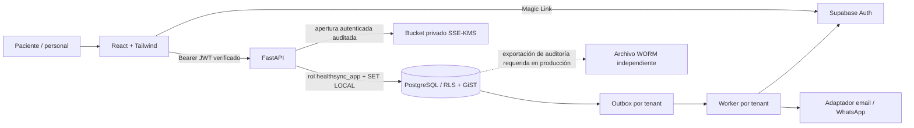
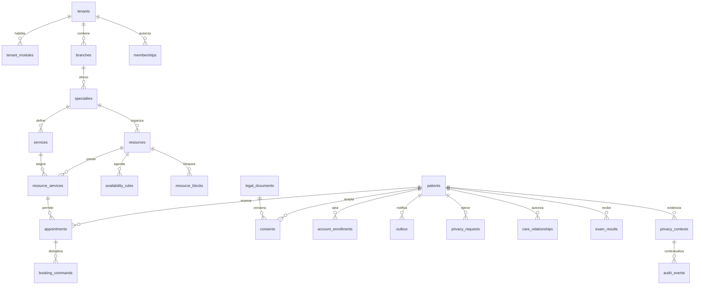

# Arquitectura y decisiones · Medical Appointment System

La ampliación vigente de roles, unidades organizativas, espacios de trabajo y módulos se detalla en [Producto](PRODUCT_BLUEPRINT.md). Pagos y telemedicina tienen su [especificación](PAYMENTS_COVERAGE_TELEMEDICINE.md). El esquema histórico se conserva y las migraciones 003/004 agregan tablas sin reiniciar instalaciones.

## Flujo general



El tenant de la URL es un ámbito solicitado, no una prueba de autorización. El catálogo y las horas libres son públicos por clínica. Los endpoints privados verifican un JWT firmado, su issuer, audience y expiración. La identidad sale de `sub`, nunca de un header `X-User` o metadata editable. Los permisos del personal se consultan en `memberships` del tenant; el paciente solo ve filas vinculadas a su `auth_user_id`.

La API es el único acceso a datos; el rol SQL es un rol de servicio confiable y puede establecer `app.*`. **No debe entregarse su conexión a un navegador o usuario final.** RLS protege de omisiones de filtros por tenant; la autorización por paciente/personal está en los controladores. No se atribuye a estas políticas una autorización basada en `auth.uid()` que no implementan. El pool limpia el contexto al cerrar cada transacción mediante `set_config(..., true)`.

## Carpetas

```text
HealthSync/
├── database/
│   ├── 001_schema.sql          # migración inicial: todas las entidades, RLS y triggers
│   └── 002_demo.sql            # catálogo y documentos ficticios, sin pacientes
├── backend/
│   ├── app/
│   │   ├── main.py             # endpoints, autorización y Vault
│   │   ├── booking.py          # reserva atómica, disponibilidad e idempotencia
│   │   ├── db.py               # pool, contexto local y auditoría de lecturas
│   │   ├── auth.py             # JWT/JWKS y comprobación de correo
│   │   ├── crypto.py           # AES-GCM, AAD y HMAC por tenant
│   │   ├── models.py           # contratos estrictos de entrada
│   │   ├── config.py           # configuración tipada, sin claves predeterminadas
│   │   └── worker.py           # outbox, recordatorios y proveedores
│   ├── tests/                 # pruebas reales sobre PostgreSQL temporal
│   ├── pyproject.toml
│   └── uv.lock
├── frontend/
│   ├── src/
│   │   ├── BookingFlow.tsx     # reserva, login, portal y solicitud de derechos
│   │   ├── BookingFlow.test.tsx
│   │   ├── api.ts             # API y sesión Auth en memoria
│   │   └── styles.css         # Tailwind
│   ├── package.json
│   └── package-lock.json
├── scripts/
│   ├── bootstrap.py           # secretos locales y base Docker; conserva estado existente
│   └── install.sh             # instalación reproducible con lockfiles
├── docs/
│   ├── architecture.md
│   └── privacy-security.md
├── compose.yaml
└── .env.example               # nombres, nunca credenciales reales
```

## Modelo de dominio

Todas las tablas tienen `tenant_id`, RLS habilitada y forzada, y claves/relaciones compuestas para impedir referencias cruzadas entre clínicas.



`resource_services` exige misma sucursal y especialidad mediante FKs compuestas. Cada especialidad depende de un módulo habilitado. Apagar el módulo impide nuevas reservas sin borrar el historial. Los recursos son propios del tenant: compartir un profesional real entre clínicas requiere un acuerdo y un servicio de disponibilidad compartida, fuera de esta base.

## Reserva transaccional paso a paso

1. Validar payload estricto, fecha con offset, límites, proveedor de cuenta si se solicita y consentimientos explícitos de las versiones vigentes.
2. Abrir transacción con tenant, actor, IP cifrada y request ID generados por el servidor. Nunca confiar en un `X-Forwarded-For` arbitrario.
3. Tomar un advisory lock de la clave de idempotencia. Un reintento idéntico devuelve el mismo ID; reutilizar la clave con otros datos produce 409. El digest incluye al actor, el tenant y el payload, mediante HMAC.
4. Tomar el advisory lock del recurso y comprobar módulo, relación servicio/recurso, jornada local, bloqueos y disponibilidad. Cualquier futuro administrador de bloqueos/horarios debe tomar **el mismo lock** y rechazar un bloqueo que intersecte reservas vigentes.
5. Insertar un perfil de paciente con nombre/correo cifrados. Cada reserva crea un perfil; una cuenta puede tener varios perfiles vinculados, deliberadamente sin fusionar historias por correo no verificado. El portal exporta y gestiona todos sus perfiles.
6. Insertar consentimientos y la reserva con duración y buffer congelados. La restricción `EXCLUDE USING gist` sobre `(tenant_id, resource_id, slot)` decide en última instancia. No basta un `SELECT` previo.
7. Guardar inscripción de cuenta pendiente si hubo opt-in y eventos outbox. Triggers registran las escrituras con IDs, actor, fecha e IP cifrada separada.
8. Commit único. Un conflicto GiST revierte también paciente, consentimientos, eventos e inscripción; responde 409 sin exponer SQL ni datos de terceros.

Los rangos son `[inicio, fin + buffer)`. Una consulta 10:00–10:30 con 15 minutos de preparación bloquea hasta 10:45; otra puede comenzar exactamente a las 10:45. Se usa `tsrange` **normalizado a UTC** generado desde `timestamptz`; nunca se interpretan fechas sin offset como hora local del servidor. La disponibilidad recorre instantes UTC reales y muestra el huso de la sucursal, evitando inventar horas durante cambios DST. Ventanas nocturnas requieren dos reglas.

Una modificación usa bloqueo de la reserva, control optimista `expected_version`, nuevo cálculo de disponibilidad y la misma restricción GiST. Se permiten estados `booked` y `confirmed`; una confirmación no congela la fecha. Los límites para anular/modificar son independientes por tenant. Horas canceladas liberan el recurso; realizadas y no asistidas conservan su intervalo histórico. Los recordatorios de versiones anteriores se cancelan y se regeneran a 24h/2h si el plazo aún no pasó.

La cuenta externa no puede ser parte de un commit PostgreSQL. El outbox resuelve esa frontera: inscripción local atómica, envío posterior, verificación real del correo y reclamación del perfil. Una cuenta global de Supabase no se elimina al anonimizar un tenant: puede utilizarse en otras clínicas. La eliminación global de identidad requiere un procedimiento independiente.

## Vault · fase 2

El esquema y la lectura segura están implementados. La interfaz de carga, el escáner antivirus y la operación del almacenamiento quedan como integración de fase 2:

1. Un laboratorio autenticado y autorizado carga un PDF de máximo 20 MiB en cuarentena, por un servicio de ingestión. Verificar magic bytes, MIME, tamaño, malware y contenido activo; no confiar en la extensión del archivo.
2. Crear una clave opaca `tenant_uuid/random_uuid`, sin PII. Guardar SHA-256, tamaño y `scan_status='quarantine'`. El bucket tiene bloqueo de acceso público, IAM mínimo, TLS, cifrado SSE-KMS y políticas de retención. No habilitar listados públicos ni URLs permanentes. El servicio de ingestión debe exigir la misma clave KMS configurada en `VAULT_KMS_KEY_ID` (ARN completo).
3. Solo el escáner puede promover a `clean`; el rol de laboratorio no puede autoaprobar sus archivos. Separar estas credenciales al implementar ingestión. La base aún no implementa una API para subir ni promover archivos.
4. `POST /exam-results/{id}/access` comprueba identidad, tenant, módulo y propiedad o rol clínico con relación asistencial vigente. Emite una URL firmada de **900 segundos**, vinculada además al usuario y al tenant.
5. Esa URL apunta al proxy FastAPI y necesita el mismo Bearer. Cada GET vuelve a autorizar, descarga desde el bucket privado, valida cifrado/tamaño/SHA-256 y **confirma la auditoría antes de entregar bytes**. La respuesta no se cachea y descarga el PDF como adjunto con sandbox. No utilizar un iframe con token en URL ni exponer el token en logs.

No se entrega directamente una URL presignada de S3 al paciente: emitirla solo auditaría su emisión, no cada reapertura. El proxy permite auditar cada apertura aunque la URL se reutilice dentro de los 15 minutos. Los médicos requieren el rol `clinician` y una relación asistencial vigente y no revocada en `care_relationships`. Su concesión es una operación administrativa auditada, sin permisos de autoconcesión para el runtime. Documentar finalidad y reglas de delegación con el responsable de la clínica.

Un paciente que ya descargó un archivo puede conservarlo; el vencimiento del enlace no elimina copias. La eliminación del objeto y sus versiones/backups requiere un trabajo autorizado de retención y reconciliación; no se finge atomicidad entre PostgreSQL y un object store.
