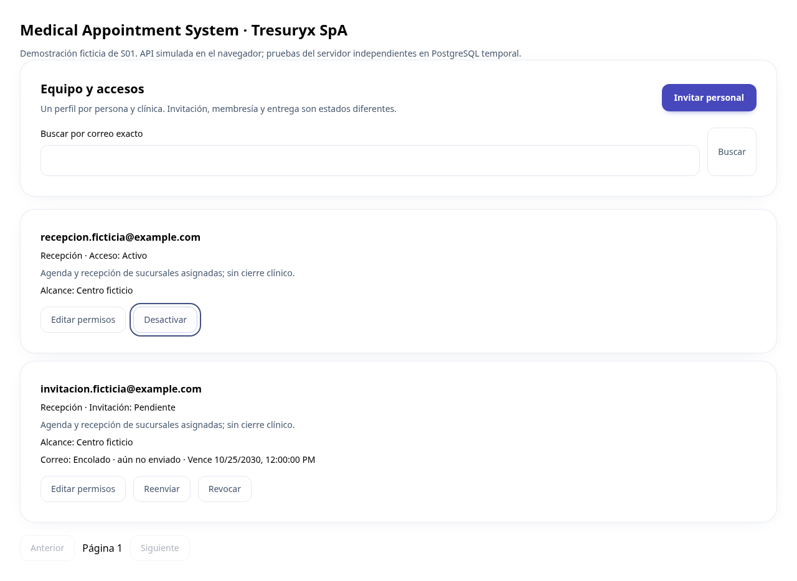

# Demostración ficticia de Equipo · S01

Estas imágenes muestran el componente real React/Tailwind con **API interceptada en una prueba de navegador**. No hay cuentas reales ni acceso alternativo en el servidor. El comportamiento transaccional y los permisos se prueban aparte en PostgreSQL temporal; las imágenes no acreditan integración con Supabase ni correo entregado.

[Escritorio](team-1280.png) · [Móvil 360 px](team-360.png) · [Confirmación de permisos móvil](team-confirm-360.png) · [Resultado de navegador](browser-results.json)



La demostración recorre: cargar directorio mínimo → revisar estados separados → cancelar desactivación con Escape sin modificar → recuperar foco → invitar a una persona ficticia → asignar sucursal → revisar permisos en modal → confirmar encolado. En ambas resoluciones se comprueban Tab/Shift+Tab dentro del modal, ausencia de desbordamiento y de alertas del sistema. No se llama a proveedores externos.

Para reproducir las capturas, desde la raíz, primera terminal:

```text
npm --prefix frontend run dev -- --port 5174 --strictPort
```

Segunda terminal:

```text
node scripts/test_team_browser.cjs
```

El script es automático, usa Chromium y guarda estas capturas. Para ver la ventana en PowerShell, antes de ejecutarlo usa `$env:TEAM_TEST_HEADED="true"`. Si no hay Chromium instalado, desde `frontend` ejecutar `npx playwright install chromium`. Puede indicarse un ejecutable mediante `CHROMIUM_PATH`. La dependencia Playwright es solo de desarrollo. El fixture se copia temporalmente a `frontend/.local` y se elimina al terminar; no forma parte del build distribuido ni proporciona identidades de prueba a FastAPI. Cambiar la URL a un dominio remoto está prohibido por el script.

Para probar el servidor sin Auth real: desde `backend`, `uv run --frozen pytest -q tests/test_team.py`. Se generan tenants/personas ficticios y una base temporal, se invitan identidades verificadas mediante dobles aislados, se aceptan/revocan y se prueban carreras. No hace falta ni se autoriza enviar correo real. Para un recorrido humano conectado, primero completar S01.06 con las configuraciones y autorización descritas en [Equipo](../team-access.md).
