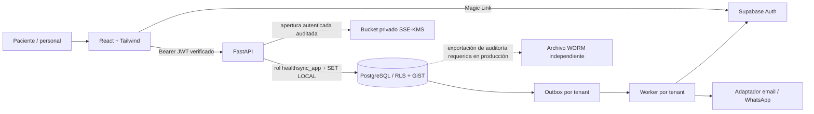
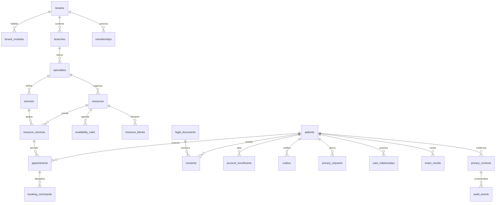
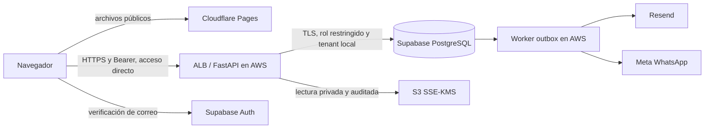

<!-- Generated by python scripts/planning.py; source SHA256 bfe86f4c23545bd875767e6cebfd4b7fcad2f58ca196fc7984e5b6785e41c343 -->

# Backlog · Medical Appointment System

Fuente única: [backlog.json](backlog.json). Texto original íntegro y procedencia en cada requisito. No editar esta vista.


| ID | Solicitud | Estado | Implementación | Validación |
|---|---|---|---|---|
| S00 | Control persistente del proyecto | terminado | comprobado | pasa |
| S01 | Acceso y ciclo de vida del personal | bloqueado | parcial | pasa |
| S02 | Un médico, varias agendas, una sola ocupación | propuesto | parcial | no ejecutado |
| S03 | Seguridad de acceso, navegador y API | propuesto | parcial | no ejecutado |
| S04 | Recuperación de datos y rotación de claves | propuesto | parcial | no ejecutado |
| S05 | Decisión de arquitectura y mantenibilidad | propuesto | pendiente | no ejecutado |
| S06 | Organización, servicios y configuración versionada | propuesto | parcial | no ejecutado |
| S07 | Agenda operativa y experiencia de pantallas | propuesto | parcial | no ejecutado |
| S08 | Notificaciones fiables y seguimiento de incidencias | propuesto | parcial | no ejecutado |
| S09 | Identidad de pacientes y representantes | propuesto | pendiente | no ejecutado |
| S10 | Reportes fiables y exportación controlada | propuesto | parcial | no ejecutado |
| S11 | Gestión de privacidad y derechos | propuesto | parcial | no ejecutado |
| S12 | Carga y entrega de resultados | propuesto | parcial | no ejecutado |
| S13 | Presupuestos, coberturas y cobros | propuesto | pendiente | no ejecutado |
| S14 | Telemedicina privada | propuesto | pendiente | no ejecutado |
| S15 | Administración comercial SaaS y permisos múltiples | propuesto | parcial | no ejecutado |

## S00 · Control persistente del proyecto

**terminado** · P0 · entrega actual · Responsable: IA desarrolladora

Fuente: `docs/planning/references/Medical_Appointment_System_Prompt_01.md:34` (2026-10-23). Relacionados: ninguno.

Tipo: épica. Implementación: comprobado. Validación: pasa. Cobertura: S00.01, S00.02.

Usuario: Según requisito original

Permisos: Denegación por defecto; tenant y alcance en servidor

Configuración: Valores propuestos en fuente; no habilitan módulos

Fuente única, trazabilidad completa, decisiones, Gantt y cierre comprobable

Criterios:
- Fuente única, trazabilidad completa, decisiones, Gantt y cierre comprobable

Evidencia: docs/planning/VALIDATION_S00_S01.md; scripts/planning.py --check; pruebas ejecutadas al cierre; Código validado: 397de0d9cfd90c724880b95502efb6218d591e5c

Bloqueos: ninguno registrado

Siguiente acción: Conservar evidencia y releer al comenzar la siguiente entrega

## S01 · Acceso y ciclo de vida del personal

**bloqueado** · P0 · entrega actual · Responsable: IA desarrolladora

Fuente: `docs/planning/references/Medical_Appointment_System_Prompt_01.md:346` (2026-10-23). Relacionados: ninguno.

Tipo: épica. Implementación: parcial. Validación: pasa. Cobertura: S01.01, S01.02, S01.03, S01.04, S01.05, S01.06.

Usuario: Administrador de clínica / destinatario verificado

Permisos: Admin activo del tenant con MFA; médico por agenda; recepción/coordinación/finanzas por sucursal; privacidad sin agenda; SaaS separado.

Configuración: Un perfil principal por tenant; invitación 48h; MFA obligatorio en servidor; envío externo apagado por defecto.

**Objetivo.** Que una clínica pueda dar acceso al equipo y retirarlo con trazabilidad.

**Actual.** Hay validación de tokens, membresía principal y alcances; faltan configuración real y administración completa. Tener código Supabase no prueba que Auth esté operativo.

**Usuarios/permisos.** Administrador del tenant gestiona personal de su clínica. Cada empleado ve sus funciones autorizadas. Solo un operador SaaS autorizado puede realizar el aprovisionamiento inicial definido; no recibe permisos clínicos por ello.

**Funcionamiento.** Pantalla Equipo con invitación, estado pendiente/activo/desactivado, perfil y sucursales/agendas. El destinatario verifica su identidad; la invitación no permite elegir privilegios. Mostrar vista previa de permisos antes de guardar. Desactivar conserva citas e historial.

**Configuración propuesta.** Empezar conservando un perfil principal por usuario y tenant; múltiples perfiles se desarrollan en una ampliación explícita. Invitación de 48 horas y segundo factor obligatorio para personal en el piloto alojado, sujetos a validación del proveedor. Verificar el segundo factor en servidor. Proteger el último administrador activo.

**Excepciones.** Invitación vencida, duplicada, usuario ya existente, fallo de correo y desactivación simultánea. No afirmar “correo entregado” por encolarlo. La baja bloquea nuevas operaciones de esa clínica aun con un token no vencido; cerrar la interfaz no basta.

**Comprobación.** Aceptar dos veces una invitación no duplica acceso; recepción A no ve B; paciente no se autoasigna rol; operador SaaS no obtiene PDFs; usuario dado de baja falla en su siguiente operación protegida. Fallo de Auth muestra un modal y no abre un acceso alternativo.

**Alcance.** Preparar y probar flujo con identidades ficticias en entorno de desarrollo; cuentas, dominio y envío real requieren configuración autorizada. No migrar el backend para hacer esta entrega.

Criterios:
- **Objetivo.** Que una clínica pueda dar acceso al equipo y retirarlo con trazabilidad.  **Actual.** Hay validación de tokens, membresía principal y alcances; faltan configuración real y administración completa. Tener código Supabase no prueba que Auth esté operativo.  **Usuarios/permisos.** Administrador del tenant gestiona personal de su clínica. Cada empleado ve sus funciones autorizadas. Solo un operador SaaS autorizado puede realizar el aprovisionamiento inicial definido; no recibe permisos clínicos por ello.  **Funcionamiento.** Pantalla Equipo con invitación, estado pendiente/activo/desactivado, perfil y sucursales/agendas. El destinatario verifica su identidad; la invitación no permite elegir privilegios. Mostrar vista previa de permisos antes de guardar. Desactivar conserva citas e historial.  **Configuración propuesta.** Empezar conservando un perfil principal por usuario y tenant; múltiples perfiles se desarrollan en una ampliación explícita. Invitación de 48 horas y segundo factor obligatorio para personal en el piloto alojado, sujetos a validación del proveedor. Verificar el segundo factor en servidor. Proteger el último administrador activo.  **Excepciones.** Invitación vencida, duplicada, usuario ya existente, fallo de correo y desactivación simultánea. No afirmar “correo entregado” por encolarlo. La baja bloquea nuevas operaciones de esa clínica aun con un token no vencido; cerrar la interfaz no basta.  **Comprobación.** Aceptar dos veces una invitación no duplica acceso; recepción A no ve B; paciente no se autoasigna rol; operador SaaS no obtiene PDFs; usuario dado de baja falla en su siguiente operación protegida. Fallo de Auth muestra un modal y no abre un acceso alternativo.  **Alcance.** Preparar y probar flujo con identidades ficticias en entorno de desarrollo; cuentas, dominio y envío real requieren configuración autorizada. No migrar el backend para hacer esta entrega.

Evidencia: docs/planning/VALIDATION_S00_S01.md (A–P; pruebas aisladas, no integración real); Código validado: 397de0d9cfd90c724880b95502efb6218d591e5c

Bloqueos: S01.06: Auth/OTP/MFA, dominio y correo reales sin configuración ni prueba autorizada

Siguiente acción: Autorizar entorno de prueba externo y ejecutar recorrido de identidad/MFA/entrega; no habilitar piloto con pacientes reales

## S01.R01 · Objetivo

**en validación** · P0 · entrega actual · Responsable: IA desarrolladora

Fuente: `docs/planning/references/Medical_Appointment_System_Prompt_01.md:348` (2026-10-23). Relacionados: S01.

Tipo: cláusula de fuente. Implementación: parcial. Validación: no ejecutado. Cobertura: S01.01, S01.02, S01.03, S01.04, S01.05, S01.06.

Usuario: Administrador de clínica / destinatario verificado

Permisos: Admin activo del tenant con MFA; médico por agenda; recepción/coordinación/finanzas por sucursal; privacidad sin agenda; SaaS separado.

Configuración: Un perfil principal por tenant; invitación 48h; MFA obligatorio en servidor; envío externo apagado por defecto.

**Objetivo.** Que una clínica pueda dar acceso al equipo y retirarlo con trazabilidad.

Criterios:
- **Objetivo.** Que una clínica pueda dar acceso al equipo y retirarlo con trazabilidad.

Evidencia: docs/planning/VALIDATION_S00_S01.md (A–P; pruebas aisladas, no integración real)

Bloqueos: ninguno registrado

Siguiente acción: Validar cierre técnico e integración externa autorizada

## S01.R02 · Actual

**en validación** · P0 · entrega actual · Responsable: IA desarrolladora

Fuente: `docs/planning/references/Medical_Appointment_System_Prompt_01.md:350` (2026-10-23). Relacionados: S01.

Tipo: cláusula de fuente. Implementación: parcial. Validación: no ejecutado. Cobertura: S01.01, S01.02, S01.03, S01.04, S01.05, S01.06.

Usuario: Administrador de clínica / destinatario verificado

Permisos: Admin activo del tenant con MFA; médico por agenda; recepción/coordinación/finanzas por sucursal; privacidad sin agenda; SaaS separado.

Configuración: Un perfil principal por tenant; invitación 48h; MFA obligatorio en servidor; envío externo apagado por defecto.

**Actual.** Hay validación de tokens, membresía principal y alcances; faltan configuración real y administración completa. Tener código Supabase no prueba que Auth esté operativo.

Criterios:
- **Actual.** Hay validación de tokens, membresía principal y alcances; faltan configuración real y administración completa. Tener código Supabase no prueba que Auth esté operativo.

Evidencia: docs/planning/VALIDATION_S00_S01.md (A–P; pruebas aisladas, no integración real)

Bloqueos: ninguno registrado

Siguiente acción: Validar cierre técnico e integración externa autorizada

## S01.R03 · Usuarios/permisos

**en validación** · P0 · entrega actual · Responsable: IA desarrolladora

Fuente: `docs/planning/references/Medical_Appointment_System_Prompt_01.md:352` (2026-10-23). Relacionados: S01.

Tipo: cláusula de fuente. Implementación: parcial. Validación: no ejecutado. Cobertura: S01.01, S01.02, S01.03, S01.04, S01.05, S01.06.

Usuario: Administrador de clínica / destinatario verificado

Permisos: Admin activo del tenant con MFA; médico por agenda; recepción/coordinación/finanzas por sucursal; privacidad sin agenda; SaaS separado.

Configuración: Un perfil principal por tenant; invitación 48h; MFA obligatorio en servidor; envío externo apagado por defecto.

**Usuarios/permisos.** Administrador del tenant gestiona personal de su clínica. Cada empleado ve sus funciones autorizadas. Solo un operador SaaS autorizado puede realizar el aprovisionamiento inicial definido; no recibe permisos clínicos por ello.

Criterios:
- **Usuarios/permisos.** Administrador del tenant gestiona personal de su clínica. Cada empleado ve sus funciones autorizadas. Solo un operador SaaS autorizado puede realizar el aprovisionamiento inicial definido; no recibe permisos clínicos por ello.

Evidencia: docs/planning/VALIDATION_S00_S01.md (A–P; pruebas aisladas, no integración real)

Bloqueos: ninguno registrado

Siguiente acción: Validar cierre técnico e integración externa autorizada

## S01.R04 · Funcionamiento

**en validación** · P0 · entrega actual · Responsable: IA desarrolladora

Fuente: `docs/planning/references/Medical_Appointment_System_Prompt_01.md:354` (2026-10-23). Relacionados: S01.

Tipo: cláusula de fuente. Implementación: parcial. Validación: no ejecutado. Cobertura: S01.01, S01.02, S01.03, S01.04, S01.05, S01.06.

Usuario: Administrador de clínica / destinatario verificado

Permisos: Admin activo del tenant con MFA; médico por agenda; recepción/coordinación/finanzas por sucursal; privacidad sin agenda; SaaS separado.

Configuración: Un perfil principal por tenant; invitación 48h; MFA obligatorio en servidor; envío externo apagado por defecto.

**Funcionamiento.** Pantalla Equipo con invitación, estado pendiente/activo/desactivado, perfil y sucursales/agendas. El destinatario verifica su identidad; la invitación no permite elegir privilegios. Mostrar vista previa de permisos antes de guardar. Desactivar conserva citas e historial.

Criterios:
- **Funcionamiento.** Pantalla Equipo con invitación, estado pendiente/activo/desactivado, perfil y sucursales/agendas. El destinatario verifica su identidad; la invitación no permite elegir privilegios. Mostrar vista previa de permisos antes de guardar. Desactivar conserva citas e historial.

Evidencia: docs/planning/VALIDATION_S00_S01.md (A–P; pruebas aisladas, no integración real)

Bloqueos: ninguno registrado

Siguiente acción: Validar cierre técnico e integración externa autorizada

## S01.R05 · Configuración propuesta

**en validación** · P0 · entrega actual · Responsable: IA desarrolladora

Fuente: `docs/planning/references/Medical_Appointment_System_Prompt_01.md:356` (2026-10-23). Relacionados: S01.

Tipo: cláusula de fuente. Implementación: parcial. Validación: no ejecutado. Cobertura: S01.01, S01.02, S01.03, S01.04, S01.05, S01.06.

Usuario: Administrador de clínica / destinatario verificado

Permisos: Admin activo del tenant con MFA; médico por agenda; recepción/coordinación/finanzas por sucursal; privacidad sin agenda; SaaS separado.

Configuración: Un perfil principal por tenant; invitación 48h; MFA obligatorio en servidor; envío externo apagado por defecto.

**Configuración propuesta.** Empezar conservando un perfil principal por usuario y tenant; múltiples perfiles se desarrollan en una ampliación explícita. Invitación de 48 horas y segundo factor obligatorio para personal en el piloto alojado, sujetos a validación del proveedor. Verificar el segundo factor en servidor. Proteger el último administrador activo.

Criterios:
- **Configuración propuesta.** Empezar conservando un perfil principal por usuario y tenant; múltiples perfiles se desarrollan en una ampliación explícita. Invitación de 48 horas y segundo factor obligatorio para personal en el piloto alojado, sujetos a validación del proveedor. Verificar el segundo factor en servidor. Proteger el último administrador activo.

Evidencia: docs/planning/VALIDATION_S00_S01.md (A–P; pruebas aisladas, no integración real)

Bloqueos: ninguno registrado

Siguiente acción: Validar cierre técnico e integración externa autorizada

## S01.R06 · Excepciones

**en validación** · P0 · entrega actual · Responsable: IA desarrolladora

Fuente: `docs/planning/references/Medical_Appointment_System_Prompt_01.md:358` (2026-10-23). Relacionados: S01.

Tipo: cláusula de fuente. Implementación: parcial. Validación: no ejecutado. Cobertura: S01.01, S01.02, S01.03, S01.04, S01.05, S01.06.

Usuario: Administrador de clínica / destinatario verificado

Permisos: Admin activo del tenant con MFA; médico por agenda; recepción/coordinación/finanzas por sucursal; privacidad sin agenda; SaaS separado.

Configuración: Un perfil principal por tenant; invitación 48h; MFA obligatorio en servidor; envío externo apagado por defecto.

**Excepciones.** Invitación vencida, duplicada, usuario ya existente, fallo de correo y desactivación simultánea. No afirmar “correo entregado” por encolarlo. La baja bloquea nuevas operaciones de esa clínica aun con un token no vencido; cerrar la interfaz no basta.

Criterios:
- **Excepciones.** Invitación vencida, duplicada, usuario ya existente, fallo de correo y desactivación simultánea. No afirmar “correo entregado” por encolarlo. La baja bloquea nuevas operaciones de esa clínica aun con un token no vencido; cerrar la interfaz no basta.

Evidencia: docs/planning/VALIDATION_S00_S01.md (A–P; pruebas aisladas, no integración real)

Bloqueos: ninguno registrado

Siguiente acción: Validar cierre técnico e integración externa autorizada

## S01.R07 · Comprobación

**en validación** · P0 · entrega actual · Responsable: IA desarrolladora

Fuente: `docs/planning/references/Medical_Appointment_System_Prompt_01.md:360` (2026-10-23). Relacionados: S01.

Tipo: cláusula de fuente. Implementación: parcial. Validación: no ejecutado. Cobertura: S01.01, S01.02, S01.03, S01.04, S01.05, S01.06.

Usuario: Administrador de clínica / destinatario verificado

Permisos: Admin activo del tenant con MFA; médico por agenda; recepción/coordinación/finanzas por sucursal; privacidad sin agenda; SaaS separado.

Configuración: Un perfil principal por tenant; invitación 48h; MFA obligatorio en servidor; envío externo apagado por defecto.

**Comprobación.** Aceptar dos veces una invitación no duplica acceso; recepción A no ve B; paciente no se autoasigna rol; operador SaaS no obtiene PDFs; usuario dado de baja falla en su siguiente operación protegida. Fallo de Auth muestra un modal y no abre un acceso alternativo.

Criterios:
- **Comprobación.** Aceptar dos veces una invitación no duplica acceso; recepción A no ve B; paciente no se autoasigna rol; operador SaaS no obtiene PDFs; usuario dado de baja falla en su siguiente operación protegida. Fallo de Auth muestra un modal y no abre un acceso alternativo.

Evidencia: docs/planning/VALIDATION_S00_S01.md (A–P; pruebas aisladas, no integración real)

Bloqueos: ninguno registrado

Siguiente acción: Validar cierre técnico e integración externa autorizada

## S01.R08 · Alcance

**en validación** · P0 · entrega actual · Responsable: IA desarrolladora

Fuente: `docs/planning/references/Medical_Appointment_System_Prompt_01.md:362` (2026-10-23). Relacionados: S01.

Tipo: cláusula de fuente. Implementación: parcial. Validación: no ejecutado. Cobertura: S01.01, S01.02, S01.03, S01.04, S01.05, S01.06.

Usuario: Administrador de clínica / destinatario verificado

Permisos: Admin activo del tenant con MFA; médico por agenda; recepción/coordinación/finanzas por sucursal; privacidad sin agenda; SaaS separado.

Configuración: Un perfil principal por tenant; invitación 48h; MFA obligatorio en servidor; envío externo apagado por defecto.

**Alcance.** Preparar y probar flujo con identidades ficticias en entorno de desarrollo; cuentas, dominio y envío real requieren configuración autorizada. No migrar el backend para hacer esta entrega.

Criterios:
- **Alcance.** Preparar y probar flujo con identidades ficticias en entorno de desarrollo; cuentas, dominio y envío real requieren configuración autorizada. No migrar el backend para hacer esta entrega.

Evidencia: docs/planning/VALIDATION_S00_S01.md (A–P; pruebas aisladas, no integración real)

Bloqueos: ninguno registrado

Siguiente acción: Validar cierre técnico e integración externa autorizada

## S02 · Un médico, varias agendas, una sola ocupación

**propuesto** · P0 · antes del piloto · Responsable: por asignar

Fuente: `docs/planning/references/Medical_Appointment_System_Prompt_01.md:364` (2026-10-23). Relacionados: ninguno.

Tipo: épica. Implementación: parcial. Validación: no ejecutado. Cobertura: sin entrega asignada.

Usuario: Según requisito original

Permisos: Denegación por defecto; tenant y alcance en servidor

Configuración: Valores propuestos en fuente; no habilitan módulos

**Objetivo.** Evitar citas simultáneas del mismo profesional entre sedes, recursos y futuras modalidades.

**Actual.** GiST protege el recurso; falta la identidad profesional canónica por tenant.

**Usuarios/permisos.** Administrador vincula recursos al profesional correcto. Coordinación opera solo sus sedes; médico consulta sus agendas. Ninguno puede saltarse el bloqueo.

**Funcionamiento.** Crear identidad estable y relacionarla con recursos existentes. La disponibilidad y confirmación consideran toda su ocupación dentro del tenant sin revelar pacientes o detalles de otra sede. La migración identifica conflictos previos y entrega un informe restringido; no anula ni mueve citas automáticamente.

**Configuración propuesta.** Una identidad por persona dentro de cada tenant; buffers aplicados al intervalo ocupado y coexistencia con el bloqueo del recurso. Para el piloto, traslado entre sedes se cubre con bloqueos explícitos configurados; reglas automáticas de viaje quedan pendientes. El bloqueo entre tenants independientes requiere diseño adicional de privacidad.

**Excepciones.** Recursos históricos sin vinculación, duplicados sospechados y conflictos vigentes requieren revisión. No inferir identidad definitiva solo por nombre.

**Comprobación.** Dos reservas concurrentes en recursos del mismo médico no pueden confirmarse si chocan; tampoco dos reprogramaciones. Se respetan buffers y cambios de huso horario. No hay filtración de otra sede y todas las citas previas permanecen. La protección funciona contra solicitudes directas, no solo desde la pantalla.

Criterios:
- **Comprobación.** Dos reservas concurrentes en recursos del mismo médico no pueden confirmarse si chocan; tampoco dos reprogramaciones. Se respetan buffers y cambios de huso horario. No hay filtración de otra sede y todas las citas previas permanecen. La protección funciona contra solicitudes directas, no solo desde la pantalla.

Evidencia: docs/planning/INITIAL_REVIEW.md; fuente íntegra preservada; no cierre de módulo futuro

Bloqueos: ninguno registrado

Siguiente acción: Desglosar y estimar al seleccionar la entrega

## S02.R01 · Objetivo

**propuesto** · P0 · antes del piloto · Responsable: por asignar

Fuente: `docs/planning/references/Medical_Appointment_System_Prompt_01.md:366` (2026-10-23). Relacionados: S02.

Tipo: cláusula de fuente. Implementación: pendiente. Validación: no ejecutado. Cobertura: sin entrega asignada.

Usuario: Según requisito original

Permisos: Denegación por defecto; tenant y alcance en servidor

Configuración: Valores propuestos en fuente; no habilitan módulos

**Objetivo.** Evitar citas simultáneas del mismo profesional entre sedes, recursos y futuras modalidades.

Criterios:
- **Objetivo.** Evitar citas simultáneas del mismo profesional entre sedes, recursos y futuras modalidades.

Evidencia: No ejecutada / sin evidencia de cierre

Bloqueos: ninguno registrado

Siguiente acción: Desglosar y estimar al seleccionar la entrega

## S02.R02 · Actual

**propuesto** · P0 · antes del piloto · Responsable: por asignar

Fuente: `docs/planning/references/Medical_Appointment_System_Prompt_01.md:368` (2026-10-23). Relacionados: S02.

Tipo: cláusula de fuente. Implementación: pendiente. Validación: no ejecutado. Cobertura: sin entrega asignada.

Usuario: Según requisito original

Permisos: Denegación por defecto; tenant y alcance en servidor

Configuración: Valores propuestos en fuente; no habilitan módulos

**Actual.** GiST protege el recurso; falta la identidad profesional canónica por tenant.

Criterios:
- **Actual.** GiST protege el recurso; falta la identidad profesional canónica por tenant.

Evidencia: No ejecutada / sin evidencia de cierre

Bloqueos: ninguno registrado

Siguiente acción: Desglosar y estimar al seleccionar la entrega

## S02.R03 · Usuarios/permisos

**propuesto** · P0 · antes del piloto · Responsable: por asignar

Fuente: `docs/planning/references/Medical_Appointment_System_Prompt_01.md:370` (2026-10-23). Relacionados: S02.

Tipo: cláusula de fuente. Implementación: pendiente. Validación: no ejecutado. Cobertura: sin entrega asignada.

Usuario: Según requisito original

Permisos: Denegación por defecto; tenant y alcance en servidor

Configuración: Valores propuestos en fuente; no habilitan módulos

**Usuarios/permisos.** Administrador vincula recursos al profesional correcto. Coordinación opera solo sus sedes; médico consulta sus agendas. Ninguno puede saltarse el bloqueo.

Criterios:
- **Usuarios/permisos.** Administrador vincula recursos al profesional correcto. Coordinación opera solo sus sedes; médico consulta sus agendas. Ninguno puede saltarse el bloqueo.

Evidencia: No ejecutada / sin evidencia de cierre

Bloqueos: ninguno registrado

Siguiente acción: Desglosar y estimar al seleccionar la entrega

## S02.R04 · Funcionamiento

**propuesto** · P0 · antes del piloto · Responsable: por asignar

Fuente: `docs/planning/references/Medical_Appointment_System_Prompt_01.md:372` (2026-10-23). Relacionados: S02.

Tipo: cláusula de fuente. Implementación: pendiente. Validación: no ejecutado. Cobertura: sin entrega asignada.

Usuario: Según requisito original

Permisos: Denegación por defecto; tenant y alcance en servidor

Configuración: Valores propuestos en fuente; no habilitan módulos

**Funcionamiento.** Crear identidad estable y relacionarla con recursos existentes. La disponibilidad y confirmación consideran toda su ocupación dentro del tenant sin revelar pacientes o detalles de otra sede. La migración identifica conflictos previos y entrega un informe restringido; no anula ni mueve citas automáticamente.

Criterios:
- **Funcionamiento.** Crear identidad estable y relacionarla con recursos existentes. La disponibilidad y confirmación consideran toda su ocupación dentro del tenant sin revelar pacientes o detalles de otra sede. La migración identifica conflictos previos y entrega un informe restringido; no anula ni mueve citas automáticamente.

Evidencia: No ejecutada / sin evidencia de cierre

Bloqueos: ninguno registrado

Siguiente acción: Desglosar y estimar al seleccionar la entrega

## S02.R05 · Configuración propuesta

**propuesto** · P0 · antes del piloto · Responsable: por asignar

Fuente: `docs/planning/references/Medical_Appointment_System_Prompt_01.md:374` (2026-10-23). Relacionados: S02.

Tipo: cláusula de fuente. Implementación: pendiente. Validación: no ejecutado. Cobertura: sin entrega asignada.

Usuario: Según requisito original

Permisos: Denegación por defecto; tenant y alcance en servidor

Configuración: Valores propuestos en fuente; no habilitan módulos

**Configuración propuesta.** Una identidad por persona dentro de cada tenant; buffers aplicados al intervalo ocupado y coexistencia con el bloqueo del recurso. Para el piloto, traslado entre sedes se cubre con bloqueos explícitos configurados; reglas automáticas de viaje quedan pendientes. El bloqueo entre tenants independientes requiere diseño adicional de privacidad.

Criterios:
- **Configuración propuesta.** Una identidad por persona dentro de cada tenant; buffers aplicados al intervalo ocupado y coexistencia con el bloqueo del recurso. Para el piloto, traslado entre sedes se cubre con bloqueos explícitos configurados; reglas automáticas de viaje quedan pendientes. El bloqueo entre tenants independientes requiere diseño adicional de privacidad.

Evidencia: No ejecutada / sin evidencia de cierre

Bloqueos: ninguno registrado

Siguiente acción: Desglosar y estimar al seleccionar la entrega

## S02.R06 · Excepciones

**propuesto** · P0 · antes del piloto · Responsable: por asignar

Fuente: `docs/planning/references/Medical_Appointment_System_Prompt_01.md:376` (2026-10-23). Relacionados: S02.

Tipo: cláusula de fuente. Implementación: pendiente. Validación: no ejecutado. Cobertura: sin entrega asignada.

Usuario: Según requisito original

Permisos: Denegación por defecto; tenant y alcance en servidor

Configuración: Valores propuestos en fuente; no habilitan módulos

**Excepciones.** Recursos históricos sin vinculación, duplicados sospechados y conflictos vigentes requieren revisión. No inferir identidad definitiva solo por nombre.

Criterios:
- **Excepciones.** Recursos históricos sin vinculación, duplicados sospechados y conflictos vigentes requieren revisión. No inferir identidad definitiva solo por nombre.

Evidencia: No ejecutada / sin evidencia de cierre

Bloqueos: ninguno registrado

Siguiente acción: Desglosar y estimar al seleccionar la entrega

## S02.R07 · Comprobación

**propuesto** · P0 · antes del piloto · Responsable: por asignar

Fuente: `docs/planning/references/Medical_Appointment_System_Prompt_01.md:378` (2026-10-23). Relacionados: S02.

Tipo: cláusula de fuente. Implementación: pendiente. Validación: no ejecutado. Cobertura: sin entrega asignada.

Usuario: Según requisito original

Permisos: Denegación por defecto; tenant y alcance en servidor

Configuración: Valores propuestos en fuente; no habilitan módulos

**Comprobación.** Dos reservas concurrentes en recursos del mismo médico no pueden confirmarse si chocan; tampoco dos reprogramaciones. Se respetan buffers y cambios de huso horario. No hay filtración de otra sede y todas las citas previas permanecen. La protección funciona contra solicitudes directas, no solo desde la pantalla.

Criterios:
- **Comprobación.** Dos reservas concurrentes en recursos del mismo médico no pueden confirmarse si chocan; tampoco dos reprogramaciones. Se respetan buffers y cambios de huso horario. No hay filtración de otra sede y todas las citas previas permanecen. La protección funciona contra solicitudes directas, no solo desde la pantalla.

Evidencia: No ejecutada / sin evidencia de cierre

Bloqueos: ninguno registrado

Siguiente acción: Desglosar y estimar al seleccionar la entrega

## S03 · Seguridad de acceso, navegador y API

**propuesto** · P0 · antes del piloto · Responsable: por asignar

Fuente: `docs/planning/references/Medical_Appointment_System_Prompt_01.md:380` (2026-10-23). Relacionados: ninguno.

Tipo: épica. Implementación: parcial. Validación: no ejecutado. Cobertura: sin entrega asignada.

Usuario: Según requisito original

Permisos: Denegación por defecto; tenant y alcance en servidor

Configuración: Valores propuestos en fuente; no habilitan módulos

**Objetivo.** Reducir abuso de reservas, escalamiento de permisos y exposición accidental.

**Actual.** Hay validación de identidad, autorización en servidor, RLS, cabeceras y cifrado; falta comprobar el endurecimiento del despliegue y sus límites reales.

**Usuarios/permisos.** Pacientes usan rutas propias/públicas; equipo usa rutas autorizadas. Operación consulta señales técnicas sin contenido clínico. Políticas obligatorias no son desactivables por una clínica.

**Funcionamiento.** Inventariar rutas y permisos; comprobar acceso por objeto/propiedad y respuestas mínimas. Añadir límites persistentes o distribuidos donde corresponda, tamaños máximos de formularios, manejo de fallos de identidad y sesiones, política de contenido del frontend y protección de transporte en el alojamiento elegido. Revisar logs del proxy además de la aplicación.

**Configuración propuesta.** Límites distintos para login/OTP, disponibilidad, reserva y exportación. La IA propone valores y los valida con tráfico ficticio de una clínica; no restringir toda una clínica solo por compartir IP. Definir la arquitectura de sesión según el alojamiento; si se eligen cookies, incluir protección CSRF y atributos adecuados.

**Excepciones.** Tráfico legítimo, accesibilidad, pérdida del proveedor de identidad y expiración de sesión. Mostrar reintento/espera sin revelar si un correo está registrado. No registrar tokens ni contenido sensible.

**Comprobación.** Cambio de tenant, paciente, recurso y rol falla cuando no hay permiso; límites operan con más de una instancia y resisten encabezados falsos; cuerpo sobredimensionado se rechaza; mensajes de error no contienen PII. Probar sesión de personal sin segundo factor y caída de JWKS. Documentar controles no ejecutados.

Criterios:
- **Comprobación.** Cambio de tenant, paciente, recurso y rol falla cuando no hay permiso; límites operan con más de una instancia y resisten encabezados falsos; cuerpo sobredimensionado se rechaza; mensajes de error no contienen PII. Probar sesión de personal sin segundo factor y caída de JWKS. Documentar controles no ejecutados.

Evidencia: docs/planning/INITIAL_REVIEW.md; fuente íntegra preservada; no cierre de módulo futuro

Bloqueos: ninguno registrado

Siguiente acción: Desglosar y estimar al seleccionar la entrega

## S03.R01 · Objetivo

**propuesto** · P0 · antes del piloto · Responsable: por asignar

Fuente: `docs/planning/references/Medical_Appointment_System_Prompt_01.md:382` (2026-10-23). Relacionados: S03.

Tipo: cláusula de fuente. Implementación: pendiente. Validación: no ejecutado. Cobertura: sin entrega asignada.

Usuario: Según requisito original

Permisos: Denegación por defecto; tenant y alcance en servidor

Configuración: Valores propuestos en fuente; no habilitan módulos

**Objetivo.** Reducir abuso de reservas, escalamiento de permisos y exposición accidental.

Criterios:
- **Objetivo.** Reducir abuso de reservas, escalamiento de permisos y exposición accidental.

Evidencia: No ejecutada / sin evidencia de cierre

Bloqueos: ninguno registrado

Siguiente acción: Desglosar y estimar al seleccionar la entrega

## S03.R02 · Actual

**propuesto** · P0 · antes del piloto · Responsable: por asignar

Fuente: `docs/planning/references/Medical_Appointment_System_Prompt_01.md:384` (2026-10-23). Relacionados: S03.

Tipo: cláusula de fuente. Implementación: pendiente. Validación: no ejecutado. Cobertura: sin entrega asignada.

Usuario: Según requisito original

Permisos: Denegación por defecto; tenant y alcance en servidor

Configuración: Valores propuestos en fuente; no habilitan módulos

**Actual.** Hay validación de identidad, autorización en servidor, RLS, cabeceras y cifrado; falta comprobar el endurecimiento del despliegue y sus límites reales.

Criterios:
- **Actual.** Hay validación de identidad, autorización en servidor, RLS, cabeceras y cifrado; falta comprobar el endurecimiento del despliegue y sus límites reales.

Evidencia: No ejecutada / sin evidencia de cierre

Bloqueos: ninguno registrado

Siguiente acción: Desglosar y estimar al seleccionar la entrega

## S03.R03 · Usuarios/permisos

**propuesto** · P0 · antes del piloto · Responsable: por asignar

Fuente: `docs/planning/references/Medical_Appointment_System_Prompt_01.md:386` (2026-10-23). Relacionados: S03.

Tipo: cláusula de fuente. Implementación: pendiente. Validación: no ejecutado. Cobertura: sin entrega asignada.

Usuario: Según requisito original

Permisos: Denegación por defecto; tenant y alcance en servidor

Configuración: Valores propuestos en fuente; no habilitan módulos

**Usuarios/permisos.** Pacientes usan rutas propias/públicas; equipo usa rutas autorizadas. Operación consulta señales técnicas sin contenido clínico. Políticas obligatorias no son desactivables por una clínica.

Criterios:
- **Usuarios/permisos.** Pacientes usan rutas propias/públicas; equipo usa rutas autorizadas. Operación consulta señales técnicas sin contenido clínico. Políticas obligatorias no son desactivables por una clínica.

Evidencia: No ejecutada / sin evidencia de cierre

Bloqueos: ninguno registrado

Siguiente acción: Desglosar y estimar al seleccionar la entrega

## S03.R04 · Funcionamiento

**propuesto** · P0 · antes del piloto · Responsable: por asignar

Fuente: `docs/planning/references/Medical_Appointment_System_Prompt_01.md:388` (2026-10-23). Relacionados: S03.

Tipo: cláusula de fuente. Implementación: pendiente. Validación: no ejecutado. Cobertura: sin entrega asignada.

Usuario: Según requisito original

Permisos: Denegación por defecto; tenant y alcance en servidor

Configuración: Valores propuestos en fuente; no habilitan módulos

**Funcionamiento.** Inventariar rutas y permisos; comprobar acceso por objeto/propiedad y respuestas mínimas. Añadir límites persistentes o distribuidos donde corresponda, tamaños máximos de formularios, manejo de fallos de identidad y sesiones, política de contenido del frontend y protección de transporte en el alojamiento elegido. Revisar logs del proxy además de la aplicación.

Criterios:
- **Funcionamiento.** Inventariar rutas y permisos; comprobar acceso por objeto/propiedad y respuestas mínimas. Añadir límites persistentes o distribuidos donde corresponda, tamaños máximos de formularios, manejo de fallos de identidad y sesiones, política de contenido del frontend y protección de transporte en el alojamiento elegido. Revisar logs del proxy además de la aplicación.

Evidencia: No ejecutada / sin evidencia de cierre

Bloqueos: ninguno registrado

Siguiente acción: Desglosar y estimar al seleccionar la entrega

## S03.R05 · Configuración propuesta

**propuesto** · P0 · antes del piloto · Responsable: por asignar

Fuente: `docs/planning/references/Medical_Appointment_System_Prompt_01.md:390` (2026-10-23). Relacionados: S03.

Tipo: cláusula de fuente. Implementación: pendiente. Validación: no ejecutado. Cobertura: sin entrega asignada.

Usuario: Según requisito original

Permisos: Denegación por defecto; tenant y alcance en servidor

Configuración: Valores propuestos en fuente; no habilitan módulos

**Configuración propuesta.** Límites distintos para login/OTP, disponibilidad, reserva y exportación. La IA propone valores y los valida con tráfico ficticio de una clínica; no restringir toda una clínica solo por compartir IP. Definir la arquitectura de sesión según el alojamiento; si se eligen cookies, incluir protección CSRF y atributos adecuados.

Criterios:
- **Configuración propuesta.** Límites distintos para login/OTP, disponibilidad, reserva y exportación. La IA propone valores y los valida con tráfico ficticio de una clínica; no restringir toda una clínica solo por compartir IP. Definir la arquitectura de sesión según el alojamiento; si se eligen cookies, incluir protección CSRF y atributos adecuados.

Evidencia: No ejecutada / sin evidencia de cierre

Bloqueos: ninguno registrado

Siguiente acción: Desglosar y estimar al seleccionar la entrega

## S03.R06 · Excepciones

**propuesto** · P0 · antes del piloto · Responsable: por asignar

Fuente: `docs/planning/references/Medical_Appointment_System_Prompt_01.md:392` (2026-10-23). Relacionados: S03.

Tipo: cláusula de fuente. Implementación: pendiente. Validación: no ejecutado. Cobertura: sin entrega asignada.

Usuario: Según requisito original

Permisos: Denegación por defecto; tenant y alcance en servidor

Configuración: Valores propuestos en fuente; no habilitan módulos

**Excepciones.** Tráfico legítimo, accesibilidad, pérdida del proveedor de identidad y expiración de sesión. Mostrar reintento/espera sin revelar si un correo está registrado. No registrar tokens ni contenido sensible.

Criterios:
- **Excepciones.** Tráfico legítimo, accesibilidad, pérdida del proveedor de identidad y expiración de sesión. Mostrar reintento/espera sin revelar si un correo está registrado. No registrar tokens ni contenido sensible.

Evidencia: No ejecutada / sin evidencia de cierre

Bloqueos: ninguno registrado

Siguiente acción: Desglosar y estimar al seleccionar la entrega

## S03.R07 · Comprobación

**propuesto** · P0 · antes del piloto · Responsable: por asignar

Fuente: `docs/planning/references/Medical_Appointment_System_Prompt_01.md:394` (2026-10-23). Relacionados: S03.

Tipo: cláusula de fuente. Implementación: pendiente. Validación: no ejecutado. Cobertura: sin entrega asignada.

Usuario: Según requisito original

Permisos: Denegación por defecto; tenant y alcance en servidor

Configuración: Valores propuestos en fuente; no habilitan módulos

**Comprobación.** Cambio de tenant, paciente, recurso y rol falla cuando no hay permiso; límites operan con más de una instancia y resisten encabezados falsos; cuerpo sobredimensionado se rechaza; mensajes de error no contienen PII. Probar sesión de personal sin segundo factor y caída de JWKS. Documentar controles no ejecutados.

Criterios:
- **Comprobación.** Cambio de tenant, paciente, recurso y rol falla cuando no hay permiso; límites operan con más de una instancia y resisten encabezados falsos; cuerpo sobredimensionado se rechaza; mensajes de error no contienen PII. Probar sesión de personal sin segundo factor y caída de JWKS. Documentar controles no ejecutados.

Evidencia: No ejecutada / sin evidencia de cierre

Bloqueos: ninguno registrado

Siguiente acción: Desglosar y estimar al seleccionar la entrega

## S04 · Recuperación de datos y rotación de claves

**propuesto** · P0 · antes del piloto · Responsable: por asignar

Fuente: `docs/planning/references/Medical_Appointment_System_Prompt_01.md:396` (2026-10-23). Relacionados: ninguno.

Tipo: épica. Implementación: parcial. Validación: no ejecutado. Cobertura: sin entrega asignada.

Usuario: Según requisito original

Permisos: Denegación por defecto; tenant y alcance en servidor

Configuración: Valores propuestos en fuente; no habilitan módulos

**Objetivo.** Poder recuperar la operación y renovar claves conservando acceso a datos antiguos.

**Actual.** Existe cifrado con identificador de clave; el código revisado no implementa un keyring multiclave. Backups restaurados y rotación completa siguen pendientes.

**Usuarios/permisos.** Operación autorizada administra respaldos y claves con separación de funciones. Ni recepción ni administrador de clínica acceden a secretos o respaldos completos del servicio.

**Funcionamiento.** Lectura con versiones anteriores permitidas, escritura con clave activa, recifrado por lotes reanudable y validación antes de retirar claves. Diseñar también rotación de HMAC y firmas: cambiar AES no resuelve las demás claves. Cifrar respaldos, restringirlos y restaurar en entorno aislado. Reaplicar supresiones que deban mantenerse después de una restauración.

**Configuración propuesta.** Separación por entorno y secretos fuera de GitHub. Proponer como objetivo inicial del piloto RPO de 24 horas y RTO de 8 horas: son metas a validar, no capacidades actuales ni un SLA. Ajustar frecuencia y costo al riesgo aprobado.

**Excepciones.** Clave ausente, backup incompleto, recifrado interrumpido o acceso revocado fallan sin descartar datos. No retirar una clave mientras existan datos o copias que la necesiten, salvo decisión de supresión válida.

**Comprobación.** Datos con clave A y B se leen durante la transición; interrupción no corrompe registros; se restaura una reserva y su auditoría en un entorno aislado; se miden pérdida real y tiempo de recuperación; secretos no aparecen en salidas. Entregar procedimiento comprensible de recuperación.

Criterios:
- **Comprobación.** Datos con clave A y B se leen durante la transición; interrupción no corrompe registros; se restaura una reserva y su auditoría en un entorno aislado; se miden pérdida real y tiempo de recuperación; secretos no aparecen en salidas. Entregar procedimiento comprensible de recuperación.

Evidencia: docs/planning/INITIAL_REVIEW.md; fuente íntegra preservada; no cierre de módulo futuro

Bloqueos: ninguno registrado

Siguiente acción: Desglosar y estimar al seleccionar la entrega

## S04.R01 · Objetivo

**propuesto** · P0 · antes del piloto · Responsable: por asignar

Fuente: `docs/planning/references/Medical_Appointment_System_Prompt_01.md:398` (2026-10-23). Relacionados: S04.

Tipo: cláusula de fuente. Implementación: pendiente. Validación: no ejecutado. Cobertura: sin entrega asignada.

Usuario: Según requisito original

Permisos: Denegación por defecto; tenant y alcance en servidor

Configuración: Valores propuestos en fuente; no habilitan módulos

**Objetivo.** Poder recuperar la operación y renovar claves conservando acceso a datos antiguos.

Criterios:
- **Objetivo.** Poder recuperar la operación y renovar claves conservando acceso a datos antiguos.

Evidencia: No ejecutada / sin evidencia de cierre

Bloqueos: ninguno registrado

Siguiente acción: Desglosar y estimar al seleccionar la entrega

## S04.R02 · Actual

**propuesto** · P0 · antes del piloto · Responsable: por asignar

Fuente: `docs/planning/references/Medical_Appointment_System_Prompt_01.md:400` (2026-10-23). Relacionados: S04.

Tipo: cláusula de fuente. Implementación: pendiente. Validación: no ejecutado. Cobertura: sin entrega asignada.

Usuario: Según requisito original

Permisos: Denegación por defecto; tenant y alcance en servidor

Configuración: Valores propuestos en fuente; no habilitan módulos

**Actual.** Existe cifrado con identificador de clave; el código revisado no implementa un keyring multiclave. Backups restaurados y rotación completa siguen pendientes.

Criterios:
- **Actual.** Existe cifrado con identificador de clave; el código revisado no implementa un keyring multiclave. Backups restaurados y rotación completa siguen pendientes.

Evidencia: No ejecutada / sin evidencia de cierre

Bloqueos: ninguno registrado

Siguiente acción: Desglosar y estimar al seleccionar la entrega

## S04.R03 · Usuarios/permisos

**propuesto** · P0 · antes del piloto · Responsable: por asignar

Fuente: `docs/planning/references/Medical_Appointment_System_Prompt_01.md:402` (2026-10-23). Relacionados: S04.

Tipo: cláusula de fuente. Implementación: pendiente. Validación: no ejecutado. Cobertura: sin entrega asignada.

Usuario: Según requisito original

Permisos: Denegación por defecto; tenant y alcance en servidor

Configuración: Valores propuestos en fuente; no habilitan módulos

**Usuarios/permisos.** Operación autorizada administra respaldos y claves con separación de funciones. Ni recepción ni administrador de clínica acceden a secretos o respaldos completos del servicio.

Criterios:
- **Usuarios/permisos.** Operación autorizada administra respaldos y claves con separación de funciones. Ni recepción ni administrador de clínica acceden a secretos o respaldos completos del servicio.

Evidencia: No ejecutada / sin evidencia de cierre

Bloqueos: ninguno registrado

Siguiente acción: Desglosar y estimar al seleccionar la entrega

## S04.R04 · Funcionamiento

**propuesto** · P0 · antes del piloto · Responsable: por asignar

Fuente: `docs/planning/references/Medical_Appointment_System_Prompt_01.md:404` (2026-10-23). Relacionados: S04.

Tipo: cláusula de fuente. Implementación: pendiente. Validación: no ejecutado. Cobertura: sin entrega asignada.

Usuario: Según requisito original

Permisos: Denegación por defecto; tenant y alcance en servidor

Configuración: Valores propuestos en fuente; no habilitan módulos

**Funcionamiento.** Lectura con versiones anteriores permitidas, escritura con clave activa, recifrado por lotes reanudable y validación antes de retirar claves. Diseñar también rotación de HMAC y firmas: cambiar AES no resuelve las demás claves. Cifrar respaldos, restringirlos y restaurar en entorno aislado. Reaplicar supresiones que deban mantenerse después de una restauración.

Criterios:
- **Funcionamiento.** Lectura con versiones anteriores permitidas, escritura con clave activa, recifrado por lotes reanudable y validación antes de retirar claves. Diseñar también rotación de HMAC y firmas: cambiar AES no resuelve las demás claves. Cifrar respaldos, restringirlos y restaurar en entorno aislado. Reaplicar supresiones que deban mantenerse después de una restauración.

Evidencia: No ejecutada / sin evidencia de cierre

Bloqueos: ninguno registrado

Siguiente acción: Desglosar y estimar al seleccionar la entrega

## S04.R05 · Configuración propuesta

**propuesto** · P0 · antes del piloto · Responsable: por asignar

Fuente: `docs/planning/references/Medical_Appointment_System_Prompt_01.md:406` (2026-10-23). Relacionados: S04.

Tipo: cláusula de fuente. Implementación: pendiente. Validación: no ejecutado. Cobertura: sin entrega asignada.

Usuario: Según requisito original

Permisos: Denegación por defecto; tenant y alcance en servidor

Configuración: Valores propuestos en fuente; no habilitan módulos

**Configuración propuesta.** Separación por entorno y secretos fuera de GitHub. Proponer como objetivo inicial del piloto RPO de 24 horas y RTO de 8 horas: son metas a validar, no capacidades actuales ni un SLA. Ajustar frecuencia y costo al riesgo aprobado.

Criterios:
- **Configuración propuesta.** Separación por entorno y secretos fuera de GitHub. Proponer como objetivo inicial del piloto RPO de 24 horas y RTO de 8 horas: son metas a validar, no capacidades actuales ni un SLA. Ajustar frecuencia y costo al riesgo aprobado.

Evidencia: No ejecutada / sin evidencia de cierre

Bloqueos: ninguno registrado

Siguiente acción: Desglosar y estimar al seleccionar la entrega

## S04.R06 · Excepciones

**propuesto** · P0 · antes del piloto · Responsable: por asignar

Fuente: `docs/planning/references/Medical_Appointment_System_Prompt_01.md:408` (2026-10-23). Relacionados: S04.

Tipo: cláusula de fuente. Implementación: pendiente. Validación: no ejecutado. Cobertura: sin entrega asignada.

Usuario: Según requisito original

Permisos: Denegación por defecto; tenant y alcance en servidor

Configuración: Valores propuestos en fuente; no habilitan módulos

**Excepciones.** Clave ausente, backup incompleto, recifrado interrumpido o acceso revocado fallan sin descartar datos. No retirar una clave mientras existan datos o copias que la necesiten, salvo decisión de supresión válida.

Criterios:
- **Excepciones.** Clave ausente, backup incompleto, recifrado interrumpido o acceso revocado fallan sin descartar datos. No retirar una clave mientras existan datos o copias que la necesiten, salvo decisión de supresión válida.

Evidencia: No ejecutada / sin evidencia de cierre

Bloqueos: ninguno registrado

Siguiente acción: Desglosar y estimar al seleccionar la entrega

## S04.R07 · Comprobación

**propuesto** · P0 · antes del piloto · Responsable: por asignar

Fuente: `docs/planning/references/Medical_Appointment_System_Prompt_01.md:410` (2026-10-23). Relacionados: S04.

Tipo: cláusula de fuente. Implementación: pendiente. Validación: no ejecutado. Cobertura: sin entrega asignada.

Usuario: Según requisito original

Permisos: Denegación por defecto; tenant y alcance en servidor

Configuración: Valores propuestos en fuente; no habilitan módulos

**Comprobación.** Datos con clave A y B se leen durante la transición; interrupción no corrompe registros; se restaura una reserva y su auditoría en un entorno aislado; se miden pérdida real y tiempo de recuperación; secretos no aparecen en salidas. Entregar procedimiento comprensible de recuperación.

Criterios:
- **Comprobación.** Datos con clave A y B se leen durante la transición; interrupción no corrompe registros; se restaura una reserva y su auditoría en un entorno aislado; se miden pérdida real y tiempo de recuperación; secretos no aparecen en salidas. Entregar procedimiento comprensible de recuperación.

Evidencia: No ejecutada / sin evidencia de cierre

Bloqueos: ninguno registrado

Siguiente acción: Desglosar y estimar al seleccionar la entrega

## S05 · Decisión de arquitectura y mantenibilidad

**propuesto** · P1 · antes del piloto · Responsable: por asignar

Fuente: `docs/planning/references/Medical_Appointment_System_Prompt_01.md:412` (2026-10-23). Relacionados: ninguno.

Tipo: épica. Implementación: pendiente. Validación: no ejecutado. Cobertura: sin entrega asignada.

Usuario: Según requisito original

Permisos: Denegación por defecto; tenant y alcance en servidor

Configuración: Valores propuestos en fuente; no habilitan módulos

**Objetivo.** Elegir alojamiento con evidencia y ordenar el código para cambiar módulos sin romper reservas.

**Actual.** FastAPI funciona como backend del proyecto; Cloudflare/Supabase es una dirección propuesta. S3 y el proceso de notificaciones requieren adaptación si cambia el runtime.

**Usuarios/permisos.** Tresuryx decide arquitectura y costos; clínicas y pacientes conservan sus permisos y flujos. La evaluación no concede acceso a datos reales.

**Funcionamiento.** Documentar responsabilidades de identidad, API, PostgreSQL, archivos y trabajos de fondo. Comparar mantener el backend actual alojado frente a migrar al runtime objetivo. Medir una operación transaccional representativa con datos ficticios y rol mínimo. Explicar costo inicial, mensual, migración, mantenimiento y recuperación, verificando documentación/precios vigentes al decidir.

**Configuración propuesta.** Mantener una aplicación modular con límites entre reserva, identidad, organización, privacidad, notificaciones y finanzas. Separar contratos de proveedores mediante adaptadores. No introducir cambios de stack o infraestructura por estilo. El archivo principal puede dividirse gradualmente por dominio conservando rutas y pruebas.

**Excepciones.** Incompatibilidad de dependencias, conexiones, tareas durables, cifrado o residencia de datos produce una decisión documentada, no un bypass de seguridad. Una región de base de datos no prueba residencia de todo el procesamiento.

**Comprobación.** La prueba conserva transacción completa, RLS, auditoría, cifrado y exclusión concurrente. Detallar qué se ejecutó y qué falta. Comparación de costos con fecha y supuestos. Esta entrega termina con decisión y prototipo aislado; migración productiva es una solicitud posterior.

Criterios:
- **Comprobación.** La prueba conserva transacción completa, RLS, auditoría, cifrado y exclusión concurrente. Detallar qué se ejecutó y qué falta. Comparación de costos con fecha y supuestos. Esta entrega termina con decisión y prototipo aislado; migración productiva es una solicitud posterior.

Evidencia: docs/planning/INITIAL_REVIEW.md; fuente íntegra preservada; no cierre de módulo futuro

Bloqueos: ninguno registrado

Siguiente acción: Desglosar y estimar al seleccionar la entrega

## S05.R01 · Objetivo

**propuesto** · P1 · antes del piloto · Responsable: por asignar

Fuente: `docs/planning/references/Medical_Appointment_System_Prompt_01.md:414` (2026-10-23). Relacionados: S05.

Tipo: cláusula de fuente. Implementación: pendiente. Validación: no ejecutado. Cobertura: sin entrega asignada.

Usuario: Según requisito original

Permisos: Denegación por defecto; tenant y alcance en servidor

Configuración: Valores propuestos en fuente; no habilitan módulos

**Objetivo.** Elegir alojamiento con evidencia y ordenar el código para cambiar módulos sin romper reservas.

Criterios:
- **Objetivo.** Elegir alojamiento con evidencia y ordenar el código para cambiar módulos sin romper reservas.

Evidencia: No ejecutada / sin evidencia de cierre

Bloqueos: ninguno registrado

Siguiente acción: Desglosar y estimar al seleccionar la entrega

## S05.R02 · Actual

**propuesto** · P1 · antes del piloto · Responsable: por asignar

Fuente: `docs/planning/references/Medical_Appointment_System_Prompt_01.md:416` (2026-10-23). Relacionados: S05.

Tipo: cláusula de fuente. Implementación: pendiente. Validación: no ejecutado. Cobertura: sin entrega asignada.

Usuario: Según requisito original

Permisos: Denegación por defecto; tenant y alcance en servidor

Configuración: Valores propuestos en fuente; no habilitan módulos

**Actual.** FastAPI funciona como backend del proyecto; Cloudflare/Supabase es una dirección propuesta. S3 y el proceso de notificaciones requieren adaptación si cambia el runtime.

Criterios:
- **Actual.** FastAPI funciona como backend del proyecto; Cloudflare/Supabase es una dirección propuesta. S3 y el proceso de notificaciones requieren adaptación si cambia el runtime.

Evidencia: No ejecutada / sin evidencia de cierre

Bloqueos: ninguno registrado

Siguiente acción: Desglosar y estimar al seleccionar la entrega

## S05.R03 · Usuarios/permisos

**propuesto** · P1 · antes del piloto · Responsable: por asignar

Fuente: `docs/planning/references/Medical_Appointment_System_Prompt_01.md:418` (2026-10-23). Relacionados: S05.

Tipo: cláusula de fuente. Implementación: pendiente. Validación: no ejecutado. Cobertura: sin entrega asignada.

Usuario: Según requisito original

Permisos: Denegación por defecto; tenant y alcance en servidor

Configuración: Valores propuestos en fuente; no habilitan módulos

**Usuarios/permisos.** Tresuryx decide arquitectura y costos; clínicas y pacientes conservan sus permisos y flujos. La evaluación no concede acceso a datos reales.

Criterios:
- **Usuarios/permisos.** Tresuryx decide arquitectura y costos; clínicas y pacientes conservan sus permisos y flujos. La evaluación no concede acceso a datos reales.

Evidencia: No ejecutada / sin evidencia de cierre

Bloqueos: ninguno registrado

Siguiente acción: Desglosar y estimar al seleccionar la entrega

## S05.R04 · Funcionamiento

**propuesto** · P1 · antes del piloto · Responsable: por asignar

Fuente: `docs/planning/references/Medical_Appointment_System_Prompt_01.md:420` (2026-10-23). Relacionados: S05.

Tipo: cláusula de fuente. Implementación: pendiente. Validación: no ejecutado. Cobertura: sin entrega asignada.

Usuario: Según requisito original

Permisos: Denegación por defecto; tenant y alcance en servidor

Configuración: Valores propuestos en fuente; no habilitan módulos

**Funcionamiento.** Documentar responsabilidades de identidad, API, PostgreSQL, archivos y trabajos de fondo. Comparar mantener el backend actual alojado frente a migrar al runtime objetivo. Medir una operación transaccional representativa con datos ficticios y rol mínimo. Explicar costo inicial, mensual, migración, mantenimiento y recuperación, verificando documentación/precios vigentes al decidir.

Criterios:
- **Funcionamiento.** Documentar responsabilidades de identidad, API, PostgreSQL, archivos y trabajos de fondo. Comparar mantener el backend actual alojado frente a migrar al runtime objetivo. Medir una operación transaccional representativa con datos ficticios y rol mínimo. Explicar costo inicial, mensual, migración, mantenimiento y recuperación, verificando documentación/precios vigentes al decidir.

Evidencia: No ejecutada / sin evidencia de cierre

Bloqueos: ninguno registrado

Siguiente acción: Desglosar y estimar al seleccionar la entrega

## S05.R05 · Configuración propuesta

**propuesto** · P1 · antes del piloto · Responsable: por asignar

Fuente: `docs/planning/references/Medical_Appointment_System_Prompt_01.md:422` (2026-10-23). Relacionados: S05.

Tipo: cláusula de fuente. Implementación: pendiente. Validación: no ejecutado. Cobertura: sin entrega asignada.

Usuario: Según requisito original

Permisos: Denegación por defecto; tenant y alcance en servidor

Configuración: Valores propuestos en fuente; no habilitan módulos

**Configuración propuesta.** Mantener una aplicación modular con límites entre reserva, identidad, organización, privacidad, notificaciones y finanzas. Separar contratos de proveedores mediante adaptadores. No introducir cambios de stack o infraestructura por estilo. El archivo principal puede dividirse gradualmente por dominio conservando rutas y pruebas.

Criterios:
- **Configuración propuesta.** Mantener una aplicación modular con límites entre reserva, identidad, organización, privacidad, notificaciones y finanzas. Separar contratos de proveedores mediante adaptadores. No introducir cambios de stack o infraestructura por estilo. El archivo principal puede dividirse gradualmente por dominio conservando rutas y pruebas.

Evidencia: No ejecutada / sin evidencia de cierre

Bloqueos: ninguno registrado

Siguiente acción: Desglosar y estimar al seleccionar la entrega

## S05.R06 · Excepciones

**propuesto** · P1 · antes del piloto · Responsable: por asignar

Fuente: `docs/planning/references/Medical_Appointment_System_Prompt_01.md:424` (2026-10-23). Relacionados: S05.

Tipo: cláusula de fuente. Implementación: pendiente. Validación: no ejecutado. Cobertura: sin entrega asignada.

Usuario: Según requisito original

Permisos: Denegación por defecto; tenant y alcance en servidor

Configuración: Valores propuestos en fuente; no habilitan módulos

**Excepciones.** Incompatibilidad de dependencias, conexiones, tareas durables, cifrado o residencia de datos produce una decisión documentada, no un bypass de seguridad. Una región de base de datos no prueba residencia de todo el procesamiento.

Criterios:
- **Excepciones.** Incompatibilidad de dependencias, conexiones, tareas durables, cifrado o residencia de datos produce una decisión documentada, no un bypass de seguridad. Una región de base de datos no prueba residencia de todo el procesamiento.

Evidencia: No ejecutada / sin evidencia de cierre

Bloqueos: ninguno registrado

Siguiente acción: Desglosar y estimar al seleccionar la entrega

## S05.R07 · Comprobación

**propuesto** · P1 · antes del piloto · Responsable: por asignar

Fuente: `docs/planning/references/Medical_Appointment_System_Prompt_01.md:426` (2026-10-23). Relacionados: S05.

Tipo: cláusula de fuente. Implementación: pendiente. Validación: no ejecutado. Cobertura: sin entrega asignada.

Usuario: Según requisito original

Permisos: Denegación por defecto; tenant y alcance en servidor

Configuración: Valores propuestos en fuente; no habilitan módulos

**Comprobación.** La prueba conserva transacción completa, RLS, auditoría, cifrado y exclusión concurrente. Detallar qué se ejecutó y qué falta. Comparación de costos con fecha y supuestos. Esta entrega termina con decisión y prototipo aislado; migración productiva es una solicitud posterior.

Criterios:
- **Comprobación.** La prueba conserva transacción completa, RLS, auditoría, cifrado y exclusión concurrente. Detallar qué se ejecutó y qué falta. Comparación de costos con fecha y supuestos. Esta entrega termina con decisión y prototipo aislado; migración productiva es una solicitud posterior.

Evidencia: No ejecutada / sin evidencia de cierre

Bloqueos: ninguno registrado

Siguiente acción: Desglosar y estimar al seleccionar la entrega

## S06 · Organización, servicios y configuración versionada

**propuesto** · P1 · etapa posterior · Responsable: por asignar

Fuente: `docs/planning/references/Medical_Appointment_System_Prompt_01.md:428` (2026-10-23). Relacionados: ninguno.

Tipo: épica. Implementación: parcial. Validación: no ejecutado. Cobertura: sin entrega asignada.

Usuario: Según requisito original

Permisos: Denegación por defecto; tenant y alcance en servidor

Configuración: Valores propuestos en fuente; no habilitan módulos

**Objetivo.** Que una sede pequeña se configure con pocos pasos y una red pueda administrar su jerarquía.

**Actual.** Estructura jerárquica consultable; faltan formularios completos y publicación de políticas.

**Usuarios/permisos.** Administrador del tenant administra sus sedes y catálogo. Delegados solo campos y sedes concedidos. Tresuryx habilita módulos y límites; clínica no puede ampliar su plan ni desactivar controles obligatorios.

**Funcionamiento.** Asistente de organización → sedes/husos → profesionales → servicios/agenda → revisión. Mostrar borrador, dependencias, valor efectivo, origen y fecha de aplicación. Guardar y publicar son acciones distintas. Desactivar conserva historia y advierte sobre citas futuras.

**Configuración propuesta.** Jerarquía geográfica opcional para una sede única. Herencia tenant → sucursal → servicio/profesional para campos delegables; no para ampliar permisos. Conservar condiciones aceptadas de citas existentes. Límites actuales de anticipación, cambio y asistencia se muestran como reglas actuales, no como configurables hasta implementarlas.

**Excepciones.** Ciclos, zona horaria inválida, profesional ocupado, dependencia no configurada y edición concurrente. Pedir recarga si la versión cambió; no sobrescribir en silencio.

**Comprobación.** Se configura una sede sin crear región/agencia; no hay ciclos; un delegado no edita otra sede; un cambio futuro no altera citas previas; un módulo sin proveedor no se anuncia activo. No se eliminan recursos con historia para “limpiar” el catálogo.

Criterios:
- **Comprobación.** Se configura una sede sin crear región/agencia; no hay ciclos; un delegado no edita otra sede; un cambio futuro no altera citas previas; un módulo sin proveedor no se anuncia activo. No se eliminan recursos con historia para “limpiar” el catálogo.

Evidencia: docs/planning/INITIAL_REVIEW.md; fuente íntegra preservada; no cierre de módulo futuro

Bloqueos: ninguno registrado

Siguiente acción: Desglosar y estimar al seleccionar la entrega

## S06.R01 · Objetivo

**propuesto** · P1 · etapa posterior · Responsable: por asignar

Fuente: `docs/planning/references/Medical_Appointment_System_Prompt_01.md:430` (2026-10-23). Relacionados: S06.

Tipo: cláusula de fuente. Implementación: pendiente. Validación: no ejecutado. Cobertura: sin entrega asignada.

Usuario: Según requisito original

Permisos: Denegación por defecto; tenant y alcance en servidor

Configuración: Valores propuestos en fuente; no habilitan módulos

**Objetivo.** Que una sede pequeña se configure con pocos pasos y una red pueda administrar su jerarquía.

Criterios:
- **Objetivo.** Que una sede pequeña se configure con pocos pasos y una red pueda administrar su jerarquía.

Evidencia: No ejecutada / sin evidencia de cierre

Bloqueos: ninguno registrado

Siguiente acción: Desglosar y estimar al seleccionar la entrega

## S06.R02 · Actual

**propuesto** · P1 · etapa posterior · Responsable: por asignar

Fuente: `docs/planning/references/Medical_Appointment_System_Prompt_01.md:432` (2026-10-23). Relacionados: S06.

Tipo: cláusula de fuente. Implementación: pendiente. Validación: no ejecutado. Cobertura: sin entrega asignada.

Usuario: Según requisito original

Permisos: Denegación por defecto; tenant y alcance en servidor

Configuración: Valores propuestos en fuente; no habilitan módulos

**Actual.** Estructura jerárquica consultable; faltan formularios completos y publicación de políticas.

Criterios:
- **Actual.** Estructura jerárquica consultable; faltan formularios completos y publicación de políticas.

Evidencia: No ejecutada / sin evidencia de cierre

Bloqueos: ninguno registrado

Siguiente acción: Desglosar y estimar al seleccionar la entrega

## S06.R03 · Usuarios/permisos

**propuesto** · P1 · etapa posterior · Responsable: por asignar

Fuente: `docs/planning/references/Medical_Appointment_System_Prompt_01.md:434` (2026-10-23). Relacionados: S06.

Tipo: cláusula de fuente. Implementación: pendiente. Validación: no ejecutado. Cobertura: sin entrega asignada.

Usuario: Según requisito original

Permisos: Denegación por defecto; tenant y alcance en servidor

Configuración: Valores propuestos en fuente; no habilitan módulos

**Usuarios/permisos.** Administrador del tenant administra sus sedes y catálogo. Delegados solo campos y sedes concedidos. Tresuryx habilita módulos y límites; clínica no puede ampliar su plan ni desactivar controles obligatorios.

Criterios:
- **Usuarios/permisos.** Administrador del tenant administra sus sedes y catálogo. Delegados solo campos y sedes concedidos. Tresuryx habilita módulos y límites; clínica no puede ampliar su plan ni desactivar controles obligatorios.

Evidencia: No ejecutada / sin evidencia de cierre

Bloqueos: ninguno registrado

Siguiente acción: Desglosar y estimar al seleccionar la entrega

## S06.R04 · Funcionamiento

**propuesto** · P1 · etapa posterior · Responsable: por asignar

Fuente: `docs/planning/references/Medical_Appointment_System_Prompt_01.md:436` (2026-10-23). Relacionados: S06.

Tipo: cláusula de fuente. Implementación: pendiente. Validación: no ejecutado. Cobertura: sin entrega asignada.

Usuario: Según requisito original

Permisos: Denegación por defecto; tenant y alcance en servidor

Configuración: Valores propuestos en fuente; no habilitan módulos

**Funcionamiento.** Asistente de organización → sedes/husos → profesionales → servicios/agenda → revisión. Mostrar borrador, dependencias, valor efectivo, origen y fecha de aplicación. Guardar y publicar son acciones distintas. Desactivar conserva historia y advierte sobre citas futuras.

Criterios:
- **Funcionamiento.** Asistente de organización → sedes/husos → profesionales → servicios/agenda → revisión. Mostrar borrador, dependencias, valor efectivo, origen y fecha de aplicación. Guardar y publicar son acciones distintas. Desactivar conserva historia y advierte sobre citas futuras.

Evidencia: No ejecutada / sin evidencia de cierre

Bloqueos: ninguno registrado

Siguiente acción: Desglosar y estimar al seleccionar la entrega

## S06.R05 · Configuración propuesta

**propuesto** · P1 · etapa posterior · Responsable: por asignar

Fuente: `docs/planning/references/Medical_Appointment_System_Prompt_01.md:438` (2026-10-23). Relacionados: S06.

Tipo: cláusula de fuente. Implementación: pendiente. Validación: no ejecutado. Cobertura: sin entrega asignada.

Usuario: Según requisito original

Permisos: Denegación por defecto; tenant y alcance en servidor

Configuración: Valores propuestos en fuente; no habilitan módulos

**Configuración propuesta.** Jerarquía geográfica opcional para una sede única. Herencia tenant → sucursal → servicio/profesional para campos delegables; no para ampliar permisos. Conservar condiciones aceptadas de citas existentes. Límites actuales de anticipación, cambio y asistencia se muestran como reglas actuales, no como configurables hasta implementarlas.

Criterios:
- **Configuración propuesta.** Jerarquía geográfica opcional para una sede única. Herencia tenant → sucursal → servicio/profesional para campos delegables; no para ampliar permisos. Conservar condiciones aceptadas de citas existentes. Límites actuales de anticipación, cambio y asistencia se muestran como reglas actuales, no como configurables hasta implementarlas.

Evidencia: No ejecutada / sin evidencia de cierre

Bloqueos: ninguno registrado

Siguiente acción: Desglosar y estimar al seleccionar la entrega

## S06.R06 · Excepciones

**propuesto** · P1 · etapa posterior · Responsable: por asignar

Fuente: `docs/planning/references/Medical_Appointment_System_Prompt_01.md:440` (2026-10-23). Relacionados: S06.

Tipo: cláusula de fuente. Implementación: pendiente. Validación: no ejecutado. Cobertura: sin entrega asignada.

Usuario: Según requisito original

Permisos: Denegación por defecto; tenant y alcance en servidor

Configuración: Valores propuestos en fuente; no habilitan módulos

**Excepciones.** Ciclos, zona horaria inválida, profesional ocupado, dependencia no configurada y edición concurrente. Pedir recarga si la versión cambió; no sobrescribir en silencio.

Criterios:
- **Excepciones.** Ciclos, zona horaria inválida, profesional ocupado, dependencia no configurada y edición concurrente. Pedir recarga si la versión cambió; no sobrescribir en silencio.

Evidencia: No ejecutada / sin evidencia de cierre

Bloqueos: ninguno registrado

Siguiente acción: Desglosar y estimar al seleccionar la entrega

## S06.R07 · Comprobación

**propuesto** · P1 · etapa posterior · Responsable: por asignar

Fuente: `docs/planning/references/Medical_Appointment_System_Prompt_01.md:442` (2026-10-23). Relacionados: S06.

Tipo: cláusula de fuente. Implementación: pendiente. Validación: no ejecutado. Cobertura: sin entrega asignada.

Usuario: Según requisito original

Permisos: Denegación por defecto; tenant y alcance en servidor

Configuración: Valores propuestos en fuente; no habilitan módulos

**Comprobación.** Se configura una sede sin crear región/agencia; no hay ciclos; un delegado no edita otra sede; un cambio futuro no altera citas previas; un módulo sin proveedor no se anuncia activo. No se eliminan recursos con historia para “limpiar” el catálogo.

Criterios:
- **Comprobación.** Se configura una sede sin crear región/agencia; no hay ciclos; un delegado no edita otra sede; un cambio futuro no altera citas previas; un módulo sin proveedor no se anuncia activo. No se eliminan recursos con historia para “limpiar” el catálogo.

Evidencia: No ejecutada / sin evidencia de cierre

Bloqueos: ninguno registrado

Siguiente acción: Desglosar y estimar al seleccionar la entrega

## S07 · Agenda operativa y experiencia de pantallas

**propuesto** · P1 · etapa posterior · Responsable: por asignar

Fuente: `docs/planning/references/Medical_Appointment_System_Prompt_01.md:444` (2026-10-23). Relacionados: ninguno.

Tipo: épica. Implementación: parcial. Validación: no ejecutado. Cobertura: sin entrega asignada.

Usuario: Según requisito original

Permisos: Denegación por defecto; tenant y alcance en servidor

Configuración: Valores propuestos en fuente; no habilitan módulos

**Objetivo.** Agilizar recepción y coordinación con información clara y accesible.

**Actual.** Hay agenda diaria paginada, filtro de sede, llegada y estados; la gestión completa desde la interfaz debe comprobarse por acción.

**Usuarios/permisos.** Recepción registra llegada y acciones administrativas permitidas en su sede. Coordinación gestiona agenda dentro de su alcance. Médico cierra sus atenciones. Finanzas mantiene su vista agregada.

**Funcionamiento.** Filtros consistentes, estado de carga/vacío/error, detalle mínimo de cita y acciones válidas según permiso/estado. Confirmar, reprogramar y anular reutilizan API existente cuando corresponda, con auditoría y versión. Una reprogramación muestra hora anterior/nueva y huso. Evitar dobles clics sin depender solo del botón deshabilitado.

**Configuración propuesta.** Conservar inicialmente llegada desde una hora antes hasta un día después e inasistencia desde diez minutos después. Su futura variación se versiona en S06. Recomendar que el cierre administrativo excepcional se distinga del cierre clínico, con motivo y permiso específico; no cambiar unilateralmente el permiso actual.

**Excepciones.** Sesión expirada, cita cambiada por otro usuario, horario ocupado y conexión perdida muestran un modal con siguiente paso. Si el resultado del guardado es desconocido, consultar antes de repetir.

**Comprobación.** Flujo completo con teclado; foco regresa al botón al cerrar modal; a 360 px no hay acciones esenciales inaccesibles; cancelar modal no modifica datos; dos cambios simultáneos generan conflicto controlado. Al cambiar de usuario/tenant se descartan datos anteriores. Navegación no muestra pacientes en títulos de URL ni cachés compartidas.

Criterios:
- **Comprobación.** Flujo completo con teclado; foco regresa al botón al cerrar modal; a 360 px no hay acciones esenciales inaccesibles; cancelar modal no modifica datos; dos cambios simultáneos generan conflicto controlado. Al cambiar de usuario/tenant se descartan datos anteriores. Navegación no muestra pacientes en títulos de URL ni cachés compartidas.

Evidencia: docs/planning/INITIAL_REVIEW.md; fuente íntegra preservada; no cierre de módulo futuro

Bloqueos: ninguno registrado

Siguiente acción: Desglosar y estimar al seleccionar la entrega

## S07.R01 · Objetivo

**propuesto** · P1 · etapa posterior · Responsable: por asignar

Fuente: `docs/planning/references/Medical_Appointment_System_Prompt_01.md:446` (2026-10-23). Relacionados: S07.

Tipo: cláusula de fuente. Implementación: pendiente. Validación: no ejecutado. Cobertura: sin entrega asignada.

Usuario: Según requisito original

Permisos: Denegación por defecto; tenant y alcance en servidor

Configuración: Valores propuestos en fuente; no habilitan módulos

**Objetivo.** Agilizar recepción y coordinación con información clara y accesible.

Criterios:
- **Objetivo.** Agilizar recepción y coordinación con información clara y accesible.

Evidencia: No ejecutada / sin evidencia de cierre

Bloqueos: ninguno registrado

Siguiente acción: Desglosar y estimar al seleccionar la entrega

## S07.R02 · Actual

**propuesto** · P1 · etapa posterior · Responsable: por asignar

Fuente: `docs/planning/references/Medical_Appointment_System_Prompt_01.md:448` (2026-10-23). Relacionados: S07.

Tipo: cláusula de fuente. Implementación: pendiente. Validación: no ejecutado. Cobertura: sin entrega asignada.

Usuario: Según requisito original

Permisos: Denegación por defecto; tenant y alcance en servidor

Configuración: Valores propuestos en fuente; no habilitan módulos

**Actual.** Hay agenda diaria paginada, filtro de sede, llegada y estados; la gestión completa desde la interfaz debe comprobarse por acción.

Criterios:
- **Actual.** Hay agenda diaria paginada, filtro de sede, llegada y estados; la gestión completa desde la interfaz debe comprobarse por acción.

Evidencia: No ejecutada / sin evidencia de cierre

Bloqueos: ninguno registrado

Siguiente acción: Desglosar y estimar al seleccionar la entrega

## S07.R03 · Usuarios/permisos

**propuesto** · P1 · etapa posterior · Responsable: por asignar

Fuente: `docs/planning/references/Medical_Appointment_System_Prompt_01.md:450` (2026-10-23). Relacionados: S07.

Tipo: cláusula de fuente. Implementación: pendiente. Validación: no ejecutado. Cobertura: sin entrega asignada.

Usuario: Según requisito original

Permisos: Denegación por defecto; tenant y alcance en servidor

Configuración: Valores propuestos en fuente; no habilitan módulos

**Usuarios/permisos.** Recepción registra llegada y acciones administrativas permitidas en su sede. Coordinación gestiona agenda dentro de su alcance. Médico cierra sus atenciones. Finanzas mantiene su vista agregada.

Criterios:
- **Usuarios/permisos.** Recepción registra llegada y acciones administrativas permitidas en su sede. Coordinación gestiona agenda dentro de su alcance. Médico cierra sus atenciones. Finanzas mantiene su vista agregada.

Evidencia: No ejecutada / sin evidencia de cierre

Bloqueos: ninguno registrado

Siguiente acción: Desglosar y estimar al seleccionar la entrega

## S07.R04 · Funcionamiento

**propuesto** · P1 · etapa posterior · Responsable: por asignar

Fuente: `docs/planning/references/Medical_Appointment_System_Prompt_01.md:452` (2026-10-23). Relacionados: S07.

Tipo: cláusula de fuente. Implementación: pendiente. Validación: no ejecutado. Cobertura: sin entrega asignada.

Usuario: Según requisito original

Permisos: Denegación por defecto; tenant y alcance en servidor

Configuración: Valores propuestos en fuente; no habilitan módulos

**Funcionamiento.** Filtros consistentes, estado de carga/vacío/error, detalle mínimo de cita y acciones válidas según permiso/estado. Confirmar, reprogramar y anular reutilizan API existente cuando corresponda, con auditoría y versión. Una reprogramación muestra hora anterior/nueva y huso. Evitar dobles clics sin depender solo del botón deshabilitado.

Criterios:
- **Funcionamiento.** Filtros consistentes, estado de carga/vacío/error, detalle mínimo de cita y acciones válidas según permiso/estado. Confirmar, reprogramar y anular reutilizan API existente cuando corresponda, con auditoría y versión. Una reprogramación muestra hora anterior/nueva y huso. Evitar dobles clics sin depender solo del botón deshabilitado.

Evidencia: No ejecutada / sin evidencia de cierre

Bloqueos: ninguno registrado

Siguiente acción: Desglosar y estimar al seleccionar la entrega

## S07.R05 · Configuración propuesta

**propuesto** · P1 · etapa posterior · Responsable: por asignar

Fuente: `docs/planning/references/Medical_Appointment_System_Prompt_01.md:454` (2026-10-23). Relacionados: S07.

Tipo: cláusula de fuente. Implementación: pendiente. Validación: no ejecutado. Cobertura: sin entrega asignada.

Usuario: Según requisito original

Permisos: Denegación por defecto; tenant y alcance en servidor

Configuración: Valores propuestos en fuente; no habilitan módulos

**Configuración propuesta.** Conservar inicialmente llegada desde una hora antes hasta un día después e inasistencia desde diez minutos después. Su futura variación se versiona en S06. Recomendar que el cierre administrativo excepcional se distinga del cierre clínico, con motivo y permiso específico; no cambiar unilateralmente el permiso actual.

Criterios:
- **Configuración propuesta.** Conservar inicialmente llegada desde una hora antes hasta un día después e inasistencia desde diez minutos después. Su futura variación se versiona en S06. Recomendar que el cierre administrativo excepcional se distinga del cierre clínico, con motivo y permiso específico; no cambiar unilateralmente el permiso actual.

Evidencia: No ejecutada / sin evidencia de cierre

Bloqueos: ninguno registrado

Siguiente acción: Desglosar y estimar al seleccionar la entrega

## S07.R06 · Excepciones

**propuesto** · P1 · etapa posterior · Responsable: por asignar

Fuente: `docs/planning/references/Medical_Appointment_System_Prompt_01.md:456` (2026-10-23). Relacionados: S07.

Tipo: cláusula de fuente. Implementación: pendiente. Validación: no ejecutado. Cobertura: sin entrega asignada.

Usuario: Según requisito original

Permisos: Denegación por defecto; tenant y alcance en servidor

Configuración: Valores propuestos en fuente; no habilitan módulos

**Excepciones.** Sesión expirada, cita cambiada por otro usuario, horario ocupado y conexión perdida muestran un modal con siguiente paso. Si el resultado del guardado es desconocido, consultar antes de repetir.

Criterios:
- **Excepciones.** Sesión expirada, cita cambiada por otro usuario, horario ocupado y conexión perdida muestran un modal con siguiente paso. Si el resultado del guardado es desconocido, consultar antes de repetir.

Evidencia: No ejecutada / sin evidencia de cierre

Bloqueos: ninguno registrado

Siguiente acción: Desglosar y estimar al seleccionar la entrega

## S07.R07 · Comprobación

**propuesto** · P1 · etapa posterior · Responsable: por asignar

Fuente: `docs/planning/references/Medical_Appointment_System_Prompt_01.md:458` (2026-10-23). Relacionados: S07.

Tipo: cláusula de fuente. Implementación: pendiente. Validación: no ejecutado. Cobertura: sin entrega asignada.

Usuario: Según requisito original

Permisos: Denegación por defecto; tenant y alcance en servidor

Configuración: Valores propuestos en fuente; no habilitan módulos

**Comprobación.** Flujo completo con teclado; foco regresa al botón al cerrar modal; a 360 px no hay acciones esenciales inaccesibles; cancelar modal no modifica datos; dos cambios simultáneos generan conflicto controlado. Al cambiar de usuario/tenant se descartan datos anteriores. Navegación no muestra pacientes en títulos de URL ni cachés compartidas.

Criterios:
- **Comprobación.** Flujo completo con teclado; foco regresa al botón al cerrar modal; a 360 px no hay acciones esenciales inaccesibles; cancelar modal no modifica datos; dos cambios simultáneos generan conflicto controlado. Al cambiar de usuario/tenant se descartan datos anteriores. Navegación no muestra pacientes en títulos de URL ni cachés compartidas.

Evidencia: No ejecutada / sin evidencia de cierre

Bloqueos: ninguno registrado

Siguiente acción: Desglosar y estimar al seleccionar la entrega

## S08 · Notificaciones fiables y seguimiento de incidencias

**propuesto** · P1 · etapa posterior · Responsable: por asignar

Fuente: `docs/planning/references/Medical_Appointment_System_Prompt_01.md:460` (2026-10-23). Relacionados: ninguno.

Tipo: épica. Implementación: parcial. Validación: no ejecutado. Cobertura: sin entrega asignada.

Usuario: Según requisito original

Permisos: Denegación por defecto; tenant y alcance en servidor

Configuración: Valores propuestos en fuente; no habilitan módulos

**Objetivo.** Saber si una confirmación salió y avisar al equipo cuando cambia su agenda.

**Actual.** Outbox y worker con reintentos; entrega real y avisos internos siguen pendientes. El worker revisado hace llamadas externas dentro de una transacción: evaluar su impacto antes de cambiar el patrón de bloqueo.

**Usuarios/permisos.** Paciente administra canales permitidos; personal recibe avisos de su alcance; operación reintenta eventos autorizados sin ver contenido clínico. Preferencias no conceden acceso.

**Funcionamiento.** Separar encolado, aceptado por proveedor, entregado y fallido solo si hay evidencia de cada estado. Bandeja interna del equipo, correo transaccional y adaptadores por canal se dividen en subentregas. Recuperación con evento estable, reintentos, cola agotada y estado desconocido. Si se acortan transacciones con leases, preservar orden, revalidación, recuperación y deduplicación.

**Configuración propuesta.** Proveedor por entorno/tenant según contrato; plantillas mínimas sin resultados ni diagnósticos. Retención de metadatos operativos definida; destinos de webhook limitados para impedir llamadas arbitrarias desde configuración. Reintento manual auditado.

**Excepciones.** El proveedor acepta y luego se pierde la respuesta; paciente retira consentimiento; cita se cancela antes de recordatorio; aviso se queda sin intentos.

**Comprobación.** Dos workers no provocan duplicados evitables; eventos viejos no envían horario anulado; no se marca entregado por recibir un 200 genérico; reinicio recupera pendientes; revocación de canal se respeta. La ventana de carreras y las garantías del proveedor quedan explícitas.

Criterios:
- **Comprobación.** Dos workers no provocan duplicados evitables; eventos viejos no envían horario anulado; no se marca entregado por recibir un 200 genérico; reinicio recupera pendientes; revocación de canal se respeta. La ventana de carreras y las garantías del proveedor quedan explícitas.

Evidencia: docs/planning/INITIAL_REVIEW.md; fuente íntegra preservada; no cierre de módulo futuro

Bloqueos: ninguno registrado

Siguiente acción: Desglosar y estimar al seleccionar la entrega

## S08.R01 · Objetivo

**propuesto** · P1 · etapa posterior · Responsable: por asignar

Fuente: `docs/planning/references/Medical_Appointment_System_Prompt_01.md:462` (2026-10-23). Relacionados: S08.

Tipo: cláusula de fuente. Implementación: pendiente. Validación: no ejecutado. Cobertura: sin entrega asignada.

Usuario: Según requisito original

Permisos: Denegación por defecto; tenant y alcance en servidor

Configuración: Valores propuestos en fuente; no habilitan módulos

**Objetivo.** Saber si una confirmación salió y avisar al equipo cuando cambia su agenda.

Criterios:
- **Objetivo.** Saber si una confirmación salió y avisar al equipo cuando cambia su agenda.

Evidencia: No ejecutada / sin evidencia de cierre

Bloqueos: ninguno registrado

Siguiente acción: Desglosar y estimar al seleccionar la entrega

## S08.R02 · Actual

**propuesto** · P1 · etapa posterior · Responsable: por asignar

Fuente: `docs/planning/references/Medical_Appointment_System_Prompt_01.md:464` (2026-10-23). Relacionados: S08.

Tipo: cláusula de fuente. Implementación: pendiente. Validación: no ejecutado. Cobertura: sin entrega asignada.

Usuario: Según requisito original

Permisos: Denegación por defecto; tenant y alcance en servidor

Configuración: Valores propuestos en fuente; no habilitan módulos

**Actual.** Outbox y worker con reintentos; entrega real y avisos internos siguen pendientes. El worker revisado hace llamadas externas dentro de una transacción: evaluar su impacto antes de cambiar el patrón de bloqueo.

Criterios:
- **Actual.** Outbox y worker con reintentos; entrega real y avisos internos siguen pendientes. El worker revisado hace llamadas externas dentro de una transacción: evaluar su impacto antes de cambiar el patrón de bloqueo.

Evidencia: No ejecutada / sin evidencia de cierre

Bloqueos: ninguno registrado

Siguiente acción: Desglosar y estimar al seleccionar la entrega

## S08.R03 · Usuarios/permisos

**propuesto** · P1 · etapa posterior · Responsable: por asignar

Fuente: `docs/planning/references/Medical_Appointment_System_Prompt_01.md:466` (2026-10-23). Relacionados: S08.

Tipo: cláusula de fuente. Implementación: pendiente. Validación: no ejecutado. Cobertura: sin entrega asignada.

Usuario: Según requisito original

Permisos: Denegación por defecto; tenant y alcance en servidor

Configuración: Valores propuestos en fuente; no habilitan módulos

**Usuarios/permisos.** Paciente administra canales permitidos; personal recibe avisos de su alcance; operación reintenta eventos autorizados sin ver contenido clínico. Preferencias no conceden acceso.

Criterios:
- **Usuarios/permisos.** Paciente administra canales permitidos; personal recibe avisos de su alcance; operación reintenta eventos autorizados sin ver contenido clínico. Preferencias no conceden acceso.

Evidencia: No ejecutada / sin evidencia de cierre

Bloqueos: ninguno registrado

Siguiente acción: Desglosar y estimar al seleccionar la entrega

## S08.R04 · Funcionamiento

**propuesto** · P1 · etapa posterior · Responsable: por asignar

Fuente: `docs/planning/references/Medical_Appointment_System_Prompt_01.md:468` (2026-10-23). Relacionados: S08.

Tipo: cláusula de fuente. Implementación: pendiente. Validación: no ejecutado. Cobertura: sin entrega asignada.

Usuario: Según requisito original

Permisos: Denegación por defecto; tenant y alcance en servidor

Configuración: Valores propuestos en fuente; no habilitan módulos

**Funcionamiento.** Separar encolado, aceptado por proveedor, entregado y fallido solo si hay evidencia de cada estado. Bandeja interna del equipo, correo transaccional y adaptadores por canal se dividen en subentregas. Recuperación con evento estable, reintentos, cola agotada y estado desconocido. Si se acortan transacciones con leases, preservar orden, revalidación, recuperación y deduplicación.

Criterios:
- **Funcionamiento.** Separar encolado, aceptado por proveedor, entregado y fallido solo si hay evidencia de cada estado. Bandeja interna del equipo, correo transaccional y adaptadores por canal se dividen en subentregas. Recuperación con evento estable, reintentos, cola agotada y estado desconocido. Si se acortan transacciones con leases, preservar orden, revalidación, recuperación y deduplicación.

Evidencia: No ejecutada / sin evidencia de cierre

Bloqueos: ninguno registrado

Siguiente acción: Desglosar y estimar al seleccionar la entrega

## S08.R05 · Configuración propuesta

**propuesto** · P1 · etapa posterior · Responsable: por asignar

Fuente: `docs/planning/references/Medical_Appointment_System_Prompt_01.md:470` (2026-10-23). Relacionados: S08.

Tipo: cláusula de fuente. Implementación: pendiente. Validación: no ejecutado. Cobertura: sin entrega asignada.

Usuario: Según requisito original

Permisos: Denegación por defecto; tenant y alcance en servidor

Configuración: Valores propuestos en fuente; no habilitan módulos

**Configuración propuesta.** Proveedor por entorno/tenant según contrato; plantillas mínimas sin resultados ni diagnósticos. Retención de metadatos operativos definida; destinos de webhook limitados para impedir llamadas arbitrarias desde configuración. Reintento manual auditado.

Criterios:
- **Configuración propuesta.** Proveedor por entorno/tenant según contrato; plantillas mínimas sin resultados ni diagnósticos. Retención de metadatos operativos definida; destinos de webhook limitados para impedir llamadas arbitrarias desde configuración. Reintento manual auditado.

Evidencia: No ejecutada / sin evidencia de cierre

Bloqueos: ninguno registrado

Siguiente acción: Desglosar y estimar al seleccionar la entrega

## S08.R06 · Excepciones

**propuesto** · P1 · etapa posterior · Responsable: por asignar

Fuente: `docs/planning/references/Medical_Appointment_System_Prompt_01.md:472` (2026-10-23). Relacionados: S08.

Tipo: cláusula de fuente. Implementación: pendiente. Validación: no ejecutado. Cobertura: sin entrega asignada.

Usuario: Según requisito original

Permisos: Denegación por defecto; tenant y alcance en servidor

Configuración: Valores propuestos en fuente; no habilitan módulos

**Excepciones.** El proveedor acepta y luego se pierde la respuesta; paciente retira consentimiento; cita se cancela antes de recordatorio; aviso se queda sin intentos.

Criterios:
- **Excepciones.** El proveedor acepta y luego se pierde la respuesta; paciente retira consentimiento; cita se cancela antes de recordatorio; aviso se queda sin intentos.

Evidencia: No ejecutada / sin evidencia de cierre

Bloqueos: ninguno registrado

Siguiente acción: Desglosar y estimar al seleccionar la entrega

## S08.R07 · Comprobación

**propuesto** · P1 · etapa posterior · Responsable: por asignar

Fuente: `docs/planning/references/Medical_Appointment_System_Prompt_01.md:474` (2026-10-23). Relacionados: S08.

Tipo: cláusula de fuente. Implementación: pendiente. Validación: no ejecutado. Cobertura: sin entrega asignada.

Usuario: Según requisito original

Permisos: Denegación por defecto; tenant y alcance en servidor

Configuración: Valores propuestos en fuente; no habilitan módulos

**Comprobación.** Dos workers no provocan duplicados evitables; eventos viejos no envían horario anulado; no se marca entregado por recibir un 200 genérico; reinicio recupera pendientes; revocación de canal se respeta. La ventana de carreras y las garantías del proveedor quedan explícitas.

Criterios:
- **Comprobación.** Dos workers no provocan duplicados evitables; eventos viejos no envían horario anulado; no se marca entregado por recibir un 200 genérico; reinicio recupera pendientes; revocación de canal se respeta. La ventana de carreras y las garantías del proveedor quedan explícitas.

Evidencia: No ejecutada / sin evidencia de cierre

Bloqueos: ninguno registrado

Siguiente acción: Desglosar y estimar al seleccionar la entrega

## S09 · Identidad de pacientes y representantes

**propuesto** · P1 · etapa posterior · Responsable: por asignar

Fuente: `docs/planning/references/Medical_Appointment_System_Prompt_01.md:476` (2026-10-23). Relacionados: ninguno.

Tipo: épica. Implementación: pendiente. Validación: no ejecutado. Cobertura: sin entrega asignada.

Usuario: Según requisito original

Permisos: Denegación por defecto; tenant y alcance en servidor

Configuración: Valores propuestos en fuente; no habilitan módulos

**Objetivo.** Reconocer personas sin confundir familiares ni unir historiales incorrectamente.

**Actual.** Perfiles de reserva no constituyen identidad canónica; representantes y personas únicas están pendientes.

**Usuarios/permisos.** Paciente verifica vinculaciones propias. Personal autorizado revisa posibles duplicados con información mínima. Representante solo accede a personas y acciones expresamente autorizadas; privacidad supervisa casos sensibles.

**Funcionamiento.** Separar persona atendida, cuenta de acceso y contacto. Implementar primero paciente canónico y vinculación verificada; representantes constituyen una subentrega con pruebas propias. Migrar referencias conservando citas/consentimientos/auditoría y dejar ambiguos para revisión. Toda unión registra evidencia y permite corrección controlada.

**Configuración propuesta.** Identidad por tenant. No unir personas automáticamente por nombre, correo compartido o teléfono; no exigir RUT/DNI/CPF como solución general. Para el piloto, acciones de representación deshabilitadas hasta contar con verificación y reglas aprobadas.

**Excepciones.** Familia comparte email; menor de edad; cuenta comprometida; autorización revocada; documentos contradictorios. Retirar representación no borra evidencia ni cancela por sí solo la atención.

**Comprobación.** Madre e hijo con mismo correo siguen siendo personas distintas; cuenta ajena no reclama historial; revocación quita acceso futuro; persona repetida se cuenta una vez solo después de vinculación válida. No cruzar identidades entre clínicas independientes sin diseño y autorización específicos.

Criterios:
- **Comprobación.** Madre e hijo con mismo correo siguen siendo personas distintas; cuenta ajena no reclama historial; revocación quita acceso futuro; persona repetida se cuenta una vez solo después de vinculación válida. No cruzar identidades entre clínicas independientes sin diseño y autorización específicos.

Evidencia: docs/planning/INITIAL_REVIEW.md; fuente íntegra preservada; no cierre de módulo futuro

Bloqueos: ninguno registrado

Siguiente acción: Desglosar y estimar al seleccionar la entrega

## S09.R01 · Objetivo

**propuesto** · P1 · etapa posterior · Responsable: por asignar

Fuente: `docs/planning/references/Medical_Appointment_System_Prompt_01.md:478` (2026-10-23). Relacionados: S09.

Tipo: cláusula de fuente. Implementación: pendiente. Validación: no ejecutado. Cobertura: sin entrega asignada.

Usuario: Según requisito original

Permisos: Denegación por defecto; tenant y alcance en servidor

Configuración: Valores propuestos en fuente; no habilitan módulos

**Objetivo.** Reconocer personas sin confundir familiares ni unir historiales incorrectamente.

Criterios:
- **Objetivo.** Reconocer personas sin confundir familiares ni unir historiales incorrectamente.

Evidencia: No ejecutada / sin evidencia de cierre

Bloqueos: ninguno registrado

Siguiente acción: Desglosar y estimar al seleccionar la entrega

## S09.R02 · Actual

**propuesto** · P1 · etapa posterior · Responsable: por asignar

Fuente: `docs/planning/references/Medical_Appointment_System_Prompt_01.md:480` (2026-10-23). Relacionados: S09.

Tipo: cláusula de fuente. Implementación: pendiente. Validación: no ejecutado. Cobertura: sin entrega asignada.

Usuario: Según requisito original

Permisos: Denegación por defecto; tenant y alcance en servidor

Configuración: Valores propuestos en fuente; no habilitan módulos

**Actual.** Perfiles de reserva no constituyen identidad canónica; representantes y personas únicas están pendientes.

Criterios:
- **Actual.** Perfiles de reserva no constituyen identidad canónica; representantes y personas únicas están pendientes.

Evidencia: No ejecutada / sin evidencia de cierre

Bloqueos: ninguno registrado

Siguiente acción: Desglosar y estimar al seleccionar la entrega

## S09.R03 · Usuarios/permisos

**propuesto** · P1 · etapa posterior · Responsable: por asignar

Fuente: `docs/planning/references/Medical_Appointment_System_Prompt_01.md:482` (2026-10-23). Relacionados: S09.

Tipo: cláusula de fuente. Implementación: pendiente. Validación: no ejecutado. Cobertura: sin entrega asignada.

Usuario: Según requisito original

Permisos: Denegación por defecto; tenant y alcance en servidor

Configuración: Valores propuestos en fuente; no habilitan módulos

**Usuarios/permisos.** Paciente verifica vinculaciones propias. Personal autorizado revisa posibles duplicados con información mínima. Representante solo accede a personas y acciones expresamente autorizadas; privacidad supervisa casos sensibles.

Criterios:
- **Usuarios/permisos.** Paciente verifica vinculaciones propias. Personal autorizado revisa posibles duplicados con información mínima. Representante solo accede a personas y acciones expresamente autorizadas; privacidad supervisa casos sensibles.

Evidencia: No ejecutada / sin evidencia de cierre

Bloqueos: ninguno registrado

Siguiente acción: Desglosar y estimar al seleccionar la entrega

## S09.R04 · Funcionamiento

**propuesto** · P1 · etapa posterior · Responsable: por asignar

Fuente: `docs/planning/references/Medical_Appointment_System_Prompt_01.md:484` (2026-10-23). Relacionados: S09.

Tipo: cláusula de fuente. Implementación: pendiente. Validación: no ejecutado. Cobertura: sin entrega asignada.

Usuario: Según requisito original

Permisos: Denegación por defecto; tenant y alcance en servidor

Configuración: Valores propuestos en fuente; no habilitan módulos

**Funcionamiento.** Separar persona atendida, cuenta de acceso y contacto. Implementar primero paciente canónico y vinculación verificada; representantes constituyen una subentrega con pruebas propias. Migrar referencias conservando citas/consentimientos/auditoría y dejar ambiguos para revisión. Toda unión registra evidencia y permite corrección controlada.

Criterios:
- **Funcionamiento.** Separar persona atendida, cuenta de acceso y contacto. Implementar primero paciente canónico y vinculación verificada; representantes constituyen una subentrega con pruebas propias. Migrar referencias conservando citas/consentimientos/auditoría y dejar ambiguos para revisión. Toda unión registra evidencia y permite corrección controlada.

Evidencia: No ejecutada / sin evidencia de cierre

Bloqueos: ninguno registrado

Siguiente acción: Desglosar y estimar al seleccionar la entrega

## S09.R05 · Configuración propuesta

**propuesto** · P1 · etapa posterior · Responsable: por asignar

Fuente: `docs/planning/references/Medical_Appointment_System_Prompt_01.md:486` (2026-10-23). Relacionados: S09.

Tipo: cláusula de fuente. Implementación: pendiente. Validación: no ejecutado. Cobertura: sin entrega asignada.

Usuario: Según requisito original

Permisos: Denegación por defecto; tenant y alcance en servidor

Configuración: Valores propuestos en fuente; no habilitan módulos

**Configuración propuesta.** Identidad por tenant. No unir personas automáticamente por nombre, correo compartido o teléfono; no exigir RUT/DNI/CPF como solución general. Para el piloto, acciones de representación deshabilitadas hasta contar con verificación y reglas aprobadas.

Criterios:
- **Configuración propuesta.** Identidad por tenant. No unir personas automáticamente por nombre, correo compartido o teléfono; no exigir RUT/DNI/CPF como solución general. Para el piloto, acciones de representación deshabilitadas hasta contar con verificación y reglas aprobadas.

Evidencia: No ejecutada / sin evidencia de cierre

Bloqueos: ninguno registrado

Siguiente acción: Desglosar y estimar al seleccionar la entrega

## S09.R06 · Excepciones

**propuesto** · P1 · etapa posterior · Responsable: por asignar

Fuente: `docs/planning/references/Medical_Appointment_System_Prompt_01.md:488` (2026-10-23). Relacionados: S09.

Tipo: cláusula de fuente. Implementación: pendiente. Validación: no ejecutado. Cobertura: sin entrega asignada.

Usuario: Según requisito original

Permisos: Denegación por defecto; tenant y alcance en servidor

Configuración: Valores propuestos en fuente; no habilitan módulos

**Excepciones.** Familia comparte email; menor de edad; cuenta comprometida; autorización revocada; documentos contradictorios. Retirar representación no borra evidencia ni cancela por sí solo la atención.

Criterios:
- **Excepciones.** Familia comparte email; menor de edad; cuenta comprometida; autorización revocada; documentos contradictorios. Retirar representación no borra evidencia ni cancela por sí solo la atención.

Evidencia: No ejecutada / sin evidencia de cierre

Bloqueos: ninguno registrado

Siguiente acción: Desglosar y estimar al seleccionar la entrega

## S09.R07 · Comprobación

**propuesto** · P1 · etapa posterior · Responsable: por asignar

Fuente: `docs/planning/references/Medical_Appointment_System_Prompt_01.md:490` (2026-10-23). Relacionados: S09.

Tipo: cláusula de fuente. Implementación: pendiente. Validación: no ejecutado. Cobertura: sin entrega asignada.

Usuario: Según requisito original

Permisos: Denegación por defecto; tenant y alcance en servidor

Configuración: Valores propuestos en fuente; no habilitan módulos

**Comprobación.** Madre e hijo con mismo correo siguen siendo personas distintas; cuenta ajena no reclama historial; revocación quita acceso futuro; persona repetida se cuenta una vez solo después de vinculación válida. No cruzar identidades entre clínicas independientes sin diseño y autorización específicos.

Criterios:
- **Comprobación.** Madre e hijo con mismo correo siguen siendo personas distintas; cuenta ajena no reclama historial; revocación quita acceso futuro; persona repetida se cuenta una vez solo después de vinculación válida. No cruzar identidades entre clínicas independientes sin diseño y autorización específicos.

Evidencia: No ejecutada / sin evidencia de cierre

Bloqueos: ninguno registrado

Siguiente acción: Desglosar y estimar al seleccionar la entrega

## S10 · Reportes fiables y exportación controlada

**propuesto** · P1 · etapa posterior · Responsable: por asignar

Fuente: `docs/planning/references/Medical_Appointment_System_Prompt_01.md:492` (2026-10-23). Relacionados: ninguno.

Tipo: épica. Implementación: parcial. Validación: no ejecutado. Cobertura: sin entrega asignada.

Usuario: Según requisito original

Permisos: Denegación por defecto; tenant y alcance en servidor

Configuración: Valores propuestos en fuente; no habilitan módulos

**Objetivo.** Que cada perfil tome decisiones con cifras que pueda interpretar y comprobar.

**Actual.** Conteos de citas por estado/día/alcance; no personas únicas, ingresos ni duración real.

**Usuarios/permisos.** Administrador consulta su tenant; coordinación sus sedes; médico sus recursos; finanzas agregados operativos y, cuando exista, información monetaria autorizada. Exportar requiere permiso separado de visualizar.

**Funcionamiento.** Primero ampliar reportes operativos basados en eventos existentes, con rango, sede, huso, definición y fecha de actualización. Presentar citas creadas, agendadas para el período, realizadas, anuladas e inasistencias como medidas distintas. Detalle nominal solo a quien tenga permiso. Exportaciones auditadas, limitadas y con descarga protegida.

**Configuración propuesta.** Un diccionario por indicador: numerador, denominador, fecha, estados y limitaciones. Personas únicas depende de S09. Ocupación histórica depende de guardar jornadas/bloqueos vigentes históricamente; asistencia no prueba duración real. Ingresos dependen de cobros confirmados de S13. Evitar totales que mezclen monedas sin regla explícita.

**Excepciones.** Denominador cero, períodos anteriores a migración, datos tardíos y falta de permisos. Mostrar “sin datos” o “no medible”; no inventar ceros. Consolidación entre tenants no se deriva del permiso SaaS.

**Comprobación.** Un conjunto ficticio conocido produce totales reproducibles; fronteras de día/huso son correctas; exportación y pantalla concilian con mismos filtros; finanzas no recibe nombres/PDFs; archivos tabulares neutralizan fórmulas aportadas por usuarios. Cambios de estado se reflejan sin doble conteo.

Criterios:
- **Comprobación.** Un conjunto ficticio conocido produce totales reproducibles; fronteras de día/huso son correctas; exportación y pantalla concilian con mismos filtros; finanzas no recibe nombres/PDFs; archivos tabulares neutralizan fórmulas aportadas por usuarios. Cambios de estado se reflejan sin doble conteo.

Evidencia: docs/planning/INITIAL_REVIEW.md; fuente íntegra preservada; no cierre de módulo futuro

Bloqueos: ninguno registrado

Siguiente acción: Desglosar y estimar al seleccionar la entrega

## S10.R01 · Objetivo

**propuesto** · P1 · etapa posterior · Responsable: por asignar

Fuente: `docs/planning/references/Medical_Appointment_System_Prompt_01.md:494` (2026-10-23). Relacionados: S10.

Tipo: cláusula de fuente. Implementación: pendiente. Validación: no ejecutado. Cobertura: sin entrega asignada.

Usuario: Según requisito original

Permisos: Denegación por defecto; tenant y alcance en servidor

Configuración: Valores propuestos en fuente; no habilitan módulos

**Objetivo.** Que cada perfil tome decisiones con cifras que pueda interpretar y comprobar.

Criterios:
- **Objetivo.** Que cada perfil tome decisiones con cifras que pueda interpretar y comprobar.

Evidencia: No ejecutada / sin evidencia de cierre

Bloqueos: ninguno registrado

Siguiente acción: Desglosar y estimar al seleccionar la entrega

## S10.R02 · Actual

**propuesto** · P1 · etapa posterior · Responsable: por asignar

Fuente: `docs/planning/references/Medical_Appointment_System_Prompt_01.md:496` (2026-10-23). Relacionados: S10.

Tipo: cláusula de fuente. Implementación: pendiente. Validación: no ejecutado. Cobertura: sin entrega asignada.

Usuario: Según requisito original

Permisos: Denegación por defecto; tenant y alcance en servidor

Configuración: Valores propuestos en fuente; no habilitan módulos

**Actual.** Conteos de citas por estado/día/alcance; no personas únicas, ingresos ni duración real.

Criterios:
- **Actual.** Conteos de citas por estado/día/alcance; no personas únicas, ingresos ni duración real.

Evidencia: No ejecutada / sin evidencia de cierre

Bloqueos: ninguno registrado

Siguiente acción: Desglosar y estimar al seleccionar la entrega

## S10.R03 · Usuarios/permisos

**propuesto** · P1 · etapa posterior · Responsable: por asignar

Fuente: `docs/planning/references/Medical_Appointment_System_Prompt_01.md:498` (2026-10-23). Relacionados: S10.

Tipo: cláusula de fuente. Implementación: pendiente. Validación: no ejecutado. Cobertura: sin entrega asignada.

Usuario: Según requisito original

Permisos: Denegación por defecto; tenant y alcance en servidor

Configuración: Valores propuestos en fuente; no habilitan módulos

**Usuarios/permisos.** Administrador consulta su tenant; coordinación sus sedes; médico sus recursos; finanzas agregados operativos y, cuando exista, información monetaria autorizada. Exportar requiere permiso separado de visualizar.

Criterios:
- **Usuarios/permisos.** Administrador consulta su tenant; coordinación sus sedes; médico sus recursos; finanzas agregados operativos y, cuando exista, información monetaria autorizada. Exportar requiere permiso separado de visualizar.

Evidencia: No ejecutada / sin evidencia de cierre

Bloqueos: ninguno registrado

Siguiente acción: Desglosar y estimar al seleccionar la entrega

## S10.R04 · Funcionamiento

**propuesto** · P1 · etapa posterior · Responsable: por asignar

Fuente: `docs/planning/references/Medical_Appointment_System_Prompt_01.md:500` (2026-10-23). Relacionados: S10.

Tipo: cláusula de fuente. Implementación: pendiente. Validación: no ejecutado. Cobertura: sin entrega asignada.

Usuario: Según requisito original

Permisos: Denegación por defecto; tenant y alcance en servidor

Configuración: Valores propuestos en fuente; no habilitan módulos

**Funcionamiento.** Primero ampliar reportes operativos basados en eventos existentes, con rango, sede, huso, definición y fecha de actualización. Presentar citas creadas, agendadas para el período, realizadas, anuladas e inasistencias como medidas distintas. Detalle nominal solo a quien tenga permiso. Exportaciones auditadas, limitadas y con descarga protegida.

Criterios:
- **Funcionamiento.** Primero ampliar reportes operativos basados en eventos existentes, con rango, sede, huso, definición y fecha de actualización. Presentar citas creadas, agendadas para el período, realizadas, anuladas e inasistencias como medidas distintas. Detalle nominal solo a quien tenga permiso. Exportaciones auditadas, limitadas y con descarga protegida.

Evidencia: No ejecutada / sin evidencia de cierre

Bloqueos: ninguno registrado

Siguiente acción: Desglosar y estimar al seleccionar la entrega

## S10.R05 · Configuración propuesta

**propuesto** · P1 · etapa posterior · Responsable: por asignar

Fuente: `docs/planning/references/Medical_Appointment_System_Prompt_01.md:502` (2026-10-23). Relacionados: S10.

Tipo: cláusula de fuente. Implementación: pendiente. Validación: no ejecutado. Cobertura: sin entrega asignada.

Usuario: Según requisito original

Permisos: Denegación por defecto; tenant y alcance en servidor

Configuración: Valores propuestos en fuente; no habilitan módulos

**Configuración propuesta.** Un diccionario por indicador: numerador, denominador, fecha, estados y limitaciones. Personas únicas depende de S09. Ocupación histórica depende de guardar jornadas/bloqueos vigentes históricamente; asistencia no prueba duración real. Ingresos dependen de cobros confirmados de S13. Evitar totales que mezclen monedas sin regla explícita.

Criterios:
- **Configuración propuesta.** Un diccionario por indicador: numerador, denominador, fecha, estados y limitaciones. Personas únicas depende de S09. Ocupación histórica depende de guardar jornadas/bloqueos vigentes históricamente; asistencia no prueba duración real. Ingresos dependen de cobros confirmados de S13. Evitar totales que mezclen monedas sin regla explícita.

Evidencia: No ejecutada / sin evidencia de cierre

Bloqueos: ninguno registrado

Siguiente acción: Desglosar y estimar al seleccionar la entrega

## S10.R06 · Excepciones

**propuesto** · P1 · etapa posterior · Responsable: por asignar

Fuente: `docs/planning/references/Medical_Appointment_System_Prompt_01.md:504` (2026-10-23). Relacionados: S10.

Tipo: cláusula de fuente. Implementación: pendiente. Validación: no ejecutado. Cobertura: sin entrega asignada.

Usuario: Según requisito original

Permisos: Denegación por defecto; tenant y alcance en servidor

Configuración: Valores propuestos en fuente; no habilitan módulos

**Excepciones.** Denominador cero, períodos anteriores a migración, datos tardíos y falta de permisos. Mostrar “sin datos” o “no medible”; no inventar ceros. Consolidación entre tenants no se deriva del permiso SaaS.

Criterios:
- **Excepciones.** Denominador cero, períodos anteriores a migración, datos tardíos y falta de permisos. Mostrar “sin datos” o “no medible”; no inventar ceros. Consolidación entre tenants no se deriva del permiso SaaS.

Evidencia: No ejecutada / sin evidencia de cierre

Bloqueos: ninguno registrado

Siguiente acción: Desglosar y estimar al seleccionar la entrega

## S10.R07 · Comprobación

**propuesto** · P1 · etapa posterior · Responsable: por asignar

Fuente: `docs/planning/references/Medical_Appointment_System_Prompt_01.md:506` (2026-10-23). Relacionados: S10.

Tipo: cláusula de fuente. Implementación: pendiente. Validación: no ejecutado. Cobertura: sin entrega asignada.

Usuario: Según requisito original

Permisos: Denegación por defecto; tenant y alcance en servidor

Configuración: Valores propuestos en fuente; no habilitan módulos

**Comprobación.** Un conjunto ficticio conocido produce totales reproducibles; fronteras de día/huso son correctas; exportación y pantalla concilian con mismos filtros; finanzas no recibe nombres/PDFs; archivos tabulares neutralizan fórmulas aportadas por usuarios. Cambios de estado se reflejan sin doble conteo.

Criterios:
- **Comprobación.** Un conjunto ficticio conocido produce totales reproducibles; fronteras de día/huso son correctas; exportación y pantalla concilian con mismos filtros; finanzas no recibe nombres/PDFs; archivos tabulares neutralizan fórmulas aportadas por usuarios. Cambios de estado se reflejan sin doble conteo.

Evidencia: No ejecutada / sin evidencia de cierre

Bloqueos: ninguno registrado

Siguiente acción: Desglosar y estimar al seleccionar la entrega

## S11 · Gestión de privacidad y derechos

**propuesto** · P1 · etapa posterior · Responsable: por asignar

Fuente: `docs/planning/references/Medical_Appointment_System_Prompt_01.md:508` (2026-10-23). Relacionados: ninguno.

Tipo: épica. Implementación: parcial. Validación: no ejecutado. Cobertura: sin entrega asignada.

Usuario: Según requisito original

Permisos: Denegación por defecto; tenant y alcance en servidor

Configuración: Valores propuestos en fuente; no habilitan módulos

**Objetivo.** Que las solicitudes tengan responsable, seguimiento y respuesta verificable.

**Actual.** Hay API y controles; falta consola integral y procedimientos de ejecución/respuesta.

**Usuarios/permisos.** Titular solicita derechos; responsable de privacidad de la clínica gestiona solo sus casos. Administrador SaaS consulta únicamente señales operativas autorizadas. Separar aprobación y ejecución cuando la política lo exija.

**Funcionamiento.** Bandeja por estado, identidad verificada, responsable, fundamento, plazos aprobados, evidencias y respuesta. Canal alternativo para invitado sin revelar existencia de un paciente antes de verificarlo. Retención desconocida o impedimento legal bloquea supresión y explica el siguiente paso al responsable.

**Configuración propuesta.** Reglas por jurisdicción/clase de documento revisadas profesionalmente. No inventar un plazo universal ni presentar consentimiento como base única. Versionar documentos reales. Describir correctamente los registros seudonimizados retenidos; no prometer anonimización irreversible.

**Excepciones.** Solicitud incompleta, identidad dudosa, retención vigente, cita futura, almacenamiento pendiente de purga y backup restaurado. No borrar el rastro de la decisión.

**Comprobación.** Solo privacidad autorizada ejecuta el procedimiento; límites vigentes impiden supresión; el titular accede solo a su exportación; acciones dejan responsable/fecha/motivo; restauración respeta supresiones aplicables. No declarar cumplimiento legal por aprobar pruebas técnicas.

Criterios:
- **Comprobación.** Solo privacidad autorizada ejecuta el procedimiento; límites vigentes impiden supresión; el titular accede solo a su exportación; acciones dejan responsable/fecha/motivo; restauración respeta supresiones aplicables. No declarar cumplimiento legal por aprobar pruebas técnicas.

Evidencia: docs/planning/INITIAL_REVIEW.md; fuente íntegra preservada; no cierre de módulo futuro

Bloqueos: ninguno registrado

Siguiente acción: Desglosar y estimar al seleccionar la entrega

## S11.R01 · Objetivo

**propuesto** · P1 · etapa posterior · Responsable: por asignar

Fuente: `docs/planning/references/Medical_Appointment_System_Prompt_01.md:510` (2026-10-23). Relacionados: S11.

Tipo: cláusula de fuente. Implementación: pendiente. Validación: no ejecutado. Cobertura: sin entrega asignada.

Usuario: Según requisito original

Permisos: Denegación por defecto; tenant y alcance en servidor

Configuración: Valores propuestos en fuente; no habilitan módulos

**Objetivo.** Que las solicitudes tengan responsable, seguimiento y respuesta verificable.

Criterios:
- **Objetivo.** Que las solicitudes tengan responsable, seguimiento y respuesta verificable.

Evidencia: No ejecutada / sin evidencia de cierre

Bloqueos: ninguno registrado

Siguiente acción: Desglosar y estimar al seleccionar la entrega

## S11.R02 · Actual

**propuesto** · P1 · etapa posterior · Responsable: por asignar

Fuente: `docs/planning/references/Medical_Appointment_System_Prompt_01.md:512` (2026-10-23). Relacionados: S11.

Tipo: cláusula de fuente. Implementación: pendiente. Validación: no ejecutado. Cobertura: sin entrega asignada.

Usuario: Según requisito original

Permisos: Denegación por defecto; tenant y alcance en servidor

Configuración: Valores propuestos en fuente; no habilitan módulos

**Actual.** Hay API y controles; falta consola integral y procedimientos de ejecución/respuesta.

Criterios:
- **Actual.** Hay API y controles; falta consola integral y procedimientos de ejecución/respuesta.

Evidencia: No ejecutada / sin evidencia de cierre

Bloqueos: ninguno registrado

Siguiente acción: Desglosar y estimar al seleccionar la entrega

## S11.R03 · Usuarios/permisos

**propuesto** · P1 · etapa posterior · Responsable: por asignar

Fuente: `docs/planning/references/Medical_Appointment_System_Prompt_01.md:514` (2026-10-23). Relacionados: S11.

Tipo: cláusula de fuente. Implementación: pendiente. Validación: no ejecutado. Cobertura: sin entrega asignada.

Usuario: Según requisito original

Permisos: Denegación por defecto; tenant y alcance en servidor

Configuración: Valores propuestos en fuente; no habilitan módulos

**Usuarios/permisos.** Titular solicita derechos; responsable de privacidad de la clínica gestiona solo sus casos. Administrador SaaS consulta únicamente señales operativas autorizadas. Separar aprobación y ejecución cuando la política lo exija.

Criterios:
- **Usuarios/permisos.** Titular solicita derechos; responsable de privacidad de la clínica gestiona solo sus casos. Administrador SaaS consulta únicamente señales operativas autorizadas. Separar aprobación y ejecución cuando la política lo exija.

Evidencia: No ejecutada / sin evidencia de cierre

Bloqueos: ninguno registrado

Siguiente acción: Desglosar y estimar al seleccionar la entrega

## S11.R04 · Funcionamiento

**propuesto** · P1 · etapa posterior · Responsable: por asignar

Fuente: `docs/planning/references/Medical_Appointment_System_Prompt_01.md:516` (2026-10-23). Relacionados: S11.

Tipo: cláusula de fuente. Implementación: pendiente. Validación: no ejecutado. Cobertura: sin entrega asignada.

Usuario: Según requisito original

Permisos: Denegación por defecto; tenant y alcance en servidor

Configuración: Valores propuestos en fuente; no habilitan módulos

**Funcionamiento.** Bandeja por estado, identidad verificada, responsable, fundamento, plazos aprobados, evidencias y respuesta. Canal alternativo para invitado sin revelar existencia de un paciente antes de verificarlo. Retención desconocida o impedimento legal bloquea supresión y explica el siguiente paso al responsable.

Criterios:
- **Funcionamiento.** Bandeja por estado, identidad verificada, responsable, fundamento, plazos aprobados, evidencias y respuesta. Canal alternativo para invitado sin revelar existencia de un paciente antes de verificarlo. Retención desconocida o impedimento legal bloquea supresión y explica el siguiente paso al responsable.

Evidencia: No ejecutada / sin evidencia de cierre

Bloqueos: ninguno registrado

Siguiente acción: Desglosar y estimar al seleccionar la entrega

## S11.R05 · Configuración propuesta

**propuesto** · P1 · etapa posterior · Responsable: por asignar

Fuente: `docs/planning/references/Medical_Appointment_System_Prompt_01.md:518` (2026-10-23). Relacionados: S11.

Tipo: cláusula de fuente. Implementación: pendiente. Validación: no ejecutado. Cobertura: sin entrega asignada.

Usuario: Según requisito original

Permisos: Denegación por defecto; tenant y alcance en servidor

Configuración: Valores propuestos en fuente; no habilitan módulos

**Configuración propuesta.** Reglas por jurisdicción/clase de documento revisadas profesionalmente. No inventar un plazo universal ni presentar consentimiento como base única. Versionar documentos reales. Describir correctamente los registros seudonimizados retenidos; no prometer anonimización irreversible.

Criterios:
- **Configuración propuesta.** Reglas por jurisdicción/clase de documento revisadas profesionalmente. No inventar un plazo universal ni presentar consentimiento como base única. Versionar documentos reales. Describir correctamente los registros seudonimizados retenidos; no prometer anonimización irreversible.

Evidencia: No ejecutada / sin evidencia de cierre

Bloqueos: ninguno registrado

Siguiente acción: Desglosar y estimar al seleccionar la entrega

## S11.R06 · Excepciones

**propuesto** · P1 · etapa posterior · Responsable: por asignar

Fuente: `docs/planning/references/Medical_Appointment_System_Prompt_01.md:520` (2026-10-23). Relacionados: S11.

Tipo: cláusula de fuente. Implementación: pendiente. Validación: no ejecutado. Cobertura: sin entrega asignada.

Usuario: Según requisito original

Permisos: Denegación por defecto; tenant y alcance en servidor

Configuración: Valores propuestos en fuente; no habilitan módulos

**Excepciones.** Solicitud incompleta, identidad dudosa, retención vigente, cita futura, almacenamiento pendiente de purga y backup restaurado. No borrar el rastro de la decisión.

Criterios:
- **Excepciones.** Solicitud incompleta, identidad dudosa, retención vigente, cita futura, almacenamiento pendiente de purga y backup restaurado. No borrar el rastro de la decisión.

Evidencia: No ejecutada / sin evidencia de cierre

Bloqueos: ninguno registrado

Siguiente acción: Desglosar y estimar al seleccionar la entrega

## S11.R07 · Comprobación

**propuesto** · P1 · etapa posterior · Responsable: por asignar

Fuente: `docs/planning/references/Medical_Appointment_System_Prompt_01.md:522` (2026-10-23). Relacionados: S11.

Tipo: cláusula de fuente. Implementación: pendiente. Validación: no ejecutado. Cobertura: sin entrega asignada.

Usuario: Según requisito original

Permisos: Denegación por defecto; tenant y alcance en servidor

Configuración: Valores propuestos en fuente; no habilitan módulos

**Comprobación.** Solo privacidad autorizada ejecuta el procedimiento; límites vigentes impiden supresión; el titular accede solo a su exportación; acciones dejan responsable/fecha/motivo; restauración respeta supresiones aplicables. No declarar cumplimiento legal por aprobar pruebas técnicas.

Criterios:
- **Comprobación.** Solo privacidad autorizada ejecuta el procedimiento; límites vigentes impiden supresión; el titular accede solo a su exportación; acciones dejan responsable/fecha/motivo; restauración respeta supresiones aplicables. No declarar cumplimiento legal por aprobar pruebas técnicas.

Evidencia: No ejecutada / sin evidencia de cierre

Bloqueos: ninguno registrado

Siguiente acción: Desglosar y estimar al seleccionar la entrega

## S12 · Carga y entrega de resultados

**propuesto** · P1 · etapa posterior · Responsable: por asignar

Fuente: `docs/planning/references/Medical_Appointment_System_Prompt_01.md:524` (2026-10-23). Relacionados: ninguno.

Tipo: épica. Implementación: parcial. Validación: no ejecutado. Cobertura: sin entrega asignada.

Usuario: Según requisito original

Permisos: Denegación por defecto; tenant y alcance en servidor

Configuración: Valores propuestos en fuente; no habilitan módulos

**Objetivo.** Completar el recorrido desde carga autorizada hasta lectura segura.

**Actual.** Existe acceso seguro de lectura; faltan ingestión, malware y almacenamiento operativo.

**Usuarios/permisos.** Un cargador autorizado incorpora documentos de su alcance; médico requiere autorización asistencial; paciente accede a lo propio. Recepción, finanzas y operador SaaS no obtienen permisos clínicos automáticamente.

**Funcionamiento.** Cargar en cuarentena, validar tamaño/tipo real, escanear, verificar integridad, vincular a paciente confirmado y publicar. Fallo/timeout de escaneo conserva cuarentena. Versionar correcciones y retiradas. Al abrir, comprobar identidad y autorización actuales además de la vigencia del enlace.

**Configuración propuesta.** Bucket privado y proveedor escogido explícitamente; conservar enlace de 15 minutos, sin tratarlo como credencial suficiente. Si cambia S3 por Supabase Storage, implementar adaptador y probar sus garantías. Retención por clase documental, no borrado masivo por fin de suscripción.

**Excepciones.** Archivo malicioso, PDF inválido, asignación errónea, relación asistencial revocada, doble carga y purga incompleta.

**Comprobación.** Documento en cuarentena no se descarga; enlace filtrado no permite acceso a otra cuenta; revocación actúa aunque el enlace no venza; auditoría registra aperturas; integridad alterada falla; carga no publica datos en logs. Probar purga y descarga en el proveedor elegido antes de llamarlo integrado.

Criterios:
- **Comprobación.** Documento en cuarentena no se descarga; enlace filtrado no permite acceso a otra cuenta; revocación actúa aunque el enlace no venza; auditoría registra aperturas; integridad alterada falla; carga no publica datos en logs. Probar purga y descarga en el proveedor elegido antes de llamarlo integrado.

Evidencia: docs/planning/INITIAL_REVIEW.md; fuente íntegra preservada; no cierre de módulo futuro

Bloqueos: ninguno registrado

Siguiente acción: Desglosar y estimar al seleccionar la entrega

## S12.R01 · Objetivo

**propuesto** · P1 · etapa posterior · Responsable: por asignar

Fuente: `docs/planning/references/Medical_Appointment_System_Prompt_01.md:526` (2026-10-23). Relacionados: S12.

Tipo: cláusula de fuente. Implementación: pendiente. Validación: no ejecutado. Cobertura: sin entrega asignada.

Usuario: Según requisito original

Permisos: Denegación por defecto; tenant y alcance en servidor

Configuración: Valores propuestos en fuente; no habilitan módulos

**Objetivo.** Completar el recorrido desde carga autorizada hasta lectura segura.

Criterios:
- **Objetivo.** Completar el recorrido desde carga autorizada hasta lectura segura.

Evidencia: No ejecutada / sin evidencia de cierre

Bloqueos: ninguno registrado

Siguiente acción: Desglosar y estimar al seleccionar la entrega

## S12.R02 · Actual

**propuesto** · P1 · etapa posterior · Responsable: por asignar

Fuente: `docs/planning/references/Medical_Appointment_System_Prompt_01.md:528` (2026-10-23). Relacionados: S12.

Tipo: cláusula de fuente. Implementación: pendiente. Validación: no ejecutado. Cobertura: sin entrega asignada.

Usuario: Según requisito original

Permisos: Denegación por defecto; tenant y alcance en servidor

Configuración: Valores propuestos en fuente; no habilitan módulos

**Actual.** Existe acceso seguro de lectura; faltan ingestión, malware y almacenamiento operativo.

Criterios:
- **Actual.** Existe acceso seguro de lectura; faltan ingestión, malware y almacenamiento operativo.

Evidencia: No ejecutada / sin evidencia de cierre

Bloqueos: ninguno registrado

Siguiente acción: Desglosar y estimar al seleccionar la entrega

## S12.R03 · Usuarios/permisos

**propuesto** · P1 · etapa posterior · Responsable: por asignar

Fuente: `docs/planning/references/Medical_Appointment_System_Prompt_01.md:530` (2026-10-23). Relacionados: S12.

Tipo: cláusula de fuente. Implementación: pendiente. Validación: no ejecutado. Cobertura: sin entrega asignada.

Usuario: Según requisito original

Permisos: Denegación por defecto; tenant y alcance en servidor

Configuración: Valores propuestos en fuente; no habilitan módulos

**Usuarios/permisos.** Un cargador autorizado incorpora documentos de su alcance; médico requiere autorización asistencial; paciente accede a lo propio. Recepción, finanzas y operador SaaS no obtienen permisos clínicos automáticamente.

Criterios:
- **Usuarios/permisos.** Un cargador autorizado incorpora documentos de su alcance; médico requiere autorización asistencial; paciente accede a lo propio. Recepción, finanzas y operador SaaS no obtienen permisos clínicos automáticamente.

Evidencia: No ejecutada / sin evidencia de cierre

Bloqueos: ninguno registrado

Siguiente acción: Desglosar y estimar al seleccionar la entrega

## S12.R04 · Funcionamiento

**propuesto** · P1 · etapa posterior · Responsable: por asignar

Fuente: `docs/planning/references/Medical_Appointment_System_Prompt_01.md:532` (2026-10-23). Relacionados: S12.

Tipo: cláusula de fuente. Implementación: pendiente. Validación: no ejecutado. Cobertura: sin entrega asignada.

Usuario: Según requisito original

Permisos: Denegación por defecto; tenant y alcance en servidor

Configuración: Valores propuestos en fuente; no habilitan módulos

**Funcionamiento.** Cargar en cuarentena, validar tamaño/tipo real, escanear, verificar integridad, vincular a paciente confirmado y publicar. Fallo/timeout de escaneo conserva cuarentena. Versionar correcciones y retiradas. Al abrir, comprobar identidad y autorización actuales además de la vigencia del enlace.

Criterios:
- **Funcionamiento.** Cargar en cuarentena, validar tamaño/tipo real, escanear, verificar integridad, vincular a paciente confirmado y publicar. Fallo/timeout de escaneo conserva cuarentena. Versionar correcciones y retiradas. Al abrir, comprobar identidad y autorización actuales además de la vigencia del enlace.

Evidencia: No ejecutada / sin evidencia de cierre

Bloqueos: ninguno registrado

Siguiente acción: Desglosar y estimar al seleccionar la entrega

## S12.R05 · Configuración propuesta

**propuesto** · P1 · etapa posterior · Responsable: por asignar

Fuente: `docs/planning/references/Medical_Appointment_System_Prompt_01.md:534` (2026-10-23). Relacionados: S12.

Tipo: cláusula de fuente. Implementación: pendiente. Validación: no ejecutado. Cobertura: sin entrega asignada.

Usuario: Según requisito original

Permisos: Denegación por defecto; tenant y alcance en servidor

Configuración: Valores propuestos en fuente; no habilitan módulos

**Configuración propuesta.** Bucket privado y proveedor escogido explícitamente; conservar enlace de 15 minutos, sin tratarlo como credencial suficiente. Si cambia S3 por Supabase Storage, implementar adaptador y probar sus garantías. Retención por clase documental, no borrado masivo por fin de suscripción.

Criterios:
- **Configuración propuesta.** Bucket privado y proveedor escogido explícitamente; conservar enlace de 15 minutos, sin tratarlo como credencial suficiente. Si cambia S3 por Supabase Storage, implementar adaptador y probar sus garantías. Retención por clase documental, no borrado masivo por fin de suscripción.

Evidencia: No ejecutada / sin evidencia de cierre

Bloqueos: ninguno registrado

Siguiente acción: Desglosar y estimar al seleccionar la entrega

## S12.R06 · Excepciones

**propuesto** · P1 · etapa posterior · Responsable: por asignar

Fuente: `docs/planning/references/Medical_Appointment_System_Prompt_01.md:536` (2026-10-23). Relacionados: S12.

Tipo: cláusula de fuente. Implementación: pendiente. Validación: no ejecutado. Cobertura: sin entrega asignada.

Usuario: Según requisito original

Permisos: Denegación por defecto; tenant y alcance en servidor

Configuración: Valores propuestos en fuente; no habilitan módulos

**Excepciones.** Archivo malicioso, PDF inválido, asignación errónea, relación asistencial revocada, doble carga y purga incompleta.

Criterios:
- **Excepciones.** Archivo malicioso, PDF inválido, asignación errónea, relación asistencial revocada, doble carga y purga incompleta.

Evidencia: No ejecutada / sin evidencia de cierre

Bloqueos: ninguno registrado

Siguiente acción: Desglosar y estimar al seleccionar la entrega

## S12.R07 · Comprobación

**propuesto** · P1 · etapa posterior · Responsable: por asignar

Fuente: `docs/planning/references/Medical_Appointment_System_Prompt_01.md:538` (2026-10-23). Relacionados: S12.

Tipo: cláusula de fuente. Implementación: pendiente. Validación: no ejecutado. Cobertura: sin entrega asignada.

Usuario: Según requisito original

Permisos: Denegación por defecto; tenant y alcance en servidor

Configuración: Valores propuestos en fuente; no habilitan módulos

**Comprobación.** Documento en cuarentena no se descarga; enlace filtrado no permite acceso a otra cuenta; revocación actúa aunque el enlace no venza; auditoría registra aperturas; integridad alterada falla; carga no publica datos en logs. Probar purga y descarga en el proveedor elegido antes de llamarlo integrado.

Criterios:
- **Comprobación.** Documento en cuarentena no se descarga; enlace filtrado no permite acceso a otra cuenta; revocación actúa aunque el enlace no venza; auditoría registra aperturas; integridad alterada falla; carga no publica datos en logs. Probar purga y descarga en el proveedor elegido antes de llamarlo integrado.

Evidencia: No ejecutada / sin evidencia de cierre

Bloqueos: ninguno registrado

Siguiente acción: Desglosar y estimar al seleccionar la entrega

## S13 · Presupuestos, coberturas y cobros

**propuesto** · P1 · etapa posterior · Responsable: por asignar

Fuente: `docs/planning/references/Medical_Appointment_System_Prompt_01.md:540` (2026-10-23). Relacionados: ninguno.

Tipo: épica. Implementación: pendiente. Validación: no ejecutado. Cobertura: sin entrega asignada.

Usuario: Según requisito original

Permisos: Denegación por defecto; tenant y alcance en servidor

Configuración: Valores propuestos en fuente; no habilitan módulos

**Objetivo.** Saber cuánto acepta pagar el paciente y conciliar lo realmente cobrado.

**Actual.** Especificación; no cobros, caja, bonos ni integración i-med activos.

**Usuarios/permisos.** Paciente acepta presupuesto; recepción tramita casos permitidos; finanzas cobra/conciliación según permiso; devolución y aprobación pueden ser funciones separadas. Tresuryx habilita el módulo; clínica configura contratos y comercio propios.

**Funcionamiento.** Dividir en entregas: tarifas/presupuesto → registro de pagos presenciales/caja → un proveedor online → devoluciones/conciliación → conectores de cobertura. Cada fase conserva sus criterios independientes. Separar presupuesto, cobertura, pago, devolución, liquidación y cita. Un retorno del navegador no acredita un cobro.

**Configuración propuesta.** Cada clínica recibe en su comercio y Tresuryx factura SaaS aparte, sujeto a decisión comercial. Sin PAN/CVV almacenado. Importes/moneda calculados en servidor; fotografía versionada del presupuesto aceptado. Cobertura desconocida va a revisión, sin cobro particular automático. Retenciones de horario deben entrar en GiST antes de habilitar checkout.

**Excepciones.** Pago tardío, webhook repetido/desordenado, proveedor sin respuesta, precio cambiado, devolución fallida y reprogramación con diferencia.

**Comprobación.** Dos pagos simultáneos no asignan la misma hora; monto/moneda manipulados fallan; webhook ajeno no afecta otro comercio/tenant; repetición no duplica movimientos; pago fuera de plazo inicia compensación/revisión sin desplazar a otro paciente; anular cita no declara una devolución inexistente. No anunciar integración activa por probar un simulador.

Criterios:
- **Comprobación.** Dos pagos simultáneos no asignan la misma hora; monto/moneda manipulados fallan; webhook ajeno no afecta otro comercio/tenant; repetición no duplica movimientos; pago fuera de plazo inicia compensación/revisión sin desplazar a otro paciente; anular cita no declara una devolución inexistente. No anunciar integración activa por probar un simulador.

Evidencia: docs/planning/INITIAL_REVIEW.md; fuente íntegra preservada; no cierre de módulo futuro

Bloqueos: ninguno registrado

Siguiente acción: Desglosar y estimar al seleccionar la entrega

## S13.R01 · Objetivo

**propuesto** · P1 · etapa posterior · Responsable: por asignar

Fuente: `docs/planning/references/Medical_Appointment_System_Prompt_01.md:542` (2026-10-23). Relacionados: S13.

Tipo: cláusula de fuente. Implementación: pendiente. Validación: no ejecutado. Cobertura: sin entrega asignada.

Usuario: Finanzas clínica / Tresuryx solo suscripciones

Permisos: Denegación por defecto; tenant y alcance en servidor

Configuración: Por tenant/comercio, coexistencia condicionada a capacidad verificada

**Objetivo.** Saber cuánto acepta pagar el paciente y conciliar lo realmente cobrado.

Criterios:
- **Objetivo.** Saber cuánto acepta pagar el paciente y conciliar lo realmente cobrado.

Evidencia: No ejecutada / sin evidencia de cierre

Bloqueos: ninguno registrado

Siguiente acción: Desglosar y estimar al seleccionar la entrega

## S13.R02 · Actual

**propuesto** · P1 · etapa posterior · Responsable: por asignar

Fuente: `docs/planning/references/Medical_Appointment_System_Prompt_01.md:544` (2026-10-23). Relacionados: S13.

Tipo: cláusula de fuente. Implementación: pendiente. Validación: no ejecutado. Cobertura: sin entrega asignada.

Usuario: Finanzas clínica / Tresuryx solo suscripciones

Permisos: Denegación por defecto; tenant y alcance en servidor

Configuración: Por tenant/comercio, coexistencia condicionada a capacidad verificada

**Actual.** Especificación; no cobros, caja, bonos ni integración i-med activos.

Criterios:
- **Actual.** Especificación; no cobros, caja, bonos ni integración i-med activos.

Evidencia: No ejecutada / sin evidencia de cierre

Bloqueos: ninguno registrado

Siguiente acción: Desglosar y estimar al seleccionar la entrega

## S13.R03 · Usuarios/permisos

**propuesto** · P1 · etapa posterior · Responsable: por asignar

Fuente: `docs/planning/references/Medical_Appointment_System_Prompt_01.md:546` (2026-10-23). Relacionados: S13.

Tipo: cláusula de fuente. Implementación: pendiente. Validación: no ejecutado. Cobertura: sin entrega asignada.

Usuario: Finanzas clínica / Tresuryx solo suscripciones

Permisos: Denegación por defecto; tenant y alcance en servidor

Configuración: Por tenant/comercio, coexistencia condicionada a capacidad verificada

**Usuarios/permisos.** Paciente acepta presupuesto; recepción tramita casos permitidos; finanzas cobra/conciliación según permiso; devolución y aprobación pueden ser funciones separadas. Tresuryx habilita el módulo; clínica configura contratos y comercio propios.

Criterios:
- **Usuarios/permisos.** Paciente acepta presupuesto; recepción tramita casos permitidos; finanzas cobra/conciliación según permiso; devolución y aprobación pueden ser funciones separadas. Tresuryx habilita el módulo; clínica configura contratos y comercio propios.

Evidencia: No ejecutada / sin evidencia de cierre

Bloqueos: ninguno registrado

Siguiente acción: Desglosar y estimar al seleccionar la entrega

## S13.R04 · Funcionamiento

**propuesto** · P1 · etapa posterior · Responsable: por asignar

Fuente: `docs/planning/references/Medical_Appointment_System_Prompt_01.md:548` (2026-10-23). Relacionados: S13.

Tipo: cláusula de fuente. Implementación: pendiente. Validación: no ejecutado. Cobertura: sin entrega asignada.

Usuario: Finanzas clínica / Tresuryx solo suscripciones

Permisos: Denegación por defecto; tenant y alcance en servidor

Configuración: Por tenant/comercio, coexistencia condicionada a capacidad verificada

**Funcionamiento.** Dividir en entregas: tarifas/presupuesto → registro de pagos presenciales/caja → un proveedor online → devoluciones/conciliación → conectores de cobertura. Cada fase conserva sus criterios independientes. Separar presupuesto, cobertura, pago, devolución, liquidación y cita. Un retorno del navegador no acredita un cobro.

Criterios:
- **Funcionamiento.** Dividir en entregas: tarifas/presupuesto → registro de pagos presenciales/caja → un proveedor online → devoluciones/conciliación → conectores de cobertura. Cada fase conserva sus criterios independientes. Separar presupuesto, cobertura, pago, devolución, liquidación y cita. Un retorno del navegador no acredita un cobro.

Evidencia: No ejecutada / sin evidencia de cierre

Bloqueos: ninguno registrado

Siguiente acción: Desglosar y estimar al seleccionar la entrega

## S13.R05 · Configuración propuesta

**propuesto** · P1 · etapa posterior · Responsable: por asignar

Fuente: `docs/planning/references/Medical_Appointment_System_Prompt_01.md:550` (2026-10-23). Relacionados: S13.

Tipo: cláusula de fuente. Implementación: pendiente. Validación: no ejecutado. Cobertura: sin entrega asignada.

Usuario: Finanzas clínica / Tresuryx solo suscripciones

Permisos: Denegación por defecto; tenant y alcance en servidor

Configuración: Por tenant/comercio, coexistencia condicionada a capacidad verificada

**Configuración propuesta.** Cada clínica recibe en su comercio y Tresuryx factura SaaS aparte, sujeto a decisión comercial. Sin PAN/CVV almacenado. Importes/moneda calculados en servidor; fotografía versionada del presupuesto aceptado. Cobertura desconocida va a revisión, sin cobro particular automático. Retenciones de horario deben entrar en GiST antes de habilitar checkout.

Criterios:
- **Configuración propuesta.** Cada clínica recibe en su comercio y Tresuryx factura SaaS aparte, sujeto a decisión comercial. Sin PAN/CVV almacenado. Importes/moneda calculados en servidor; fotografía versionada del presupuesto aceptado. Cobertura desconocida va a revisión, sin cobro particular automático. Retenciones de horario deben entrar en GiST antes de habilitar checkout.

Evidencia: No ejecutada / sin evidencia de cierre

Bloqueos: ninguno registrado

Siguiente acción: Desglosar y estimar al seleccionar la entrega

## S13.R06 · Excepciones

**propuesto** · P1 · etapa posterior · Responsable: por asignar

Fuente: `docs/planning/references/Medical_Appointment_System_Prompt_01.md:552` (2026-10-23). Relacionados: S13.

Tipo: cláusula de fuente. Implementación: pendiente. Validación: no ejecutado. Cobertura: sin entrega asignada.

Usuario: Finanzas clínica / Tresuryx solo suscripciones

Permisos: Denegación por defecto; tenant y alcance en servidor

Configuración: Por tenant/comercio, coexistencia condicionada a capacidad verificada

**Excepciones.** Pago tardío, webhook repetido/desordenado, proveedor sin respuesta, precio cambiado, devolución fallida y reprogramación con diferencia.

Criterios:
- **Excepciones.** Pago tardío, webhook repetido/desordenado, proveedor sin respuesta, precio cambiado, devolución fallida y reprogramación con diferencia.

Evidencia: No ejecutada / sin evidencia de cierre

Bloqueos: ninguno registrado

Siguiente acción: Desglosar y estimar al seleccionar la entrega

## S13.R07 · Comprobación

**propuesto** · P1 · etapa posterior · Responsable: por asignar

Fuente: `docs/planning/references/Medical_Appointment_System_Prompt_01.md:554` (2026-10-23). Relacionados: S13.

Tipo: cláusula de fuente. Implementación: pendiente. Validación: no ejecutado. Cobertura: sin entrega asignada.

Usuario: Finanzas clínica / Tresuryx solo suscripciones

Permisos: Denegación por defecto; tenant y alcance en servidor

Configuración: Por tenant/comercio, coexistencia condicionada a capacidad verificada

**Comprobación.** Dos pagos simultáneos no asignan la misma hora; monto/moneda manipulados fallan; webhook ajeno no afecta otro comercio/tenant; repetición no duplica movimientos; pago fuera de plazo inicia compensación/revisión sin desplazar a otro paciente; anular cita no declara una devolución inexistente. No anunciar integración activa por probar un simulador.

Criterios:
- **Comprobación.** Dos pagos simultáneos no asignan la misma hora; monto/moneda manipulados fallan; webhook ajeno no afecta otro comercio/tenant; repetición no duplica movimientos; pago fuera de plazo inicia compensación/revisión sin desplazar a otro paciente; anular cita no declara una devolución inexistente. No anunciar integración activa por probar un simulador.

Evidencia: No ejecutada / sin evidencia de cierre

Bloqueos: ninguno registrado

Siguiente acción: Desglosar y estimar al seleccionar la entrega

## S14 · Telemedicina privada

**propuesto** · P1 · etapa posterior · Responsable: por asignar

Fuente: `docs/planning/references/Medical_Appointment_System_Prompt_01.md:556` (2026-10-23). Relacionados: ninguno.

Tipo: épica. Implementación: pendiente. Validación: no ejecutado. Cobertura: sin entrega asignada.

Usuario: Según requisito original

Permisos: Denegación por defecto; tenant y alcance en servidor

Configuración: Valores propuestos en fuente; no habilitan módulos

**Objetivo.** Habilitar consulta remota con acceso vinculado a la cita y política de incidentes.

**Actual.** Módulo especificado; proveedor, sesiones y flujos pendientes.

**Usuarios/permisos.** Médico asignado, paciente y acompañante autorizado. Soporte no ingresa por defecto. Recepción puede ayudar con la cita sin acceder al contenido clínico.

**Funcionamiento.** Crear sesión privada cuando se cumplan condiciones; prueba de dispositivo, sala de espera, ingreso por identidad verificada, ventana de acceso y registro de asistencia. Compartir ocupación profesional con presencial mediante S02. Inicio/fin de conexión no se presenta como duración clínica sin definición aprobada.

**Configuración propuesta.** Modalidades por servicio/profesional; grabación, transcripción e IA desactivadas. Proponer ingreso diez minutos antes y cierre de admisión treinta minutos después del fin programado como valores a validar. Consentimiento, jurisdicción, incidentes y proveedor requieren decisiones explícitas.

**Excepciones.** Médico ausente, desconexión, paciente sin cámara, acompañante sin autorización y nueva cita. Definir contacto alternativo y cómo se decide devolución o reprogramación.

**Comprobación.** Token de otra cita/cuenta o vencido no entra; cancelación/revocación quita acceso; no hay sala pública reutilizable; no se superpone atención remota/presencial; fallo técnico muestra ayuda y deja seguimiento sin datos clínicos en logs. Prueba real autorizada del proveedor antes de habilitar a pacientes.

Criterios:
- **Comprobación.** Token de otra cita/cuenta o vencido no entra; cancelación/revocación quita acceso; no hay sala pública reutilizable; no se superpone atención remota/presencial; fallo técnico muestra ayuda y deja seguimiento sin datos clínicos en logs. Prueba real autorizada del proveedor antes de habilitar a pacientes.

Evidencia: docs/planning/INITIAL_REVIEW.md; fuente íntegra preservada; no cierre de módulo futuro

Bloqueos: ninguno registrado

Siguiente acción: Desglosar y estimar al seleccionar la entrega

## S14.R01 · Objetivo

**propuesto** · P1 · etapa posterior · Responsable: por asignar

Fuente: `docs/planning/references/Medical_Appointment_System_Prompt_01.md:558` (2026-10-23). Relacionados: S14.

Tipo: cláusula de fuente. Implementación: pendiente. Validación: no ejecutado. Cobertura: sin entrega asignada.

Usuario: Según requisito original

Permisos: Denegación por defecto; tenant y alcance en servidor

Configuración: Valores propuestos en fuente; no habilitan módulos

**Objetivo.** Habilitar consulta remota con acceso vinculado a la cita y política de incidentes.

Criterios:
- **Objetivo.** Habilitar consulta remota con acceso vinculado a la cita y política de incidentes.

Evidencia: No ejecutada / sin evidencia de cierre

Bloqueos: ninguno registrado

Siguiente acción: Desglosar y estimar al seleccionar la entrega

## S14.R02 · Actual

**propuesto** · P1 · etapa posterior · Responsable: por asignar

Fuente: `docs/planning/references/Medical_Appointment_System_Prompt_01.md:560` (2026-10-23). Relacionados: S14.

Tipo: cláusula de fuente. Implementación: pendiente. Validación: no ejecutado. Cobertura: sin entrega asignada.

Usuario: Según requisito original

Permisos: Denegación por defecto; tenant y alcance en servidor

Configuración: Valores propuestos en fuente; no habilitan módulos

**Actual.** Módulo especificado; proveedor, sesiones y flujos pendientes.

Criterios:
- **Actual.** Módulo especificado; proveedor, sesiones y flujos pendientes.

Evidencia: No ejecutada / sin evidencia de cierre

Bloqueos: ninguno registrado

Siguiente acción: Desglosar y estimar al seleccionar la entrega

## S14.R03 · Usuarios/permisos

**propuesto** · P1 · etapa posterior · Responsable: por asignar

Fuente: `docs/planning/references/Medical_Appointment_System_Prompt_01.md:562` (2026-10-23). Relacionados: S14.

Tipo: cláusula de fuente. Implementación: pendiente. Validación: no ejecutado. Cobertura: sin entrega asignada.

Usuario: Según requisito original

Permisos: Denegación por defecto; tenant y alcance en servidor

Configuración: Valores propuestos en fuente; no habilitan módulos

**Usuarios/permisos.** Médico asignado, paciente y acompañante autorizado. Soporte no ingresa por defecto. Recepción puede ayudar con la cita sin acceder al contenido clínico.

Criterios:
- **Usuarios/permisos.** Médico asignado, paciente y acompañante autorizado. Soporte no ingresa por defecto. Recepción puede ayudar con la cita sin acceder al contenido clínico.

Evidencia: No ejecutada / sin evidencia de cierre

Bloqueos: ninguno registrado

Siguiente acción: Desglosar y estimar al seleccionar la entrega

## S14.R04 · Funcionamiento

**propuesto** · P1 · etapa posterior · Responsable: por asignar

Fuente: `docs/planning/references/Medical_Appointment_System_Prompt_01.md:564` (2026-10-23). Relacionados: S14.

Tipo: cláusula de fuente. Implementación: pendiente. Validación: no ejecutado. Cobertura: sin entrega asignada.

Usuario: Según requisito original

Permisos: Denegación por defecto; tenant y alcance en servidor

Configuración: Valores propuestos en fuente; no habilitan módulos

**Funcionamiento.** Crear sesión privada cuando se cumplan condiciones; prueba de dispositivo, sala de espera, ingreso por identidad verificada, ventana de acceso y registro de asistencia. Compartir ocupación profesional con presencial mediante S02. Inicio/fin de conexión no se presenta como duración clínica sin definición aprobada.

Criterios:
- **Funcionamiento.** Crear sesión privada cuando se cumplan condiciones; prueba de dispositivo, sala de espera, ingreso por identidad verificada, ventana de acceso y registro de asistencia. Compartir ocupación profesional con presencial mediante S02. Inicio/fin de conexión no se presenta como duración clínica sin definición aprobada.

Evidencia: No ejecutada / sin evidencia de cierre

Bloqueos: ninguno registrado

Siguiente acción: Desglosar y estimar al seleccionar la entrega

## S14.R05 · Configuración propuesta

**propuesto** · P1 · etapa posterior · Responsable: por asignar

Fuente: `docs/planning/references/Medical_Appointment_System_Prompt_01.md:566` (2026-10-23). Relacionados: S14.

Tipo: cláusula de fuente. Implementación: pendiente. Validación: no ejecutado. Cobertura: sin entrega asignada.

Usuario: Según requisito original

Permisos: Denegación por defecto; tenant y alcance en servidor

Configuración: Valores propuestos en fuente; no habilitan módulos

**Configuración propuesta.** Modalidades por servicio/profesional; grabación, transcripción e IA desactivadas. Proponer ingreso diez minutos antes y cierre de admisión treinta minutos después del fin programado como valores a validar. Consentimiento, jurisdicción, incidentes y proveedor requieren decisiones explícitas.

Criterios:
- **Configuración propuesta.** Modalidades por servicio/profesional; grabación, transcripción e IA desactivadas. Proponer ingreso diez minutos antes y cierre de admisión treinta minutos después del fin programado como valores a validar. Consentimiento, jurisdicción, incidentes y proveedor requieren decisiones explícitas.

Evidencia: No ejecutada / sin evidencia de cierre

Bloqueos: ninguno registrado

Siguiente acción: Desglosar y estimar al seleccionar la entrega

## S14.R06 · Excepciones

**propuesto** · P1 · etapa posterior · Responsable: por asignar

Fuente: `docs/planning/references/Medical_Appointment_System_Prompt_01.md:568` (2026-10-23). Relacionados: S14.

Tipo: cláusula de fuente. Implementación: pendiente. Validación: no ejecutado. Cobertura: sin entrega asignada.

Usuario: Según requisito original

Permisos: Denegación por defecto; tenant y alcance en servidor

Configuración: Valores propuestos en fuente; no habilitan módulos

**Excepciones.** Médico ausente, desconexión, paciente sin cámara, acompañante sin autorización y nueva cita. Definir contacto alternativo y cómo se decide devolución o reprogramación.

Criterios:
- **Excepciones.** Médico ausente, desconexión, paciente sin cámara, acompañante sin autorización y nueva cita. Definir contacto alternativo y cómo se decide devolución o reprogramación.

Evidencia: No ejecutada / sin evidencia de cierre

Bloqueos: ninguno registrado

Siguiente acción: Desglosar y estimar al seleccionar la entrega

## S14.R07 · Comprobación

**propuesto** · P1 · etapa posterior · Responsable: por asignar

Fuente: `docs/planning/references/Medical_Appointment_System_Prompt_01.md:570` (2026-10-23). Relacionados: S14.

Tipo: cláusula de fuente. Implementación: pendiente. Validación: no ejecutado. Cobertura: sin entrega asignada.

Usuario: Según requisito original

Permisos: Denegación por defecto; tenant y alcance en servidor

Configuración: Valores propuestos en fuente; no habilitan módulos

**Comprobación.** Token de otra cita/cuenta o vencido no entra; cancelación/revocación quita acceso; no hay sala pública reutilizable; no se superpone atención remota/presencial; fallo técnico muestra ayuda y deja seguimiento sin datos clínicos en logs. Prueba real autorizada del proveedor antes de habilitar a pacientes.

Criterios:
- **Comprobación.** Token de otra cita/cuenta o vencido no entra; cancelación/revocación quita acceso; no hay sala pública reutilizable; no se superpone atención remota/presencial; fallo técnico muestra ayuda y deja seguimiento sin datos clínicos en logs. Prueba real autorizada del proveedor antes de habilitar a pacientes.

Evidencia: No ejecutada / sin evidencia de cierre

Bloqueos: ninguno registrado

Siguiente acción: Desglosar y estimar al seleccionar la entrega

## S15 · Administración comercial SaaS y permisos múltiples

**propuesto** · P1 · etapa posterior · Responsable: por asignar

Fuente: `docs/planning/references/Medical_Appointment_System_Prompt_01.md:572` (2026-10-23). Relacionados: ninguno.

Tipo: épica. Implementación: parcial. Validación: no ejecutado. Cobertura: sin entrega asignada.

Usuario: Según requisito original

Permisos: Denegación por defecto; tenant y alcance en servidor

Configuración: Valores propuestos en fuente; no habilitan módulos

**Objetivo.** Escalar el servicio conservando separación entre operación técnica, comercial y clínica.

**Actual.** Directorio SaaS protegido; planes, suscripciones y concesiones múltiples pendientes.

**Usuarios/permisos.** Operador comercial administra planes y metadatos autorizados. Administrador de clínica gestiona su contrato/configuración permitida. Personal puede necesitar varios roles con alcance específico; no recibe el máximo alcance de todos ellos indiscriminadamente.

**Funcionamiento.** Separar dos entregas: catálogo/versiones de planes y ciclo comercial; luego concesiones múltiples con matriz de conflictos. Mostrar módulo contratado, configurado y operativo como estados diferentes. Migrar rol principal a concesión equivalente sin ampliar permisos. Soporte excepcional, si se solicita, requiere una entrega específica con autorización, finalidad, caducidad y auditoría.

**Configuración propuesta.** Políticas explícitas por acción y alcance; restricciones obligatorias prevalecen sobre concesiones. Relación asistencial sigue siendo requisito independiente para resultados. Un usuario puede ser recepción A y finanzas B sin ver pacientes B. Cambios de plan tienen vigencia y tratamiento claro de datos preexistentes.

**Excepciones.** Suscripción impaga, downgrade con uso superior, revocación parcial y operador con varias funciones. No eliminar historia ni bloquear automáticamente derechos por deuda comercial.

**Comprobación.** Agregar finanzas B no amplía la agenda nominal de recepción A; retirar una concesión mantiene solo las otras autorizadas; rol comercial no abre resultados; plan deshabilitado se hace cumplir en servidor; cambios tienen trazabilidad y no se cobra dos veces un mismo período.

Criterios:
- **Comprobación.** Agregar finanzas B no amplía la agenda nominal de recepción A; retirar una concesión mantiene solo las otras autorizadas; rol comercial no abre resultados; plan deshabilitado se hace cumplir en servidor; cambios tienen trazabilidad y no se cobra dos veces un mismo período.

Evidencia: docs/planning/INITIAL_REVIEW.md; fuente íntegra preservada; no cierre de módulo futuro

Bloqueos: ninguno registrado

Siguiente acción: Desglosar y estimar al seleccionar la entrega

## S15.R01 · Objetivo

**propuesto** · P1 · etapa posterior · Responsable: por asignar

Fuente: `docs/planning/references/Medical_Appointment_System_Prompt_01.md:574` (2026-10-23). Relacionados: S15.

Tipo: cláusula de fuente. Implementación: pendiente. Validación: no ejecutado. Cobertura: sin entrega asignada.

Usuario: Según requisito original

Permisos: Denegación por defecto; tenant y alcance en servidor

Configuración: Valores propuestos en fuente; no habilitan módulos

**Objetivo.** Escalar el servicio conservando separación entre operación técnica, comercial y clínica.

Criterios:
- **Objetivo.** Escalar el servicio conservando separación entre operación técnica, comercial y clínica.

Evidencia: No ejecutada / sin evidencia de cierre

Bloqueos: ninguno registrado

Siguiente acción: Desglosar y estimar al seleccionar la entrega

## S15.R02 · Actual

**propuesto** · P1 · etapa posterior · Responsable: por asignar

Fuente: `docs/planning/references/Medical_Appointment_System_Prompt_01.md:576` (2026-10-23). Relacionados: S15.

Tipo: cláusula de fuente. Implementación: pendiente. Validación: no ejecutado. Cobertura: sin entrega asignada.

Usuario: Según requisito original

Permisos: Denegación por defecto; tenant y alcance en servidor

Configuración: Valores propuestos en fuente; no habilitan módulos

**Actual.** Directorio SaaS protegido; planes, suscripciones y concesiones múltiples pendientes.

Criterios:
- **Actual.** Directorio SaaS protegido; planes, suscripciones y concesiones múltiples pendientes.

Evidencia: No ejecutada / sin evidencia de cierre

Bloqueos: ninguno registrado

Siguiente acción: Desglosar y estimar al seleccionar la entrega

## S15.R03 · Usuarios/permisos

**propuesto** · P1 · etapa posterior · Responsable: por asignar

Fuente: `docs/planning/references/Medical_Appointment_System_Prompt_01.md:578` (2026-10-23). Relacionados: S15.

Tipo: cláusula de fuente. Implementación: pendiente. Validación: no ejecutado. Cobertura: sin entrega asignada.

Usuario: Según requisito original

Permisos: Denegación por defecto; tenant y alcance en servidor

Configuración: Valores propuestos en fuente; no habilitan módulos

**Usuarios/permisos.** Operador comercial administra planes y metadatos autorizados. Administrador de clínica gestiona su contrato/configuración permitida. Personal puede necesitar varios roles con alcance específico; no recibe el máximo alcance de todos ellos indiscriminadamente.

Criterios:
- **Usuarios/permisos.** Operador comercial administra planes y metadatos autorizados. Administrador de clínica gestiona su contrato/configuración permitida. Personal puede necesitar varios roles con alcance específico; no recibe el máximo alcance de todos ellos indiscriminadamente.

Evidencia: No ejecutada / sin evidencia de cierre

Bloqueos: ninguno registrado

Siguiente acción: Desglosar y estimar al seleccionar la entrega

## S15.R04 · Funcionamiento

**propuesto** · P1 · etapa posterior · Responsable: por asignar

Fuente: `docs/planning/references/Medical_Appointment_System_Prompt_01.md:580` (2026-10-23). Relacionados: S15.

Tipo: cláusula de fuente. Implementación: pendiente. Validación: no ejecutado. Cobertura: sin entrega asignada.

Usuario: Según requisito original

Permisos: Denegación por defecto; tenant y alcance en servidor

Configuración: Valores propuestos en fuente; no habilitan módulos

**Funcionamiento.** Separar dos entregas: catálogo/versiones de planes y ciclo comercial; luego concesiones múltiples con matriz de conflictos. Mostrar módulo contratado, configurado y operativo como estados diferentes. Migrar rol principal a concesión equivalente sin ampliar permisos. Soporte excepcional, si se solicita, requiere una entrega específica con autorización, finalidad, caducidad y auditoría.

Criterios:
- **Funcionamiento.** Separar dos entregas: catálogo/versiones de planes y ciclo comercial; luego concesiones múltiples con matriz de conflictos. Mostrar módulo contratado, configurado y operativo como estados diferentes. Migrar rol principal a concesión equivalente sin ampliar permisos. Soporte excepcional, si se solicita, requiere una entrega específica con autorización, finalidad, caducidad y auditoría.

Evidencia: No ejecutada / sin evidencia de cierre

Bloqueos: ninguno registrado

Siguiente acción: Desglosar y estimar al seleccionar la entrega

## S15.R05 · Configuración propuesta

**propuesto** · P1 · etapa posterior · Responsable: por asignar

Fuente: `docs/planning/references/Medical_Appointment_System_Prompt_01.md:582` (2026-10-23). Relacionados: S15.

Tipo: cláusula de fuente. Implementación: pendiente. Validación: no ejecutado. Cobertura: sin entrega asignada.

Usuario: Según requisito original

Permisos: Denegación por defecto; tenant y alcance en servidor

Configuración: Valores propuestos en fuente; no habilitan módulos

**Configuración propuesta.** Políticas explícitas por acción y alcance; restricciones obligatorias prevalecen sobre concesiones. Relación asistencial sigue siendo requisito independiente para resultados. Un usuario puede ser recepción A y finanzas B sin ver pacientes B. Cambios de plan tienen vigencia y tratamiento claro de datos preexistentes.

Criterios:
- **Configuración propuesta.** Políticas explícitas por acción y alcance; restricciones obligatorias prevalecen sobre concesiones. Relación asistencial sigue siendo requisito independiente para resultados. Un usuario puede ser recepción A y finanzas B sin ver pacientes B. Cambios de plan tienen vigencia y tratamiento claro de datos preexistentes.

Evidencia: No ejecutada / sin evidencia de cierre

Bloqueos: ninguno registrado

Siguiente acción: Desglosar y estimar al seleccionar la entrega

## S15.R06 · Excepciones

**propuesto** · P1 · etapa posterior · Responsable: por asignar

Fuente: `docs/planning/references/Medical_Appointment_System_Prompt_01.md:584` (2026-10-23). Relacionados: S15.

Tipo: cláusula de fuente. Implementación: pendiente. Validación: no ejecutado. Cobertura: sin entrega asignada.

Usuario: Según requisito original

Permisos: Denegación por defecto; tenant y alcance en servidor

Configuración: Valores propuestos en fuente; no habilitan módulos

**Excepciones.** Suscripción impaga, downgrade con uso superior, revocación parcial y operador con varias funciones. No eliminar historia ni bloquear automáticamente derechos por deuda comercial.

Criterios:
- **Excepciones.** Suscripción impaga, downgrade con uso superior, revocación parcial y operador con varias funciones. No eliminar historia ni bloquear automáticamente derechos por deuda comercial.

Evidencia: No ejecutada / sin evidencia de cierre

Bloqueos: ninguno registrado

Siguiente acción: Desglosar y estimar al seleccionar la entrega

## S15.R07 · Comprobación

**propuesto** · P1 · etapa posterior · Responsable: por asignar

Fuente: `docs/planning/references/Medical_Appointment_System_Prompt_01.md:586` (2026-10-23). Relacionados: S15.

Tipo: cláusula de fuente. Implementación: pendiente. Validación: no ejecutado. Cobertura: sin entrega asignada.

Usuario: Según requisito original

Permisos: Denegación por defecto; tenant y alcance en servidor

Configuración: Valores propuestos en fuente; no habilitan módulos

**Comprobación.** Agregar finanzas B no amplía la agenda nominal de recepción A; retirar una concesión mantiene solo las otras autorizadas; rol comercial no abre resultados; plan deshabilitado se hace cumplir en servidor; cambios tienen trazabilidad y no se cobra dos veces un mismo período.

Criterios:
- **Comprobación.** Agregar finanzas B no amplía la agenda nominal de recepción A; retirar una concesión mantiene solo las otras autorizadas; rol comercial no abre resultados; plan deshabilitado se hace cumplir en servidor; cambios tienen trazabilidad y no se cobra dos veces un mismo período.

Evidencia: No ejecutada / sin evidencia de cierre

Bloqueos: ninguno registrado

Siguiente acción: Desglosar y estimar al seleccionar la entrega

## X001 · Preparado el 23 de octubre de 2026 para Clemente Faraco. Este archivo contiene el prompt completo y

**propuesto** · P1 · entrega actual · Responsable: por asignar

Fuente: `docs/planning/references/Medical_Appointment_System_Prompt_01.md:3` (2026-10-23). Relacionados: S00.

Tipo: cláusula de fuente. Implementación: parcial. Validación: no ejecutado. Cobertura: S00.01, S00.02.

Usuario: Según requisito original

Permisos: Denegación por defecto; tenant y alcance en servidor

Configuración: Valores propuestos en fuente; no habilitan módulos

Preparado el 23 de octubre de 2026 para Clemente Faraco. Este archivo contiene el prompt completo y la guía de referencia íntegra. Entregar el archivo completo a la IA desarrolladora. Los requisitos de pagos del prompt amplían S13 de la guía; las prioridades y valores iniciales siguen siendo propuestas salvo instrucciones expresas del dueño.

Criterios:
- Preparado el 23 de octubre de 2026 para Clemente Faraco. Este archivo contiene el prompt completo y la guía de referencia íntegra. Entregar el archivo completo a la IA desarrolladora. Los requisitos de pagos del prompt amplían S13 de la guía; las prioridades y valores iniciales siguen siendo propuestas salvo instrucciones expresas del dueño.

Evidencia: No ejecutada / sin evidencia de cierre

Bloqueos: ninguno registrado

Siguiente acción: Desglosar y estimar al seleccionar la entrega

## X002 · Actúa como responsable técnico de Medical Appointment System, desarrollado por Tresuryx SpA. Necesit

**propuesto** · P1 · entrega actual · Responsable: por asignar

Fuente: `docs/planning/references/Medical_Appointment_System_Prompt_01.md:7` (2026-10-23). Relacionados: S00.

Tipo: cláusula de fuente. Implementación: parcial. Validación: no ejecutado. Cobertura: S00.01, S00.02.

Usuario: Según requisito original

Permisos: Denegación por defecto; tenant y alcance en servidor

Configuración: Valores propuestos en fuente; no habilitan módulos

Actúa como responsable técnico de Medical Appointment System, desarrollado por Tresuryx SpA. Necesito iniciar un desarrollo ordenado, verificable y sin perder requisitos. Soy dueño del producto y no programo: explica las decisiones por su efecto en usuarios, costos, seguridad y operación.

Criterios:
- Actúa como responsable técnico de Medical Appointment System, desarrollado por Tresuryx SpA. Necesito iniciar un desarrollo ordenado, verificable y sin perder requisitos. Soy dueño del producto y no programo: explica las decisiones por su efecto en usuarios, costos, seguridad y operación.

Evidencia: No ejecutada / sin evidencia de cierre

Bloqueos: ninguno registrado

Siguiente acción: Desglosar y estimar al seleccionar la entrega

## X003 · Repositorio: https://github.com/clefaraco/Reserve_System

**propuesto** · P1 · entrega actual · Responsable: por asignar

Fuente: `docs/planning/references/Medical_Appointment_System_Prompt_01.md:9` (2026-10-23). Relacionados: S00.

Tipo: cláusula de fuente. Implementación: parcial. Validación: no ejecutado. Cobertura: S00.01, S00.02.

Usuario: Según requisito original

Permisos: Denegación por defecto; tenant y alcance en servidor

Configuración: Valores propuestos en fuente; no habilitan módulos

Repositorio: https://github.com/clefaraco/Reserve_System

Criterios:
- Repositorio: https://github.com/clefaraco/Reserve_System

Evidencia: No ejecutada / sin evidencia de cierre

Bloqueos: ninguno registrado

Siguiente acción: Desglosar y estimar al seleccionar la entrega

## X004 · Esta entrega tiene dos objetivos concretos:

**propuesto** · P1 · entrega actual · Responsable: por asignar

Fuente: `docs/planning/references/Medical_Appointment_System_Prompt_01.md:11` (2026-10-23). Relacionados: S00.

Tipo: cláusula de fuente. Implementación: parcial. Validación: no ejecutado. Cobertura: S00.01, S00.02.

Usuario: Según requisito original

Permisos: Denegación por defecto; tenant y alcance en servidor

Configuración: Valores propuestos en fuente; no habilitan módulos

Esta entrega tiene dos objetivos concretos:

Criterios:
- Esta entrega tiene dos objetivos concretos:

Evidencia: No ejecutada / sin evidencia de cierre

Bloqueos: ninguno registrado

Siguiente acción: Desglosar y estimar al seleccionar la entrega

## X005 · A. Instalar un control persistente del proyecto con backlog, decisiones, requisitos y Gantt.

**propuesto** · P1 · entrega actual · Responsable: por asignar

Fuente: `docs/planning/references/Medical_Appointment_System_Prompt_01.md:12` (2026-10-23). Relacionados: S00.

Tipo: cláusula de fuente. Implementación: parcial. Validación: no ejecutado. Cobertura: S00.01, S00.02.

Usuario: Según requisito original

Permisos: Denegación por defecto; tenant y alcance en servidor

Configuración: Valores propuestos en fuente; no habilitan módulos

A. Instalar un control persistente del proyecto con backlog, decisiones, requisitos y Gantt.

Criterios:
- A. Instalar un control persistente del proyecto con backlog, decisiones, requisitos y Gantt.

Evidencia: No ejecutada / sin evidencia de cierre

Bloqueos: ninguno registrado

Siguiente acción: Desglosar y estimar al seleccionar la entrega

## X006 · B. Implementar S01, gestión segura de acceso y ciclo de vida del personal de una clínica, reutilizan

**propuesto** · P1 · entrega actual · Responsable: por asignar

Fuente: `docs/planning/references/Medical_Appointment_System_Prompt_01.md:13` (2026-10-23). Relacionados: S00.

Tipo: cláusula de fuente. Implementación: parcial. Validación: no ejecutado. Cobertura: S00.01, S00.02.

Usuario: Según requisito original

Permisos: Denegación por defecto; tenant y alcance en servidor

Configuración: Valores propuestos en fuente; no habilitan módulos

B. Implementar S01, gestión segura de acceso y ciclo de vida del personal de una clínica, reutilizando lo existente.

Criterios:
- B. Implementar S01, gestión segura de acceso y ciclo de vida del personal de una clínica, reutilizando lo existente.

Evidencia: No ejecutada / sin evidencia de cierre

Bloqueos: ninguno registrado

Siguiente acción: Desglosar y estimar al seleccionar la entrega

## X007 · La guía íntegra incluida después de este prompt es parte del alcance documental. Sus 15 solicitudes

**propuesto** · P1 · entrega actual · Responsable: por asignar

Fuente: `docs/planning/references/Medical_Appointment_System_Prompt_01.md:15` (2026-10-23). Relacionados: S00.

Tipo: cláusula de fuente. Implementación: parcial. Validación: no ejecutado. Cobertura: S00.01, S00.02.

Usuario: Según requisito original

Permisos: Denegación por defecto; tenant y alcance en servidor

Configuración: Valores propuestos en fuente; no habilitan módulos

La guía íntegra incluida después de este prompt es parte del alcance documental. Sus 15 solicitudes son el mapa de trabajo, no una orden de implementarlas todas ahora.

Criterios:
- La guía íntegra incluida después de este prompt es parte del alcance documental. Sus 15 solicitudes son el mapa de trabajo, no una orden de implementarlas todas ahora.

Evidencia: No ejecutada / sin evidencia de cierre

Bloqueos: ninguno registrado

Siguiente acción: Desglosar y estimar al seleccionar la entrega

## X008 · 1. REVISIÓN INICIAL, SIN REINICIAR EL PROYECTO

**propuesto** · P1 · entrega actual · Responsable: por asignar

Fuente: `docs/planning/references/Medical_Appointment_System_Prompt_01.md:17` (2026-10-23). Relacionados: S00.

Tipo: cláusula de fuente. Implementación: parcial. Validación: no ejecutado. Cobertura: S00.01, S00.02.

Usuario: Según requisito original

Permisos: Denegación por defecto; tenant y alcance en servidor

Configuración: Valores propuestos en fuente; no habilitan módulos

1. REVISIÓN INICIAL, SIN REINICIAR EL PROYECTO

Criterios:
- 1. REVISIÓN INICIAL, SIN REINICIAR EL PROYECTO

Evidencia: No ejecutada / sin evidencia de cierre

Bloqueos: ninguno registrado

Siguiente acción: Desglosar y estimar al seleccionar la entrega

## X009 · Revisa AGENTS.md si existe, rama/commit actual, cambios locales y:

**propuesto** · P1 · entrega actual · Responsable: por asignar

Fuente: `docs/planning/references/Medical_Appointment_System_Prompt_01.md:19` (2026-10-23). Relacionados: S00.

Tipo: cláusula de fuente. Implementación: parcial. Validación: no ejecutado. Cobertura: S00.01, S00.02.

Usuario: Según requisito original

Permisos: Denegación por defecto; tenant y alcance en servidor

Configuración: Valores propuestos en fuente; no habilitan módulos

Revisa AGENTS.md si existe, rama/commit actual, cambios locales y:

Criterios:
- Revisa AGENTS.md si existe, rama/commit actual, cambios locales y:

Evidencia: No ejecutada / sin evidencia de cierre

Bloqueos: ninguno registrado

Siguiente acción: Desglosar y estimar al seleccionar la entrega

## X010 · - docs/AI_CONTEXT.md

**propuesto** · P1 · entrega actual · Responsable: por asignar

Fuente: `docs/planning/references/Medical_Appointment_System_Prompt_01.md:20` (2026-10-23). Relacionados: S00.

Tipo: cláusula de fuente. Implementación: parcial. Validación: no ejecutado. Cobertura: S00.01, S00.02.

Usuario: Según requisito original

Permisos: Denegación por defecto; tenant y alcance en servidor

Configuración: Valores propuestos en fuente; no habilitan módulos

- docs/AI_CONTEXT.md

Criterios:
- - docs/AI_CONTEXT.md

Evidencia: No ejecutada / sin evidencia de cierre

Bloqueos: ninguno registrado

Siguiente acción: Desglosar y estimar al seleccionar la entrega

## X011 · - docs/PRODUCT_BLUEPRINT.md

**propuesto** · P1 · entrega actual · Responsable: por asignar

Fuente: `docs/planning/references/Medical_Appointment_System_Prompt_01.md:21` (2026-10-23). Relacionados: S00.

Tipo: cláusula de fuente. Implementación: parcial. Validación: no ejecutado. Cobertura: S00.01, S00.02.

Usuario: Según requisito original

Permisos: Denegación por defecto; tenant y alcance en servidor

Configuración: Valores propuestos en fuente; no habilitan módulos

- docs/PRODUCT_BLUEPRINT.md

Criterios:
- - docs/PRODUCT_BLUEPRINT.md

Evidencia: No ejecutada / sin evidencia de cierre

Bloqueos: ninguno registrado

Siguiente acción: Desglosar y estimar al seleccionar la entrega

## X012 · - docs/PAYMENTS_COVERAGE_TELEMEDICINE.md

**propuesto** · P1 · entrega actual · Responsable: por asignar

Fuente: `docs/planning/references/Medical_Appointment_System_Prompt_01.md:22` (2026-10-23). Relacionados: S00.

Tipo: cláusula de fuente. Implementación: parcial. Validación: no ejecutado. Cobertura: S00.01, S00.02.

Usuario: Según requisito original

Permisos: Denegación por defecto; tenant y alcance en servidor

Configuración: Valores propuestos en fuente; no habilitan módulos

- docs/PAYMENTS_COVERAGE_TELEMEDICINE.md

Criterios:
- - docs/PAYMENTS_COVERAGE_TELEMEDICINE.md

Evidencia: No ejecutada / sin evidencia de cierre

Bloqueos: ninguno registrado

Siguiente acción: Desglosar y estimar al seleccionar la entrega

## X013 · - docs/privacy-security.md

**propuesto** · P1 · entrega actual · Responsable: por asignar

Fuente: `docs/planning/references/Medical_Appointment_System_Prompt_01.md:23` (2026-10-23). Relacionados: S00.

Tipo: cláusula de fuente. Implementación: parcial. Validación: no ejecutado. Cobertura: S00.01, S00.02.

Usuario: Según requisito original

Permisos: Denegación por defecto; tenant y alcance en servidor

Configuración: Valores propuestos en fuente; no habilitan módulos

- docs/privacy-security.md

Criterios:
- - docs/privacy-security.md

Evidencia: No ejecutada / sin evidencia de cierre

Bloqueos: ninguno registrado

Siguiente acción: Desglosar y estimar al seleccionar la entrega

## X014 · - docs/cloudflare-supabase-target.md

**propuesto** · P1 · entrega actual · Responsable: por asignar

Fuente: `docs/planning/references/Medical_Appointment_System_Prompt_01.md:24` (2026-10-23). Relacionados: S00.

Tipo: cláusula de fuente. Implementación: parcial. Validación: no ejecutado. Cobertura: S00.01, S00.02.

Usuario: Según requisito original

Permisos: Denegación por defecto; tenant y alcance en servidor

Configuración: Valores propuestos en fuente; no habilitan módulos

- docs/cloudflare-supabase-target.md

Criterios:
- - docs/cloudflare-supabase-target.md

Evidencia: No ejecutada / sin evidencia de cierre

Bloqueos: ninguno registrado

Siguiente acción: Desglosar y estimar al seleccionar la entrega

## X015 · - docs/local-development.md

**propuesto** · P1 · entrega actual · Responsable: por asignar

Fuente: `docs/planning/references/Medical_Appointment_System_Prompt_01.md:25` (2026-10-23). Relacionados: S00.

Tipo: cláusula de fuente. Implementación: parcial. Validación: no ejecutado. Cobertura: S00.01, S00.02.

Usuario: Según requisito original

Permisos: Denegación por defecto; tenant y alcance en servidor

Configuración: Valores propuestos en fuente; no habilitan módulos

- docs/local-development.md

Criterios:
- - docs/local-development.md

Evidencia: No ejecutada / sin evidencia de cierre

Bloqueos: ninguno registrado

Siguiente acción: Desglosar y estimar al seleccionar la entrega

## X016 · - Los demás documentos relevantes, migraciones, código y pruebas de las áreas que modificarás.

**propuesto** · P1 · entrega actual · Responsable: por asignar

Fuente: `docs/planning/references/Medical_Appointment_System_Prompt_01.md:26` (2026-10-23). Relacionados: S00.

Tipo: cláusula de fuente. Implementación: parcial. Validación: no ejecutado. Cobertura: S00.01, S00.02.

Usuario: Según requisito original

Permisos: Denegación por defecto; tenant y alcance en servidor

Configuración: Valores propuestos en fuente; no habilitan módulos

- Los demás documentos relevantes, migraciones, código y pruebas de las áreas que modificarás.

Criterios:
- - Los demás documentos relevantes, migraciones, código y pruebas de las áreas que modificarás.

Evidencia: No ejecutada / sin evidencia de cierre

Bloqueos: ninguno registrado

Siguiente acción: Desglosar y estimar al seleccionar la entrega

## X017 · La versión revisada previamente fue 2a9144bda99fb565ca157c7c42cf536c16f83deb; verifica el estado vig

**propuesto** · P1 · entrega actual · Responsable: por asignar

Fuente: `docs/planning/references/Medical_Appointment_System_Prompt_01.md:28` (2026-10-23). Relacionados: S00.

Tipo: cláusula de fuente. Implementación: parcial. Validación: no ejecutado. Cobertura: S00.01, S00.02.

Usuario: Según requisito original

Permisos: Denegación por defecto; tenant y alcance en servidor

Configuración: Valores propuestos en fuente; no habilitan módulos

La versión revisada previamente fue 2a9144bda99fb565ca157c7c42cf536c16f83deb; verifica el estado vigente y no retrocedas el repositorio para coincidir con ella.

Criterios:
- La versión revisada previamente fue 2a9144bda99fb565ca157c7c42cf536c16f83deb; verifica el estado vigente y no retrocedas el repositorio para coincidir con ella.

Evidencia: No ejecutada / sin evidencia de cierre

Bloqueos: ninguno registrado

Siguiente acción: Desglosar y estimar al seleccionar la entrega

## X018 · Presenta un diagnóstico breve: existente, parcial, pendiente, simulado, integrado y probado, con evi

**propuesto** · P1 · entrega actual · Responsable: por asignar

Fuente: `docs/planning/references/Medical_Appointment_System_Prompt_01.md:30` (2026-10-23). Relacionados: S00.

Tipo: cláusula de fuente. Implementación: parcial. Validación: no ejecutado. Cobertura: S00.01, S00.02.

Usuario: Según requisito original

Permisos: Denegación por defecto; tenant y alcance en servidor

Configuración: Valores propuestos en fuente; no habilitan módulos

Presenta un diagnóstico breve: existente, parcial, pendiente, simulado, integrado y probado, con evidencia de archivos y pruebas. No confundas “hay código de Supabase” con “Auth está conectado”. Mantén FastAPI/PostgreSQL y React actuales en esta entrega; la elección de hosting tiene su propio backlog.

Criterios:
- Presenta un diagnóstico breve: existente, parcial, pendiente, simulado, integrado y probado, con evidencia de archivos y pruebas. No confundas “hay código de Supabase” con “Auth está conectado”. Mantén FastAPI/PostgreSQL y React actuales en esta entrega; la elección de hosting tiene su propio backlog.

Evidencia: No ejecutada / sin evidencia de cierre

Bloqueos: ninguno registrado

Siguiente acción: Desglosar y estimar al seleccionar la entrega

## X019 · Tras esta revisión continúa con la implementación autorizada; no termines solo con recomendaciones.

**propuesto** · P1 · entrega actual · Responsable: por asignar

Fuente: `docs/planning/references/Medical_Appointment_System_Prompt_01.md:32` (2026-10-23). Relacionados: S00.

Tipo: cláusula de fuente. Implementación: parcial. Validación: no ejecutado. Cobertura: S00.01, S00.02.

Usuario: Según requisito original

Permisos: Denegación por defecto; tenant y alcance en servidor

Configuración: Valores propuestos en fuente; no habilitan módulos

Tras esta revisión continúa con la implementación autorizada; no termines solo con recomendaciones. Si falta una dependencia externa, avanza lo independiente y deja identificado qué queda bloqueado, por qué y cómo se desbloquea. No simules un éxito para cerrar el trabajo.

Criterios:
- Tras esta revisión continúa con la implementación autorizada; no termines solo con recomendaciones. Si falta una dependencia externa, avanza lo independiente y deja identificado qué queda bloqueado, por qué y cómo se desbloquea. No simules un éxito para cerrar el trabajo.

Evidencia: No ejecutada / sin evidencia de cierre

Bloqueos: ninguno registrado

Siguiente acción: Desglosar y estimar al seleccionar la entrega

## X020 · 2. BACKLOG PERSISTENTE Y TRAZABILIDAD

**propuesto** · P1 · entrega actual · Responsable: por asignar

Fuente: `docs/planning/references/Medical_Appointment_System_Prompt_01.md:34` (2026-10-23). Relacionados: S00.

Tipo: cláusula de fuente. Implementación: parcial. Validación: no ejecutado. Cobertura: S00.01, S00.02.

Usuario: Según requisito original

Permisos: Denegación por defecto; tenant y alcance en servidor

Configuración: Valores propuestos en fuente; no habilitan módulos

2. BACKLOG PERSISTENTE Y TRAZABILIDAD

Criterios:
- 2. BACKLOG PERSISTENTE Y TRAZABILIDAD

Evidencia: No ejecutada / sin evidencia de cierre

Bloqueos: ninguno registrado

Siguiente acción: Desglosar y estimar al seleccionar la entrega

## X021 · Antes de desarrollar, crea o adapta el mecanismo de planificación existente. Si no hay uno, utiliza:

**propuesto** · P1 · entrega actual · Responsable: por asignar

Fuente: `docs/planning/references/Medical_Appointment_System_Prompt_01.md:36` (2026-10-23). Relacionados: S00.

Tipo: cláusula de fuente. Implementación: parcial. Validación: no ejecutado. Cobertura: S00.01, S00.02.

Usuario: Según requisito original

Permisos: Denegación por defecto; tenant y alcance en servidor

Configuración: Valores propuestos en fuente; no habilitan módulos

Antes de desarrollar, crea o adapta el mecanismo de planificación existente. Si no hay uno, utiliza:

Criterios:
- Antes de desarrollar, crea o adapta el mecanismo de planificación existente. Si no hay uno, utiliza:

Evidencia: No ejecutada / sin evidencia de cierre

Bloqueos: ninguno registrado

Siguiente acción: Desglosar y estimar al seleccionar la entrega

## X022 · - docs/planning/backlog.json como fuente estructurada.

**propuesto** · P1 · entrega actual · Responsable: por asignar

Fuente: `docs/planning/references/Medical_Appointment_System_Prompt_01.md:37` (2026-10-23). Relacionados: S00.

Tipo: cláusula de fuente. Implementación: parcial. Validación: no ejecutado. Cobertura: S00.01, S00.02.

Usuario: Según requisito original

Permisos: Denegación por defecto; tenant y alcance en servidor

Configuración: Valores propuestos en fuente; no habilitan módulos

- docs/planning/backlog.json como fuente estructurada.

Criterios:
- - docs/planning/backlog.json como fuente estructurada.

Evidencia: No ejecutada / sin evidencia de cierre

Bloqueos: ninguno registrado

Siguiente acción: Desglosar y estimar al seleccionar la entrega

## X023 · - docs/planning/BACKLOG.md como vista legible.

**propuesto** · P1 · entrega actual · Responsable: por asignar

Fuente: `docs/planning/references/Medical_Appointment_System_Prompt_01.md:38` (2026-10-23). Relacionados: S00.

Tipo: cláusula de fuente. Implementación: parcial. Validación: no ejecutado. Cobertura: S00.01, S00.02.

Usuario: Según requisito original

Permisos: Denegación por defecto; tenant y alcance en servidor

Configuración: Valores propuestos en fuente; no habilitan módulos

- docs/planning/BACKLOG.md como vista legible.

Criterios:
- - docs/planning/BACKLOG.md como vista legible.

Evidencia: No ejecutada / sin evidencia de cierre

Bloqueos: ninguno registrado

Siguiente acción: Desglosar y estimar al seleccionar la entrega

## X024 · - docs/planning/GANTT.md como vista del calendario y dependencias.

**propuesto** · P1 · entrega actual · Responsable: por asignar

Fuente: `docs/planning/references/Medical_Appointment_System_Prompt_01.md:39` (2026-10-23). Relacionados: S00.

Tipo: cláusula de fuente. Implementación: parcial. Validación: no ejecutado. Cobertura: S00.01, S00.02.

Usuario: Según requisito original

Permisos: Denegación por defecto; tenant y alcance en servidor

Configuración: Valores propuestos en fuente; no habilitan módulos

- docs/planning/GANTT.md como vista del calendario y dependencias.

Criterios:
- - docs/planning/GANTT.md como vista del calendario y dependencias.

Evidencia: No ejecutada / sin evidencia de cierre

Bloqueos: ninguno registrado

Siguiente acción: Desglosar y estimar al seleccionar la entrega

## X025 · - docs/planning/DECISIONS.md como historial de decisiones.

**propuesto** · P1 · entrega actual · Responsable: por asignar

Fuente: `docs/planning/references/Medical_Appointment_System_Prompt_01.md:40` (2026-10-23). Relacionados: S00.

Tipo: cláusula de fuente. Implementación: parcial. Validación: no ejecutado. Cobertura: S00.01, S00.02.

Usuario: Según requisito original

Permisos: Denegación por defecto; tenant y alcance en servidor

Configuración: Valores propuestos en fuente; no habilitan módulos

- docs/planning/DECISIONS.md como historial de decisiones.

Criterios:
- - docs/planning/DECISIONS.md como historial de decisiones.

Evidencia: No ejecutada / sin evidencia de cierre

Bloqueos: ninguno registrado

Siguiente acción: Desglosar y estimar al seleccionar la entrega

## X026 · - docs/planning/README.md con reglas simples de actualización.

**propuesto** · P1 · entrega actual · Responsable: por asignar

Fuente: `docs/planning/references/Medical_Appointment_System_Prompt_01.md:41` (2026-10-23). Relacionados: S00.

Tipo: cláusula de fuente. Implementación: parcial. Validación: no ejecutado. Cobertura: S00.01, S00.02.

Usuario: Según requisito original

Permisos: Denegación por defecto; tenant y alcance en servidor

Configuración: Valores propuestos en fuente; no habilitan módulos

- docs/planning/README.md con reglas simples de actualización.

Criterios:
- - docs/planning/README.md con reglas simples de actualización.

Evidencia: No ejecutada / sin evidencia de cierre

Bloqueos: ninguno registrado

Siguiente acción: Desglosar y estimar al seleccionar la entrega

## X027 · - Una copia íntegra de la guía adjunta bajo docs/planning/references/, con su procedencia y fecha.

**propuesto** · P1 · entrega actual · Responsable: por asignar

Fuente: `docs/planning/references/Medical_Appointment_System_Prompt_01.md:42` (2026-10-23). Relacionados: S00.

Tipo: cláusula de fuente. Implementación: parcial. Validación: no ejecutado. Cobertura: S00.01, S00.02.

Usuario: Según requisito original

Permisos: Denegación por defecto; tenant y alcance en servidor

Configuración: Valores propuestos en fuente; no habilitan módulos

- Una copia íntegra de la guía adjunta bajo docs/planning/references/, con su procedencia y fecha.

Criterios:
- - Una copia íntegra de la guía adjunta bajo docs/planning/references/, con su procedencia y fecha.

Evidencia: No ejecutada / sin evidencia de cierre

Bloqueos: ninguno registrado

Siguiente acción: Desglosar y estimar al seleccionar la entrega

## X028 · Evita listas maestras que diverjan. Las vistas deben generarse desde la fuente estructurada con un m

**propuesto** · P1 · entrega actual · Responsable: por asignar

Fuente: `docs/planning/references/Medical_Appointment_System_Prompt_01.md:44` (2026-10-23). Relacionados: S00.

Tipo: cláusula de fuente. Implementación: parcial. Validación: no ejecutado. Cobertura: S00.01, S00.02.

Usuario: Según requisito original

Permisos: Denegación por defecto; tenant y alcance en servidor

Configuración: Valores propuestos en fuente; no habilitan módulos

Evita listas maestras que diverjan. Las vistas deben generarse desde la fuente estructurada con un mecanismo pequeño y reproducible; si ya hay uno adecuado, reutilízalo. El archivo de decisiones guarda el historial, no duplica estados del backlog.

Criterios:
- Evita listas maestras que diverjan. Las vistas deben generarse desde la fuente estructurada con un mecanismo pequeño y reproducible; si ya hay uno adecuado, reutilízalo. El archivo de decisiones guarda el historial, no duplica estados del backlog.

Evidencia: No ejecutada / sin evidencia de cierre

Bloqueos: ninguno registrado

Siguiente acción: Desglosar y estimar al seleccionar la entrega

## X029 · Importa todos los requisitos de la guía y documentos del repositorio. Conserva S01 a S15 como IDs es

**propuesto** · P1 · entrega actual · Responsable: por asignar

Fuente: `docs/planning/references/Medical_Appointment_System_Prompt_01.md:46` (2026-10-23). Relacionados: S00.

Tipo: cláusula de fuente. Implementación: parcial. Validación: no ejecutado. Cobertura: S00.01, S00.02.

Usuario: Según requisito original

Permisos: Denegación por defecto; tenant y alcance en servidor

Configuración: Valores propuestos en fuente; no habilitan módulos

Importa todos los requisitos de la guía y documentos del repositorio. Conserva S01 a S15 como IDs estables y añade S00 para este control del proyecto. Desglosa en tareas hijas cuando sea necesario; no pierdas los criterios originales al resumir. Da ID también a requisitos transversales. Relaciona cada requisito con las tareas que lo cubren y registra los que aún no tengan entrega asignada.

Criterios:
- Importa todos los requisitos de la guía y documentos del repositorio. Conserva S01 a S15 como IDs estables y añade S00 para este control del proyecto. Desglosa en tareas hijas cuando sea necesario; no pierdas los criterios originales al resumir. Da ID también a requisitos transversales. Relaciona cada requisito con las tareas que lo cubren y registra los que aún no tengan entrega asignada.

Evidencia: No ejecutada / sin evidencia de cierre

Bloqueos: ninguno registrado

Siguiente acción: Desglosar y estimar al seleccionar la entrega

## X030 · Registra al menos:

**propuesto** · P1 · entrega actual · Responsable: por asignar

Fuente: `docs/planning/references/Medical_Appointment_System_Prompt_01.md:48` (2026-10-23). Relacionados: S00.

Tipo: cláusula de fuente. Implementación: parcial. Validación: no ejecutado. Cobertura: S00.01, S00.02.

Usuario: Según requisito original

Permisos: Denegación por defecto; tenant y alcance en servidor

Configuración: Valores propuestos en fuente; no habilitan módulos

Registra al menos:

Criterios:
- Registra al menos:

Evidencia: No ejecutada / sin evidencia de cierre

Bloqueos: ninguno registrado

Siguiente acción: Desglosar y estimar al seleccionar la entrega

## X031 · - ID, título, necesidad, fuente exacta/fecha y requisitos relacionados.

**propuesto** · P1 · entrega actual · Responsable: por asignar

Fuente: `docs/planning/references/Medical_Appointment_System_Prompt_01.md:49` (2026-10-23). Relacionados: S00.

Tipo: cláusula de fuente. Implementación: parcial. Validación: no ejecutado. Cobertura: S00.01, S00.02.

Usuario: Según requisito original

Permisos: Denegación por defecto; tenant y alcance en servidor

Configuración: Valores propuestos en fuente; no habilitan módulos

- ID, título, necesidad, fuente exacta/fecha y requisitos relacionados.

Criterios:
- - ID, título, necesidad, fuente exacta/fecha y requisitos relacionados.

Evidencia: No ejecutada / sin evidencia de cierre

Bloqueos: ninguno registrado

Siguiente acción: Desglosar y estimar al seleccionar la entrega

## X032 · - Categoría: funcional, arquitectura, seguridad, privacidad, interfaz, datos, reportes u operación.

**propuesto** · P1 · entrega actual · Responsable: por asignar

Fuente: `docs/planning/references/Medical_Appointment_System_Prompt_01.md:50` (2026-10-23). Relacionados: S00.

Tipo: cláusula de fuente. Implementación: parcial. Validación: no ejecutado. Cobertura: S00.01, S00.02.

Usuario: Según requisito original

Permisos: Denegación por defecto; tenant y alcance en servidor

Configuración: Valores propuestos en fuente; no habilitan módulos

- Categoría: funcional, arquitectura, seguridad, privacidad, interfaz, datos, reportes u operación.

Criterios:
- - Categoría: funcional, arquitectura, seguridad, privacidad, interfaz, datos, reportes u operación.

Evidencia: No ejecutada / sin evidencia de cierre

Bloqueos: ninguno registrado

Siguiente acción: Desglosar y estimar al seleccionar la entrega

## X033 · - Prioridad y justificación: P0 crítico, P1 alto, P2 mejora, P3 evolución.

**propuesto** · P1 · entrega actual · Responsable: por asignar

Fuente: `docs/planning/references/Medical_Appointment_System_Prompt_01.md:51` (2026-10-23). Relacionados: S00.

Tipo: cláusula de fuente. Implementación: parcial. Validación: no ejecutado. Cobertura: S00.01, S00.02.

Usuario: Según requisito original

Permisos: Denegación por defecto; tenant y alcance en servidor

Configuración: Valores propuestos en fuente; no habilitan módulos

- Prioridad y justificación: P0 crítico, P1 alto, P2 mejora, P3 evolución.

Criterios:
- - Prioridad y justificación: P0 crítico, P1 alto, P2 mejora, P3 evolución.

Evidencia: No ejecutada / sin evidencia de cierre

Bloqueos: ninguno registrado

Siguiente acción: Desglosar y estimar al seleccionar la entrega

## X034 · - Etapa: entrega actual, antes del piloto, piloto, comercialización o etapa posterior.

**propuesto** · P1 · entrega actual · Responsable: por asignar

Fuente: `docs/planning/references/Medical_Appointment_System_Prompt_01.md:52` (2026-10-23). Relacionados: S00.

Tipo: cláusula de fuente. Implementación: parcial. Validación: no ejecutado. Cobertura: S00.01, S00.02.

Usuario: Según requisito original

Permisos: Denegación por defecto; tenant y alcance en servidor

Configuración: Valores propuestos en fuente; no habilitan módulos

- Etapa: entrega actual, antes del piloto, piloto, comercialización o etapa posterior.

Criterios:
- - Etapa: entrega actual, antes del piloto, piloto, comercialización o etapa posterior.

Evidencia: No ejecutada / sin evidencia de cierre

Bloqueos: ninguno registrado

Siguiente acción: Desglosar y estimar al seleccionar la entrega

## X035 · - Alcance del piloto que justifica cada bloqueo; distingue bloqueo total de bloqueo de un módulo.

**propuesto** · P1 · entrega actual · Responsable: por asignar

Fuente: `docs/planning/references/Medical_Appointment_System_Prompt_01.md:53` (2026-10-23). Relacionados: S00.

Tipo: cláusula de fuente. Implementación: parcial. Validación: no ejecutado. Cobertura: S00.01, S00.02.

Usuario: Según requisito original

Permisos: Denegación por defecto; tenant y alcance en servidor

Configuración: Valores propuestos en fuente; no habilitan módulos

- Alcance del piloto que justifica cada bloqueo; distingue bloqueo total de bloqueo de un módulo.

Criterios:
- - Alcance del piloto que justifica cada bloqueo; distingue bloqueo total de bloqueo de un módulo.

Evidencia: No ejecutada / sin evidencia de cierre

Bloqueos: ninguno registrado

Siguiente acción: Desglosar y estimar al seleccionar la entrega

## X036 · - Usuario, permisos/alcance, funcionamiento y configuración.

**propuesto** · P1 · entrega actual · Responsable: por asignar

Fuente: `docs/planning/references/Medical_Appointment_System_Prompt_01.md:54` (2026-10-23). Relacionados: S00.

Tipo: cláusula de fuente. Implementación: parcial. Validación: no ejecutado. Cobertura: S00.01, S00.02.

Usuario: Según requisito original

Permisos: Denegación por defecto; tenant y alcance en servidor

Configuración: Valores propuestos en fuente; no habilitan módulos

- Usuario, permisos/alcance, funcionamiento y configuración.

Criterios:
- - Usuario, permisos/alcance, funcionamiento y configuración.

Evidencia: No ejecutada / sin evidencia de cierre

Bloqueos: ninguno registrado

Siguiente acción: Desglosar y estimar al seleccionar la entrega

## X037 · - Excepciones, criterios de aceptación y dependencias por ID.

**propuesto** · P1 · entrega actual · Responsable: por asignar

Fuente: `docs/planning/references/Medical_Appointment_System_Prompt_01.md:55` (2026-10-23). Relacionados: S00.

Tipo: cláusula de fuente. Implementación: parcial. Validación: no ejecutado. Cobertura: S00.01, S00.02.

Usuario: Según requisito original

Permisos: Denegación por defecto; tenant y alcance en servidor

Configuración: Valores propuestos en fuente; no habilitan módulos

- Excepciones, criterios de aceptación y dependencias por ID.

Criterios:
- - Excepciones, criterios de aceptación y dependencias por ID.

Evidencia: No ejecutada / sin evidencia de cierre

Bloqueos: ninguno registrado

Siguiente acción: Desglosar y estimar al seleccionar la entrega

## X038 · - Estado, responsable asignado o “por asignar”, bloqueos y siguiente acción.

**propuesto** · P1 · entrega actual · Responsable: por asignar

Fuente: `docs/planning/references/Medical_Appointment_System_Prompt_01.md:56` (2026-10-23). Relacionados: S00.

Tipo: cláusula de fuente. Implementación: parcial. Validación: no ejecutado. Cobertura: S00.01, S00.02.

Usuario: Según requisito original

Permisos: Denegación por defecto; tenant y alcance en servidor

Configuración: Valores propuestos en fuente; no habilitan módulos

- Estado, responsable asignado o “por asignar”, bloqueos y siguiente acción.

Criterios:
- - Estado, responsable asignado o “por asignar”, bloqueos y siguiente acción.

Evidencia: No ejecutada / sin evidencia de cierre

Bloqueos: ninguno registrado

Siguiente acción: Desglosar y estimar al seleccionar la entrega

## X039 · - Estimación, unidad, rango/confianza, supuestos, inicio/fin previstos y fechas reales cuando exista

**propuesto** · P1 · entrega actual · Responsable: por asignar

Fuente: `docs/planning/references/Medical_Appointment_System_Prompt_01.md:57` (2026-10-23). Relacionados: S00.

Tipo: cláusula de fuente. Implementación: parcial. Validación: no ejecutado. Cobertura: S00.01, S00.02.

Usuario: Según requisito original

Permisos: Denegación por defecto; tenant y alcance en servidor

Configuración: Valores propuestos en fuente; no habilitan módulos

- Estimación, unidad, rango/confianza, supuestos, inicio/fin previstos y fechas reales cuando existan.

Criterios:
- - Estimación, unidad, rango/confianza, supuestos, inicio/fin previstos y fechas reales cuando existan.

Evidencia: No ejecutada / sin evidencia de cierre

Bloqueos: ninguno registrado

Siguiente acción: Desglosar y estimar al seleccionar la entrega

## X040 · - Evidencia de validación y enlaces a cambios/PR/commit cuando existan.

**propuesto** · P1 · entrega actual · Responsable: por asignar

Fuente: `docs/planning/references/Medical_Appointment_System_Prompt_01.md:58` (2026-10-23). Relacionados: S00.

Tipo: cláusula de fuente. Implementación: parcial. Validación: no ejecutado. Cobertura: S00.01, S00.02.

Usuario: Según requisito original

Permisos: Denegación por defecto; tenant y alcance en servidor

Configuración: Valores propuestos en fuente; no habilitan módulos

- Evidencia de validación y enlaces a cambios/PR/commit cuando existan.

Criterios:
- - Evidencia de validación y enlaces a cambios/PR/commit cuando existan.

Evidencia: No ejecutada / sin evidencia de cierre

Bloqueos: ninguno registrado

Siguiente acción: Desglosar y estimar al seleccionar la entrega

## X041 · - Historial de cambios de prioridad, alcance, fechas, división, sustitución o cancelación.

**propuesto** · P1 · entrega actual · Responsable: por asignar

Fuente: `docs/planning/references/Medical_Appointment_System_Prompt_01.md:59` (2026-10-23). Relacionados: S00.

Tipo: cláusula de fuente. Implementación: parcial. Validación: no ejecutado. Cobertura: S00.01, S00.02.

Usuario: Según requisito original

Permisos: Denegación por defecto; tenant y alcance en servidor

Configuración: Valores propuestos en fuente; no habilitan módulos

- Historial de cambios de prioridad, alcance, fechas, división, sustitución o cancelación.

Criterios:
- - Historial de cambios de prioridad, alcance, fechas, división, sustitución o cancelación.

Evidencia: No ejecutada / sin evidencia de cierre

Bloqueos: ninguno registrado

Siguiente acción: Desglosar y estimar al seleccionar la entrega

## X042 · Estados: propuesto, listo, en desarrollo, bloqueado, en validación, terminado, diferido y cancelado.

**propuesto** · P1 · entrega actual · Responsable: por asignar

Fuente: `docs/planning/references/Medical_Appointment_System_Prompt_01.md:61` (2026-10-23). Relacionados: S00.

Tipo: cláusula de fuente. Implementación: parcial. Validación: no ejecutado. Cobertura: S00.01, S00.02.

Usuario: Según requisito original

Permisos: Denegación por defecto; tenant y alcance en servidor

Configuración: Valores propuestos en fuente; no habilitan módulos

Estados: propuesto, listo, en desarrollo, bloqueado, en validación, terminado, diferido y cancelado. “Diferido” no significa eliminado. Un duplicado conserva referencia al ID canónico. Si una tarea se divide, conserva el vínculo con la original.

Criterios:
- Estados: propuesto, listo, en desarrollo, bloqueado, en validación, terminado, diferido y cancelado. “Diferido” no significa eliminado. Un duplicado conserva referencia al ID canónico. Si una tarea se divide, conserva el vínculo con la original.

Evidencia: No ejecutada / sin evidencia de cierre

Bloqueos: ninguno registrado

Siguiente acción: Desglosar y estimar al seleccionar la entrega

## X043 · No borres requisitos, no reutilices IDs y no marques terminado por haber escrito una especificación.

**propuesto** · P1 · entrega actual · Responsable: por asignar

Fuente: `docs/planning/references/Medical_Appointment_System_Prompt_01.md:63` (2026-10-23). Relacionados: S00.

Tipo: cláusula de fuente. Implementación: parcial. Validación: no ejecutado. Cobertura: S00.01, S00.02.

Usuario: Según requisito original

Permisos: Denegación por defecto; tenant y alcance en servidor

Configuración: Valores propuestos en fuente; no habilitan módulos

No borres requisitos, no reutilices IDs y no marques terminado por haber escrito una especificación. Una épica solo termina cuando sus criterios están cubiertos; mostrar por separado cobertura verificada, pendientes y bloqueos. No inventes porcentajes de avance o fechas reales.

Criterios:
- No borres requisitos, no reutilices IDs y no marques terminado por haber escrito una especificación. Una épica solo termina cuando sus criterios están cubiertos; mostrar por separado cobertura verificada, pendientes y bloqueos. No inventes porcentajes de avance o fechas reales.

Evidencia: No ejecutada / sin evidencia de cierre

Bloqueos: ninguno registrado

Siguiente acción: Desglosar y estimar al seleccionar la entrega

## X044 · Al empezar y cerrar cada entrega, lee y actualiza estos archivos. Toda nueva mejora detectada o soli

**propuesto** · P1 · entrega actual · Responsable: por asignar

Fuente: `docs/planning/references/Medical_Appointment_System_Prompt_01.md:65` (2026-10-23). Relacionados: S00.

Tipo: cláusula de fuente. Implementación: parcial. Validación: no ejecutado. Cobertura: S00.01, S00.02.

Usuario: Según requisito original

Permisos: Denegación por defecto; tenant y alcance en servidor

Configuración: Valores propuestos en fuente; no habilitan módulos

Al empezar y cerrar cada entrega, lee y actualiza estos archivos. Toda nueva mejora detectada o solicitud del dueño debe registrarse con fuente, prioridad, etapa y criterio antes de cerrar el trabajo. El chat no será el único registro. Revisa explícitamente al final si quedó algún punto tratado sin registrar.

Criterios:
- Al empezar y cerrar cada entrega, lee y actualiza estos archivos. Toda nueva mejora detectada o solicitud del dueño debe registrarse con fuente, prioridad, etapa y criterio antes de cerrar el trabajo. El chat no será el único registro. Revisa explícitamente al final si quedó algún punto tratado sin registrar.

Evidencia: No ejecutada / sin evidencia de cierre

Bloqueos: ninguno registrado

Siguiente acción: Desglosar y estimar al seleccionar la entrega

## X045 · 3. GANTT ÚTIL Y HONESTA

**propuesto** · P1 · entrega actual · Responsable: por asignar

Fuente: `docs/planning/references/Medical_Appointment_System_Prompt_01.md:67` (2026-10-23). Relacionados: S00.

Tipo: cláusula de fuente. Implementación: parcial. Validación: no ejecutado. Cobertura: S00.01, S00.02.

Usuario: Según requisito original

Permisos: Denegación por defecto; tenant y alcance en servidor

Configuración: Valores propuestos en fuente; no habilitan módulos

3. GANTT ÚTIL Y HONESTA

Criterios:
- 3. GANTT ÚTIL Y HONESTA

Evidencia: No ejecutada / sin evidencia de cierre

Bloqueos: ninguno registrado

Siguiente acción: Desglosar y estimar al seleccionar la entrega

## X046 · Después de la revisión inicial, estima la entrega actual con supuestos explícitos de capacidad. No c

**propuesto** · P1 · entrega actual · Responsable: por asignar

Fuente: `docs/planning/references/Medical_Appointment_System_Prompt_01.md:69` (2026-10-23). Relacionados: S00.

Tipo: cláusula de fuente. Implementación: parcial. Validación: no ejecutado. Cobertura: S00.01, S00.02.

Usuario: Según requisito original

Permisos: Denegación por defecto; tenant y alcance en servidor

Configuración: Valores propuestos en fuente; no habilitan módulos

Después de la revisión inicial, estima la entrega actual con supuestos explícitos de capacidad. No conviertas una estimación en compromiso.

Criterios:
- Después de la revisión inicial, estima la entrega actual con supuestos explícitos de capacidad. No conviertas una estimación en compromiso.

Evidencia: No ejecutada / sin evidencia de cierre

Bloqueos: ninguno registrado

Siguiente acción: Desglosar y estimar al seleccionar la entrega

## X047 · La Gantt debe:

**propuesto** · P1 · entrega actual · Responsable: por asignar

Fuente: `docs/planning/references/Medical_Appointment_System_Prompt_01.md:71` (2026-10-23). Relacionados: S00.

Tipo: cláusula de fuente. Implementación: parcial. Validación: no ejecutado. Cobertura: S00.01, S00.02.

Usuario: Según requisito original

Permisos: Denegación por defecto; tenant y alcance en servidor

Configuración: Valores propuestos en fuente; no habilitan módulos

La Gantt debe:

Criterios:
- La Gantt debe:

Evidencia: No ejecutada / sin evidencia de cierre

Bloqueos: ninguno registrado

Siguiente acción: Desglosar y estimar al seleccionar la entrega

## X048 · - Mostrar tareas/hitos con los mismos IDs del backlog, dependencias, fechas y bloqueos.

**propuesto** · P1 · entrega actual · Responsable: por asignar

Fuente: `docs/planning/references/Medical_Appointment_System_Prompt_01.md:72` (2026-10-23). Relacionados: S00.

Tipo: cláusula de fuente. Implementación: parcial. Validación: no ejecutado. Cobertura: S00.01, S00.02.

Usuario: Según requisito original

Permisos: Denegación por defecto; tenant y alcance en servidor

Configuración: Valores propuestos en fuente; no habilitan módulos

- Mostrar tareas/hitos con los mismos IDs del backlog, dependencias, fechas y bloqueos.

Criterios:
- - Mostrar tareas/hitos con los mismos IDs del backlog, dependencias, fechas y bloqueos.

Evidencia: No ejecutada / sin evidencia de cierre

Bloqueos: ninguno registrado

Siguiente acción: Desglosar y estimar al seleccionar la entrega

## X049 · - Separar línea base inicial y previsión vigente; registrar motivo de reprogramación.

**propuesto** · P1 · entrega actual · Responsable: por asignar

Fuente: `docs/planning/references/Medical_Appointment_System_Prompt_01.md:73` (2026-10-23). Relacionados: S00.

Tipo: cláusula de fuente. Implementación: parcial. Validación: no ejecutado. Cobertura: S00.01, S00.02.

Usuario: Según requisito original

Permisos: Denegación por defecto; tenant y alcance en servidor

Configuración: Valores propuestos en fuente; no habilitan módulos

- Separar línea base inicial y previsión vigente; registrar motivo de reprogramación.

Criterios:
- - Separar línea base inicial y previsión vigente; registrar motivo de reprogramación.

Evidencia: No ejecutada / sin evidencia de cierre

Bloqueos: ninguno registrado

Siguiente acción: Desglosar y estimar al seleccionar la entrega

## X050 · - Mantener lo no estimado visible como “sin estimar”, con dependencia y siguiente paso, sin inventar

**propuesto** · P1 · entrega actual · Responsable: por asignar

Fuente: `docs/planning/references/Medical_Appointment_System_Prompt_01.md:74` (2026-10-23). Relacionados: S00.

Tipo: cláusula de fuente. Implementación: parcial. Validación: no ejecutado. Cobertura: S00.01, S00.02.

Usuario: Según requisito original

Permisos: Denegación por defecto; tenant y alcance en servidor

Configuración: Valores propuestos en fuente; no habilitan módulos

- Mantener lo no estimado visible como “sin estimar”, con dependencia y siguiente paso, sin inventarle fechas.

Criterios:
- - Mantener lo no estimado visible como “sin estimar”, con dependencia y siguiente paso, sin inventarle fechas.

Evidencia: No ejecutada / sin evidencia de cierre

Bloqueos: ninguno registrado

Siguiente acción: Desglosar y estimar al seleccionar la entrega

## X051 · - Usar Mermaid para la vista versionada si no existe otra herramienta adecuada.

**propuesto** · P1 · entrega actual · Responsable: por asignar

Fuente: `docs/planning/references/Medical_Appointment_System_Prompt_01.md:75` (2026-10-23). Relacionados: S00.

Tipo: cláusula de fuente. Implementación: parcial. Validación: no ejecutado. Cobertura: S00.01, S00.02.

Usuario: Según requisito original

Permisos: Denegación por defecto; tenant y alcance en servidor

Configuración: Valores propuestos en fuente; no habilitan módulos

- Usar Mermaid para la vista versionada si no existe otra herramienta adecuada.

Criterios:
- - Usar Mermaid para la vista versionada si no existe otra herramienta adecuada.

Evidencia: No ejecutada / sin evidencia de cierre

Bloqueos: ninguno registrado

Siguiente acción: Desglosar y estimar al seleccionar la entrega

## X052 · - Distinguir duraciones de trabajo, días de calendario y espera por terceros.

**propuesto** · P1 · entrega actual · Responsable: por asignar

Fuente: `docs/planning/references/Medical_Appointment_System_Prompt_01.md:76` (2026-10-23). Relacionados: S00.

Tipo: cláusula de fuente. Implementación: parcial. Validación: no ejecutado. Cobertura: S00.01, S00.02.

Usuario: Según requisito original

Permisos: Denegación por defecto; tenant y alcance en servidor

Configuración: Valores propuestos en fuente; no habilitan módulos

- Distinguir duraciones de trabajo, días de calendario y espera por terceros.

Criterios:
- - Distinguir duraciones de trabajo, días de calendario y espera por terceros.

Evidencia: No ejecutada / sin evidencia de cierre

Bloqueos: ninguno registrado

Siguiente acción: Desglosar y estimar al seleccionar la entrega

## X053 · - Señalar qué impide iniciar y qué impide cerrar cada tarea.

**propuesto** · P1 · entrega actual · Responsable: por asignar

Fuente: `docs/planning/references/Medical_Appointment_System_Prompt_01.md:77` (2026-10-23). Relacionados: S00.

Tipo: cláusula de fuente. Implementación: parcial. Validación: no ejecutado. Cobertura: S00.01, S00.02.

Usuario: Según requisito original

Permisos: Denegación por defecto; tenant y alcance en servidor

Configuración: Valores propuestos en fuente; no habilitan módulos

- Señalar qué impide iniciar y qué impide cerrar cada tarea.

Criterios:
- - Señalar qué impide iniciar y qué impide cerrar cada tarea.

Evidencia: No ejecutada / sin evidencia de cierre

Bloqueos: ninguno registrado

Siguiente acción: Desglosar y estimar al seleccionar la entrega

## X054 · - Aclarar que la ruta crítica es provisional si faltan duraciones o recursos.

**propuesto** · P1 · entrega actual · Responsable: por asignar

Fuente: `docs/planning/references/Medical_Appointment_System_Prompt_01.md:78` (2026-10-23). Relacionados: S00.

Tipo: cláusula de fuente. Implementación: parcial. Validación: no ejecutado. Cobertura: S00.01, S00.02.

Usuario: Según requisito original

Permisos: Denegación por defecto; tenant y alcance en servidor

Configuración: Valores propuestos en fuente; no habilitan módulos

- Aclarar que la ruta crítica es provisional si faltan duraciones o recursos.

Criterios:
- - Aclarar que la ruta crítica es provisional si faltan duraciones o recursos.

Evidencia: No ejecutada / sin evidencia de cierre

Bloqueos: ninguno registrado

Siguiente acción: Desglosar y estimar al seleccionar la entrega

## X055 · No programes secuencialmente todo el producto sin analizar dependencias. No prometas una fecha de go

**propuesto** · P1 · entrega actual · Responsable: por asignar

Fuente: `docs/planning/references/Medical_Appointment_System_Prompt_01.md:80` (2026-10-23). Relacionados: S00.

Tipo: cláusula de fuente. Implementación: parcial. Validación: no ejecutado. Cobertura: S00.01, S00.02.

Usuario: Según requisito original

Permisos: Denegación por defecto; tenant y alcance en servidor

Configuración: Valores propuestos en fuente; no habilitan módulos

No programes secuencialmente todo el producto sin analizar dependencias. No prometas una fecha de go-live por completar el documento. Valida IDs únicos, dependencias existentes, ausencia de ciclos, criterios trazables y consistencia entre backlog y Gantt.

Criterios:
- No programes secuencialmente todo el producto sin analizar dependencias. No prometas una fecha de go-live por completar el documento. Valida IDs únicos, dependencias existentes, ausencia de ciclos, criterios trazables y consistencia entre backlog y Gantt.

Evidencia: No ejecutada / sin evidencia de cierre

Bloqueos: ninguno registrado

Siguiente acción: Desglosar y estimar al seleccionar la entrega

## X056 · 4. MAPA MÍNIMO QUE DEBE CONSERVARSE

**propuesto** · P1 · entrega actual · Responsable: por asignar

Fuente: `docs/planning/references/Medical_Appointment_System_Prompt_01.md:82` (2026-10-23). Relacionados: S00.

Tipo: cláusula de fuente. Implementación: parcial. Validación: no ejecutado. Cobertura: S00.01, S00.02.

Usuario: Según requisito original

Permisos: Denegación por defecto; tenant y alcance en servidor

Configuración: Valores propuestos en fuente; no habilitan módulos

4. MAPA MÍNIMO QUE DEBE CONSERVARSE

Criterios:
- 4. MAPA MÍNIMO QUE DEBE CONSERVARSE

Evidencia: No ejecutada / sin evidencia de cierre

Bloqueos: ninguno registrado

Siguiente acción: Desglosar y estimar al seleccionar la entrega

## X057 · Importa la guía íntegra y sus detalles, además de esta lista de control:

**propuesto** · P1 · entrega actual · Responsable: por asignar

Fuente: `docs/planning/references/Medical_Appointment_System_Prompt_01.md:84` (2026-10-23). Relacionados: S00.

Tipo: cláusula de fuente. Implementación: parcial. Validación: no ejecutado. Cobertura: S00.01, S00.02.

Usuario: Según requisito original

Permisos: Denegación por defecto; tenant y alcance en servidor

Configuración: Valores propuestos en fuente; no habilitan módulos

Importa la guía íntegra y sus detalles, además de esta lista de control:

Criterios:
- Importa la guía íntegra y sus detalles, además de esta lista de control:

Evidencia: No ejecutada / sin evidencia de cierre

Bloqueos: ninguno registrado

Siguiente acción: Desglosar y estimar al seleccionar la entrega

## X058 · - S00: backlog, Gantt, decisiones y trazabilidad.

**propuesto** · P1 · entrega actual · Responsable: por asignar

Fuente: `docs/planning/references/Medical_Appointment_System_Prompt_01.md:85` (2026-10-23). Relacionados: S00.

Tipo: cláusula de fuente. Implementación: parcial. Validación: no ejecutado. Cobertura: S00.01, S00.02.

Usuario: Según requisito original

Permisos: Denegación por defecto; tenant y alcance en servidor

Configuración: Valores propuestos en fuente; no habilitan módulos

- S00: backlog, Gantt, decisiones y trazabilidad.

Criterios:
- - S00: backlog, Gantt, decisiones y trazabilidad.

Evidencia: No ejecutada / sin evidencia de cierre

Bloqueos: ninguno registrado

Siguiente acción: Desglosar y estimar al seleccionar la entrega

## X059 · - S01: acceso, invitaciones, perfiles, alcances, bajas, MFA y bootstrap del administrador.

**propuesto** · P1 · entrega actual · Responsable: por asignar

Fuente: `docs/planning/references/Medical_Appointment_System_Prompt_01.md:86` (2026-10-23). Relacionados: S00.

Tipo: cláusula de fuente. Implementación: parcial. Validación: no ejecutado. Cobertura: S00.01, S00.02.

Usuario: Según requisito original

Permisos: Denegación por defecto; tenant y alcance en servidor

Configuración: Valores propuestos en fuente; no habilitan módulos

- S01: acceso, invitaciones, perfiles, alcances, bajas, MFA y bootstrap del administrador.

Criterios:
- - S01: acceso, invitaciones, perfiles, alcances, bajas, MFA y bootstrap del administrador.

Evidencia: No ejecutada / sin evidencia de cierre

Bloqueos: ninguno registrado

Siguiente acción: Desglosar y estimar al seleccionar la entrega

## X060 · - S02: profesional canónico, ocupación entre sedes/recursos/modalidades, buffers, migración y confli

**propuesto** · P1 · entrega actual · Responsable: por asignar

Fuente: `docs/planning/references/Medical_Appointment_System_Prompt_01.md:87` (2026-10-23). Relacionados: S00.

Tipo: cláusula de fuente. Implementación: parcial. Validación: no ejecutado. Cobertura: S00.01, S00.02.

Usuario: Según requisito original

Permisos: Denegación por defecto; tenant y alcance en servidor

Configuración: Valores propuestos en fuente; no habilitan módulos

- S02: profesional canónico, ocupación entre sedes/recursos/modalidades, buffers, migración y conflictos previos.

Criterios:
- - S02: profesional canónico, ocupación entre sedes/recursos/modalidades, buffers, migración y conflictos previos.

Evidencia: No ejecutada / sin evidencia de cierre

Bloqueos: ninguno registrado

Siguiente acción: Desglosar y estimar al seleccionar la entrega

## X061 · - S03: seguridad de API/navegador, sesiones, autorización, abuso, rate limiting, logs y entornos.

**propuesto** · P1 · entrega actual · Responsable: por asignar

Fuente: `docs/planning/references/Medical_Appointment_System_Prompt_01.md:88` (2026-10-23). Relacionados: S00.

Tipo: cláusula de fuente. Implementación: parcial. Validación: no ejecutado. Cobertura: S00.01, S00.02.

Usuario: Según requisito original

Permisos: Denegación por defecto; tenant y alcance en servidor

Configuración: Valores propuestos en fuente; no habilitan módulos

- S03: seguridad de API/navegador, sesiones, autorización, abuso, rate limiting, logs y entornos.

Criterios:
- - S03: seguridad de API/navegador, sesiones, autorización, abuso, rate limiting, logs y entornos.

Evidencia: No ejecutada / sin evidencia de cierre

Bloqueos: ninguno registrado

Siguiente acción: Desglosar y estimar al seleccionar la entrega

## X062 · - S04: backups, restauración, claves AES/HMAC/firmas, rotación y supresiones tras restaurar.

**propuesto** · P1 · entrega actual · Responsable: por asignar

Fuente: `docs/planning/references/Medical_Appointment_System_Prompt_01.md:89` (2026-10-23). Relacionados: S00.

Tipo: cláusula de fuente. Implementación: parcial. Validación: no ejecutado. Cobertura: S00.01, S00.02.

Usuario: Según requisito original

Permisos: Denegación por defecto; tenant y alcance en servidor

Configuración: Valores propuestos en fuente; no habilitan módulos

- S04: backups, restauración, claves AES/HMAC/firmas, rotación y supresiones tras restaurar.

Criterios:
- - S04: backups, restauración, claves AES/HMAC/firmas, rotación y supresiones tras restaurar.

Evidencia: No ejecutada / sin evidencia de cierre

Bloqueos: ninguno registrado

Siguiente acción: Desglosar y estimar al seleccionar la entrega

## X063 · - S05: arquitectura, prueba Cloudflare/Supabase, costos, residencia y modularidad.

**propuesto** · P1 · entrega actual · Responsable: por asignar

Fuente: `docs/planning/references/Medical_Appointment_System_Prompt_01.md:90` (2026-10-23). Relacionados: S00.

Tipo: cláusula de fuente. Implementación: parcial. Validación: no ejecutado. Cobertura: S00.01, S00.02.

Usuario: Según requisito original

Permisos: Denegación por defecto; tenant y alcance en servidor

Configuración: Valores propuestos en fuente; no habilitan módulos

- S05: arquitectura, prueba Cloudflare/Supabase, costos, residencia y modularidad.

Criterios:
- - S05: arquitectura, prueba Cloudflare/Supabase, costos, residencia y modularidad.

Evidencia: No ejecutada / sin evidencia de cierre

Bloqueos: ninguno registrado

Siguiente acción: Desglosar y estimar al seleccionar la entrega

## X064 · - S06: organización, catálogo, agendas y configuración delegada/versionada.

**propuesto** · P1 · entrega actual · Responsable: por asignar

Fuente: `docs/planning/references/Medical_Appointment_System_Prompt_01.md:91` (2026-10-23). Relacionados: S00.

Tipo: cláusula de fuente. Implementación: parcial. Validación: no ejecutado. Cobertura: S00.01, S00.02.

Usuario: Según requisito original

Permisos: Denegación por defecto; tenant y alcance en servidor

Configuración: Valores propuestos en fuente; no habilitan módulos

- S06: organización, catálogo, agendas y configuración delegada/versionada.

Criterios:
- - S06: organización, catálogo, agendas y configuración delegada/versionada.

Evidencia: No ejecutada / sin evidencia de cierre

Bloqueos: ninguno registrado

Siguiente acción: Desglosar y estimar al seleccionar la entrega

## X065 · - S07: agenda operativa, asistencia, cambios, modales, accesibilidad y móvil.

**propuesto** · P1 · entrega actual · Responsable: por asignar

Fuente: `docs/planning/references/Medical_Appointment_System_Prompt_01.md:92` (2026-10-23). Relacionados: S00.

Tipo: cláusula de fuente. Implementación: parcial. Validación: no ejecutado. Cobertura: S00.01, S00.02.

Usuario: Según requisito original

Permisos: Denegación por defecto; tenant y alcance en servidor

Configuración: Valores propuestos en fuente; no habilitan módulos

- S07: agenda operativa, asistencia, cambios, modales, accesibilidad y móvil.

Criterios:
- - S07: agenda operativa, asistencia, cambios, modales, accesibilidad y móvil.

Evidencia: No ejecutada / sin evidencia de cierre

Bloqueos: ninguno registrado

Siguiente acción: Desglosar y estimar al seleccionar la entrega

## X066 · - S08: avisos al paciente/equipo, proveedores, preferencias, outbox, reintentos y observabilidad.

**propuesto** · P1 · entrega actual · Responsable: por asignar

Fuente: `docs/planning/references/Medical_Appointment_System_Prompt_01.md:93` (2026-10-23). Relacionados: S00.

Tipo: cláusula de fuente. Implementación: parcial. Validación: no ejecutado. Cobertura: S00.01, S00.02.

Usuario: Según requisito original

Permisos: Denegación por defecto; tenant y alcance en servidor

Configuración: Valores propuestos en fuente; no habilitan módulos

- S08: avisos al paciente/equipo, proveedores, preferencias, outbox, reintentos y observabilidad.

Criterios:
- - S08: avisos al paciente/equipo, proveedores, preferencias, outbox, reintentos y observabilidad.

Evidencia: No ejecutada / sin evidencia de cierre

Bloqueos: ninguno registrado

Siguiente acción: Desglosar y estimar al seleccionar la entrega

## X067 · - S09: identidad canónica de pacientes, duplicados, cuentas, representantes y menores.

**propuesto** · P1 · entrega actual · Responsable: por asignar

Fuente: `docs/planning/references/Medical_Appointment_System_Prompt_01.md:94` (2026-10-23). Relacionados: S00.

Tipo: cláusula de fuente. Implementación: parcial. Validación: no ejecutado. Cobertura: S00.01, S00.02.

Usuario: Según requisito original

Permisos: Denegación por defecto; tenant y alcance en servidor

Configuración: Valores propuestos en fuente; no habilitan módulos

- S09: identidad canónica de pacientes, duplicados, cuentas, representantes y menores.

Criterios:
- - S09: identidad canónica de pacientes, duplicados, cuentas, representantes y menores.

Evidencia: No ejecutada / sin evidencia de cierre

Bloqueos: ninguno registrado

Siguiente acción: Desglosar y estimar al seleccionar la entrega

## X068 · - S10: reportes, personas únicas, ocupación histórica, tiempos reales y exportación autorizada.

**propuesto** · P1 · entrega actual · Responsable: por asignar

Fuente: `docs/planning/references/Medical_Appointment_System_Prompt_01.md:95` (2026-10-23). Relacionados: S00.

Tipo: cláusula de fuente. Implementación: parcial. Validación: no ejecutado. Cobertura: S00.01, S00.02.

Usuario: Según requisito original

Permisos: Denegación por defecto; tenant y alcance en servidor

Configuración: Valores propuestos en fuente; no habilitan módulos

- S10: reportes, personas únicas, ocupación histórica, tiempos reales y exportación autorizada.

Criterios:
- - S10: reportes, personas únicas, ocupación histórica, tiempos reales y exportación autorizada.

Evidencia: No ejecutada / sin evidencia de cierre

Bloqueos: ninguno registrado

Siguiente acción: Desglosar y estimar al seleccionar la entrega

## X069 · - S11: derechos, privacidad, conservación, consentimientos y procedimientos revisados.

**propuesto** · P1 · entrega actual · Responsable: por asignar

Fuente: `docs/planning/references/Medical_Appointment_System_Prompt_01.md:96` (2026-10-23). Relacionados: S00.

Tipo: cláusula de fuente. Implementación: parcial. Validación: no ejecutado. Cobertura: S00.01, S00.02.

Usuario: Según requisito original

Permisos: Denegación por defecto; tenant y alcance en servidor

Configuración: Valores propuestos en fuente; no habilitan módulos

- S11: derechos, privacidad, conservación, consentimientos y procedimientos revisados.

Criterios:
- - S11: derechos, privacidad, conservación, consentimientos y procedimientos revisados.

Evidencia: No ejecutada / sin evidencia de cierre

Bloqueos: ninguno registrado

Siguiente acción: Desglosar y estimar al seleccionar la entrega

## X070 · - S12: carga de resultados, cuarentena, malware, almacenamiento privado, acceso y purga.

**propuesto** · P1 · entrega actual · Responsable: por asignar

Fuente: `docs/planning/references/Medical_Appointment_System_Prompt_01.md:97` (2026-10-23). Relacionados: S00.

Tipo: cláusula de fuente. Implementación: parcial. Validación: no ejecutado. Cobertura: S00.01, S00.02.

Usuario: Según requisito original

Permisos: Denegación por defecto; tenant y alcance en servidor

Configuración: Valores propuestos en fuente; no habilitan módulos

- S12: carga de resultados, cuarentena, malware, almacenamiento privado, acceso y purga.

Criterios:
- - S12: carga de resultados, cuarentena, malware, almacenamiento privado, acceso y purga.

Evidencia: No ejecutada / sin evidencia de cierre

Bloqueos: ninguno registrado

Siguiente acción: Desglosar y estimar al seleccionar la entrega

## X071 · - S13: tarifas, presupuestos, convenios/coberturas, pagos, caja, devoluciones, conciliación, liquida

**propuesto** · P1 · entrega actual · Responsable: por asignar

Fuente: `docs/planning/references/Medical_Appointment_System_Prompt_01.md:98` (2026-10-23). Relacionados: S00.

Tipo: cláusula de fuente. Implementación: parcial. Validación: no ejecutado. Cobertura: S00.01, S00.02.

Usuario: Según requisito original

Permisos: Denegación por defecto; tenant y alcance en servidor

Configuración: Valores propuestos en fuente; no habilitan módulos

- S13: tarifas, presupuestos, convenios/coberturas, pagos, caja, devoluciones, conciliación, liquidación y documentos tributarios.

Criterios:
- - S13: tarifas, presupuestos, convenios/coberturas, pagos, caja, devoluciones, conciliación, liquidación y documentos tributarios.

Evidencia: No ejecutada / sin evidencia de cierre

Bloqueos: ninguno registrado

Siguiente acción: Desglosar y estimar al seleccionar la entrega

## X072 · - S14: telemedicina, acceso privado, consentimiento, incidencias y agenda compartida con presencial.

**propuesto** · P1 · entrega actual · Responsable: por asignar

Fuente: `docs/planning/references/Medical_Appointment_System_Prompt_01.md:99` (2026-10-23). Relacionados: S00.

Tipo: cláusula de fuente. Implementación: parcial. Validación: no ejecutado. Cobertura: S00.01, S00.02.

Usuario: Según requisito original

Permisos: Denegación por defecto; tenant y alcance en servidor

Configuración: Valores propuestos en fuente; no habilitan módulos

- S14: telemedicina, acceso privado, consentimiento, incidencias y agenda compartida con presencial.

Criterios:
- - S14: telemedicina, acceso privado, consentimiento, incidencias y agenda compartida con presencial.

Evidencia: No ejecutada / sin evidencia de cierre

Bloqueos: ninguno registrado

Siguiente acción: Desglosar y estimar al seleccionar la entrega

## X073 · - S15: planos SaaS/clínica, planes, suscripciones, múltiples concesiones y soporte excepcional.

**propuesto** · P1 · entrega actual · Responsable: por asignar

Fuente: `docs/planning/references/Medical_Appointment_System_Prompt_01.md:100` (2026-10-23). Relacionados: S00.

Tipo: cláusula de fuente. Implementación: parcial. Validación: no ejecutado. Cobertura: S00.01, S00.02.

Usuario: Según requisito original

Permisos: Denegación por defecto; tenant y alcance en servidor

Configuración: Valores propuestos en fuente; no habilitan módulos

- S15: planos SaaS/clínica, planes, suscripciones, múltiples concesiones y soporte excepcional.

Criterios:
- - S15: planos SaaS/clínica, planes, suscripciones, múltiples concesiones y soporte excepcional.

Evidencia: No ejecutada / sin evidencia de cierre

Bloqueos: ninguno registrado

Siguiente acción: Desglosar y estimar al seleccionar la entrega

## X074 · - Requisitos transversales de base de datos, concurrencia, migraciones, pruebas, CI, costos, operaci

**propuesto** · P1 · entrega actual · Responsable: por asignar

Fuente: `docs/planning/references/Medical_Appointment_System_Prompt_01.md:101` (2026-10-23). Relacionados: S00.

Tipo: cláusula de fuente. Implementación: parcial. Validación: no ejecutado. Cobertura: S00.01, S00.02.

Usuario: Según requisito original

Permisos: Denegación por defecto; tenant y alcance en servidor

Configuración: Valores propuestos en fuente; no habilitan módulos

- Requisitos transversales de base de datos, concurrencia, migraciones, pruebas, CI, costos, operación, documentación y actualización Windows.

Criterios:
- - Requisitos transversales de base de datos, concurrencia, migraciones, pruebas, CI, costos, operación, documentación y actualización Windows.

Evidencia: No ejecutada / sin evidencia de cierre

Bloqueos: ninguno registrado

Siguiente acción: Desglosar y estimar al seleccionar la entrega

## X075 · 5. DECISIÓN NUEVA SOBRE PAGOS, REGISTRAR AHORA

**propuesto** · P1 · entrega actual · Responsable: por asignar

Fuente: `docs/planning/references/Medical_Appointment_System_Prompt_01.md:103` (2026-10-23). Relacionados: S00.

Tipo: cláusula de fuente. Implementación: parcial. Validación: no ejecutado. Cobertura: S00.01, S00.02.

Usuario: Según requisito original

Permisos: Denegación por defecto; tenant y alcance en servidor

Configuración: Valores propuestos en fuente; no habilitan módulos

5. DECISIÓN NUEVA SOBRE PAGOS, REGISTRAR AHORA

Criterios:
- 5. DECISIÓN NUEVA SOBRE PAGOS, REGISTRAR AHORA

Evidencia: No ejecutada / sin evidencia de cierre

Bloqueos: ninguno registrado

Siguiente acción: Desglosar y estimar al seleccionar la entrega

## X076 · Transbank y Mercado Pago son las primeras opciones previstas. También deben conservarse como candida

**propuesto** · P1 · entrega actual · Responsable: por asignar

Fuente: `docs/planning/references/Medical_Appointment_System_Prompt_01.md:105` (2026-10-23). Relacionados: S00.

Tipo: cláusula de fuente. Implementación: parcial. Validación: no ejecutado. Cobertura: S00.01, S00.02.

Usuario: Según requisito original

Permisos: Denegación por defecto; tenant y alcance en servidor

Configuración: Valores propuestos en fuente; no habilitan módulos

Transbank y Mercado Pago son las primeras opciones previstas. También deben conservarse como candidatos Flow, Khipu, Compraquí de BancoEstado, integración directa con bancos y otros proveedores futuros.

Criterios:
- Transbank y Mercado Pago son las primeras opciones previstas. También deben conservarse como candidatos Flow, Khipu, Compraquí de BancoEstado, integración directa con bancos y otros proveedores futuros.

Evidencia: No ejecutada / sin evidencia de cierre

Bloqueos: ninguno registrado

Siguiente acción: Desglosar y estimar al seleccionar la entrega

## X077 · Esto expresa preferencia de producto, no una confirmación de que sus APIs, contratos o capacidades e

**propuesto** · P1 · entrega actual · Responsable: por asignar

Fuente: `docs/planning/references/Medical_Appointment_System_Prompt_01.md:107` (2026-10-23). Relacionados: S00.

Tipo: cláusula de fuente. Implementación: parcial. Validación: no ejecutado. Cobertura: S00.01, S00.02.

Usuario: Según requisito original

Permisos: Denegación por defecto; tenant y alcance en servidor

Configuración: Valores propuestos en fuente; no habilitan módulos

Esto expresa preferencia de producto, no una confirmación de que sus APIs, contratos o capacidades estén disponibles.

Criterios:
- Esto expresa preferencia de producto, no una confirmación de que sus APIs, contratos o capacidades estén disponibles.

Evidencia: No ejecutada / sin evidencia de cierre

Bloqueos: ninguno registrado

Siguiente acción: Desglosar y estimar al seleccionar la entrega

## X078 · Añade a S13 tareas diferenciadas por proveedor y una evaluación común:

**propuesto** · P1 · entrega actual · Responsable: por asignar

Fuente: `docs/planning/references/Medical_Appointment_System_Prompt_01.md:109` (2026-10-23). Relacionados: S00.

Tipo: cláusula de fuente. Implementación: parcial. Validación: no ejecutado. Cobertura: S00.01, S00.02.

Usuario: Según requisito original

Permisos: Denegación por defecto; tenant y alcance en servidor

Configuración: Valores propuestos en fuente; no habilitan módulos

Añade a S13 tareas diferenciadas por proveedor y una evaluación común:

Criterios:
- Añade a S13 tareas diferenciadas por proveedor y una evaluación común:

Evidencia: No ejecutada / sin evidencia de cierre

Bloqueos: ninguno registrado

Siguiente acción: Desglosar y estimar al seleccionar la entrega

## X079 · - Modelo extensible con adaptadores, sin imponer una pasarela a todas las clínicas.

**propuesto** · P1 · entrega actual · Responsable: por asignar

Fuente: `docs/planning/references/Medical_Appointment_System_Prompt_01.md:110` (2026-10-23). Relacionados: S00.

Tipo: cláusula de fuente. Implementación: parcial. Validación: no ejecutado. Cobertura: S13.DECISION.

Usuario: Según requisito original

Permisos: Denegación por defecto; tenant y alcance en servidor

Configuración: Valores propuestos en fuente; no habilitan módulos

- Modelo extensible con adaptadores, sin imponer una pasarela a todas las clínicas.

Criterios:
- - Modelo extensible con adaptadores, sin imponer una pasarela a todas las clínicas.

Evidencia: No ejecutada / sin evidencia de cierre

Bloqueos: ninguno registrado

Siguiente acción: Desglosar y estimar al seleccionar la entrega

## X080 · - Configuración por tenant/comercio, entornos de prueba/producción y permisos separados.

**propuesto** · P1 · entrega actual · Responsable: por asignar

Fuente: `docs/planning/references/Medical_Appointment_System_Prompt_01.md:111` (2026-10-23). Relacionados: S00.

Tipo: cláusula de fuente. Implementación: parcial. Validación: no ejecutado. Cobertura: S13.DECISION.

Usuario: Según requisito original

Permisos: Denegación por defecto; tenant y alcance en servidor

Configuración: Valores propuestos en fuente; no habilitan módulos

- Configuración por tenant/comercio, entornos de prueba/producción y permisos separados.

Criterios:
- - Configuración por tenant/comercio, entornos de prueba/producción y permisos separados.

Evidencia: No ejecutada / sin evidencia de cierre

Bloqueos: ninguno registrado

Siguiente acción: Desglosar y estimar al seleccionar la entrega

## X081 · - Posible coexistencia de pasarelas habilitadas en la misma clínica; medios visibles según servicio,

**propuesto** · P1 · entrega actual · Responsable: por asignar

Fuente: `docs/planning/references/Medical_Appointment_System_Prompt_01.md:112` (2026-10-23). Relacionados: S00.

Tipo: cláusula de fuente. Implementación: parcial. Validación: no ejecutado. Cobertura: S13.DECISION.

Usuario: Según requisito original

Permisos: Denegación por defecto; tenant y alcance en servidor

Configuración: Valores propuestos en fuente; no habilitan módulos

- Posible coexistencia de pasarelas habilitadas en la misma clínica; medios visibles según servicio, moneda, contrato y capacidades verificadas.

Criterios:
- - Posible coexistencia de pasarelas habilitadas en la misma clínica; medios visibles según servicio, moneda, contrato y capacidades verificadas.

Evidencia: No ejecutada / sin evidencia de cierre

Bloqueos: ninguno registrado

Siguiente acción: Desglosar y estimar al seleccionar la entrega

## X082 · - Cada clínica cobra en su comercio/cuenta; suscripciones Tresuryx separadas, salvo decisión posteri

**propuesto** · P1 · entrega actual · Responsable: por asignar

Fuente: `docs/planning/references/Medical_Appointment_System_Prompt_01.md:113` (2026-10-23). Relacionados: S00.

Tipo: cláusula de fuente. Implementación: parcial. Validación: no ejecutado. Cobertura: S13.DECISION.

Usuario: Según requisito original

Permisos: Denegación por defecto; tenant y alcance en servidor

Configuración: Valores propuestos en fuente; no habilitan módulos

- Cada clínica cobra en su comercio/cuenta; suscripciones Tresuryx separadas, salvo decisión posterior explícita.

Criterios:
- - Cada clínica cobra en su comercio/cuenta; suscripciones Tresuryx separadas, salvo decisión posterior explícita.

Evidencia: No ejecutada / sin evidencia de cierre

Bloqueos: ninguno registrado

Siguiente acción: Desglosar y estimar al seleccionar la entrega

## X083 · - Separar pasarela online, POS presencial, transferencia registrada y conexión bancaria automatizada

**propuesto** · P1 · entrega actual · Responsable: por asignar

Fuente: `docs/planning/references/Medical_Appointment_System_Prompt_01.md:114` (2026-10-23). Relacionados: S00.

Tipo: cláusula de fuente. Implementación: parcial. Validación: no ejecutado. Cobertura: S13.DECISION.

Usuario: Según requisito original

Permisos: Denegación por defecto; tenant y alcance en servidor

Configuración: Valores propuestos en fuente; no habilitan módulos

- Separar pasarela online, POS presencial, transferencia registrada y conexión bancaria automatizada. Registrar una transferencia manual no equivale a integrarse con un banco.

Criterios:
- - Separar pasarela online, POS presencial, transferencia registrada y conexión bancaria automatizada. Registrar una transferencia manual no equivale a integrarse con un banco.

Evidencia: No ejecutada / sin evidencia de cierre

Bloqueos: ninguno registrado

Siguiente acción: Desglosar y estimar al seleccionar la entrega

## X084 · - Verificar documentación oficial, contratación, sandbox, costos y capacidades antes de elegir el pr

**propuesto** · P1 · entrega actual · Responsable: por asignar

Fuente: `docs/planning/references/Medical_Appointment_System_Prompt_01.md:115` (2026-10-23). Relacionados: S00.

Tipo: cláusula de fuente. Implementación: parcial. Validación: no ejecutado. Cobertura: S13.DECISION.

Usuario: Según requisito original

Permisos: Denegación por defecto; tenant y alcance en servidor

Configuración: Valores propuestos en fuente; no habilitan módulos

- Verificar documentación oficial, contratación, sandbox, costos y capacidades antes de elegir el primer conector.

Criterios:
- - Verificar documentación oficial, contratación, sandbox, costos y capacidades antes de elegir el primer conector.

Evidencia: No ejecutada / sin evidencia de cierre

Bloqueos: ninguno registrado

Siguiente acción: Desglosar y estimar al seleccionar la entrega

## X085 · - No confundir Fonasa/Isapres/i-med/coberturas con pasarelas.

**propuesto** · P1 · entrega actual · Responsable: por asignar

Fuente: `docs/planning/references/Medical_Appointment_System_Prompt_01.md:116` (2026-10-23). Relacionados: S00.

Tipo: cláusula de fuente. Implementación: parcial. Validación: no ejecutado. Cobertura: S13.DECISION.

Usuario: Según requisito original

Permisos: Denegación por defecto; tenant y alcance en servidor

Configuración: Valores propuestos en fuente; no habilitan módulos

- No confundir Fonasa/Isapres/i-med/coberturas con pasarelas.

Criterios:
- - No confundir Fonasa/Isapres/i-med/coberturas con pasarelas.

Evidencia: No ejecutada / sin evidencia de cierre

Bloqueos: ninguno registrado

Siguiente acción: Desglosar y estimar al seleccionar la entrega

## X086 · - Mantener importes/moneda y referencias en servidor, webhooks auténticos, idempotencia, aislamiento

**propuesto** · P1 · entrega actual · Responsable: por asignar

Fuente: `docs/planning/references/Medical_Appointment_System_Prompt_01.md:117` (2026-10-23). Relacionados: S00.

Tipo: cláusula de fuente. Implementación: parcial. Validación: no ejecutado. Cobertura: S13.DECISION.

Usuario: Según requisito original

Permisos: Denegación por defecto; tenant y alcance en servidor

Configuración: Valores propuestos en fuente; no habilitan módulos

- Mantener importes/moneda y referencias en servidor, webhooks auténticos, idempotencia, aislamiento por comercio, pagos tardíos, devoluciones y conciliación.

Criterios:
- - Mantener importes/moneda y referencias en servidor, webhooks auténticos, idempotencia, aislamiento por comercio, pagos tardíos, devoluciones y conciliación.

Evidencia: No ejecutada / sin evidencia de cierre

Bloqueos: ninguno registrado

Siguiente acción: Desglosar y estimar al seleccionar la entrega

## X087 · - No almacenar PAN completo ni CVV.

**propuesto** · P1 · entrega actual · Responsable: por asignar

Fuente: `docs/planning/references/Medical_Appointment_System_Prompt_01.md:118` (2026-10-23). Relacionados: S00.

Tipo: cláusula de fuente. Implementación: parcial. Validación: no ejecutado. Cobertura: S13.DECISION.

Usuario: Según requisito original

Permisos: Denegación por defecto; tenant y alcance en servidor

Configuración: Valores propuestos en fuente; no habilitan módulos

- No almacenar PAN completo ni CVV.

Criterios:
- - No almacenar PAN completo ni CVV.

Evidencia: No ejecutada / sin evidencia de cierre

Bloqueos: ninguno registrado

Siguiente acción: Desglosar y estimar al seleccionar la entrega

## X088 · - La retención de horarios debe quedar incluida en el bloqueo de PostgreSQL antes de introducir pago

**propuesto** · P1 · entrega actual · Responsable: por asignar

Fuente: `docs/planning/references/Medical_Appointment_System_Prompt_01.md:119` (2026-10-23). Relacionados: S00.

Tipo: cláusula de fuente. Implementación: parcial. Validación: no ejecutado. Cobertura: S13.DECISION.

Usuario: Según requisito original

Permisos: Denegación por defecto; tenant y alcance en servidor

Configuración: Valores propuestos en fuente; no habilitan módulos

- La retención de horarios debe quedar incluida en el bloqueo de PostgreSQL antes de introducir pago previo.

Criterios:
- - La retención de horarios debe quedar incluida en el bloqueo de PostgreSQL antes de introducir pago previo.

Evidencia: No ejecutada / sin evidencia de cierre

Bloqueos: ninguno registrado

Siguiente acción: Desglosar y estimar al seleccionar la entrega

## X089 · - Definir costo/comisión y su tratamiento por clínica solo como decisión pendiente; no cobrar automá

**propuesto** · P1 · entrega actual · Responsable: por asignar

Fuente: `docs/planning/references/Medical_Appointment_System_Prompt_01.md:120` (2026-10-23). Relacionados: S00.

Tipo: cláusula de fuente. Implementación: parcial. Validación: no ejecutado. Cobertura: S13.DECISION.

Usuario: Según requisito original

Permisos: Denegación por defecto; tenant y alcance en servidor

Configuración: Valores propuestos en fuente; no habilitan módulos

- Definir costo/comisión y su tratamiento por clínica solo como decisión pendiente; no cobrar automáticamente un recargo al paciente.

Criterios:
- - Definir costo/comisión y su tratamiento por clínica solo como decisión pendiente; no cobrar automáticamente un recargo al paciente.

Evidencia: No ejecutada / sin evidencia de cierre

Bloqueos: ninguno registrado

Siguiente acción: Desglosar y estimar al seleccionar la entrega

## X090 · - No hacer fallback a otra pasarela ni cobrar nuevamente ante estado desconocido sin resolver el int

**propuesto** · P1 · entrega actual · Responsable: por asignar

Fuente: `docs/planning/references/Medical_Appointment_System_Prompt_01.md:121` (2026-10-23). Relacionados: S00.

Tipo: cláusula de fuente. Implementación: parcial. Validación: no ejecutado. Cobertura: S13.DECISION.

Usuario: Según requisito original

Permisos: Denegación por defecto; tenant y alcance en servidor

Configuración: Valores propuestos en fuente; no habilitan módulos

- No hacer fallback a otra pasarela ni cobrar nuevamente ante estado desconocido sin resolver el intento anterior.

Criterios:
- - No hacer fallback a otra pasarela ni cobrar nuevamente ante estado desconocido sin resolver el intento anterior.

Evidencia: No ejecutada / sin evidencia de cierre

Bloqueos: ninguno registrado

Siguiente acción: Desglosar y estimar al seleccionar la entrega

## X091 · Actualiza los documentos funcionales pertinentes con esta decisión. En esta primera entrega no imple

**propuesto** · P1 · entrega actual · Responsable: por asignar

Fuente: `docs/planning/references/Medical_Appointment_System_Prompt_01.md:123` (2026-10-23). Relacionados: S00.

Tipo: cláusula de fuente. Implementación: parcial. Validación: no ejecutado. Cobertura: S13.DECISION.

Usuario: Según requisito original

Permisos: Denegación por defecto; tenant y alcance en servidor

Configuración: Valores propuestos en fuente; no habilitan módulos

Actualiza los documentos funcionales pertinentes con esta decisión. En esta primera entrega no implementes ni actives cobros; tampoco construyas anticipadamente un framework de pagos que no necesita S01.

Criterios:
- Actualiza los documentos funcionales pertinentes con esta decisión. En esta primera entrega no implementes ni actives cobros; tampoco construyas anticipadamente un framework de pagos que no necesita S01.

Evidencia: No ejecutada / sin evidencia de cierre

Bloqueos: ninguno registrado

Siguiente acción: Desglosar y estimar al seleccionar la entrega

## X092 · 6. ENTREGA FUNCIONAL S01, EQUIPO Y ACCESOS

**propuesto** · P1 · entrega actual · Responsable: por asignar

Fuente: `docs/planning/references/Medical_Appointment_System_Prompt_01.md:125` (2026-10-23). Relacionados: S00.

Tipo: cláusula de fuente. Implementación: parcial. Validación: no ejecutado. Cobertura: S13.DECISION.

Usuario: Según requisito original

Permisos: Denegación por defecto; tenant y alcance en servidor

Configuración: Valores propuestos en fuente; no habilitan módulos

6. ENTREGA FUNCIONAL S01, EQUIPO Y ACCESOS

Criterios:
- 6. ENTREGA FUNCIONAL S01, EQUIPO Y ACCESOS

Evidencia: No ejecutada / sin evidencia de cierre

Bloqueos: ninguno registrado

Siguiente acción: Desglosar y estimar al seleccionar la entrega

## X093 · Objetivo: que el administrador de una clínica pueda invitar, asignar y retirar acceso a su personal

**propuesto** · P1 · entrega actual · Responsable: por asignar

Fuente: `docs/planning/references/Medical_Appointment_System_Prompt_01.md:127` (2026-10-23). Relacionados: S00.

Tipo: cláusula de fuente. Implementación: parcial. Validación: no ejecutado. Cobertura: S13.DECISION.

Usuario: Según requisito original

Permisos: Denegación por defecto; tenant y alcance en servidor

Configuración: Valores propuestos en fuente; no habilitan módulos

Objetivo: que el administrador de una clínica pueda invitar, asignar y retirar acceso a su personal con trazabilidad.

Criterios:
- Objetivo: que el administrador de una clínica pueda invitar, asignar y retirar acceso a su personal con trazabilidad.

Evidencia: No ejecutada / sin evidencia de cierre

Bloqueos: ninguno registrado

Siguiente acción: Desglosar y estimar al seleccionar la entrega

## X094 · Reutiliza las membresías y alcances actuales. Mantén inicialmente un perfil principal por usuario/te

**propuesto** · P1 · entrega actual · Responsable: por asignar

Fuente: `docs/planning/references/Medical_Appointment_System_Prompt_01.md:129` (2026-10-23). Relacionados: S00.

Tipo: cláusula de fuente. Implementación: parcial. Validación: no ejecutado. Cobertura: S13.DECISION.

Usuario: Según requisito original

Permisos: Denegación por defecto; tenant y alcance en servidor

Configuración: Valores propuestos en fuente; no habilitan módulos

Reutiliza las membresías y alcances actuales. Mantén inicialmente un perfil principal por usuario/tenant; múltiples concesiones permanecen registradas para una entrega posterior.

Criterios:
- Reutiliza las membresías y alcances actuales. Mantén inicialmente un perfil principal por usuario/tenant; múltiples concesiones permanecen registradas para una entrega posterior.

Evidencia: No ejecutada / sin evidencia de cierre

Bloqueos: ninguno registrado

Siguiente acción: Desglosar y estimar al seleccionar la entrega

## X095 · Usuarios y límites:

**propuesto** · P1 · entrega actual · Responsable: por asignar

Fuente: `docs/planning/references/Medical_Appointment_System_Prompt_01.md:131` (2026-10-23). Relacionados: S00.

Tipo: cláusula de fuente. Implementación: parcial. Validación: no ejecutado. Cobertura: S01.01, S01.02, S01.03, S01.04, S01.05, S01.06.

Usuario: Según requisito original

Permisos: Denegación por defecto; tenant y alcance en servidor

Configuración: Valores propuestos en fuente; no habilitan módulos

Usuarios y límites:

Criterios:
- Usuarios y límites:

Evidencia: No ejecutada / sin evidencia de cierre

Bloqueos: ninguno registrado

Siguiente acción: Desglosar y estimar al seleccionar la entrega

## X096 · - Administrador del tenant: gestiona personal de su clínica; no operadores SaaS.

**propuesto** · P1 · entrega actual · Responsable: por asignar

Fuente: `docs/planning/references/Medical_Appointment_System_Prompt_01.md:132` (2026-10-23). Relacionados: S00.

Tipo: cláusula de fuente. Implementación: parcial. Validación: no ejecutado. Cobertura: S01.01, S01.02, S01.03, S01.04, S01.05, S01.06.

Usuario: Según requisito original

Permisos: Denegación por defecto; tenant y alcance en servidor

Configuración: Valores propuestos en fuente; no habilitan módulos

- Administrador del tenant: gestiona personal de su clínica; no operadores SaaS.

Criterios:
- - Administrador del tenant: gestiona personal de su clínica; no operadores SaaS.

Evidencia: No ejecutada / sin evidencia de cierre

Bloqueos: ninguno registrado

Siguiente acción: Desglosar y estimar al seleccionar la entrega

## X097 · - Recepción/coordinación: solo sucursales asignadas.

**propuesto** · P1 · entrega actual · Responsable: por asignar

Fuente: `docs/planning/references/Medical_Appointment_System_Prompt_01.md:133` (2026-10-23). Relacionados: S00.

Tipo: cláusula de fuente. Implementación: parcial. Validación: no ejecutado. Cobertura: S01.01, S01.02, S01.03, S01.04, S01.05, S01.06.

Usuario: Según requisito original

Permisos: Denegación por defecto; tenant y alcance en servidor

Configuración: Valores propuestos en fuente; no habilitan módulos

- Recepción/coordinación: solo sucursales asignadas.

Criterios:
- - Recepción/coordinación: solo sucursales asignadas.

Evidencia: No ejecutada / sin evidencia de cierre

Bloqueos: ninguno registrado

Siguiente acción: Desglosar y estimar al seleccionar la entrega

## X098 · - Médico: solo recursos/agendas asignados; resultados exigen además autorización asistencial.

**propuesto** · P1 · entrega actual · Responsable: por asignar

Fuente: `docs/planning/references/Medical_Appointment_System_Prompt_01.md:134` (2026-10-23). Relacionados: S00.

Tipo: cláusula de fuente. Implementación: parcial. Validación: no ejecutado. Cobertura: S01.01, S01.02, S01.03, S01.04, S01.05, S01.06.

Usuario: Según requisito original

Permisos: Denegación por defecto; tenant y alcance en servidor

Configuración: Valores propuestos en fuente; no habilitan módulos

- Médico: solo recursos/agendas asignados; resultados exigen además autorización asistencial.

Criterios:
- - Médico: solo recursos/agendas asignados; resultados exigen además autorización asistencial.

Evidencia: No ejecutada / sin evidencia de cierre

Bloqueos: ninguno registrado

Siguiente acción: Desglosar y estimar al seleccionar la entrega

## X099 · - Finanzas: funciones financieras/agregados autorizados, sin agenda nominal ni PDFs por defecto.

**propuesto** · P1 · entrega actual · Responsable: por asignar

Fuente: `docs/planning/references/Medical_Appointment_System_Prompt_01.md:135` (2026-10-23). Relacionados: S00.

Tipo: cláusula de fuente. Implementación: parcial. Validación: no ejecutado. Cobertura: S01.01, S01.02, S01.03, S01.04, S01.05, S01.06.

Usuario: Según requisito original

Permisos: Denegación por defecto; tenant y alcance en servidor

Configuración: Valores propuestos en fuente; no habilitan módulos

- Finanzas: funciones financieras/agregados autorizados, sin agenda nominal ni PDFs por defecto.

Criterios:
- - Finanzas: funciones financieras/agregados autorizados, sin agenda nominal ni PDFs por defecto.

Evidencia: No ejecutada / sin evidencia de cierre

Bloqueos: ninguno registrado

Siguiente acción: Desglosar y estimar al seleccionar la entrega

## X100 · - Privacidad: sus procedimientos autorizados, sin acceso general automático a la agenda.

**propuesto** · P1 · entrega actual · Responsable: por asignar

Fuente: `docs/planning/references/Medical_Appointment_System_Prompt_01.md:136` (2026-10-23). Relacionados: S00.

Tipo: cláusula de fuente. Implementación: parcial. Validación: no ejecutado. Cobertura: S01.01, S01.02, S01.03, S01.04, S01.05, S01.06.

Usuario: Según requisito original

Permisos: Denegación por defecto; tenant y alcance en servidor

Configuración: Valores propuestos en fuente; no habilitan módulos

- Privacidad: sus procedimientos autorizados, sin acceso general automático a la agenda.

Criterios:
- - Privacidad: sus procedimientos autorizados, sin acceso general automático a la agenda.

Evidencia: No ejecutada / sin evidencia de cierre

Bloqueos: ninguno registrado

Siguiente acción: Desglosar y estimar al seleccionar la entrega

## X101 · - Paciente: no se convierte en empleado por elegir perfil.

**propuesto** · P1 · entrega actual · Responsable: por asignar

Fuente: `docs/planning/references/Medical_Appointment_System_Prompt_01.md:137` (2026-10-23). Relacionados: S00.

Tipo: cláusula de fuente. Implementación: parcial. Validación: no ejecutado. Cobertura: S01.01, S01.02, S01.03, S01.04, S01.05, S01.06.

Usuario: Según requisito original

Permisos: Denegación por defecto; tenant y alcance en servidor

Configuración: Valores propuestos en fuente; no habilitan módulos

- Paciente: no se convierte en empleado por elegir perfil.

Criterios:
- - Paciente: no se convierte en empleado por elegir perfil.

Evidencia: No ejecutada / sin evidencia de cierre

Bloqueos: ninguno registrado

Siguiente acción: Desglosar y estimar al seleccionar la entrega

## X102 · - Operador SaaS: no obtiene acceso clínico por administrar el servicio.

**propuesto** · P1 · entrega actual · Responsable: por asignar

Fuente: `docs/planning/references/Medical_Appointment_System_Prompt_01.md:138` (2026-10-23). Relacionados: S00.

Tipo: cláusula de fuente. Implementación: parcial. Validación: no ejecutado. Cobertura: S01.01, S01.02, S01.03, S01.04, S01.05, S01.06.

Usuario: Según requisito original

Permisos: Denegación por defecto; tenant y alcance en servidor

Configuración: Valores propuestos en fuente; no habilitan módulos

- Operador SaaS: no obtiene acceso clínico por administrar el servicio.

Criterios:
- - Operador SaaS: no obtiene acceso clínico por administrar el servicio.

Evidencia: No ejecutada / sin evidencia de cierre

Bloqueos: ninguno registrado

Siguiente acción: Desglosar y estimar al seleccionar la entrega

## X103 · Pantalla Equipo:

**propuesto** · P1 · entrega actual · Responsable: por asignar

Fuente: `docs/planning/references/Medical_Appointment_System_Prompt_01.md:140` (2026-10-23). Relacionados: S00.

Tipo: cláusula de fuente. Implementación: parcial. Validación: no ejecutado. Cobertura: S01.01, S01.02, S01.03, S01.04, S01.05, S01.06.

Usuario: Según requisito original

Permisos: Denegación por defecto; tenant y alcance en servidor

Configuración: Valores propuestos en fuente; no habilitan módulos

Pantalla Equipo:

Criterios:
- Pantalla Equipo:

Evidencia: No ejecutada / sin evidencia de cierre

Bloqueos: ninguno registrado

Siguiente acción: Desglosar y estimar al seleccionar la entrega

## X104 · - Listado paginado con información mínima, búsqueda permitida, perfil, estado y alcance.

**propuesto** · P1 · entrega actual · Responsable: por asignar

Fuente: `docs/planning/references/Medical_Appointment_System_Prompt_01.md:141` (2026-10-23). Relacionados: S00.

Tipo: cláusula de fuente. Implementación: parcial. Validación: no ejecutado. Cobertura: S01.01, S01.02, S01.03, S01.04, S01.05, S01.06.

Usuario: Según requisito original

Permisos: Denegación por defecto; tenant y alcance en servidor

Configuración: Valores propuestos en fuente; no habilitan módulos

- Listado paginado con información mínima, búsqueda permitida, perfil, estado y alcance.

Criterios:
- - Listado paginado con información mínima, búsqueda permitida, perfil, estado y alcance.

Evidencia: No ejecutada / sin evidencia de cierre

Bloqueos: ninguno registrado

Siguiente acción: Desglosar y estimar al seleccionar la entrega

## X105 · - Invitar por correo, asignar perfil y sucursales/recursos válidos.

**propuesto** · P1 · entrega actual · Responsable: por asignar

Fuente: `docs/planning/references/Medical_Appointment_System_Prompt_01.md:142` (2026-10-23). Relacionados: S00.

Tipo: cláusula de fuente. Implementación: parcial. Validación: no ejecutado. Cobertura: S01.01, S01.02, S01.03, S01.04, S01.05, S01.06.

Usuario: Según requisito original

Permisos: Denegación por defecto; tenant y alcance en servidor

Configuración: Valores propuestos en fuente; no habilitan módulos

- Invitar por correo, asignar perfil y sucursales/recursos válidos.

Criterios:
- - Invitar por correo, asignar perfil y sucursales/recursos válidos.

Evidencia: No ejecutada / sin evidencia de cierre

Bloqueos: ninguno registrado

Siguiente acción: Desglosar y estimar al seleccionar la entrega

## X106 · - Vista previa de permisos antes de confirmar.

**propuesto** · P1 · entrega actual · Responsable: por asignar

Fuente: `docs/planning/references/Medical_Appointment_System_Prompt_01.md:143` (2026-10-23). Relacionados: S00.

Tipo: cláusula de fuente. Implementación: parcial. Validación: no ejecutado. Cobertura: S01.01, S01.02, S01.03, S01.04, S01.05, S01.06.

Usuario: Según requisito original

Permisos: Denegación por defecto; tenant y alcance en servidor

Configuración: Valores propuestos en fuente; no habilitan módulos

- Vista previa de permisos antes de confirmar.

Criterios:
- - Vista previa de permisos antes de confirmar.

Evidencia: No ejecutada / sin evidencia de cierre

Bloqueos: ninguno registrado

Siguiente acción: Desglosar y estimar al seleccionar la entrega

## X107 · - Editar perfil/alcance, reenviar o revocar invitación y desactivar/reactivar usuario.

**propuesto** · P1 · entrega actual · Responsable: por asignar

Fuente: `docs/planning/references/Medical_Appointment_System_Prompt_01.md:144` (2026-10-23). Relacionados: S00.

Tipo: cláusula de fuente. Implementación: parcial. Validación: no ejecutado. Cobertura: S01.01, S01.02, S01.03, S01.04, S01.05, S01.06.

Usuario: Según requisito original

Permisos: Denegación por defecto; tenant y alcance en servidor

Configuración: Valores propuestos en fuente; no habilitan módulos

- Editar perfil/alcance, reenviar o revocar invitación y desactivar/reactivar usuario.

Criterios:
- - Editar perfil/alcance, reenviar o revocar invitación y desactivar/reactivar usuario.

Evidencia: No ejecutada / sin evidencia de cierre

Bloqueos: ninguno registrado

Siguiente acción: Desglosar y estimar al seleccionar la entrega

## X108 · - Diferenciar estado de membresía, invitación y entrega de correo; no mezclarlos.

**propuesto** · P1 · entrega actual · Responsable: por asignar

Fuente: `docs/planning/references/Medical_Appointment_System_Prompt_01.md:145` (2026-10-23). Relacionados: S00.

Tipo: cláusula de fuente. Implementación: parcial. Validación: no ejecutado. Cobertura: S01.01, S01.02, S01.03, S01.04, S01.05, S01.06.

Usuario: Según requisito original

Permisos: Denegación por defecto; tenant y alcance en servidor

Configuración: Valores propuestos en fuente; no habilitan módulos

- Diferenciar estado de membresía, invitación y entrega de correo; no mezclarlos.

Criterios:
- - Diferenciar estado de membresía, invitación y entrega de correo; no mezclarlos.

Evidencia: No ejecutada / sin evidencia de cierre

Bloqueos: ninguno registrado

Siguiente acción: Desglosar y estimar al seleccionar la entrega

## X109 · - Toda acción queda auditada; desactivar conserva citas e historial.

**propuesto** · P1 · entrega actual · Responsable: por asignar

Fuente: `docs/planning/references/Medical_Appointment_System_Prompt_01.md:146` (2026-10-23). Relacionados: S00.

Tipo: cláusula de fuente. Implementación: parcial. Validación: no ejecutado. Cobertura: S01.01, S01.02, S01.03, S01.04, S01.05, S01.06.

Usuario: Según requisito original

Permisos: Denegación por defecto; tenant y alcance en servidor

Configuración: Valores propuestos en fuente; no habilitan módulos

- Toda acción queda auditada; desactivar conserva citas e historial.

Criterios:
- - Toda acción queda auditada; desactivar conserva citas e historial.

Evidencia: No ejecutada / sin evidencia de cierre

Bloqueos: ninguno registrado

Siguiente acción: Desglosar y estimar al seleccionar la entrega

## X110 · - Estados de carga/vacío/error y modales accesibles, diseño claro índigo/menta y uso móvil.

**propuesto** · P1 · entrega actual · Responsable: por asignar

Fuente: `docs/planning/references/Medical_Appointment_System_Prompt_01.md:147` (2026-10-23). Relacionados: S00.

Tipo: cláusula de fuente. Implementación: parcial. Validación: no ejecutado. Cobertura: S01.01, S01.02, S01.03, S01.04, S01.05, S01.06.

Usuario: Según requisito original

Permisos: Denegación por defecto; tenant y alcance en servidor

Configuración: Valores propuestos en fuente; no habilitan módulos

- Estados de carga/vacío/error y modales accesibles, diseño claro índigo/menta y uso móvil.

Criterios:
- - Estados de carga/vacío/error y modales accesibles, diseño claro índigo/menta y uso móvil.

Evidencia: No ejecutada / sin evidencia de cierre

Bloqueos: ninguno registrado

Siguiente acción: Desglosar y estimar al seleccionar la entrega

## X111 · Reglas:

**propuesto** · P1 · entrega actual · Responsable: por asignar

Fuente: `docs/planning/references/Medical_Appointment_System_Prompt_01.md:149` (2026-10-23). Relacionados: S00.

Tipo: cláusula de fuente. Implementación: parcial. Validación: no ejecutado. Cobertura: S01.01, S01.02, S01.03, S01.04, S01.05, S01.06.

Usuario: Según requisito original

Permisos: Denegación por defecto; tenant y alcance en servidor

Configuración: Valores propuestos en fuente; no habilitan módulos

Reglas:

Criterios:
- Reglas:

Evidencia: No ejecutada / sin evidencia de cierre

Bloqueos: ninguno registrado

Siguiente acción: Desglosar y estimar al seleccionar la entrega

## X112 · - Invitación de 48 horas como valor inicial, token opaco almacenado mediante hash, un solo uso, revo

**propuesto** · P1 · entrega actual · Responsable: por asignar

Fuente: `docs/planning/references/Medical_Appointment_System_Prompt_01.md:150` (2026-10-23). Relacionados: S00.

Tipo: cláusula de fuente. Implementación: parcial. Validación: no ejecutado. Cobertura: S01.01, S01.02, S01.03, S01.04, S01.05, S01.06.

Usuario: Según requisito original

Permisos: Denegación por defecto; tenant y alcance en servidor

Configuración: Valores propuestos en fuente; no habilitan módulos

- Invitación de 48 horas como valor inicial, token opaco almacenado mediante hash, un solo uso, revocable y vinculado a tenant, destinatario y permisos decididos por servidor.

Criterios:
- - Invitación de 48 horas como valor inicial, token opaco almacenado mediante hash, un solo uso, revocable y vinculado a tenant, destinatario y permisos decididos por servidor.

Evidencia: No ejecutada / sin evidencia de cierre

Bloqueos: ninguno registrado

Siguiente acción: Desglosar y estimar al seleccionar la entrega

## X113 · - Aceptación exige identidad verificada del destinatario; no confiar en email o perfil enviados por

**propuesto** · P1 · entrega actual · Responsable: por asignar

Fuente: `docs/planning/references/Medical_Appointment_System_Prompt_01.md:151` (2026-10-23). Relacionados: S00.

Tipo: cláusula de fuente. Implementación: parcial. Validación: no ejecutado. Cobertura: S01.01, S01.02, S01.03, S01.04, S01.05, S01.06.

Usuario: Según requisito original

Permisos: Denegación por defecto; tenant y alcance en servidor

Configuración: Valores propuestos en fuente; no habilitan módulos

- Aceptación exige identidad verificada del destinatario; no confiar en email o perfil enviados por el navegador.

Criterios:
- - Aceptación exige identidad verificada del destinatario; no confiar en email o perfil enviados por el navegador.

Evidencia: No ejecutada / sin evidencia de cierre

Bloqueos: ninguno registrado

Siguiente acción: Desglosar y estimar al seleccionar la entrega

## X114 · - Cambiar permisos o revocar invalida invitaciones pendientes relacionadas de forma segura.

**propuesto** · P1 · entrega actual · Responsable: por asignar

Fuente: `docs/planning/references/Medical_Appointment_System_Prompt_01.md:152` (2026-10-23). Relacionados: S00.

Tipo: cláusula de fuente. Implementación: parcial. Validación: no ejecutado. Cobertura: S01.01, S01.02, S01.03, S01.04, S01.05, S01.06.

Usuario: Según requisito original

Permisos: Denegación por defecto; tenant y alcance en servidor

Configuración: Valores propuestos en fuente; no habilitan módulos

- Cambiar permisos o revocar invalida invitaciones pendientes relacionadas de forma segura.

Criterios:
- - Cambiar permisos o revocar invalida invitaciones pendientes relacionadas de forma segura.

Evidencia: No ejecutada / sin evidencia de cierre

Bloqueos: ninguno registrado

Siguiente acción: Desglosar y estimar al seleccionar la entrega

## X115 · - Guardar contacto mínimo del personal con protección coherente con la existente; no usar tablas de

**propuesto** · P1 · entrega actual · Responsable: por asignar

Fuente: `docs/planning/references/Medical_Appointment_System_Prompt_01.md:153` (2026-10-23). Relacionados: S00.

Tipo: cláusula de fuente. Implementación: parcial. Validación: no ejecutado. Cobertura: S01.01, S01.02, S01.03, S01.04, S01.05, S01.06.

Usuario: Según requisito original

Permisos: Denegación por defecto; tenant y alcance en servidor

Configuración: Valores propuestos en fuente; no habilitan módulos

- Guardar contacto mínimo del personal con protección coherente con la existente; no usar tablas de pacientes para resolver identidades de empleados.

Criterios:
- - Guardar contacto mínimo del personal con protección coherente con la existente; no usar tablas de pacientes para resolver identidades de empleados.

Evidencia: No ejecutada / sin evidencia de cierre

Bloqueos: ninguno registrado

Siguiente acción: Desglosar y estimar al seleccionar la entrega

## X116 · - La baja/reducción de alcance se aplica en la siguiente operación protegida, aunque exista un token

**propuesto** · P1 · entrega actual · Responsable: por asignar

Fuente: `docs/planning/references/Medical_Appointment_System_Prompt_01.md:154` (2026-10-23). Relacionados: S00.

Tipo: cláusula de fuente. Implementación: parcial. Validación: no ejecutado. Cobertura: S01.01, S01.02, S01.03, S01.04, S01.05, S01.06.

Usuario: Según requisito original

Permisos: Denegación por defecto; tenant y alcance en servidor

Configuración: Valores propuestos en fuente; no habilitan módulos

- La baja/reducción de alcance se aplica en la siguiente operación protegida, aunque exista un token aún vigente.

Criterios:
- - La baja/reducción de alcance se aplica en la siguiente operación protegida, aunque exista un token aún vigente.

Evidencia: No ejecutada / sin evidencia de cierre

Bloqueos: ninguno registrado

Siguiente acción: Desglosar y estimar al seleccionar la entrega

## X117 · - Impedir desactivar, degradar o retirar acceso al último administrador activo, incluso con operacio

**propuesto** · P1 · entrega actual · Responsable: por asignar

Fuente: `docs/planning/references/Medical_Appointment_System_Prompt_01.md:155` (2026-10-23). Relacionados: S00.

Tipo: cláusula de fuente. Implementación: parcial. Validación: no ejecutado. Cobertura: S01.01, S01.02, S01.03, S01.04, S01.05, S01.06.

Usuario: Según requisito original

Permisos: Denegación por defecto; tenant y alcance en servidor

Configuración: Valores propuestos en fuente; no habilitan módulos

- Impedir desactivar, degradar o retirar acceso al último administrador activo, incluso con operaciones simultáneas.

Criterios:
- - Impedir desactivar, degradar o retirar acceso al último administrador activo, incluso con operaciones simultáneas.

Evidencia: No ejecutada / sin evidencia de cierre

Bloqueos: ninguno registrado

Siguiente acción: Desglosar y estimar al seleccionar la entrega

## X118 · - Aprovisionar el primer administrador con procedimiento administrativo explícito y auditado; no med

**propuesto** · P1 · entrega actual · Responsable: por asignar

Fuente: `docs/planning/references/Medical_Appointment_System_Prompt_01.md:156` (2026-10-23). Relacionados: S00.

Tipo: cláusula de fuente. Implementación: parcial. Validación: no ejecutado. Cobertura: S01.01, S01.02, S01.03, S01.04, S01.05, S01.06.

Usuario: Según requisito original

Permisos: Denegación por defecto; tenant y alcance en servidor

Configuración: Valores propuestos en fuente; no habilitan módulos

- Aprovisionar el primer administrador con procedimiento administrativo explícito y auditado; no mediante registro público, correo hardcodeado ni privilegios demo.

Criterios:
- - Aprovisionar el primer administrador con procedimiento administrativo explícito y auditado; no mediante registro público, correo hardcodeado ni privilegios demo.

Evidencia: No ejecutada / sin evidencia de cierre

Bloqueos: ninguno registrado

Siguiente acción: Desglosar y estimar al seleccionar la entrega

## X119 · - MFA obligatorio para personal en el piloto alojado, con validación efectiva en servidor; no basta

**propuesto** · P1 · entrega actual · Responsable: por asignar

Fuente: `docs/planning/references/Medical_Appointment_System_Prompt_01.md:157` (2026-10-23). Relacionados: S00.

Tipo: cláusula de fuente. Implementación: parcial. Validación: no ejecutado. Cobertura: S01.01, S01.02, S01.03, S01.04, S01.05, S01.06.

Usuario: Según requisito original

Permisos: Denegación por defecto; tenant y alcance en servidor

Configuración: Valores propuestos en fuente; no habilitan módulos

- MFA obligatorio para personal en el piloto alojado, con validación efectiva en servidor; no basta una pantalla ni una bandera del frontend. Mantener el flujo de pacientes existente.

Criterios:
- - MFA obligatorio para personal en el piloto alojado, con validación efectiva en servidor; no basta una pantalla ni una bandera del frontend. Mantener el flujo de pacientes existente.

Evidencia: No ejecutada / sin evidencia de cierre

Bloqueos: ninguno registrado

Siguiente acción: Desglosar y estimar al seleccionar la entrega

## X120 · - Configuración de Auth ausente o proveedor caído falla sin conceder acceso. Los dobles de pruebas q

**propuesto** · P1 · entrega actual · Responsable: por asignar

Fuente: `docs/planning/references/Medical_Appointment_System_Prompt_01.md:158` (2026-10-23). Relacionados: S00.

Tipo: cláusula de fuente. Implementación: parcial. Validación: no ejecutado. Cobertura: S01.01, S01.02, S01.03, S01.04, S01.05, S01.06.

Usuario: Según requisito original

Permisos: Denegación por defecto; tenant y alcance en servidor

Configuración: Valores propuestos en fuente; no habilitan módulos

- Configuración de Auth ausente o proveedor caído falla sin conceder acceso. Los dobles de pruebas quedan aislados del runtime desplegable.

Criterios:
- - Configuración de Auth ausente o proveedor caído falla sin conceder acceso. Los dobles de pruebas quedan aislados del runtime desplegable.

Evidencia: No ejecutada / sin evidencia de cierre

Bloqueos: ninguno registrado

Siguiente acción: Desglosar y estimar al seleccionar la entrega

## X121 · - No envíes invitaciones reales ni conectes cuentas sin autorización aplicable. Usa datos ficticios

**propuesto** · P1 · entrega actual · Responsable: por asignar

Fuente: `docs/planning/references/Medical_Appointment_System_Prompt_01.md:159` (2026-10-23). Relacionados: S00.

Tipo: cláusula de fuente. Implementación: parcial. Validación: no ejecutado. Cobertura: S01.01, S01.02, S01.03, S01.04, S01.05, S01.06.

Usuario: Según requisito original

Permisos: Denegación por defecto; tenant y alcance en servidor

Configuración: Valores propuestos en fuente; no habilitan módulos

- No envíes invitaciones reales ni conectes cuentas sin autorización aplicable. Usa datos ficticios y adaptadores de prueba claramente identificados.

Criterios:
- - No envíes invitaciones reales ni conectes cuentas sin autorización aplicable. Usa datos ficticios y adaptadores de prueba claramente identificados.

Evidencia: No ejecutada / sin evidencia de cierre

Bloqueos: ninguno registrado

Siguiente acción: Desglosar y estimar al seleccionar la entrega

## X122 · - No escribas tokens/enlaces de invitación, correos privados o secretos en logs.

**propuesto** · P1 · entrega actual · Responsable: por asignar

Fuente: `docs/planning/references/Medical_Appointment_System_Prompt_01.md:160` (2026-10-23). Relacionados: S00.

Tipo: cláusula de fuente. Implementación: parcial. Validación: no ejecutado. Cobertura: S01.01, S01.02, S01.03, S01.04, S01.05, S01.06.

Usuario: Según requisito original

Permisos: Denegación por defecto; tenant y alcance en servidor

Configuración: Valores propuestos en fuente; no habilitan módulos

- No escribas tokens/enlaces de invitación, correos privados o secretos en logs.

Criterios:
- - No escribas tokens/enlaces de invitación, correos privados o secretos en logs.

Evidencia: No ejecutada / sin evidencia de cierre

Bloqueos: ninguno registrado

Siguiente acción: Desglosar y estimar al seleccionar la entrega

## X123 · Integra invitaciones con el mecanismo durable existente si es adecuado. Comprueba entrega, deduplica

**propuesto** · P1 · entrega actual · Responsable: por asignar

Fuente: `docs/planning/references/Medical_Appointment_System_Prompt_01.md:162` (2026-10-23). Relacionados: S00.

Tipo: cláusula de fuente. Implementación: parcial. Validación: no ejecutado. Cobertura: S01.01, S01.02, S01.03, S01.04, S01.05, S01.06.

Usuario: Según requisito original

Permisos: Denegación por defecto; tenant y alcance en servidor

Configuración: Valores propuestos en fuente; no habilitan módulos

Integra invitaciones con el mecanismo durable existente si es adecuado. Comprueba entrega, deduplicación y recuperación sin afirmar que un correo fue entregado solo porque quedó en outbox. Si faltan credenciales externas, entrega código y pruebas independientes, documenta la configuración segura pendiente y deja ese cierre bloqueado.

Criterios:
- Integra invitaciones con el mecanismo durable existente si es adecuado. Comprueba entrega, deduplicación y recuperación sin afirmar que un correo fue entregado solo porque quedó en outbox. Si faltan credenciales externas, entrega código y pruebas independientes, documenta la configuración segura pendiente y deja ese cierre bloqueado.

Evidencia: No ejecutada / sin evidencia de cierre

Bloqueos: ninguno registrado

Siguiente acción: Desglosar y estimar al seleccionar la entrega

## X124 · 7. CRITERIOS OBLIGATORIOS DE S01

**propuesto** · P1 · entrega actual · Responsable: por asignar

Fuente: `docs/planning/references/Medical_Appointment_System_Prompt_01.md:164` (2026-10-23). Relacionados: S00.

Tipo: cláusula de fuente. Implementación: parcial. Validación: no ejecutado. Cobertura: S01.01, S01.02, S01.03, S01.04, S01.05, S01.06.

Usuario: Según requisito original

Permisos: Denegación por defecto; tenant y alcance en servidor

Configuración: Valores propuestos en fuente; no habilitan módulos

7. CRITERIOS OBLIGATORIOS DE S01

Criterios:
- 7. CRITERIOS OBLIGATORIOS DE S01

Evidencia: No ejecutada / sin evidencia de cierre

Bloqueos: ninguno registrado

Siguiente acción: Desglosar y estimar al seleccionar la entrega

## X125 · Prueba y reporta cada criterio como pasa, falla o no ejecutado:

**propuesto** · P1 · entrega actual · Responsable: por asignar

Fuente: `docs/planning/references/Medical_Appointment_System_Prompt_01.md:166` (2026-10-23). Relacionados: S00.

Tipo: cláusula de fuente. Implementación: parcial. Validación: no ejecutado. Cobertura: S01.01, S01.02, S01.03, S01.04, S01.05, S01.06.

Usuario: Según requisito original

Permisos: Denegación por defecto; tenant y alcance en servidor

Configuración: Valores propuestos en fuente; no habilitan módulos

Prueba y reporta cada criterio como pasa, falla o no ejecutado:

Criterios:
- Prueba y reporta cada criterio como pasa, falla o no ejecutado:

Evidencia: No ejecutada / sin evidencia de cierre

Bloqueos: ninguno registrado

Siguiente acción: Desglosar y estimar al seleccionar la entrega

## X126 · A. Administrador A no lista ni modifica personal del tenant B.

**propuesto** · P1 · entrega actual · Responsable: por asignar

Fuente: `docs/planning/references/Medical_Appointment_System_Prompt_01.md:167` (2026-10-23). Relacionados: S00.

Tipo: cláusula de fuente. Implementación: parcial. Validación: no ejecutado. Cobertura: S01.01, S01.02, S01.03, S01.04, S01.05, S01.06.

Usuario: Según requisito original

Permisos: Denegación por defecto; tenant y alcance en servidor

Configuración: Valores propuestos en fuente; no habilitan módulos

A. Administrador A no lista ni modifica personal del tenant B.

Criterios:
- A. Administrador A no lista ni modifica personal del tenant B.

Evidencia: No ejecutada / sin evidencia de cierre

Bloqueos: ninguno registrado

Siguiente acción: Desglosar y estimar al seleccionar la entrega

## X127 · B. Recepción de sede A no obtiene citas de B manipulando solicitudes.

**propuesto** · P1 · entrega actual · Responsable: por asignar

Fuente: `docs/planning/references/Medical_Appointment_System_Prompt_01.md:168` (2026-10-23). Relacionados: S00.

Tipo: cláusula de fuente. Implementación: parcial. Validación: no ejecutado. Cobertura: S01.01, S01.02, S01.03, S01.04, S01.05, S01.06.

Usuario: Según requisito original

Permisos: Denegación por defecto; tenant y alcance en servidor

Configuración: Valores propuestos en fuente; no habilitan módulos

B. Recepción de sede A no obtiene citas de B manipulando solicitudes.

Criterios:
- B. Recepción de sede A no obtiene citas de B manipulando solicitudes.

Evidencia: No ejecutada / sin evidencia de cierre

Bloqueos: ninguno registrado

Siguiente acción: Desglosar y estimar al seleccionar la entrega

## X128 · C. Paciente o empleado no eleva privilegios editando perfil, token o IDs.

**propuesto** · P1 · entrega actual · Responsable: por asignar

Fuente: `docs/planning/references/Medical_Appointment_System_Prompt_01.md:169` (2026-10-23). Relacionados: S00.

Tipo: cláusula de fuente. Implementación: parcial. Validación: no ejecutado. Cobertura: S01.01, S01.02, S01.03, S01.04, S01.05, S01.06.

Usuario: Según requisito original

Permisos: Denegación por defecto; tenant y alcance en servidor

Configuración: Valores propuestos en fuente; no habilitan módulos

C. Paciente o empleado no eleva privilegios editando perfil, token o IDs.

Criterios:
- C. Paciente o empleado no eleva privilegios editando perfil, token o IDs.

Evidencia: No ejecutada / sin evidencia de cierre

Bloqueos: ninguno registrado

Siguiente acción: Desglosar y estimar al seleccionar la entrega

## X129 · D. Invitación válida solo activa al destinatario correcto con el alcance previsto.

**propuesto** · P1 · entrega actual · Responsable: por asignar

Fuente: `docs/planning/references/Medical_Appointment_System_Prompt_01.md:170` (2026-10-23). Relacionados: S00.

Tipo: cláusula de fuente. Implementación: parcial. Validación: no ejecutado. Cobertura: S01.01, S01.02, S01.03, S01.04, S01.05, S01.06.

Usuario: Según requisito original

Permisos: Denegación por defecto; tenant y alcance en servidor

Configuración: Valores propuestos en fuente; no habilitan módulos

D. Invitación válida solo activa al destinatario correcto con el alcance previsto.

Criterios:
- D. Invitación válida solo activa al destinatario correcto con el alcance previsto.

Evidencia: No ejecutada / sin evidencia de cierre

Bloqueos: ninguno registrado

Siguiente acción: Desglosar y estimar al seleccionar la entrega

## X130 · E. Invitación repetida, vencida, revocada o sustituida no concede acceso.

**propuesto** · P1 · entrega actual · Responsable: por asignar

Fuente: `docs/planning/references/Medical_Appointment_System_Prompt_01.md:171` (2026-10-23). Relacionados: S00.

Tipo: cláusula de fuente. Implementación: parcial. Validación: no ejecutado. Cobertura: S01.01, S01.02, S01.03, S01.04, S01.05, S01.06.

Usuario: Según requisito original

Permisos: Denegación por defecto; tenant y alcance en servidor

Configuración: Valores propuestos en fuente; no habilitan módulos

E. Invitación repetida, vencida, revocada o sustituida no concede acceso.

Criterios:
- E. Invitación repetida, vencida, revocada o sustituida no concede acceso.

Evidencia: No ejecutada / sin evidencia de cierre

Bloqueos: ninguno registrado

Siguiente acción: Desglosar y estimar al seleccionar la entrega

## X131 · F. Aceptación concurrente no duplica membresías ni amplía permisos.

**propuesto** · P1 · entrega actual · Responsable: por asignar

Fuente: `docs/planning/references/Medical_Appointment_System_Prompt_01.md:172` (2026-10-23). Relacionados: S00.

Tipo: cláusula de fuente. Implementación: parcial. Validación: no ejecutado. Cobertura: S01.01, S01.02, S01.03, S01.04, S01.05, S01.06.

Usuario: Según requisito original

Permisos: Denegación por defecto; tenant y alcance en servidor

Configuración: Valores propuestos en fuente; no habilitan módulos

F. Aceptación concurrente no duplica membresías ni amplía permisos.

Criterios:
- F. Aceptación concurrente no duplica membresías ni amplía permisos.

Evidencia: No ejecutada / sin evidencia de cierre

Bloqueos: ninguno registrado

Siguiente acción: Desglosar y estimar al seleccionar la entrega

## X132 · G. Cambio de permisos simultáneo se resuelve sin sobrescritura silenciosa.

**propuesto** · P1 · entrega actual · Responsable: por asignar

Fuente: `docs/planning/references/Medical_Appointment_System_Prompt_01.md:173` (2026-10-23). Relacionados: S00.

Tipo: cláusula de fuente. Implementación: parcial. Validación: no ejecutado. Cobertura: S01.01, S01.02, S01.03, S01.04, S01.05, S01.06.

Usuario: Según requisito original

Permisos: Denegación por defecto; tenant y alcance en servidor

Configuración: Valores propuestos en fuente; no habilitan módulos

G. Cambio de permisos simultáneo se resuelve sin sobrescritura silenciosa.

Criterios:
- G. Cambio de permisos simultáneo se resuelve sin sobrescritura silenciosa.

Evidencia: No ejecutada / sin evidencia de cierre

Bloqueos: ninguno registrado

Siguiente acción: Desglosar y estimar al seleccionar la entrega

## X133 · H. Baja/reducción de alcance actúa con un token previamente válido.

**propuesto** · P1 · entrega actual · Responsable: por asignar

Fuente: `docs/planning/references/Medical_Appointment_System_Prompt_01.md:174` (2026-10-23). Relacionados: S00.

Tipo: cláusula de fuente. Implementación: parcial. Validación: no ejecutado. Cobertura: S01.01, S01.02, S01.03, S01.04, S01.05, S01.06.

Usuario: Según requisito original

Permisos: Denegación por defecto; tenant y alcance en servidor

Configuración: Valores propuestos en fuente; no habilitan módulos

H. Baja/reducción de alcance actúa con un token previamente válido.

Criterios:
- H. Baja/reducción de alcance actúa con un token previamente válido.

Evidencia: No ejecutada / sin evidencia de cierre

Bloqueos: ninguno registrado

Siguiente acción: Desglosar y estimar al seleccionar la entrega

## X134 · I. Dos bajas/degradaciones concurrentes no dejan la clínica sin administrador.

**propuesto** · P1 · entrega actual · Responsable: por asignar

Fuente: `docs/planning/references/Medical_Appointment_System_Prompt_01.md:175` (2026-10-23). Relacionados: S00.

Tipo: cláusula de fuente. Implementación: parcial. Validación: no ejecutado. Cobertura: S01.01, S01.02, S01.03, S01.04, S01.05, S01.06.

Usuario: Según requisito original

Permisos: Denegación por defecto; tenant y alcance en servidor

Configuración: Valores propuestos en fuente; no habilitan módulos

I. Dos bajas/degradaciones concurrentes no dejan la clínica sin administrador.

Criterios:
- I. Dos bajas/degradaciones concurrentes no dejan la clínica sin administrador.

Evidencia: No ejecutada / sin evidencia de cierre

Bloqueos: ninguno registrado

Siguiente acción: Desglosar y estimar al seleccionar la entrega

## X135 · J. Operador SaaS y finanzas siguen sin acceder a pacientes/resultados por estos cambios.

**propuesto** · P1 · entrega actual · Responsable: por asignar

Fuente: `docs/planning/references/Medical_Appointment_System_Prompt_01.md:176` (2026-10-23). Relacionados: S00.

Tipo: cláusula de fuente. Implementación: parcial. Validación: no ejecutado. Cobertura: S01.01, S01.02, S01.03, S01.04, S01.05, S01.06.

Usuario: Según requisito original

Permisos: Denegación por defecto; tenant y alcance en servidor

Configuración: Valores propuestos en fuente; no habilitan módulos

J. Operador SaaS y finanzas siguen sin acceder a pacientes/resultados por estos cambios.

Criterios:
- J. Operador SaaS y finanzas siguen sin acceder a pacientes/resultados por estos cambios.

Evidencia: No ejecutada / sin evidencia de cierre

Bloqueos: ninguno registrado

Siguiente acción: Desglosar y estimar al seleccionar la entrega

## X136 · K. Fallo de Auth o sesión sin MFA donde es obligatorio no abre el espacio del equipo.

**propuesto** · P1 · entrega actual · Responsable: por asignar

Fuente: `docs/planning/references/Medical_Appointment_System_Prompt_01.md:177` (2026-10-23). Relacionados: S00.

Tipo: cláusula de fuente. Implementación: parcial. Validación: no ejecutado. Cobertura: S01.01, S01.02, S01.03, S01.04, S01.05, S01.06.

Usuario: Según requisito original

Permisos: Denegación por defecto; tenant y alcance en servidor

Configuración: Valores propuestos en fuente; no habilitan módulos

K. Fallo de Auth o sesión sin MFA donde es obligatorio no abre el espacio del equipo.

Criterios:
- K. Fallo de Auth o sesión sin MFA donde es obligatorio no abre el espacio del equipo.

Evidencia: No ejecutada / sin evidencia de cierre

Bloqueos: ninguno registrado

Siguiente acción: Desglosar y estimar al seleccionar la entrega

## X137 · L. Auditoría registra acciones sin secretos; se conserva la historia anterior.

**propuesto** · P1 · entrega actual · Responsable: por asignar

Fuente: `docs/planning/references/Medical_Appointment_System_Prompt_01.md:178` (2026-10-23). Relacionados: S00.

Tipo: cláusula de fuente. Implementación: parcial. Validación: no ejecutado. Cobertura: S01.01, S01.02, S01.03, S01.04, S01.05, S01.06.

Usuario: Según requisito original

Permisos: Denegación por defecto; tenant y alcance en servidor

Configuración: Valores propuestos en fuente; no habilitan módulos

L. Auditoría registra acciones sin secretos; se conserva la historia anterior.

Criterios:
- L. Auditoría registra acciones sin secretos; se conserva la historia anterior.

Evidencia: No ejecutada / sin evidencia de cierre

Bloqueos: ninguno registrado

Siguiente acción: Desglosar y estimar al seleccionar la entrega

## X138 · M. Modales funcionan con teclado, foco y cancelación; el flujo cabe en móvil.

**propuesto** · P1 · entrega actual · Responsable: por asignar

Fuente: `docs/planning/references/Medical_Appointment_System_Prompt_01.md:179` (2026-10-23). Relacionados: S00.

Tipo: cláusula de fuente. Implementación: parcial. Validación: no ejecutado. Cobertura: S01.01, S01.02, S01.03, S01.04, S01.05, S01.06.

Usuario: Según requisito original

Permisos: Denegación por defecto; tenant y alcance en servidor

Configuración: Valores propuestos en fuente; no habilitan módulos

M. Modales funcionan con teclado, foco y cancelación; el flujo cabe en móvil.

Criterios:
- M. Modales funcionan con teclado, foco y cancelación; el flujo cabe en móvil.

Evidencia: No ejecutada / sin evidencia de cierre

Bloqueos: ninguno registrado

Siguiente acción: Desglosar y estimar al seleccionar la entrega

## X139 · N. Reserva invitada y demás funciones existentes pertinentes no se rompen.

**propuesto** · P1 · entrega actual · Responsable: por asignar

Fuente: `docs/planning/references/Medical_Appointment_System_Prompt_01.md:180` (2026-10-23). Relacionados: S00.

Tipo: cláusula de fuente. Implementación: parcial. Validación: no ejecutado. Cobertura: S01.01, S01.02, S01.03, S01.04, S01.05, S01.06.

Usuario: Según requisito original

Permisos: Denegación por defecto; tenant y alcance en servidor

Configuración: Valores propuestos en fuente; no habilitan módulos

N. Reserva invitada y demás funciones existentes pertinentes no se rompen.

Criterios:
- N. Reserva invitada y demás funciones existentes pertinentes no se rompen.

Evidencia: No ejecutada / sin evidencia de cierre

Bloqueos: ninguno registrado

Siguiente acción: Desglosar y estimar al seleccionar la entrega

## X140 · O. Migraciones nuevas conservan datos, RLS, FKs compuestas y privilegios mínimos.

**propuesto** · P1 · entrega actual · Responsable: por asignar

Fuente: `docs/planning/references/Medical_Appointment_System_Prompt_01.md:181` (2026-10-23). Relacionados: S00.

Tipo: cláusula de fuente. Implementación: parcial. Validación: no ejecutado. Cobertura: S01.01, S01.02, S01.03, S01.04, S01.05, S01.06.

Usuario: Según requisito original

Permisos: Denegación por defecto; tenant y alcance en servidor

Configuración: Valores propuestos en fuente; no habilitan módulos

O. Migraciones nuevas conservan datos, RLS, FKs compuestas y privilegios mínimos.

Criterios:
- O. Migraciones nuevas conservan datos, RLS, FKs compuestas y privilegios mínimos.

Evidencia: No ejecutada / sin evidencia de cierre

Bloqueos: ninguno registrado

Siguiente acción: Desglosar y estimar al seleccionar la entrega

## X141 · P. Backlog/Gantt incluyen las 15 solicitudes, pagos ampliados y hallazgos nuevos sin perder requisit

**propuesto** · P1 · entrega actual · Responsable: por asignar

Fuente: `docs/planning/references/Medical_Appointment_System_Prompt_01.md:182` (2026-10-23). Relacionados: S00.

Tipo: cláusula de fuente. Implementación: parcial. Validación: no ejecutado. Cobertura: S01.01, S01.02, S01.03, S01.04, S01.05, S01.06.

Usuario: Según requisito original

Permisos: Denegación por defecto; tenant y alcance en servidor

Configuración: Valores propuestos en fuente; no habilitan módulos

P. Backlog/Gantt incluyen las 15 solicitudes, pagos ampliados y hallazgos nuevos sin perder requisitos.

Criterios:
- P. Backlog/Gantt incluyen las 15 solicitudes, pagos ampliados y hallazgos nuevos sin perder requisitos.

Evidencia: No ejecutada / sin evidencia de cierre

Bloqueos: ninguno registrado

Siguiente acción: Desglosar y estimar al seleccionar la entrega

## X142 · No marques toda S01 terminada si solo hay pantallas, mocks o parte del flujo. Registra lo validado y

**propuesto** · P1 · entrega actual · Responsable: por asignar

Fuente: `docs/planning/references/Medical_Appointment_System_Prompt_01.md:184` (2026-10-23). Relacionados: S00.

Tipo: cláusula de fuente. Implementación: parcial. Validación: no ejecutado. Cobertura: S01.01, S01.02, S01.03, S01.04, S01.05, S01.06.

Usuario: Según requisito original

Permisos: Denegación por defecto; tenant y alcance en servidor

Configuración: Valores propuestos en fuente; no habilitan módulos

No marques toda S01 terminada si solo hay pantallas, mocks o parte del flujo. Registra lo validado y lo bloqueado por integración externa.

Criterios:
- No marques toda S01 terminada si solo hay pantallas, mocks o parte del flujo. Registra lo validado y lo bloqueado por integración externa.

Evidencia: No ejecutada / sin evidencia de cierre

Bloqueos: ninguno registrado

Siguiente acción: Desglosar y estimar al seleccionar la entrega

## X143 · 8. CONSERVACIÓN, VALIDACIÓN Y ENTREGA

**propuesto** · P1 · entrega actual · Responsable: por asignar

Fuente: `docs/planning/references/Medical_Appointment_System_Prompt_01.md:186` (2026-10-23). Relacionados: S00.

Tipo: cláusula de fuente. Implementación: parcial. Validación: no ejecutado. Cobertura: S01.05, S00.02, S00.PUBLICATION.

Usuario: Según requisito original

Permisos: Denegación por defecto; tenant y alcance en servidor

Configuración: Valores propuestos en fuente; no habilitan módulos

8. CONSERVACIÓN, VALIDACIÓN Y ENTREGA

Criterios:
- 8. CONSERVACIÓN, VALIDACIÓN Y ENTREGA

Evidencia: No ejecutada / sin evidencia de cierre

Bloqueos: ninguno registrado

Siguiente acción: Desglosar y estimar al seleccionar la entrega

## X144 · No borres/resetées la base ni sobrescribas .env. No modifiques migraciones aplicadas; agrega nuevas.

**propuesto** · P1 · entrega actual · Responsable: por asignar

Fuente: `docs/planning/references/Medical_Appointment_System_Prompt_01.md:188` (2026-10-23). Relacionados: S00.

Tipo: cláusula de fuente. Implementación: parcial. Validación: no ejecutado. Cobertura: S01.05, S00.02, S00.PUBLICATION.

Usuario: Según requisito original

Permisos: Denegación por defecto; tenant y alcance en servidor

Configuración: Valores propuestos en fuente; no habilitan módulos

No borres/resetées la base ni sobrescribas .env. No modifiques migraciones aplicadas; agrega nuevas. Conserva cifrado, RLS, FKs compuestas, auditoría, versiones, GiST con UTC/buffers e idempotencia. No expongas las tablas actuales directamente al navegador ni cambies a un rol SQL con BYPASSRLS para simplificar.

Criterios:
- No borres/resetées la base ni sobrescribas .env. No modifiques migraciones aplicadas; agrega nuevas. Conserva cifrado, RLS, FKs compuestas, auditoría, versiones, GiST con UTC/buffers e idempotencia. No expongas las tablas actuales directamente al navegador ni cambies a un rol SQL con BYPASSRLS para simplificar.

Evidencia: No ejecutada / sin evidencia de cierre

Bloqueos: ninguno registrado

Siguiente acción: Desglosar y estimar al seleccionar la entrega

## X145 · Usa pruebas de integración en PostgreSQL temporal para permisos, concurrencia y migraciones, además

**propuesto** · P1 · entrega actual · Responsable: por asignar

Fuente: `docs/planning/references/Medical_Appointment_System_Prompt_01.md:190` (2026-10-23). Relacionados: S00.

Tipo: cláusula de fuente. Implementación: parcial. Validación: no ejecutado. Cobertura: S01.05, S00.02, S00.PUBLICATION.

Usuario: Según requisito original

Permisos: Denegación por defecto; tenant y alcance en servidor

Configuración: Valores propuestos en fuente; no habilitan módulos

Usa pruebas de integración en PostgreSQL temporal para permisos, concurrencia y migraciones, además de pruebas de interfaz pertinentes. Ejecuta las comprobaciones del repositorio adecuadas al cambio. No ejecutes pruebas destructivas sobre datos reales.

Criterios:
- Usa pruebas de integración en PostgreSQL temporal para permisos, concurrencia y migraciones, además de pruebas de interfaz pertinentes. Ejecuta las comprobaciones del repositorio adecuadas al cambio. No ejecutes pruebas destructivas sobre datos reales.

Evidencia: No ejecutada / sin evidencia de cierre

Bloqueos: ninguno registrado

Siguiente acción: Desglosar y estimar al seleccionar la entrega

## X146 · Trabaja en una rama revisable. Si tienes permisos de GitHub, sube la rama y abre un PR en borrador c

**propuesto** · P1 · entrega actual · Responsable: por asignar

Fuente: `docs/planning/references/Medical_Appointment_System_Prompt_01.md:192` (2026-10-23). Relacionados: S00.

Tipo: cláusula de fuente. Implementación: parcial. Validación: no ejecutado. Cobertura: S01.05, S00.02, S00.PUBLICATION.

Usuario: Según requisito original

Permisos: Denegación por defecto; tenant y alcance en servidor

Configuración: Valores propuestos en fuente; no habilitan módulos

Trabaja en una rama revisable. Si tienes permisos de GitHub, sube la rama y abre un PR en borrador con alcance y evidencia; no hagas merge ni despliegues. Si no puedes, entrega los cambios locales y explica el impedimento.

Criterios:
- Trabaja en una rama revisable. Si tienes permisos de GitHub, sube la rama y abre un PR en borrador con alcance y evidencia; no hagas merge ni despliegues. Si no puedes, entrega los cambios locales y explica el impedimento.

Evidencia: No ejecutada / sin evidencia de cierre

Bloqueos: ninguno registrado

Siguiente acción: Desglosar y estimar al seleccionar la entrega

## X147 · Al finalizar entrega:

**propuesto** · P1 · entrega actual · Responsable: por asignar

Fuente: `docs/planning/references/Medical_Appointment_System_Prompt_01.md:194` (2026-10-23). Relacionados: S00.

Tipo: cláusula de fuente. Implementación: parcial. Validación: no ejecutado. Cobertura: S01.05, S00.02, S00.PUBLICATION.

Usuario: Según requisito original

Permisos: Denegación por defecto; tenant y alcance en servidor

Configuración: Valores propuestos en fuente; no habilitan módulos

Al finalizar entrega:

Criterios:
- Al finalizar entrega:

Evidencia: No ejecutada / sin evidencia de cierre

Bloqueos: ninguno registrado

Siguiente acción: Desglosar y estimar al seleccionar la entrega

## X148 · - Qué quedó funcionando y cómo probarlo paso a paso con datos ficticios.

**propuesto** · P1 · entrega actual · Responsable: por asignar

Fuente: `docs/planning/references/Medical_Appointment_System_Prompt_01.md:195` (2026-10-23). Relacionados: S00.

Tipo: cláusula de fuente. Implementación: parcial. Validación: no ejecutado. Cobertura: S01.05, S00.02, S00.PUBLICATION.

Usuario: Según requisito original

Permisos: Denegación por defecto; tenant y alcance en servidor

Configuración: Valores propuestos en fuente; no habilitan módulos

- Qué quedó funcionando y cómo probarlo paso a paso con datos ficticios.

Criterios:
- - Qué quedó funcionando y cómo probarlo paso a paso con datos ficticios.

Evidencia: No ejecutada / sin evidencia de cierre

Bloqueos: ninguno registrado

Siguiente acción: Desglosar y estimar al seleccionar la entrega

## X149 · - Criterios con resultados y evidencia ligados al commit; integraciones reales frente a simuladas.

**propuesto** · P1 · entrega actual · Responsable: por asignar

Fuente: `docs/planning/references/Medical_Appointment_System_Prompt_01.md:196` (2026-10-23). Relacionados: S00.

Tipo: cláusula de fuente. Implementación: parcial. Validación: no ejecutado. Cobertura: S01.05, S00.02, S00.PUBLICATION.

Usuario: Según requisito original

Permisos: Denegación por defecto; tenant y alcance en servidor

Configuración: Valores propuestos en fuente; no habilitan módulos

- Criterios con resultados y evidencia ligados al commit; integraciones reales frente a simuladas.

Criterios:
- - Criterios con resultados y evidencia ligados al commit; integraciones reales frente a simuladas.

Evidencia: No ejecutada / sin evidencia de cierre

Bloqueos: ninguno registrado

Siguiente acción: Desglosar y estimar al seleccionar la entrega

## X150 · - Resumen del backlog: nuevos, terminados, bloqueados, diferidos y cambio de previsión.

**propuesto** · P1 · entrega actual · Responsable: por asignar

Fuente: `docs/planning/references/Medical_Appointment_System_Prompt_01.md:197` (2026-10-23). Relacionados: S00.

Tipo: cláusula de fuente. Implementación: parcial. Validación: no ejecutado. Cobertura: S01.05, S00.02, S00.PUBLICATION.

Usuario: Según requisito original

Permisos: Denegación por defecto; tenant y alcance en servidor

Configuración: Valores propuestos en fuente; no habilitan módulos

- Resumen del backlog: nuevos, terminados, bloqueados, diferidos y cambio de previsión.

Criterios:
- - Resumen del backlog: nuevos, terminados, bloqueados, diferidos y cambio de previsión.

Evidencia: No ejecutada / sin evidencia de cierre

Bloqueos: ninguno registrado

Siguiente acción: Desglosar y estimar al seleccionar la entrega

## X151 · - Gantt vigente, supuestos y desviaciones frente a línea base.

**propuesto** · P1 · entrega actual · Responsable: por asignar

Fuente: `docs/planning/references/Medical_Appointment_System_Prompt_01.md:198` (2026-10-23). Relacionados: S00.

Tipo: cláusula de fuente. Implementación: parcial. Validación: no ejecutado. Cobertura: S01.05, S00.02, S00.PUBLICATION.

Usuario: Según requisito original

Permisos: Denegación por defecto; tenant y alcance en servidor

Configuración: Valores propuestos en fuente; no habilitan módulos

- Gantt vigente, supuestos y desviaciones frente a línea base.

Criterios:
- - Gantt vigente, supuestos y desviaciones frente a línea base.

Evidencia: No ejecutada / sin evidencia de cierre

Bloqueos: ninguno registrado

Siguiente acción: Desglosar y estimar al seleccionar la entrega

## X152 · - Decisiones adoptadas, pendientes y costos/dependencias externas.

**propuesto** · P1 · entrega actual · Responsable: por asignar

Fuente: `docs/planning/references/Medical_Appointment_System_Prompt_01.md:199` (2026-10-23). Relacionados: S00.

Tipo: cláusula de fuente. Implementación: parcial. Validación: no ejecutado. Cobertura: S01.05, S00.02, S00.PUBLICATION.

Usuario: Según requisito original

Permisos: Denegación por defecto; tenant y alcance en servidor

Configuración: Valores propuestos en fuente; no habilitan módulos

- Decisiones adoptadas, pendientes y costos/dependencias externas.

Criterios:
- - Decisiones adoptadas, pendientes y costos/dependencias externas.

Evidencia: No ejecutada / sin evidencia de cierre

Bloqueos: ninguno registrado

Siguiente acción: Desglosar y estimar al seleccionar la entrega

## X153 · - Instrucciones para actualizar Windows sin perder cambios, claves o base existente.

**propuesto** · P1 · entrega actual · Responsable: por asignar

Fuente: `docs/planning/references/Medical_Appointment_System_Prompt_01.md:200` (2026-10-23). Relacionados: S00.

Tipo: cláusula de fuente. Implementación: parcial. Validación: no ejecutado. Cobertura: S01.05, S00.02, S00.PUBLICATION.

Usuario: Según requisito original

Permisos: Denegación por defecto; tenant y alcance en servidor

Configuración: Valores propuestos en fuente; no habilitan módulos

- Instrucciones para actualizar Windows sin perder cambios, claves o base existente.

Criterios:
- - Instrucciones para actualizar Windows sin perder cambios, claves o base existente.

Evidencia: No ejecutada / sin evidencia de cierre

Bloqueos: ninguno registrado

Siguiente acción: Desglosar y estimar al seleccionar la entrega

## X154 · - Limitaciones y siguiente entrega recomendada.

**propuesto** · P1 · entrega actual · Responsable: por asignar

Fuente: `docs/planning/references/Medical_Appointment_System_Prompt_01.md:201` (2026-10-23). Relacionados: S00.

Tipo: cláusula de fuente. Implementación: parcial. Validación: no ejecutado. Cobertura: S01.05, S00.02, S00.PUBLICATION.

Usuario: Según requisito original

Permisos: Denegación por defecto; tenant y alcance en servidor

Configuración: Valores propuestos en fuente; no habilitan módulos

- Limitaciones y siguiente entrega recomendada.

Criterios:
- - Limitaciones y siguiente entrega recomendada.

Evidencia: No ejecutada / sin evidencia de cierre

Bloqueos: ninguno registrado

Siguiente acción: Desglosar y estimar al seleccionar la entrega

## X155 · Si encuentras un bloqueo de seguridad imprescindible para S01, corrígelo dentro de su alcance. Regis

**propuesto** · P1 · entrega actual · Responsable: por asignar

Fuente: `docs/planning/references/Medical_Appointment_System_Prompt_01.md:203` (2026-10-23). Relacionados: S00.

Tipo: cláusula de fuente. Implementación: parcial. Validación: no ejecutado. Cobertura: S01.05, S00.02, S00.PUBLICATION.

Usuario: Según requisito original

Permisos: Denegación por defecto; tenant y alcance en servidor

Configuración: Valores propuestos en fuente; no habilitan módulos

Si encuentras un bloqueo de seguridad imprescindible para S01, corrígelo dentro de su alcance. Registra y separa mejoras mayores para evitar que este encargo se convierta en una reescritura de todo el producto.

Criterios:
- Si encuentras un bloqueo de seguridad imprescindible para S01, corrígelo dentro de su alcance. Registra y separa mejoras mayores para evitar que este encargo se convierta en una reescritura de todo el producto.

Evidencia: No ejecutada / sin evidencia de cierre

Bloqueos: ninguno registrado

Siguiente acción: Desglosar y estimar al seleccionar la entrega

## X156 · Comienza por revisar el estado real, crear el registro persistente y desarrollar S01.

**propuesto** · P1 · entrega actual · Responsable: por asignar

Fuente: `docs/planning/references/Medical_Appointment_System_Prompt_01.md:205` (2026-10-23). Relacionados: S00.

Tipo: cláusula de fuente. Implementación: parcial. Validación: no ejecutado. Cobertura: S01.05, S00.02, S00.PUBLICATION.

Usuario: Según requisito original

Permisos: Denegación por defecto; tenant y alcance en servidor

Configuración: Valores propuestos en fuente; no habilitan módulos

Comienza por revisar el estado real, crear el registro persistente y desarrollar S01.

Criterios:
- Comienza por revisar el estado real, crear el registro persistente y desarrollar S01.

Evidencia: No ejecutada / sin evidencia de cierre

Bloqueos: ninguno registrado

Siguiente acción: Desglosar y estimar al seleccionar la entrega

## X157 · ---

**propuesto** · P1 · entrega actual · Responsable: por asignar

Fuente: `docs/planning/references/Medical_Appointment_System_Prompt_01.md:207` (2026-10-23). Relacionados: S00.

Tipo: cláusula de fuente. Implementación: parcial. Validación: no ejecutado. Cobertura: S01.05, S00.02, S00.PUBLICATION.

Usuario: Según requisito original

Permisos: Denegación por defecto; tenant y alcance en servidor

Configuración: Valores propuestos en fuente; no habilitan módulos

---

Criterios:
- ---

Evidencia: No ejecutada / sin evidencia de cierre

Bloqueos: ninguno registrado

Siguiente acción: Desglosar y estimar al seleccionar la entrega

## X158 · Fuente: Medical_Appointment_System_Guia_de_Desarrollo.md, versión consultada el 23 de octubre de 202

**propuesto** · P1 · entrega actual · Responsable: por asignar

Fuente: `docs/planning/references/Medical_Appointment_System_Prompt_01.md:211` (2026-10-23). Relacionados: S00.

Tipo: cláusula de fuente. Implementación: parcial. Validación: no ejecutado. Cobertura: S01.05, S00.02, S00.PUBLICATION.

Usuario: Según requisito original

Permisos: Denegación por defecto; tenant y alcance en servidor

Configuración: Valores propuestos en fuente; no habilitan módulos

Fuente: Medical_Appointment_System_Guia_de_Desarrollo.md, versión consultada el 23 de octubre de 2026. Se conserva como referencia; el estado del repositorio debe comprobarse al comenzar. La nueva decisión de pasarelas se registra en el prompt anterior.

Criterios:
- Fuente: Medical_Appointment_System_Guia_de_Desarrollo.md, versión consultada el 23 de octubre de 2026. Se conserva como referencia; el estado del repositorio debe comprobarse al comenzar. La nueva decisión de pasarelas se registra en el prompt anterior.

Evidencia: No ejecutada / sin evidencia de cierre

Bloqueos: ninguno registrado

Siguiente acción: Desglosar y estimar al seleccionar la entrega

## T001 · **Actual.** Directorio SaaS protegido; planes, suscripciones y concesiones múltiples pendientes.

**propuesto** · P1 · antes del piloto · Responsable: por asignar

Fuente: `docs/planning/references/Medical_Appointment_System_Prompt_01.md:576` (2026-10-23). Relacionados: ninguno.

Tipo: cláusula de fuente. Implementación: pendiente. Validación: no ejecutado. Cobertura: sin entrega asignada.

Usuario: Según requisito original

Permisos: Denegación por defecto; tenant y alcance en servidor

Configuración: Valores propuestos en fuente; no habilitan módulos

**Actual.** Directorio SaaS protegido; planes, suscripciones y concesiones múltiples pendientes.

Criterios:
- **Actual.** Directorio SaaS protegido; planes, suscripciones y concesiones múltiples pendientes.

Evidencia: No ejecutada / sin evidencia de cierre

Bloqueos: ninguno registrado

Siguiente acción: Desglosar y estimar al seleccionar la entrega

## T002 · **Usuarios/permisos.** Operador comercial administra planes y metadatos autorizados. Administrador d

**propuesto** · P1 · antes del piloto · Responsable: por asignar

Fuente: `docs/planning/references/Medical_Appointment_System_Prompt_01.md:578` (2026-10-23). Relacionados: ninguno.

Tipo: cláusula de fuente. Implementación: pendiente. Validación: no ejecutado. Cobertura: sin entrega asignada.

Usuario: Según requisito original

Permisos: Denegación por defecto; tenant y alcance en servidor

Configuración: Valores propuestos en fuente; no habilitan módulos

**Usuarios/permisos.** Operador comercial administra planes y metadatos autorizados. Administrador de clínica gestiona su contrato/configuración permitida. Personal puede necesitar varios roles con alcance específico; no recibe el máximo alcance de todos ellos indiscriminadamente.

Criterios:
- **Usuarios/permisos.** Operador comercial administra planes y metadatos autorizados. Administrador de clínica gestiona su contrato/configuración permitida. Personal puede necesitar varios roles con alcance específico; no recibe el máximo alcance de todos ellos indiscriminadamente.

Evidencia: No ejecutada / sin evidencia de cierre

Bloqueos: ninguno registrado

Siguiente acción: Desglosar y estimar al seleccionar la entrega

## T003 · **Funcionamiento.** Separar dos entregas: catálogo/versiones de planes y ciclo comercial; luego conc

**propuesto** · P1 · antes del piloto · Responsable: por asignar

Fuente: `docs/planning/references/Medical_Appointment_System_Prompt_01.md:580` (2026-10-23). Relacionados: ninguno.

Tipo: cláusula de fuente. Implementación: pendiente. Validación: no ejecutado. Cobertura: sin entrega asignada.

Usuario: Según requisito original

Permisos: Denegación por defecto; tenant y alcance en servidor

Configuración: Valores propuestos en fuente; no habilitan módulos

**Funcionamiento.** Separar dos entregas: catálogo/versiones de planes y ciclo comercial; luego concesiones múltiples con matriz de conflictos. Mostrar módulo contratado, configurado y operativo como estados diferentes. Migrar rol principal a concesión equivalente sin ampliar permisos. Soporte excepcional, si se solicita, requiere una entrega específica con autorización, finalidad, caducidad y auditoría.

Criterios:
- **Funcionamiento.** Separar dos entregas: catálogo/versiones de planes y ciclo comercial; luego concesiones múltiples con matriz de conflictos. Mostrar módulo contratado, configurado y operativo como estados diferentes. Migrar rol principal a concesión equivalente sin ampliar permisos. Soporte excepcional, si se solicita, requiere una entrega específica con autorización, finalidad, caducidad y auditoría.

Evidencia: No ejecutada / sin evidencia de cierre

Bloqueos: ninguno registrado

Siguiente acción: Desglosar y estimar al seleccionar la entrega

## T004 · **Configuración propuesta.** Políticas explícitas por acción y alcance; restricciones obligatorias p

**propuesto** · P1 · antes del piloto · Responsable: por asignar

Fuente: `docs/planning/references/Medical_Appointment_System_Prompt_01.md:582` (2026-10-23). Relacionados: ninguno.

Tipo: cláusula de fuente. Implementación: pendiente. Validación: no ejecutado. Cobertura: sin entrega asignada.

Usuario: Según requisito original

Permisos: Denegación por defecto; tenant y alcance en servidor

Configuración: Valores propuestos en fuente; no habilitan módulos

**Configuración propuesta.** Políticas explícitas por acción y alcance; restricciones obligatorias prevalecen sobre concesiones. Relación asistencial sigue siendo requisito independiente para resultados. Un usuario puede ser recepción A y finanzas B sin ver pacientes B. Cambios de plan tienen vigencia y tratamiento claro de datos preexistentes.

Criterios:
- **Configuración propuesta.** Políticas explícitas por acción y alcance; restricciones obligatorias prevalecen sobre concesiones. Relación asistencial sigue siendo requisito independiente para resultados. Un usuario puede ser recepción A y finanzas B sin ver pacientes B. Cambios de plan tienen vigencia y tratamiento claro de datos preexistentes.

Evidencia: No ejecutada / sin evidencia de cierre

Bloqueos: ninguno registrado

Siguiente acción: Desglosar y estimar al seleccionar la entrega

## T005 · **Excepciones.** Suscripción impaga, downgrade con uso superior, revocación parcial y operador con v

**propuesto** · P1 · antes del piloto · Responsable: por asignar

Fuente: `docs/planning/references/Medical_Appointment_System_Prompt_01.md:584` (2026-10-23). Relacionados: ninguno.

Tipo: cláusula de fuente. Implementación: pendiente. Validación: no ejecutado. Cobertura: sin entrega asignada.

Usuario: Según requisito original

Permisos: Denegación por defecto; tenant y alcance en servidor

Configuración: Valores propuestos en fuente; no habilitan módulos

**Excepciones.** Suscripción impaga, downgrade con uso superior, revocación parcial y operador con varias funciones. No eliminar historia ni bloquear automáticamente derechos por deuda comercial.

Criterios:
- **Excepciones.** Suscripción impaga, downgrade con uso superior, revocación parcial y operador con varias funciones. No eliminar historia ni bloquear automáticamente derechos por deuda comercial.

Evidencia: No ejecutada / sin evidencia de cierre

Bloqueos: ninguno registrado

Siguiente acción: Desglosar y estimar al seleccionar la entrega

## T006 · **Comprobación.** Agregar finanzas B no amplía la agenda nominal de recepción A; retirar una concesi

**propuesto** · P1 · antes del piloto · Responsable: por asignar

Fuente: `docs/planning/references/Medical_Appointment_System_Prompt_01.md:586` (2026-10-23). Relacionados: ninguno.

Tipo: cláusula de fuente. Implementación: pendiente. Validación: no ejecutado. Cobertura: sin entrega asignada.

Usuario: Según requisito original

Permisos: Denegación por defecto; tenant y alcance en servidor

Configuración: Valores propuestos en fuente; no habilitan módulos

**Comprobación.** Agregar finanzas B no amplía la agenda nominal de recepción A; retirar una concesión mantiene solo las otras autorizadas; rol comercial no abre resultados; plan deshabilitado se hace cumplir en servidor; cambios tienen trazabilidad y no se cobra dos veces un mismo período.

Criterios:
- **Comprobación.** Agregar finanzas B no amplía la agenda nominal de recepción A; retirar una concesión mantiene solo las otras autorizadas; rol comercial no abre resultados; plan deshabilitado se hace cumplir en servidor; cambios tienen trazabilidad y no se cobra dos veces un mismo período.

Evidencia: No ejecutada / sin evidencia de cierre

Bloqueos: ninguno registrado

Siguiente acción: Desglosar y estimar al seleccionar la entrega

## T007 · | Tema | Instrucción práctica | Evidencia esperada |

**propuesto** · P1 · antes del piloto · Responsable: por asignar

Fuente: `docs/planning/references/Medical_Appointment_System_Prompt_01.md:590` (2026-10-23). Relacionados: ninguno.

Tipo: cláusula de fuente. Implementación: pendiente. Validación: no ejecutado. Cobertura: sin entrega asignada.

Usuario: Según requisito original

Permisos: Denegación por defecto; tenant y alcance en servidor

Configuración: Valores propuestos en fuente; no habilitan módulos

| Tema | Instrucción práctica | Evidencia esperada |

Criterios:
- | Tema | Instrucción práctica | Evidencia esperada |

Evidencia: No ejecutada / sin evidencia de cierre

Bloqueos: ninguno registrado

Siguiente acción: Desglosar y estimar al seleccionar la entrega

## T008 · | --- | --- | --- |

**propuesto** · P1 · antes del piloto · Responsable: por asignar

Fuente: `docs/planning/references/Medical_Appointment_System_Prompt_01.md:591` (2026-10-23). Relacionados: ninguno.

Tipo: cláusula de fuente. Implementación: pendiente. Validación: no ejecutado. Cobertura: sin entrega asignada.

Usuario: Según requisito original

Permisos: Denegación por defecto; tenant y alcance en servidor

Configuración: Valores propuestos en fuente; no habilitan módulos

| --- | --- | --- |

Criterios:
- | --- | --- | --- |

Evidencia: No ejecutada / sin evidencia de cierre

Bloqueos: ninguno registrado

Siguiente acción: Desglosar y estimar al seleccionar la entrega

## T009 · | Base de datos | Validar FKs compuestas, RLS y privilegios para entidades nuevas; cambios compatibl

**propuesto** · P1 · antes del piloto · Responsable: por asignar

Fuente: `docs/planning/references/Medical_Appointment_System_Prompt_01.md:592` (2026-10-23). Relacionados: ninguno.

Tipo: cláusula de fuente. Implementación: pendiente. Validación: no ejecutado. Cobertura: sin entrega asignada.

Usuario: Según requisito original

Permisos: Denegación por defecto; tenant y alcance en servidor

Configuración: Valores propuestos en fuente; no habilitan módulos

| Base de datos | Validar FKs compuestas, RLS y privilegios para entidades nuevas; cambios compatibles y migraciones incrementales | Prueba con rol runtime y dos tenants; datos previos intactos |

Criterios:
- | Base de datos | Validar FKs compuestas, RLS y privilegios para entidades nuevas; cambios compatibles y migraciones incrementales | Prueba con rol runtime y dos tenants; datos previos intactos |

Evidencia: No ejecutada / sin evidencia de cierre

Bloqueos: ninguno registrado

Siguiente acción: Desglosar y estimar al seleccionar la entrega

## T010 · | Rendimiento | Medir consultas reales; revisar plan, paginación y límites antes de añadir índices |

**propuesto** · P1 · antes del piloto · Responsable: por asignar

Fuente: `docs/planning/references/Medical_Appointment_System_Prompt_01.md:593` (2026-10-23). Relacionados: ninguno.

Tipo: cláusula de fuente. Implementación: pendiente. Validación: no ejecutado. Cobertura: sin entrega asignada.

Usuario: Según requisito original

Permisos: Denegación por defecto; tenant y alcance en servidor

Configuración: Valores propuestos en fuente; no habilitan módulos

| Rendimiento | Medir consultas reales; revisar plan, paginación y límites antes de añadir índices | Medición reproducible, volumen ficticio y comparación antes/después |

Criterios:
- | Rendimiento | Medir consultas reales; revisar plan, paginación y límites antes de añadir índices | Medición reproducible, volumen ficticio y comparación antes/después |

Evidencia: No ejecutada / sin evidencia de cierre

Bloqueos: ninguno registrado

Siguiente acción: Desglosar y estimar al seleccionar la entrega

## T011 · | Conexiones | Mantener actor/tenant ligados a la transacción y limpiar contexto al reutilizar conex

**propuesto** · P1 · antes del piloto · Responsable: por asignar

Fuente: `docs/planning/references/Medical_Appointment_System_Prompt_01.md:594` (2026-10-23). Relacionados: ninguno.

Tipo: cláusula de fuente. Implementación: pendiente. Validación: no ejecutado. Cobertura: sin entrega asignada.

Usuario: Según requisito original

Permisos: Denegación por defecto; tenant y alcance en servidor

Configuración: Valores propuestos en fuente; no habilitan módulos

| Conexiones | Mantener actor/tenant ligados a la transacción y limpiar contexto al reutilizar conexión | Solicitudes alternadas entre tenants sin contaminación |

Criterios:
- | Conexiones | Mantener actor/tenant ligados a la transacción y limpiar contexto al reutilizar conexión | Solicitudes alternadas entre tenants sin contaminación |

Evidencia: No ejecutada / sin evidencia de cierre

Bloqueos: ninguno registrado

Siguiente acción: Desglosar y estimar al seleccionar la entrega

## T012 · | API | Validación estricta, versiones, idempotencia donde aplica y respuestas mínimas | Reintentos,

**propuesto** · P1 · antes del piloto · Responsable: por asignar

Fuente: `docs/planning/references/Medical_Appointment_System_Prompt_01.md:595` (2026-10-23). Relacionados: ninguno.

Tipo: cláusula de fuente. Implementación: pendiente. Validación: no ejecutado. Cobertura: sin entrega asignada.

Usuario: Según requisito original

Permisos: Denegación por defecto; tenant y alcance en servidor

Configuración: Valores propuestos en fuente; no habilitan módulos

| API | Validación estricta, versiones, idempotencia donde aplica y respuestas mínimas | Reintentos, campos no permitidos, concurrencia y conflicto controlado |

Criterios:
- | API | Validación estricta, versiones, idempotencia donde aplica y respuestas mínimas | Reintentos, campos no permitidos, concurrencia y conflicto controlado |

Evidencia: No ejecutada / sin evidencia de cierre

Bloqueos: ninguno registrado

Siguiente acción: Desglosar y estimar al seleccionar la entrega

## T013 · | Frontend | Componentes por dominio; carga/vacío/error y permisos coherentes; limpiar datos al camb

**propuesto** · P1 · antes del piloto · Responsable: por asignar

Fuente: `docs/planning/references/Medical_Appointment_System_Prompt_01.md:596` (2026-10-23). Relacionados: ninguno.

Tipo: cláusula de fuente. Implementación: pendiente. Validación: no ejecutado. Cobertura: sin entrega asignada.

Usuario: Según requisito original

Permisos: Denegación por defecto; tenant y alcance en servidor

Configuración: Valores propuestos en fuente; no habilitan módulos

| Frontend | Componentes por dominio; carga/vacío/error y permisos coherentes; limpiar datos al cambiar contexto | Recorridos con roles distintos, teclado y móvil |

Criterios:
- | Frontend | Componentes por dominio; carga/vacío/error y permisos coherentes; limpiar datos al cambiar contexto | Recorridos con roles distintos, teclado y móvil |

Evidencia: No ejecutada / sin evidencia de cierre

Bloqueos: ninguno registrado

Siguiente acción: Desglosar y estimar al seleccionar la entrega

## T014 · | Observabilidad | Identificador de incidente opaco, métricas técnicas, colas fallidas y alertas úti

**propuesto** · P1 · antes del piloto · Responsable: por asignar

Fuente: `docs/planning/references/Medical_Appointment_System_Prompt_01.md:597` (2026-10-23). Relacionados: ninguno.

Tipo: cláusula de fuente. Implementación: pendiente. Validación: no ejecutado. Cobertura: sin entrega asignada.

Usuario: Según requisito original

Permisos: Denegación por defecto; tenant y alcance en servidor

Configuración: Valores propuestos en fuente; no habilitan módulos

| Observabilidad | Identificador de incidente opaco, métricas técnicas, colas fallidas y alertas útiles | Fallo provocado detectable sin exponer pacientes ni secretos |

Criterios:
- | Observabilidad | Identificador de incidente opaco, métricas técnicas, colas fallidas y alertas útiles | Fallo provocado detectable sin exponer pacientes ni secretos |

Evidencia: No ejecutada / sin evidencia de cierre

Bloqueos: ninguno registrado

Siguiente acción: Desglosar y estimar al seleccionar la entrega

## T015 · | Desarrollo | Pruebas necesarias y análisis de dependencias/secretos en CI | Resultado ligado al co

**propuesto** · P1 · antes del piloto · Responsable: por asignar

Fuente: `docs/planning/references/Medical_Appointment_System_Prompt_01.md:598` (2026-10-23). Relacionados: ninguno.

Tipo: cláusula de fuente. Implementación: pendiente. Validación: no ejecutado. Cobertura: sin entrega asignada.

Usuario: Según requisito original

Permisos: Denegación por defecto; tenant y alcance en servidor

Configuración: Valores propuestos en fuente; no habilitan módulos

| Desarrollo | Pruebas necesarias y análisis de dependencias/secretos en CI | Resultado ligado al commit, sin afirmar que el análisis prueba seguridad total |

Criterios:
- | Desarrollo | Pruebas necesarias y análisis de dependencias/secretos en CI | Resultado ligado al commit, sin afirmar que el análisis prueba seguridad total |

Evidencia: No ejecutada / sin evidencia de cierre

Bloqueos: ninguno registrado

Siguiente acción: Desglosar y estimar al seleccionar la entrega

## T016 · | Publicación | Separar desarrollo, pruebas y producción; revisar protección de rama/controles exigi

**propuesto** · P1 · antes del piloto · Responsable: por asignar

Fuente: `docs/planning/references/Medical_Appointment_System_Prompt_01.md:599` (2026-10-23). Relacionados: ninguno.

Tipo: cláusula de fuente. Implementación: pendiente. Validación: no ejecutado. Cobertura: sin entrega asignada.

Usuario: Según requisito original

Permisos: Denegación por defecto; tenant y alcance en servidor

Configuración: Valores propuestos en fuente; no habilitan módulos

| Publicación | Separar desarrollo, pruebas y producción; revisar protección de rama/controles exigidos | Estado de configuración comprobado, no supuesto por existir un archivo CI |

Criterios:
- | Publicación | Separar desarrollo, pruebas y producción; revisar protección de rama/controles exigidos | Estado de configuración comprobado, no supuesto por existir un archivo CI |

Evidencia: No ejecutada / sin evidencia de cierre

Bloqueos: ninguno registrado

Siguiente acción: Desglosar y estimar al seleccionar la entrega

## T017 · | Costos | Explicar nuevos servicios, cuotas, retención y responsables; evitar estimaciones sin supu

**propuesto** · P1 · antes del piloto · Responsable: por asignar

Fuente: `docs/planning/references/Medical_Appointment_System_Prompt_01.md:600` (2026-10-23). Relacionados: ninguno.

Tipo: cláusula de fuente. Implementación: pendiente. Validación: no ejecutado. Cobertura: sin entrega asignada.

Usuario: Según requisito original

Permisos: Denegación por defecto; tenant y alcance en servidor

Configuración: Valores propuestos en fuente; no habilitan módulos

| Costos | Explicar nuevos servicios, cuotas, retención y responsables; evitar estimaciones sin supuestos | Comparación fechada y alcance económico de la entrega |

Criterios:
- | Costos | Explicar nuevos servicios, cuotas, retención y responsables; evitar estimaciones sin supuestos | Comparación fechada y alcance económico de la entrega |

Evidencia: No ejecutada / sin evidencia de cierre

Bloqueos: ninguno registrado

Siguiente acción: Desglosar y estimar al seleccionar la entrega

## T018 · | Datos de prueba | Ficticios y aislados; restauraciones no deben disparar mensajes reales | Entorno

**propuesto** · P1 · antes del piloto · Responsable: por asignar

Fuente: `docs/planning/references/Medical_Appointment_System_Prompt_01.md:601` (2026-10-23). Relacionados: ninguno.

Tipo: cláusula de fuente. Implementación: pendiente. Validación: no ejecutado. Cobertura: sin entrega asignada.

Usuario: Según requisito original

Permisos: Denegación por defecto; tenant y alcance en servidor

Configuración: Valores propuestos en fuente; no habilitan módulos

| Datos de prueba | Ficticios y aislados; restauraciones no deben disparar mensajes reales | Entorno recuperado con comunicaciones externas deshabilitadas |

Criterios:
- | Datos de prueba | Ficticios y aislados; restauraciones no deben disparar mensajes reales | Entorno recuperado con comunicaciones externas deshabilitadas |

Evidencia: No ejecutada / sin evidencia de cierre

Bloqueos: ninguno registrado

Siguiente acción: Desglosar y estimar al seleccionar la entrega

## T019 · Los índices, particiones, cachés y rediseños se justifican con medidas. Toda caché con información d

**propuesto** · P1 · antes del piloto · Responsable: por asignar

Fuente: `docs/planning/references/Medical_Appointment_System_Prompt_01.md:603` (2026-10-23). Relacionados: ninguno.

Tipo: cláusula de fuente. Implementación: pendiente. Validación: no ejecutado. Cobertura: sin entrega asignada.

Usuario: Según requisito original

Permisos: Denegación por defecto; tenant y alcance en servidor

Configuración: Valores propuestos en fuente; no habilitan módulos

Los índices, particiones, cachés y rediseños se justifican con medidas. Toda caché con información de usuario debe incorporar alcance y revocación; no sacrificar autorización por velocidad.

Criterios:
- Los índices, particiones, cachés y rediseños se justifican con medidas. Toda caché con información de usuario debe incorporar alcance y revocación; no sacrificar autorización por velocidad.

Evidencia: No ejecutada / sin evidencia de cierre

Bloqueos: ninguno registrado

Siguiente acción: Desglosar y estimar al seleccionar la entrega

## T020 · Pedir a la IA que complete esta tabla con evidencia de lo que ejecutó. Un resultado “no ejecutado” e

**propuesto** · P1 · antes del piloto · Responsable: por asignar

Fuente: `docs/planning/references/Medical_Appointment_System_Prompt_01.md:607` (2026-10-23). Relacionados: ninguno.

Tipo: cláusula de fuente. Implementación: pendiente. Validación: no ejecutado. Cobertura: sin entrega asignada.

Usuario: Según requisito original

Permisos: Denegación por defecto; tenant y alcance en servidor

Configuración: Valores propuestos en fuente; no habilitan módulos

Pedir a la IA que complete esta tabla con evidencia de lo que ejecutó. Un resultado “no ejecutado” es válido y debe quedar visible; no equivale a aprobado.

Criterios:
- Pedir a la IA que complete esta tabla con evidencia de lo que ejecutó. Un resultado “no ejecutado” es válido y debe quedar visible; no equivale a aprobado.

Evidencia: No ejecutada / sin evidencia de cierre

Bloqueos: ninguno registrado

Siguiente acción: Desglosar y estimar al seleccionar la entrega

## T021 · | Criterio | Resultado esperado | Estado | Evidencia / limitación |

**propuesto** · P1 · antes del piloto · Responsable: por asignar

Fuente: `docs/planning/references/Medical_Appointment_System_Prompt_01.md:609` (2026-10-23). Relacionados: ninguno.

Tipo: cláusula de fuente. Implementación: pendiente. Validación: no ejecutado. Cobertura: sin entrega asignada.

Usuario: Según requisito original

Permisos: Denegación por defecto; tenant y alcance en servidor

Configuración: Valores propuestos en fuente; no habilitan módulos

| Criterio | Resultado esperado | Estado | Evidencia / limitación |

Criterios:
- | Criterio | Resultado esperado | Estado | Evidencia / limitación |

Evidencia: No ejecutada / sin evidencia de cierre

Bloqueos: ninguno registrado

Siguiente acción: Desglosar y estimar al seleccionar la entrega

## T022 · | --- | --- | --- | --- |

**propuesto** · P1 · antes del piloto · Responsable: por asignar

Fuente: `docs/planning/references/Medical_Appointment_System_Prompt_01.md:610` (2026-10-23). Relacionados: ninguno.

Tipo: cláusula de fuente. Implementación: pendiente. Validación: no ejecutado. Cobertura: sin entrega asignada.

Usuario: Según requisito original

Permisos: Denegación por defecto; tenant y alcance en servidor

Configuración: Valores propuestos en fuente; no habilitan módulos

| --- | --- | --- | --- |

Criterios:
- | --- | --- | --- | --- |

Evidencia: No ejecutada / sin evidencia de cierre

Bloqueos: ninguno registrado

Siguiente acción: Desglosar y estimar al seleccionar la entrega

## D01.001 · # Contexto para la IA que ayuda a preparar instrucciones

**propuesto** · P1 · etapa posterior · Responsable: por asignar

Fuente: `docs/planning/references/baseline-AI_CONTEXT.md:1` (2026-10-23). Relacionados: ninguno.

Tipo: contexto / requisito de documento vigente al inicio. Implementación: pendiente. Validación: no ejecutado. Cobertura: sin entrega asignada.

Usuario: Según requisito original

Permisos: Denegación por defecto; tenant y alcance en servidor

Configuración: Valores propuestos en fuente; no habilitan módulos

# Contexto para la IA que ayuda a preparar instrucciones

Criterios:
- # Contexto para la IA que ayuda a preparar instrucciones

Evidencia: docs/planning/INITIAL_REVIEW.md (estado inicial; no certifica todos los textos)

Bloqueos: ninguno registrado

Siguiente acción: Consultar texto íntegro al seleccionar tarea; contextualizar implementación con revisión inicial

## D01.002 · Este archivo es el punto de partida. Comparte su contenido y los documentos enlazados; no compartas

**propuesto** · P1 · etapa posterior · Responsable: por asignar

Fuente: `docs/planning/references/baseline-AI_CONTEXT.md:3` (2026-10-23). Relacionados: ninguno.

Tipo: contexto / requisito de documento vigente al inicio. Implementación: pendiente. Validación: no ejecutado. Cobertura: sin entrega asignada.

Usuario: Según requisito original

Permisos: Denegación por defecto; tenant y alcance en servidor

Configuración: Valores propuestos en fuente; no habilitan módulos

Este archivo es el punto de partida. Comparte su contenido y los documentos enlazados; no compartas `.env`, credenciales, datos de pacientes ni resultados médicos. Si una IA no puede abrir el repositorio, pega los documentos en el chat. El archivo describe el código de esta entrega, no capacidades futuras garantizadas.

Criterios:
- Este archivo es el punto de partida. Comparte su contenido y los documentos enlazados; no compartas `.env`, credenciales, datos de pacientes ni resultados médicos. Si una IA no puede abrir el repositorio, pega los documentos en el chat. El archivo describe el código de esta entrega, no capacidades futuras garantizadas.

Evidencia: docs/planning/INITIAL_REVIEW.md (estado inicial; no certifica todos los textos)

Bloqueos: ninguno registrado

Siguiente acción: Consultar texto íntegro al seleccionar tarea; contextualizar implementación con revisión inicial

## D01.003 · ## Mensaje listo para copiar

**propuesto** · P1 · etapa posterior · Responsable: por asignar

Fuente: `docs/planning/references/baseline-AI_CONTEXT.md:5` (2026-10-23). Relacionados: ninguno.

Tipo: contexto / requisito de documento vigente al inicio. Implementación: pendiente. Validación: no ejecutado. Cobertura: sin entrega asignada.

Usuario: Según requisito original

Permisos: Denegación por defecto; tenant y alcance en servidor

Configuración: Valores propuestos en fuente; no habilitan módulos

## Mensaje listo para copiar

Criterios:
- ## Mensaje listo para copiar

Evidencia: docs/planning/INITIAL_REVIEW.md (estado inicial; no certifica todos los textos)

Bloqueos: ninguno registrado

Siguiente acción: Consultar texto íntegro al seleccionar tarea; contextualizar implementación con revisión inicial

## D01.004 · > Actúa como analista de producto y ayúdame a convertir mis necesidades en instrucciones claras para

**propuesto** · P1 · etapa posterior · Responsable: por asignar

Fuente: `docs/planning/references/baseline-AI_CONTEXT.md:7` (2026-10-23). Relacionados: ninguno.

Tipo: contexto / requisito de documento vigente al inicio. Implementación: parcial. Validación: no ejecutado. Cobertura: sin entrega asignada.

Usuario: Según requisito original

Permisos: Denegación por defecto; tenant y alcance en servidor

Configuración: Valores propuestos en fuente; no habilitan módulos

> Actúa como analista de producto y ayúdame a convertir mis necesidades en instrucciones claras para la IA desarrolladora. Soy una persona sin conocimientos de programación: explícame las decisiones por su impacto en usuarios, costos, seguridad y operación. El producto se llama Medical Appointment System, desarrollado por Tresuryx SpA. Es un SaaS de gestión médica para consultorios pequeños y redes de clínicas con distintas regiones, comunas, agencias y sucursales. Antes de generar un prompt revisa el estado real del proyecto y separa lo implementado de lo propuesto. No afirmes que una integración existe por aparecer en una especificación. Lee el contexto del repositorio y ayúdame a definir un cambio concreto, sus usuarios, permisos, flujo, excepciones y criterios de aceptación. No me pidas claves o datos reales ni propongas borrar la base existente. Si una decisión pendiente no bloquea el trabajo, propone un valor razonable y decláralo.

Criterios:
- > Actúa como analista de producto y ayúdame a convertir mis necesidades en instrucciones claras para la IA desarrolladora. Soy una persona sin conocimientos de programación: explícame las decisiones por su impacto en usuarios, costos, seguridad y operación. El producto se llama Medical Appointment System, desarrollado por Tresuryx SpA. Es un SaaS de gestión médica para consultorios pequeños y redes de clínicas con distintas regiones, comunas, agencias y sucursales. Antes de generar un prompt revisa el estado real del proyecto y separa lo implementado de lo propuesto. No afirmes que una integración existe por aparecer en una especificación. Lee el contexto del repositorio y ayúdame a definir un cambio concreto, sus usuarios, permisos, flujo, excepciones y criterios de aceptación. No me pidas claves o datos reales ni propongas borrar la base existente. Si una decisión pendiente no bloquea el trabajo, propone un valor razonable y decláralo.

Evidencia: docs/planning/INITIAL_REVIEW.md (estado inicial; no certifica todos los textos)

Bloqueos: ninguno registrado

Siguiente acción: Consultar texto íntegro al seleccionar tarea; contextualizar implementación con revisión inicial

## D01.005 · Repositorio: https://github.com/clefaraco/Reserve_System

**propuesto** · P1 · etapa posterior · Responsable: por asignar

Fuente: `docs/planning/references/baseline-AI_CONTEXT.md:9` (2026-10-23). Relacionados: ninguno.

Tipo: contexto / requisito de documento vigente al inicio. Implementación: pendiente. Validación: no ejecutado. Cobertura: sin entrega asignada.

Usuario: Según requisito original

Permisos: Denegación por defecto; tenant y alcance en servidor

Configuración: Valores propuestos en fuente; no habilitan módulos

Repositorio: https://github.com/clefaraco/Reserve_System

Criterios:
- Repositorio: https://github.com/clefaraco/Reserve_System

Evidencia: docs/planning/INITIAL_REVIEW.md (estado inicial; no certifica todos los textos)

Bloqueos: ninguno registrado

Siguiente acción: Consultar texto íntegro al seleccionar tarea; contextualizar implementación con revisión inicial

## D01.006 · ## Requisitos y decisiones vigentes

**propuesto** · P1 · etapa posterior · Responsable: por asignar

Fuente: `docs/planning/references/baseline-AI_CONTEXT.md:11` (2026-10-23). Relacionados: ninguno.

Tipo: contexto / requisito de documento vigente al inicio. Implementación: pendiente. Validación: no ejecutado. Cobertura: sin entrega asignada.

Usuario: Según requisito original

Permisos: Denegación por defecto; tenant y alcance en servidor

Configuración: Valores propuestos en fuente; no habilitan módulos

## Requisitos y decisiones vigentes

Criterios:
- ## Requisitos y decisiones vigentes

Evidencia: docs/planning/INITIAL_REVIEW.md (estado inicial; no certifica todos los textos)

Bloqueos: ninguno registrado

Siguiente acción: Consultar texto íntegro al seleccionar tarea; contextualizar implementación con revisión inicial

## D01.007 · - Producto visible: Medical Appointment System. Firma: Tresuryx SpA. `HealthSync` era el nombre ante

**propuesto** · P1 · etapa posterior · Responsable: por asignar

Fuente: `docs/planning/references/baseline-AI_CONTEXT.md:13` (2026-10-23). Relacionados: ninguno.

Tipo: contexto / requisito de documento vigente al inicio. Implementación: parcial. Validación: no ejecutado. Cobertura: sin entrega asignada.

Usuario: Según requisito original

Permisos: Denegación por defecto; tenant y alcance en servidor

Configuración: Valores propuestos en fuente; no habilitan módulos

- Producto visible: Medical Appointment System. Firma: Tresuryx SpA. `HealthSync` era el nombre anterior; identificadores técnicos históricos permanecen para conservar compatibilidad.
- Desarrollo local: Windows del usuario, carpeta `Reserve_System` dentro de su carpeta personal. Se actualiza mediante GitHub; este chat trabaja sobre otro checkout y sube cambios. La máquina del usuario no se actualiza sola.
- UI: React 19, TypeScript, Tailwind 4 y Vite 8. Paleta clara índigo/menta, diseño moderno, responsive. Errores/confirmaciones/éxitos en modales accesibles, nunca alertas de sistema.
- Backend ACTUAL: Python 3.12+ con FastAPI, psycopg y PostgreSQL 17 en Docker local. El usuario ya pudo ejecutar y ver la aplicación. Hay instalación portable con `python scripts/install.py`, que conserva claves y datos y aplica migraciones nuevas.
- Alojamiento OBJETIVO a evaluar: Cloudflare Workers/Static Assets o Pages, Supabase PostgreSQL/Auth/Storage y Resend. Todavía no está desplegado ni migrado a Workers. No asumir que FastAPI o el adaptador S3 se trasladan sin cambios.
- Privacidad: Chile Ley 21.719, Brasil LGPD y Argentina Ley 25.326; controles técnicos no equivalen a un dictamen de cumplimiento. Minimización, cifrado, consentimiento versionado, solicitudes de derechos, auditoría y retención revisada.
- Cada tenant tiene sus datos aislados con RLS y FKs compuestas. API con rol SQL sin propiedad ni BYPASSRLS. Las tablas actuales no se exponen directamente al navegador mediante Supabase.
- La restricción GiST con rangos UTC y buffers es obligatoria para evitar solapamientos, incluso al añadir pagos/telemedicina. Los cambios respetan límites y versiones.
- Paciente, administrador SaaS de Tresuryx, administrador del tenant, coordinación, recepción, médicos, finanzas y privacidad son ámbitos distintos. La interfaz no concede permisos por seleccionar un perfil.
- Pagos, seguros/Isapres/Fonasa/i-med, convenios, copagos y telemedicina son módulos requeridos con configuración delegada y versionada; las integraciones reales están pendientes.

Criterios:
- - Producto visible: Medical Appointment System. Firma: Tresuryx SpA. `HealthSync` era el nombre anterior; identificadores técnicos históricos permanecen para conservar compatibilidad. - Desarrollo local: Windows del usuario, carpeta `Reserve_System` dentro de su carpeta personal. Se actualiza mediante GitHub; este chat trabaja sobre otro checkout y sube cambios. La máquina del usuario no se actualiza sola. - UI: React 19, TypeScript, Tailwind 4 y Vite 8. Paleta clara índigo/menta, diseño moderno, responsive. Errores/confirmaciones/éxitos en modales accesibles, nunca alertas de sistema. - Backend ACTUAL: Python 3.12+ con FastAPI, psycopg y PostgreSQL 17 en Docker local. El usuario ya pudo ejecutar y ver la aplicación. Hay instalación portable con `python scripts/install.py`, que conserva claves y datos y aplica migraciones nuevas. - Alojamiento OBJETIVO a evaluar: Cloudflare Workers/Static Assets o Pages, Supabase PostgreSQL/Auth/Storage y Resend. Todavía no está desplegado ni migrado a Workers. No asumir que FastAPI o el adaptador S3 se trasladan sin cambios. - Privacidad: Chile Ley 21.719, Brasil LGPD y Argentina Ley 25.326; controles técnicos no equivalen a un dictamen de cumplimiento. Minimización, cifrado, consentimiento versionado, solicitudes de derechos, auditoría y retención revisada. - Cada tenant tiene sus datos aislados con RLS y FKs compuestas. API con rol SQL sin propiedad ni BYPASSRLS. Las tablas actuales no se exponen directamente al navegador mediante Supabase. - La restricción GiST con rangos UTC y buffers es obligatoria para evitar solapamientos, incluso al añadir pagos/telemedicina. Los cambios respetan límites y versiones. - Paciente, administrador SaaS de Tresuryx, administrador del tenant, coordinación, recepción, médicos, finanzas y privacidad son ámbitos distintos. La interfaz no concede permisos por seleccionar un perfil. - Pagos, seguros/Isapres/Fonasa/i-med, convenios, copagos y telemedicina son módulos requeridos con configuración delegada y versionada; las integraciones reales están pendientes.

Evidencia: docs/planning/INITIAL_REVIEW.md (estado inicial; no certifica todos los textos)

Bloqueos: ninguno registrado

Siguiente acción: Consultar texto íntegro al seleccionar tarea; contextualizar implementación con revisión inicial

## D01.008 · ## Implementado

**propuesto** · P1 · etapa posterior · Responsable: por asignar

Fuente: `docs/planning/references/baseline-AI_CONTEXT.md:24` (2026-10-23). Relacionados: ninguno.

Tipo: contexto / requisito de documento vigente al inicio. Implementación: parcial. Validación: no ejecutado. Cobertura: sin entrega asignada.

Usuario: Según requisito original

Permisos: Denegación por defecto; tenant y alcance en servidor

Configuración: Valores propuestos en fuente; no habilitan módulos

## Implementado

Criterios:
- ## Implementado

Evidencia: docs/planning/INITIAL_REVIEW.md (estado inicial; no certifica todos los textos)

Bloqueos: ninguno registrado

Siguiente acción: Consultar texto íntegro al seleccionar tarea; contextualizar implementación con revisión inicial

## D01.009 · - Reserva por servicio/profesional/fecha y hora, como invitado o con inscripción de cuenta mediante

**propuesto** · P1 · etapa posterior · Responsable: por asignar

Fuente: `docs/planning/references/baseline-AI_CONTEXT.md:26` (2026-10-23). Relacionados: ninguno.

Tipo: contexto / requisito de documento vigente al inicio. Implementación: pendiente. Validación: no ejecutado. Cobertura: sin entrega asignada.

Usuario: Según requisito original

Permisos: Denegación por defecto; tenant y alcance en servidor

Configuración: Valores propuestos en fuente; no habilitan módulos

- Reserva por servicio/profesional/fecha y hora, como invitado o con inscripción de cuenta mediante outbox y Magic Link verificado cuando se configura Auth.
- Confirmación, modificación y anulación de citas por paciente, portal con próximas citas e historial, exportación y solicitud de anonimización.
- API de privacidad y anonimización revisada, PII/IP cifrada, auditoría append-only y lecturas sensibles auditadas.
- Esquema y proxy de lectura segura de resultados con enlaces firmados de 15 minutos y auditoría por apertura. El almacenamiento externo y carga/escaneo aún requieren integración.
- Organización jerárquica, vinculación de sucursales y permisos de personal por sucursal o recurso.
- Espacio de equipo: agenda diaria paginada, sucursal, mínimo nombre de paciente para personal autorizado, recepción, cierre de atención/incomparecencia y resumen agregado.
- Perfil finanzas: resumen operativo sin nombres ni PDFs; no caja ni contabilidad monetaria todavía.
- Plano SaaS: operadores autorizados y directorio de organizaciones, acceso auditado; sin acceso clínico automático ni gestión comercial completa.
- Migraciones 003/004 agregan capacidades preservando reservas previas; no se inventa un historial de cambios anterior a su instalación.

Criterios:
- - Reserva por servicio/profesional/fecha y hora, como invitado o con inscripción de cuenta mediante outbox y Magic Link verificado cuando se configura Auth. - Confirmación, modificación y anulación de citas por paciente, portal con próximas citas e historial, exportación y solicitud de anonimización. - API de privacidad y anonimización revisada, PII/IP cifrada, auditoría append-only y lecturas sensibles auditadas. - Esquema y proxy de lectura segura de resultados con enlaces firmados de 15 minutos y auditoría por apertura. El almacenamiento externo y carga/escaneo aún requieren integración. - Organización jerárquica, vinculación de sucursales y permisos de personal por sucursal o recurso. - Espacio de equipo: agenda diaria paginada, sucursal, mínimo nombre de paciente para personal autorizado, recepción, cierre de atención/incomparecencia y resumen agregado. - Perfil finanzas: resumen operativo sin nombres ni PDFs; no caja ni contabilidad monetaria todavía. - Plano SaaS: operadores autorizados y directorio de organizaciones, acceso auditado; sin acceso clínico automático ni gestión comercial completa. - Migraciones 003/004 agregan capacidades preservando reservas previas; no se inventa un historial de cambios anterior a su instalación.

Evidencia: docs/planning/INITIAL_REVIEW.md (estado inicial; no certifica todos los textos)

Bloqueos: ninguno registrado

Siguiente acción: Consultar texto íntegro al seleccionar tarea; contextualizar implementación con revisión inicial

## D01.010 · ## Pendiente

**propuesto** · P1 · etapa posterior · Responsable: por asignar

Fuente: `docs/planning/references/baseline-AI_CONTEXT.md:36` (2026-10-23). Relacionados: ninguno.

Tipo: contexto / requisito de documento vigente al inicio. Implementación: pendiente. Validación: no ejecutado. Cobertura: sin entrega asignada.

Usuario: Según requisito original

Permisos: Denegación por defecto; tenant y alcance en servidor

Configuración: Valores propuestos en fuente; no habilitan módulos

## Pendiente

Criterios:
- ## Pendiente

Evidencia: docs/planning/INITIAL_REVIEW.md (estado inicial; no certifica todos los textos)

Bloqueos: ninguno registrado

Siguiente acción: Consultar texto íntegro al seleccionar tarea; contextualizar implementación con revisión inicial

## D01.011 · - Conectar Supabase/Auth real y aprovisionar identidades/perfiles; no hay usuarios demo con privileg

**propuesto** · P1 · etapa posterior · Responsable: por asignar

Fuente: `docs/planning/references/baseline-AI_CONTEXT.md:38` (2026-10-23). Relacionados: ninguno.

Tipo: contexto / requisito de documento vigente al inicio. Implementación: parcial. Validación: no ejecutado. Cobertura: sin entrega asignada.

Usuario: Según requisito original

Permisos: Denegación por defecto; tenant y alcance en servidor

Configuración: Valores propuestos en fuente; no habilitan módulos

- Conectar Supabase/Auth real y aprovisionar identidades/perfiles; no hay usuarios demo con privilegios automáticos.
- Pantallas completas de edición de organización, usuarios y configuración; concesiones múltiples por usuario; consola comercial de planes/suscripciones.
- Identidad canónica de paciente para contar personas únicas sin duplicar perfiles de reserva; representantes/familiares y sus autorizaciones.
- Identidad profesional canónica para bloquear solapamientos de la misma persona cuando se publique en varias sedes/recursos. La restricción actual protege el recurso individual; no declarar resuelto ese caso por asignar varias agendas a una cuenta.
- Reportería avanzada, ocupación histórica y tiempos reales; las métricas actuales cuentan citas, no personas únicas.
- Avisos internos del personal y entrega real Resend/WhatsApp, preferencias, observabilidad y recuperación de eventos.
- Pagos online, caja, devoluciones, conciliación, documentos tributarios y conectores de cobertura/bonos.
- Sesiones privadas de telemedicina, proveedor real, consentimiento específico, reglas de acceso y manejo de incidentes.
- Ingestión de PDFs, malware, infraestructura, rotación multiclave, auditoría externa WORM, backups/recuperación y validaciones jurídicas/operativas.

Criterios:
- - Conectar Supabase/Auth real y aprovisionar identidades/perfiles; no hay usuarios demo con privilegios automáticos. - Pantallas completas de edición de organización, usuarios y configuración; concesiones múltiples por usuario; consola comercial de planes/suscripciones. - Identidad canónica de paciente para contar personas únicas sin duplicar perfiles de reserva; representantes/familiares y sus autorizaciones. - Identidad profesional canónica para bloquear solapamientos de la misma persona cuando se publique en varias sedes/recursos. La restricción actual protege el recurso individual; no declarar resuelto ese caso por asignar varias agendas a una cuenta. - Reportería avanzada, ocupación histórica y tiempos reales; las métricas actuales cuentan citas, no personas únicas. - Avisos internos del personal y entrega real Resend/WhatsApp, preferencias, observabilidad y recuperación de eventos. - Pagos online, caja, devoluciones, conciliación, documentos tributarios y conectores de cobertura/bonos. - Sesiones privadas de telemedicina, proveedor real, consentimiento específico, reglas de acceso y manejo de incidentes. - Ingestión de PDFs, malware, infraestructura, rotación multiclave, auditoría externa WORM, backups/recuperación y validaciones jurídicas/operativas.

Evidencia: docs/planning/INITIAL_REVIEW.md (estado inicial; no certifica todos los textos)

Bloqueos: ninguno registrado

Siguiente acción: Consultar texto íntegro al seleccionar tarea; contextualizar implementación con revisión inicial

## D01.012 · ## Estructura para orientar los prompts

**propuesto** · P1 · etapa posterior · Responsable: por asignar

Fuente: `docs/planning/references/baseline-AI_CONTEXT.md:48` (2026-10-23). Relacionados: ninguno.

Tipo: contexto / requisito de documento vigente al inicio. Implementación: pendiente. Validación: no ejecutado. Cobertura: sin entrega asignada.

Usuario: Según requisito original

Permisos: Denegación por defecto; tenant y alcance en servidor

Configuración: Valores propuestos en fuente; no habilitan módulos

## Estructura para orientar los prompts

Criterios:
- ## Estructura para orientar los prompts

Evidencia: docs/planning/INITIAL_REVIEW.md (estado inicial; no certifica todos los textos)

Bloqueos: ninguno registrado

Siguiente acción: Consultar texto íntegro al seleccionar tarea; contextualizar implementación con revisión inicial

## D01.013 · ```text backend/app/main.py          API principal de reserva/paciente/privacidad/Vault backend/app/

**propuesto** · P1 · etapa posterior · Responsable: por asignar

Fuente: `docs/planning/references/baseline-AI_CONTEXT.md:50` (2026-10-23). Relacionados: ninguno.

Tipo: contexto / requisito de documento vigente al inicio. Implementación: pendiente. Validación: no ejecutado. Cobertura: sin entrega asignada.

Usuario: Según requisito original

Permisos: Denegación por defecto; tenant y alcance en servidor

Configuración: Valores propuestos en fuente; no habilitan módulos

```text
backend/app/main.py          API principal de reserva/paciente/privacidad/Vault
backend/app/workspaces.py    sesión, organización, agenda, asistencia y plano SaaS
backend/app/db.py            contexto transaccional y auditoría
backend/app/booking.py       reserva, disponibilidad, idempotencia y outbox
backend/app/worker.py        procesamiento de notificaciones
backend/tests/              integración real en PostgreSQL temporal
frontend/src/BookingFlow.tsx reserva, cuenta y portal del paciente
frontend/src/Dialog.tsx     modales accesibles y confirmaciones
frontend/src/Workspace.tsx  espacio del equipo y directorio SaaS
frontend/src/brand.ts        nombre del producto y empresa
database/001_schema.sql      esquema base histórico
database/002_demo.sql        catálogo ficticio inicial
database/003_*.sql           organización, alcances e historial operativo
database/004_*.sql           auditoría del plano SaaS
scripts/install.py          preparación local
scripts/bootstrap.py        base Docker y migraciones incrementales
scripts/migrations.py       versiones/checksums de migraciones
```

Criterios:
- ```text backend/app/main.py          API principal de reserva/paciente/privacidad/Vault backend/app/workspaces.py    sesión, organización, agenda, asistencia y plano SaaS backend/app/db.py            contexto transaccional y auditoría backend/app/booking.py       reserva, disponibilidad, idempotencia y outbox backend/app/worker.py        procesamiento de notificaciones backend/tests/              integración real en PostgreSQL temporal frontend/src/BookingFlow.tsx reserva, cuenta y portal del paciente frontend/src/Dialog.tsx     modales accesibles y confirmaciones frontend/src/Workspace.tsx  espacio del equipo y directorio SaaS frontend/src/brand.ts        nombre del producto y empresa database/001_schema.sql      esquema base histórico database/002_demo.sql        catálogo ficticio inicial database/003_*.sql           organización, alcances e historial operativo database/004_*.sql           auditoría del plano SaaS scripts/install.py          preparación local scripts/bootstrap.py        base Docker y migraciones incrementales scripts/migrations.py       versiones/checksums de migraciones ```

Evidencia: docs/planning/INITIAL_REVIEW.md (estado inicial; no certifica todos los textos)

Bloqueos: ninguno registrado

Siguiente acción: Consultar texto íntegro al seleccionar tarea; contextualizar implementación con revisión inicial

## D01.014 · Lee [Producto y perfiles](PRODUCT_BLUEPRINT.md), [Pagos/coberturas/telemedicina](PAYMENTS_COVERAGE_T

**propuesto** · P1 · etapa posterior · Responsable: por asignar

Fuente: `docs/planning/references/baseline-AI_CONTEXT.md:70` (2026-10-23). Relacionados: ninguno.

Tipo: contexto / requisito de documento vigente al inicio. Implementación: pendiente. Validación: no ejecutado. Cobertura: sin entrega asignada.

Usuario: Según requisito original

Permisos: Denegación por defecto; tenant y alcance en servidor

Configuración: Valores propuestos en fuente; no habilitan módulos

Lee [Producto y perfiles](PRODUCT_BLUEPRINT.md), [Pagos/coberturas/telemedicina](PAYMENTS_COVERAGE_TELEMEDICINE.md), [Privacidad](privacy-security.md), [Cloudflare/Supabase](cloudflare-supabase-target.md) y [Desarrollo local](local-development.md). Las propuestas AWS anteriores son alternativas históricas, no una decisión de contratar AWS ahora.

Criterios:
- Lee [Producto y perfiles](PRODUCT_BLUEPRINT.md), [Pagos/coberturas/telemedicina](PAYMENTS_COVERAGE_TELEMEDICINE.md), [Privacidad](privacy-security.md), [Cloudflare/Supabase](cloudflare-supabase-target.md) y [Desarrollo local](local-development.md). Las propuestas AWS anteriores son alternativas históricas, no una decisión de contratar AWS ahora.

Evidencia: docs/planning/INITIAL_REVIEW.md (estado inicial; no certifica todos los textos)

Bloqueos: ninguno registrado

Siguiente acción: Consultar texto íntegro al seleccionar tarea; contextualizar implementación con revisión inicial

## D01.015 · ## Plantilla de prompt de desarrollo

**propuesto** · P1 · etapa posterior · Responsable: por asignar

Fuente: `docs/planning/references/baseline-AI_CONTEXT.md:72` (2026-10-23). Relacionados: ninguno.

Tipo: contexto / requisito de documento vigente al inicio. Implementación: pendiente. Validación: no ejecutado. Cobertura: sin entrega asignada.

Usuario: Según requisito original

Permisos: Denegación por defecto; tenant y alcance en servidor

Configuración: Valores propuestos en fuente; no habilitan módulos

## Plantilla de prompt de desarrollo

Criterios:
- ## Plantilla de prompt de desarrollo

Evidencia: docs/planning/INITIAL_REVIEW.md (estado inicial; no certifica todos los textos)

Bloqueos: ninguno registrado

Siguiente acción: Consultar texto íntegro al seleccionar tarea; contextualizar implementación con revisión inicial

## D01.016 · ```text Objetivo y necesidad del negocio: Usuario o perfil que lo necesita: Qué puede hacer y sobre

**propuesto** · P1 · etapa posterior · Responsable: por asignar

Fuente: `docs/planning/references/baseline-AI_CONTEXT.md:74` (2026-10-23). Relacionados: ninguno.

Tipo: contexto / requisito de documento vigente al inicio. Implementación: parcial. Validación: no ejecutado. Cobertura: sin entrega asignada.

Usuario: Según requisito original

Permisos: Denegación por defecto; tenant y alcance en servidor

Configuración: Valores propuestos en fuente; no habilitan módulos

```text
Objetivo y necesidad del negocio:
Usuario o perfil que lo necesita:
Qué puede hacer y sobre cuáles tenants/sucursales/recursos:
Flujo principal y qué se muestra al usuario:
Excepciones, errores y mensajes modales:
Reglas de precios/cobertura/tiempos si corresponden:
Configuración: qué habilita Tresuryx y qué puede cambiar la clínica:
Datos mínimos y restricciones de privacidad:
Integraciones existentes frente a las que aún se deben implementar:
Criterios de aceptación observables:
Datos y comportamiento anteriores que deben conservarse:
Qué debe quedar funcionando en esta entrega y qué queda para después:

Criterios:
- ```text Objetivo y necesidad del negocio: Usuario o perfil que lo necesita: Qué puede hacer y sobre cuáles tenants/sucursales/recursos: Flujo principal y qué se muestra al usuario: Excepciones, errores y mensajes modales: Reglas de precios/cobertura/tiempos si corresponden: Configuración: qué habilita Tresuryx y qué puede cambiar la clínica: Datos mínimos y restricciones de privacidad: Integraciones existentes frente a las que aún se deben implementar: Criterios de aceptación observables: Datos y comportamiento anteriores que deben conservarse: Qué debe quedar funcionando en esta entrega y qué queda para después:

Evidencia: docs/planning/INITIAL_REVIEW.md (estado inicial; no certifica todos los textos)

Bloqueos: ninguno registrado

Siguiente acción: Consultar texto íntegro al seleccionar tarea; contextualizar implementación con revisión inicial

## D01.017 · Revisa el código actual antes de implementar. Reutiliza lo existente, conserva RLS, auditoría, cifra

**propuesto** · P1 · etapa posterior · Responsable: por asignar

Fuente: `docs/planning/references/baseline-AI_CONTEXT.md:88` (2026-10-23). Relacionados: ninguno.

Tipo: contexto / requisito de documento vigente al inicio. Implementación: parcial. Validación: no ejecutado. Cobertura: sin entrega asignada.

Usuario: Según requisito original

Permisos: Denegación por defecto; tenant y alcance en servidor

Configuración: Valores propuestos en fuente; no habilitan módulos

Revisa el código actual antes de implementar. Reutiliza lo existente, conserva
RLS, auditoría, cifrado, bloqueo de agenda e idempotencia. Agrega migraciones
nuevas, pruebas pertinentes e instrucciones para actualizar Windows. No
afirmes que algo funciona si solo se escribió un diseño o se usó un proveedor
simulado. No publiques datos privados ni credenciales en GitHub.
```

Criterios:
- Revisa el código actual antes de implementar. Reutiliza lo existente, conserva RLS, auditoría, cifrado, bloqueo de agenda e idempotencia. Agrega migraciones nuevas, pruebas pertinentes e instrucciones para actualizar Windows. No afirmes que algo funciona si solo se escribió un diseño o se usó un proveedor simulado. No publiques datos privados ni credenciales en GitHub. ```

Evidencia: docs/planning/INITIAL_REVIEW.md (estado inicial; no certifica todos los textos)

Bloqueos: ninguno registrado

Siguiente acción: Consultar texto íntegro al seleccionar tarea; contextualizar implementación con revisión inicial

## D01.018 · Una buena instrucción concreta: “Permitir a recepción registrar la llegada de un paciente en sus suc

**propuesto** · P1 · etapa posterior · Responsable: por asignar

Fuente: `docs/planning/references/baseline-AI_CONTEXT.md:95` (2026-10-23). Relacionados: ninguno.

Tipo: contexto / requisito de documento vigente al inicio. Implementación: pendiente. Validación: no ejecutado. Cobertura: sin entrega asignada.

Usuario: Según requisito original

Permisos: Denegación por defecto; tenant y alcance en servidor

Configuración: Valores propuestos en fuente; no habilitan módulos

Una buena instrucción concreta: “Permitir a recepción registrar la llegada de un paciente en sus sucursales, con confirmación modal, evitando duplicados y sin que pueda cerrar clínicamente la consulta”. Una petición como “haz todo el sistema completo” necesita dividirse en entregas verificables, conservando un mapa global como estos documentos.

Criterios:
- Una buena instrucción concreta: “Permitir a recepción registrar la llegada de un paciente en sus sucursales, con confirmación modal, evitando duplicados y sin que pueda cerrar clínicamente la consulta”. Una petición como “haz todo el sistema completo” necesita dividirse en entregas verificables, conservando un mapa global como estos documentos.

Evidencia: docs/planning/INITIAL_REVIEW.md (estado inicial; no certifica todos los textos)

Bloqueos: ninguno registrado

Siguiente acción: Consultar texto íntegro al seleccionar tarea; contextualizar implementación con revisión inicial

## D02.001 · # Medical Appointment System · Tresuryx SpA

**propuesto** · P1 · etapa posterior · Responsable: por asignar

Fuente: `docs/planning/references/baseline-PRODUCT_BLUEPRINT.md:1` (2026-10-23). Relacionados: ninguno.

Tipo: contexto / requisito de documento vigente al inicio. Implementación: pendiente. Validación: no ejecutado. Cobertura: sin entrega asignada.

Usuario: Según requisito original

Permisos: Denegación por defecto; tenant y alcance en servidor

Configuración: Valores propuestos en fuente; no habilitan módulos

# Medical Appointment System · Tresuryx SpA

Criterios:
- # Medical Appointment System · Tresuryx SpA

Evidencia: docs/planning/INITIAL_REVIEW.md (estado inicial; no certifica todos los textos)

Bloqueos: ninguno registrado

Siguiente acción: Consultar texto íntegro al seleccionar tarea; contextualizar implementación con revisión inicial

## D02.002 · Documento de alcance del producto. Distingue capacidades actuales de módulos por desarrollar; una es

**propuesto** · P1 · etapa posterior · Responsable: por asignar

Fuente: `docs/planning/references/baseline-PRODUCT_BLUEPRINT.md:3` (2026-10-23). Relacionados: ninguno.

Tipo: contexto / requisito de documento vigente al inicio. Implementación: parcial. Validación: no ejecutado. Cobertura: sin entrega asignada.

Usuario: Según requisito original

Permisos: Denegación por defecto; tenant y alcance en servidor

Configuración: Valores propuestos en fuente; no habilitan módulos

Documento de alcance del producto. Distingue capacidades actuales de módulos por desarrollar; una especificación no equivale a una integración activa.

Criterios:
- Documento de alcance del producto. Distingue capacidades actuales de módulos por desarrollar; una especificación no equivale a una integración activa.

Evidencia: docs/planning/INITIAL_REVIEW.md (estado inicial; no certifica todos los textos)

Bloqueos: ninguno registrado

Siguiente acción: Consultar texto íntegro al seleccionar tarea; contextualizar implementación con revisión inicial

## D02.003 · ## Producto y diseño

**propuesto** · P1 · etapa posterior · Responsable: por asignar

Fuente: `docs/planning/references/baseline-PRODUCT_BLUEPRINT.md:5` (2026-10-23). Relacionados: ninguno.

Tipo: contexto / requisito de documento vigente al inicio. Implementación: pendiente. Validación: no ejecutado. Cobertura: sin entrega asignada.

Usuario: Según requisito original

Permisos: Denegación por defecto; tenant y alcance en servidor

Configuración: Valores propuestos en fuente; no habilitan módulos

## Producto y diseño

Criterios:
- ## Producto y diseño

Evidencia: docs/planning/INITIAL_REVIEW.md (estado inicial; no certifica todos los textos)

Bloqueos: ninguno registrado

Siguiente acción: Consultar texto íntegro al seleccionar tarea; contextualizar implementación con revisión inicial

## D02.004 · Nombre visible: **Medical Appointment System**. Desarrollador: **Tresuryx SpA**. Identificadores téc

**propuesto** · P1 · etapa posterior · Responsable: por asignar

Fuente: `docs/planning/references/baseline-PRODUCT_BLUEPRINT.md:7` (2026-10-23). Relacionados: ninguno.

Tipo: contexto / requisito de documento vigente al inicio. Implementación: parcial. Validación: no ejecutado. Cobertura: sin entrega asignada.

Usuario: Según requisito original

Permisos: Denegación por defecto; tenant y alcance en servidor

Configuración: Valores propuestos en fuente; no habilitan módulos

Nombre visible: **Medical Appointment System**. Desarrollador: **Tresuryx SpA**. Identificadores técnicos históricos `healthsync`, nombres de base, roles SQL y variables se conservan para no romper instalaciones existentes. No renombrarlos sin migración.

Criterios:
- Nombre visible: **Medical Appointment System**. Desarrollador: **Tresuryx SpA**. Identificadores técnicos históricos `healthsync`, nombres de base, roles SQL y variables se conservan para no romper instalaciones existentes. No renombrarlos sin migración.

Evidencia: docs/planning/INITIAL_REVIEW.md (estado inicial; no certifica todos los textos)

Bloqueos: ninguno registrado

Siguiente acción: Consultar texto íntegro al seleccionar tarea; contextualizar implementación con revisión inicial

## D02.005 · Interfaz clara, moderna, adaptable a móvil/escritorio: blanco, gris azulado, índigo suave, menta y e

**propuesto** · P1 · etapa posterior · Responsable: por asignar

Fuente: `docs/planning/references/baseline-PRODUCT_BLUEPRINT.md:9` (2026-10-23). Relacionados: ninguno.

Tipo: contexto / requisito de documento vigente al inicio. Implementación: pendiente. Validación: no ejecutado. Cobertura: sin entrega asignada.

Usuario: Según requisito original

Permisos: Denegación por defecto; tenant y alcance en servidor

Configuración: Valores propuestos en fuente; no habilitan módulos

Interfaz clara, moderna, adaptable a móvil/escritorio: blanco, gris azulado, índigo suave, menta y estados semánticos legibles. No usar color como única señal. Mensajes de error, éxito y confirmaciones usan el componente modal `Dialog.tsx`; no usar `window.alert`, `window.confirm`, `window.prompt` ni burbujas nativas de validación. La información estática y los estados de carga pueden mostrarse dentro de la pantalla. Los modales requieren título, descripción, foco, Escape/cancelación y confirmación explícita de acciones destructivas. No mostrar errores técnicos ni datos privados de terceros.

Criterios:
- Interfaz clara, moderna, adaptable a móvil/escritorio: blanco, gris azulado, índigo suave, menta y estados semánticos legibles. No usar color como única señal. Mensajes de error, éxito y confirmaciones usan el componente modal `Dialog.tsx`; no usar `window.alert`, `window.confirm`, `window.prompt` ni burbujas nativas de validación. La información estática y los estados de carga pueden mostrarse dentro de la pantalla. Los modales requieren título, descripción, foco, Escape/cancelación y confirmación explícita de acciones destructivas. No mostrar errores técnicos ni datos privados de terceros.

Evidencia: docs/planning/INITIAL_REVIEW.md (estado inicial; no certifica todos los textos)

Bloqueos: ninguno registrado

Siguiente acción: Consultar texto íntegro al seleccionar tarea; contextualizar implementación con revisión inicial

## D02.006 · ## Organizaciones de distintos tamaños

**propuesto** · P1 · etapa posterior · Responsable: por asignar

Fuente: `docs/planning/references/baseline-PRODUCT_BLUEPRINT.md:11` (2026-10-23). Relacionados: ninguno.

Tipo: contexto / requisito de documento vigente al inicio. Implementación: pendiente. Validación: no ejecutado. Cobertura: sin entrega asignada.

Usuario: Según requisito original

Permisos: Denegación por defecto; tenant y alcance en servidor

Configuración: Valores propuestos en fuente; no habilitan módulos

## Organizaciones de distintos tamaños

Criterios:
- ## Organizaciones de distintos tamaños

Evidencia: docs/planning/INITIAL_REVIEW.md (estado inicial; no certifica todos los textos)

Bloqueos: ninguno registrado

Siguiente acción: Consultar texto íntegro al seleccionar tarea; contextualizar implementación con revisión inicial

## D02.007 · Una clínica o consultorio es un **tenant**, con sus datos aislados. Una sede pequeña no debe complet

**propuesto** · P1 · etapa posterior · Responsable: por asignar

Fuente: `docs/planning/references/baseline-PRODUCT_BLUEPRINT.md:13` (2026-10-23). Relacionados: ninguno.

Tipo: contexto / requisito de documento vigente al inicio. Implementación: pendiente. Validación: no ejecutado. Cobertura: sin entrega asignada.

Usuario: Según requisito original

Permisos: Denegación por defecto; tenant y alcance en servidor

Configuración: Valores propuestos en fuente; no habilitan módulos

Una clínica o consultorio es un **tenant**, con sus datos aislados. Una sede pequeña no debe completar una jerarquía corporativa para reservar. Una red grande puede utilizar:

Criterios:
- Una clínica o consultorio es un **tenant**, con sus datos aislados. Una sede pequeña no debe completar una jerarquía corporativa para reservar. Una red grande puede utilizar:

Evidencia: docs/planning/INITIAL_REVIEW.md (estado inicial; no certifica todos los textos)

Bloqueos: ninguno registrado

Siguiente acción: Consultar texto íntegro al seleccionar tarea; contextualizar implementación con revisión inicial

## D02.008 · `Tenant/red → país → región/estado/provincia → comuna/localidad → agencia/unidad → sucursal → especi

**propuesto** · P1 · etapa posterior · Responsable: por asignar

Fuente: `docs/planning/references/baseline-PRODUCT_BLUEPRINT.md:15` (2026-10-23). Relacionados: ninguno.

Tipo: contexto / requisito de documento vigente al inicio. Implementación: pendiente. Validación: no ejecutado. Cobertura: sin entrega asignada.

Usuario: Según requisito original

Permisos: Denegación por defecto; tenant y alcance en servidor

Configuración: Valores propuestos en fuente; no habilitan módulos

`Tenant/red → país → región/estado/provincia → comuna/localidad → agencia/unidad → sucursal → especialidad → profesional/recurso → servicio`.

Criterios:
- `Tenant/red → país → región/estado/provincia → comuna/localidad → agencia/unidad → sucursal → especialidad → profesional/recurso → servicio`.

Evidencia: docs/planning/INITIAL_REVIEW.md (estado inicial; no certifica todos los textos)

Bloqueos: ninguno registrado

Siguiente acción: Consultar texto íntegro al seleccionar tarea; contextualizar implementación con revisión inicial

## D02.009 · Los niveles geográficos son configurables por país, no exclusivos de Chile. Cada sucursal mantiene s

**propuesto** · P1 · etapa posterior · Responsable: por asignar

Fuente: `docs/planning/references/baseline-PRODUCT_BLUEPRINT.md:17` (2026-10-23). Relacionados: ninguno.

Tipo: contexto / requisito de documento vigente al inicio. Implementación: pendiente. Validación: no ejecutado. Cobertura: sin entrega asignada.

Usuario: Según requisito original

Permisos: Denegación por defecto; tenant y alcance en servidor

Configuración: Valores propuestos en fuente; no habilitan módulos

Los niveles geográficos son configurables por país, no exclusivos de Chile. Cada sucursal mantiene su huso horario. Una red puede contener varios países, aunque cada despliegue debe respetar las condiciones de residencia y transferencia que correspondan. Si los responsables legales son entidades independientes, evaluar tenants distintos; no unir organizaciones solo para facilitar un informe. Una consolidación autorizada entre tenants necesita un diseño explícito.

Criterios:
- Los niveles geográficos son configurables por país, no exclusivos de Chile. Cada sucursal mantiene su huso horario. Una red puede contener varios países, aunque cada despliegue debe respetar las condiciones de residencia y transferencia que correspondan. Si los responsables legales son entidades independientes, evaluar tenants distintos; no unir organizaciones solo para facilitar un informe. Una consolidación autorizada entre tenants necesita un diseño explícito.

Evidencia: docs/planning/INITIAL_REVIEW.md (estado inicial; no certifica todos los textos)

Bloqueos: ninguno registrado

Siguiente acción: Consultar texto íntegro al seleccionar tarea; contextualizar implementación con revisión inicial

## D02.010 · La migración 003 agrega unidades organizativas jerárquicas, vinculación de sucursales, alcance de pe

**propuesto** · P1 · etapa posterior · Responsable: por asignar

Fuente: `docs/planning/references/baseline-PRODUCT_BLUEPRINT.md:19` (2026-10-23). Relacionados: ninguno.

Tipo: contexto / requisito de documento vigente al inicio. Implementación: parcial. Validación: no ejecutado. Cobertura: sin entrega asignada.

Usuario: Según requisito original

Permisos: Denegación por defecto; tenant y alcance en servidor

Configuración: Valores propuestos en fuente; no habilitan módulos

La migración 003 agrega unidades organizativas jerárquicas, vinculación de sucursales, alcance de personal por sucursal y asignación de agendas a médicos. Hay FKs compuestas, RLS y rechazo de ciclos. Las rutas actuales permiten consultar la organización, no administrarla completamente desde formularios.

Criterios:
- La migración 003 agrega unidades organizativas jerárquicas, vinculación de sucursales, alcance de personal por sucursal y asignación de agendas a médicos. Hay FKs compuestas, RLS y rechazo de ciclos. Las rutas actuales permiten consultar la organización, no administrarla completamente desde formularios.

Evidencia: docs/planning/INITIAL_REVIEW.md (estado inicial; no certifica todos los textos)

Bloqueos: ninguno registrado

Siguiente acción: Consultar texto íntegro al seleccionar tarea; contextualizar implementación con revisión inicial

## D02.011 · Antes de habilitar profesionales que atiendan en varias sedes, agregar una identidad profesional can

**propuesto** · P1 · etapa posterior · Responsable: por asignar

Fuente: `docs/planning/references/baseline-PRODUCT_BLUEPRINT.md:21` (2026-10-23). Relacionados: ninguno.

Tipo: contexto / requisito de documento vigente al inicio. Implementación: pendiente. Validación: no ejecutado. Cobertura: sin entrega asignada.

Usuario: Según requisito original

Permisos: Denegación por defecto; tenant y alcance en servidor

Configuración: Valores propuestos en fuente; no habilitan módulos

Antes de habilitar profesionales que atiendan en varias sedes, agregar una identidad profesional canónica por tenant y una restricción de agenda sobre esa identidad, además de la del recurso. Hoy GiST protege cada recurso; crear dos recursos distintos para la misma persona no debe convertirse en una forma de reservarle dos consultas simultáneas. El calendario asignado a una cuenta permite consultar varios recursos, pero no sustituye esa garantía pendiente de identidad/ocupación profesional. Presencial y telemedicina deben compartir ese bloqueo.

Criterios:
- Antes de habilitar profesionales que atiendan en varias sedes, agregar una identidad profesional canónica por tenant y una restricción de agenda sobre esa identidad, además de la del recurso. Hoy GiST protege cada recurso; crear dos recursos distintos para la misma persona no debe convertirse en una forma de reservarle dos consultas simultáneas. El calendario asignado a una cuenta permite consultar varios recursos, pero no sustituye esa garantía pendiente de identidad/ocupación profesional. Presencial y telemedicina deben compartir ese bloqueo.

Evidencia: docs/planning/INITIAL_REVIEW.md (estado inicial; no certifica todos los textos)

Bloqueos: ninguno registrado

Siguiente acción: Consultar texto íntegro al seleccionar tarea; contextualizar implementación con revisión inicial

## D02.012 · ## Dos niveles de administración

**propuesto** · P1 · etapa posterior · Responsable: por asignar

Fuente: `docs/planning/references/baseline-PRODUCT_BLUEPRINT.md:23` (2026-10-23). Relacionados: ninguno.

Tipo: contexto / requisito de documento vigente al inicio. Implementación: pendiente. Validación: no ejecutado. Cobertura: sin entrega asignada.

Usuario: Según requisito original

Permisos: Denegación por defecto; tenant y alcance en servidor

Configuración: Valores propuestos en fuente; no habilitan módulos

## Dos niveles de administración

Criterios:
- ## Dos niveles de administración

Evidencia: docs/planning/INITIAL_REVIEW.md (estado inicial; no certifica todos los textos)

Bloqueos: ninguno registrado

Siguiente acción: Consultar texto íntegro al seleccionar tarea; contextualizar implementación con revisión inicial

## D02.013 · | Perfil | Responsabilidad final | Estado actual | | --- | --- | --- | | Administrador SaaS de Tresu

**propuesto** · P1 · etapa posterior · Responsable: por asignar

Fuente: `docs/planning/references/baseline-PRODUCT_BLUEPRINT.md:25` (2026-10-23). Relacionados: ninguno.

Tipo: contexto / requisito de documento vigente al inicio. Implementación: parcial. Validación: no ejecutado. Cobertura: sin entrega asignada.

Usuario: Según requisito original

Permisos: Denegación por defecto; tenant y alcance en servidor

Configuración: Valores propuestos en fuente; no habilitan módulos

| Perfil | Responsabilidad final | Estado actual |
| --- | --- | --- |
| Administrador SaaS de Tresuryx | Organizaciones, planes, módulos contratados, límites, operación del servicio, soporte y suscripciones | Directorio de tenants protegido por identidad global, acceso auditado; gestión comercial pendiente |
| Administrador del tenant | Organización, sedes, profesionales, servicios, agendas, usuarios, permisos, políticas e integraciones de la clínica | Acceso al espacio operativo, estructura visible, agenda, registro de asistencia y resumen; edición completa pendiente |
| Coordinador de agenda | Reservas y cambios dentro de sucursales asignadas | Consulta de agenda y cambios protegidos por alcance; gestión avanzada pendiente |
| Recepción | Llegada de pacientes, agenda diaria, confirmaciones, anulaciones e inasistencia | Agenda scoped, check-in e inasistencia; no puede cerrar clínicamente una atención |
| Médico/profesional | Su calendario, pacientes citados, cierre de atención y resultados autorizados | Agendas asignadas y asistencia; resultados además exigen relación asistencial vigente |
| Finanzas/contabilidad | Precios, caja, copagos, cobros, reembolsos, liquidaciones, conciliación y documentos | Resumen operativo agregado por sucursal; módulo monetario pendiente, sin acceso a nombres ni PDFs clínicos |
| Responsable de privacidad | Solicitudes de titulares, revisión de retención y evidencias | API de solicitudes y anonimización revisada; consola especializada pendiente |
| Paciente | Reservar, próximas citas, historial, confirmar/modificar/anular, exportar datos, solicitar derechos, pagar y acceder a resultados | Reserva y autogestión básica, pestañas próximas/historial, privacidad; pagos y telemedicina pendientes |

Criterios:
- | Perfil | Responsabilidad final | Estado actual | | --- | --- | --- | | Administrador SaaS de Tresuryx | Organizaciones, planes, módulos contratados, límites, operación del servicio, soporte y suscripciones | Directorio de tenants protegido por identidad global, acceso auditado; gestión comercial pendiente | | Administrador del tenant | Organización, sedes, profesionales, servicios, agendas, usuarios, permisos, políticas e integraciones de la clínica | Acceso al espacio operativo, estructura visible, agenda, registro de asistencia y resumen; edición completa pendiente | | Coordinador de agenda | Reservas y cambios dentro de sucursales asignadas | Consulta de agenda y cambios protegidos por alcance; gestión avanzada pendiente | | Recepción | Llegada de pacientes, agenda diaria, confirmaciones, anulaciones e inasistencia | Agenda scoped, check-in e inasistencia; no puede cerrar clínicamente una atención | | Médico/profesional | Su calendario, pacientes citados, cierre de atención y resultados autorizados | Agendas asignadas y asistencia; resultados además exigen relación asistencial vigente | | Finanzas/contabilidad | Precios, caja, copagos, cobros, reembolsos, liquidaciones, conciliación y documentos | Resumen operativo agregado por sucursal; módulo monetario pendiente, sin acceso a nombres ni PDFs clínicos | | Responsable de privacidad | Solicitudes de titulares, revisión de retención y evidencias | API de solicitudes y anonimización revisada; consola especializada pendiente | | Paciente | Reservar, próximas citas, historial, confirmar/modificar/anular, exportar datos, solicitar derechos, pagar y acceder a resultados | Reserva y autogestión básica, pestañas próximas/historial, privacidad; pagos y telemedicina pendientes |

Evidencia: docs/planning/INITIAL_REVIEW.md (estado inicial; no certifica todos los textos)

Bloqueos: ninguno registrado

Siguiente acción: Consultar texto íntegro al seleccionar tarea; contextualizar implementación con revisión inicial

## D02.014 · El paciente es una relación de propiedad de sus datos, no un rol de personal. El rol SaaS se almacen

**propuesto** · P1 · etapa posterior · Responsable: por asignar

Fuente: `docs/planning/references/baseline-PRODUCT_BLUEPRINT.md:36` (2026-10-23). Relacionados: ninguno.

Tipo: contexto / requisito de documento vigente al inicio. Implementación: pendiente. Validación: no ejecutado. Cobertura: sin entrega asignada.

Usuario: Según requisito original

Permisos: Denegación por defecto; tenant y alcance en servidor

Configuración: Valores propuestos en fuente; no habilitan módulos

El paciente es una relación de propiedad de sus datos, no un rol de personal. El rol SaaS se almacena en un plano de control separado y no concede por sí solo acceso a citas, nombres, PII o resultados. Soporte excepcional futuro requiere autorización explícita, finalidad, plazo, trazabilidad y políticas legales; no implementar un botón de suplantación irrestricta.

Criterios:
- El paciente es una relación de propiedad de sus datos, no un rol de personal. El rol SaaS se almacena en un plano de control separado y no concede por sí solo acceso a citas, nombres, PII o resultados. Soporte excepcional futuro requiere autorización explícita, finalidad, plazo, trazabilidad y políticas legales; no implementar un botón de suplantación irrestricta.

Evidencia: docs/planning/INITIAL_REVIEW.md (estado inicial; no certifica todos los textos)

Bloqueos: ninguno registrado

Siguiente acción: Consultar texto íntegro al seleccionar tarea; contextualizar implementación con revisión inicial

## D02.015 · Los permisos se validan en servidor. Ocultar un botón, elegir un perfil o un tenant en el navegador

**propuesto** · P1 · etapa posterior · Responsable: por asignar

Fuente: `docs/planning/references/baseline-PRODUCT_BLUEPRINT.md:38` (2026-10-23). Relacionados: ninguno.

Tipo: contexto / requisito de documento vigente al inicio. Implementación: parcial. Validación: no ejecutado. Cobertura: sin entrega asignada.

Usuario: Según requisito original

Permisos: Denegación por defecto; tenant y alcance en servidor

Configuración: Valores propuestos en fuente; no habilitan módulos

Los permisos se validan en servidor. Ocultar un botón, elegir un perfil o un tenant en el navegador no autoriza nada. Actualmente hay un perfil principal por usuario y tenant; antes de soportar personas con varios perfiles simultáneos se deben implementar concesiones múltiples y resolver conflictos de alcance. No conceder `admin` como sustituto de una asignación clínica.

Criterios:
- Los permisos se validan en servidor. Ocultar un botón, elegir un perfil o un tenant en el navegador no autoriza nada. Actualmente hay un perfil principal por usuario y tenant; antes de soportar personas con varios perfiles simultáneos se deben implementar concesiones múltiples y resolver conflictos de alcance. No conceder `admin` como sustituto de una asignación clínica.

Evidencia: docs/planning/INITIAL_REVIEW.md (estado inicial; no certifica todos los textos)

Bloqueos: ninguno registrado

Siguiente acción: Consultar texto íntegro al seleccionar tarea; contextualizar implementación con revisión inicial

## D02.016 · ## Base operativa implementada en esta iteración

**propuesto** · P1 · etapa posterior · Responsable: por asignar

Fuente: `docs/planning/references/baseline-PRODUCT_BLUEPRINT.md:40` (2026-10-23). Relacionados: ninguno.

Tipo: contexto / requisito de documento vigente al inicio. Implementación: pendiente. Validación: no ejecutado. Cobertura: sin entrega asignada.

Usuario: Según requisito original

Permisos: Denegación por defecto; tenant y alcance en servidor

Configuración: Valores propuestos en fuente; no habilitan módulos

## Base operativa implementada en esta iteración

Criterios:
- ## Base operativa implementada en esta iteración

Evidencia: docs/planning/INITIAL_REVIEW.md (estado inicial; no certifica todos los textos)

Bloqueos: ninguno registrado

Siguiente acción: Consultar texto íntegro al seleccionar tarea; contextualizar implementación con revisión inicial

## D02.017 · - `/v1/{tenant}/session`: identidad de sesión, perfil, capacidades y rol SaaS propio. - `/organizati

**propuesto** · P1 · etapa posterior · Responsable: por asignar

Fuente: `docs/planning/references/baseline-PRODUCT_BLUEPRINT.md:42` (2026-10-23). Relacionados: ninguno.

Tipo: contexto / requisito de documento vigente al inicio. Implementación: pendiente. Validación: no ejecutado. Cobertura: sin entrega asignada.

Usuario: Según requisito original

Permisos: Denegación por defecto; tenant y alcance en servidor

Configuración: Valores propuestos en fuente; no habilitan módulos

- `/v1/{tenant}/session`: identidad de sesión, perfil, capacidades y rol SaaS propio.
- `/organization`: sucursales autorizadas y sus ancestros organizativos.
- `/staff/appointments`: agenda paginada, filtrada por día/sucursal y alcance; entrega nombre mínimo y audita las lecturas, sin email/teléfono ni ciphertexts.
- `/staff/summary`: conteos agregados de citas por estado, no personas únicas.
- `/staff/appointments/{id}/attendance`: recepción, cierre de atención e inasistencia con permisos, horario, bloqueo y versión.
- `/v1/platform/tenants`: directorio de metadatos para operadores SaaS verificados; no selecciona un tenant clínico.
- `attendance_records`: llegada/cierre; `appointment_events`: historial append-only desde la migración. El historial anterior a la instalación no se inventa.
- `workspace_events` y `platform.operator_events`: accesos agregados/operativos auditados con IP cifrada; no se inventa un paciente ficticio para registrar la lectura de un informe.

Criterios:
- - `/v1/{tenant}/session`: identidad de sesión, perfil, capacidades y rol SaaS propio. - `/organization`: sucursales autorizadas y sus ancestros organizativos. - `/staff/appointments`: agenda paginada, filtrada por día/sucursal y alcance; entrega nombre mínimo y audita las lecturas, sin email/teléfono ni ciphertexts. - `/staff/summary`: conteos agregados de citas por estado, no personas únicas. - `/staff/appointments/{id}/attendance`: recepción, cierre de atención e inasistencia con permisos, horario, bloqueo y versión. - `/v1/platform/tenants`: directorio de metadatos para operadores SaaS verificados; no selecciona un tenant clínico. - `attendance_records`: llegada/cierre; `appointment_events`: historial append-only desde la migración. El historial anterior a la instalación no se inventa. - `workspace_events` y `platform.operator_events`: accesos agregados/operativos auditados con IP cifrada; no se inventa un paciente ficticio para registrar la lectura de un informe.

Evidencia: docs/planning/INITIAL_REVIEW.md (estado inicial; no certifica todos los textos)

Bloqueos: ninguno registrado

Siguiente acción: Consultar texto íntegro al seleccionar tarea; contextualizar implementación con revisión inicial

## D02.018 · El check-in se habilita desde una hora antes de la cita y hasta un día después; una atención se cier

**propuesto** · P1 · etapa posterior · Responsable: por asignar

Fuente: `docs/planning/references/baseline-PRODUCT_BLUEPRINT.md:51` (2026-10-23). Relacionados: ninguno.

Tipo: contexto / requisito de documento vigente al inicio. Implementación: pendiente. Validación: no ejecutado. Cobertura: sin entrega asignada.

Usuario: Según requisito original

Permisos: Denegación por defecto; tenant y alcance en servidor

Configuración: Valores propuestos en fuente; no habilitan módulos

El check-in se habilita desde una hora antes de la cita y hasta un día después; una atención se cierra cuando ya comenzó y solo por médico asignado/admin. La inasistencia requiere diez minutos desde la hora prevista. Son reglas iniciales explícitas; su configuración versionada por tenant es una ampliación pendiente.

Criterios:
- El check-in se habilita desde una hora antes de la cita y hasta un día después; una atención se cierra cuando ya comenzó y solo por médico asignado/admin. La inasistencia requiere diez minutos desde la hora prevista. Son reglas iniciales explícitas; su configuración versionada por tenant es una ampliación pendiente.

Evidencia: docs/planning/INITIAL_REVIEW.md (estado inicial; no certifica todos los textos)

Bloqueos: ninguno registrado

Siguiente acción: Consultar texto íntegro al seleccionar tarea; contextualizar implementación con revisión inicial

## D02.019 · Médicos y personal deben recibir alertas de cambios, cancelaciones y próximos pacientes. Actualmente

**propuesto** · P1 · etapa posterior · Responsable: por asignar

Fuente: `docs/planning/references/baseline-PRODUCT_BLUEPRINT.md:53` (2026-10-23). Relacionados: ninguno.

Tipo: contexto / requisito de documento vigente al inicio. Implementación: parcial. Validación: no ejecutado. Cobertura: sin entrega asignada.

Usuario: Según requisito original

Permisos: Denegación por defecto; tenant y alcance en servidor

Configuración: Valores propuestos en fuente; no habilitan módulos

Médicos y personal deben recibir alertas de cambios, cancelaciones y próximos pacientes. Actualmente hay outbox de avisos al paciente; bandeja interna, preferencias del personal y entrega a empleados están por implementar. No confundir un resumen de agenda con notificaciones entregadas.

Criterios:
- Médicos y personal deben recibir alertas de cambios, cancelaciones y próximos pacientes. Actualmente hay outbox de avisos al paciente; bandeja interna, preferencias del personal y entrega a empleados están por implementar. No confundir un resumen de agenda con notificaciones entregadas.

Evidencia: docs/planning/INITIAL_REVIEW.md (estado inicial; no certifica todos los textos)

Bloqueos: ninguno registrado

Siguiente acción: Consultar texto íntegro al seleccionar tarea; contextualizar implementación con revisión inicial

## D02.020 · ## Configuración por Tresuryx y por clínica

**propuesto** · P1 · etapa posterior · Responsable: por asignar

Fuente: `docs/planning/references/baseline-PRODUCT_BLUEPRINT.md:55` (2026-10-23). Relacionados: ninguno.

Tipo: contexto / requisito de documento vigente al inicio. Implementación: pendiente. Validación: no ejecutado. Cobertura: sin entrega asignada.

Usuario: Según requisito original

Permisos: Denegación por defecto; tenant y alcance en servidor

Configuración: Valores propuestos en fuente; no habilitan módulos

## Configuración por Tresuryx y por clínica

Criterios:
- ## Configuración por Tresuryx y por clínica

Evidencia: docs/planning/INITIAL_REVIEW.md (estado inicial; no certifica todos los textos)

Bloqueos: ninguno registrado

Siguiente acción: Consultar texto íntegro al seleccionar tarea; contextualizar implementación con revisión inicial

## D02.021 · Separar cuatro capas:

**propuesto** · P1 · etapa posterior · Responsable: por asignar

Fuente: `docs/planning/references/baseline-PRODUCT_BLUEPRINT.md:57` (2026-10-23). Relacionados: ninguno.

Tipo: contexto / requisito de documento vigente al inicio. Implementación: pendiente. Validación: no ejecutado. Cobertura: sin entrega asignada.

Usuario: Según requisito original

Permisos: Denegación por defecto; tenant y alcance en servidor

Configuración: Valores propuestos en fuente; no habilitan módulos

Separar cuatro capas:

Criterios:
- Separar cuatro capas:

Evidencia: docs/planning/INITIAL_REVIEW.md (estado inicial; no certifica todos los textos)

Bloqueos: ninguno registrado

Siguiente acción: Consultar texto íntegro al seleccionar tarea; contextualizar implementación con revisión inicial

## D02.022 · 1. **Requisitos de seguridad/jurisdicción:** aislamiento, verificación de identidad, auditoría, cons

**propuesto** · P1 · etapa posterior · Responsable: por asignar

Fuente: `docs/planning/references/baseline-PRODUCT_BLUEPRINT.md:59` (2026-10-23). Relacionados: ninguno.

Tipo: contexto / requisito de documento vigente al inicio. Implementación: pendiente. Validación: no ejecutado. Cobertura: sin entrega asignada.

Usuario: Según requisito original

Permisos: Denegación por defecto; tenant y alcance en servidor

Configuración: Valores propuestos en fuente; no habilitan módulos

1. **Requisitos de seguridad/jurisdicción:** aislamiento, verificación de identidad, auditoría, conservación, cifrado y controles obligatorios. Un cliente no puede deshabilitarlos para eludir obligaciones.
2. **Plan habilitado por Tresuryx:** módulos y límites contratados (agenda, red de sedes, cobertura, pagos, telemedicina, resultados, reportes, API, etc.). Habilitar un módulo no significa que sus proveedores estén conectados.
3. **Políticas del tenant:** configuración clínica aprobada con responsables, vigencia y versión.
4. **Sobrescrituras autorizadas:** sucursal → especialidad/servicio/profesional, solo para campos delegables. Mostrar el valor efectivo y de dónde viene; una sede no puede ampliar permisos o módulos que el tenant/plan no permite.

Criterios:
- 1. **Requisitos de seguridad/jurisdicción:** aislamiento, verificación de identidad, auditoría, conservación, cifrado y controles obligatorios. Un cliente no puede deshabilitarlos para eludir obligaciones. 2. **Plan habilitado por Tresuryx:** módulos y límites contratados (agenda, red de sedes, cobertura, pagos, telemedicina, resultados, reportes, API, etc.). Habilitar un módulo no significa que sus proveedores estén conectados. 3. **Políticas del tenant:** configuración clínica aprobada con responsables, vigencia y versión. 4. **Sobrescrituras autorizadas:** sucursal → especialidad/servicio/profesional, solo para campos delegables. Mostrar el valor efectivo y de dónde viene; una sede no puede ampliar permisos o módulos que el tenant/plan no permite.

Evidencia: docs/planning/INITIAL_REVIEW.md (estado inicial; no certifica todos los textos)

Bloqueos: ninguno registrado

Siguiente acción: Consultar texto íntegro al seleccionar tarea; contextualizar implementación con revisión inicial

## D02.023 · La futura consola debe incluir: asistente de primera configuración, borradores, validación de depend

**propuesto** · P1 · etapa posterior · Responsable: por asignar

Fuente: `docs/planning/references/baseline-PRODUCT_BLUEPRINT.md:64` (2026-10-23). Relacionados: ninguno.

Tipo: contexto / requisito de documento vigente al inicio. Implementación: pendiente. Validación: no ejecutado. Cobertura: sin entrega asignada.

Usuario: Según requisito original

Permisos: Denegación por defecto; tenant y alcance en servidor

Configuración: Valores propuestos en fuente; no habilitan módulos

La futura consola debe incluir: asistente de primera configuración, borradores, validación de dependencias, vista previa de la experiencia del paciente, prueba de conexión, publicación con fecha efectiva, historial y reversión segura de políticas futuras. No modificar condiciones de citas/presupuestos ya aceptados sin una política y consentimiento aplicables. Las claves se almacenan en mecanismos de secretos, nunca dentro del JSON de configuración ni en el navegador. Pedir un dato solo cuando un módulo habilitado y su finalidad lo justifiquen.

Criterios:
- La futura consola debe incluir: asistente de primera configuración, borradores, validación de dependencias, vista previa de la experiencia del paciente, prueba de conexión, publicación con fecha efectiva, historial y reversión segura de políticas futuras. No modificar condiciones de citas/presupuestos ya aceptados sin una política y consentimiento aplicables. Las claves se almacenan en mecanismos de secretos, nunca dentro del JSON de configuración ni en el navegador. Pedir un dato solo cuando un módulo habilitado y su finalidad lo justifiquen.

Evidencia: docs/planning/INITIAL_REVIEW.md (estado inicial; no certifica todos los textos)

Bloqueos: ninguno registrado

Siguiente acción: Consultar texto íntegro al seleccionar tarea; contextualizar implementación con revisión inicial

## D02.024 · Configuraciones previstas: país/huso/moneda, geografía y sedes, identidad de pacientes y representan

**propuesto** · P1 · etapa posterior · Responsable: por asignar

Fuente: `docs/planning/references/baseline-PRODUCT_BLUEPRINT.md:66` (2026-10-23). Relacionados: ninguno.

Tipo: contexto / requisito de documento vigente al inicio. Implementación: pendiente. Validación: no ejecutado. Cobertura: sin entrega asignada.

Usuario: Según requisito original

Permisos: Denegación por defecto; tenant y alcance en servidor

Configuración: Valores propuestos en fuente; no habilitan módulos

Configuraciones previstas: país/huso/moneda, geografía y sedes, identidad de pacientes y representantes, roles/alcances, catálogo, reglas de anticipación/buffers, pagos, convenios y coberturas, telemedicina, comunicaciones, retención y reportes. [Pagos, cobertura y telemedicina](PAYMENTS_COVERAGE_TELEMEDICINE.md) define los flujos y dependencias.

Criterios:
- Configuraciones previstas: país/huso/moneda, geografía y sedes, identidad de pacientes y representantes, roles/alcances, catálogo, reglas de anticipación/buffers, pagos, convenios y coberturas, telemedicina, comunicaciones, retención y reportes. [Pagos, cobertura y telemedicina](PAYMENTS_COVERAGE_TELEMEDICINE.md) define los flujos y dependencias.

Evidencia: docs/planning/INITIAL_REVIEW.md (estado inicial; no certifica todos los textos)

Bloqueos: ninguno registrado

Siguiente acción: Consultar texto íntegro al seleccionar tarea; contextualizar implementación con revisión inicial

## D02.025 · ## Reportes y finanzas

**propuesto** · P1 · etapa posterior · Responsable: por asignar

Fuente: `docs/planning/references/baseline-PRODUCT_BLUEPRINT.md:68` (2026-10-23). Relacionados: ninguno.

Tipo: contexto / requisito de documento vigente al inicio. Implementación: pendiente. Validación: no ejecutado. Cobertura: sin entrega asignada.

Usuario: Según requisito original

Permisos: Denegación por defecto; tenant y alcance en servidor

Configuración: Valores propuestos en fuente; no habilitan módulos

## Reportes y finanzas

Criterios:
- ## Reportes y finanzas

Evidencia: docs/planning/INITIAL_REVIEW.md (estado inicial; no certifica todos los textos)

Bloqueos: ninguno registrado

Siguiente acción: Consultar texto íntegro al seleccionar tarea; contextualizar implementación con revisión inicial

## D02.026 · La primera entrega muestra citas del día, atenciones realizadas e inasistencias dentro del alcance d

**propuesto** · P1 · etapa posterior · Responsable: por asignar

Fuente: `docs/planning/references/baseline-PRODUCT_BLUEPRINT.md:70` (2026-10-23). Relacionados: ninguno.

Tipo: contexto / requisito de documento vigente al inicio. Implementación: pendiente. Validación: no ejecutado. Cobertura: sin entrega asignada.

Usuario: Según requisito original

Permisos: Denegación por defecto; tenant y alcance en servidor

Configuración: Valores propuestos en fuente; no habilitan módulos

La primera entrega muestra citas del día, atenciones realizadas e inasistencias dentro del alcance del usuario. No presenta cifras de facturación, ocupación real o personas únicas que el modelo todavía no permite demostrar.

Criterios:
- La primera entrega muestra citas del día, atenciones realizadas e inasistencias dentro del alcance del usuario. No presenta cifras de facturación, ocupación real o personas únicas que el modelo todavía no permite demostrar.

Evidencia: docs/planning/INITIAL_REVIEW.md (estado inicial; no certifica todos los textos)

Bloqueos: ninguno registrado

Siguiente acción: Consultar texto íntegro al seleccionar tarea; contextualizar implementación con revisión inicial

## D02.027 · Antes de métricas definitivas: paciente canónico por tenant con vinculación verificada, conservación

**propuesto** · P1 · etapa posterior · Responsable: por asignar

Fuente: `docs/planning/references/baseline-PRODUCT_BLUEPRINT.md:72` (2026-10-23). Relacionados: ninguno.

Tipo: contexto / requisito de documento vigente al inicio. Implementación: pendiente. Validación: no ejecutado. Cobertura: sin entrega asignada.

Usuario: Según requisito original

Permisos: Denegación por defecto; tenant y alcance en servidor

Configuración: Valores propuestos en fuente; no habilitan módulos

Antes de métricas definitivas: paciente canónico por tenant con vinculación verificada, conservación histórica de jornadas/bloqueos, definiciones consistentes de cohortes/husos y eventos de asistencia/pago. La duración programada no equivale al tiempo real de consulta. Un ingreso requiere un cobro confirmado, no una reserva creada. Reembolsos, autorizaciones, deudas y liquidaciones tienen fechas y estados distintos.

Criterios:
- Antes de métricas definitivas: paciente canónico por tenant con vinculación verificada, conservación histórica de jornadas/bloqueos, definiciones consistentes de cohortes/husos y eventos de asistencia/pago. La duración programada no equivale al tiempo real de consulta. Un ingreso requiere un cobro confirmado, no una reserva creada. Reembolsos, autorizaciones, deudas y liquidaciones tienen fechas y estados distintos.

Evidencia: docs/planning/INITIAL_REVIEW.md (estado inicial; no certifica todos los textos)

Bloqueos: ninguno registrado

Siguiente acción: Consultar texto íntegro al seleccionar tarea; contextualizar implementación con revisión inicial

## D02.028 · Finanzas de Tresuryx (suscripciones SaaS) y finanzas de la clínica (prestaciones/coberturas) son dom

**propuesto** · P1 · etapa posterior · Responsable: por asignar

Fuente: `docs/planning/references/baseline-PRODUCT_BLUEPRINT.md:74` (2026-10-23). Relacionados: ninguno.

Tipo: contexto / requisito de documento vigente al inicio. Implementación: pendiente. Validación: no ejecutado. Cobertura: sin entrega asignada.

Usuario: Según requisito original

Permisos: Denegación por defecto; tenant y alcance en servidor

Configuración: Valores propuestos en fuente; no habilitan módulos

Finanzas de Tresuryx (suscripciones SaaS) y finanzas de la clínica (prestaciones/coberturas) son dominios y permisos distintos. Una suscripción impaga no debe bloquear automáticamente el ejercicio de derechos ni eliminar historias clínicas.

Criterios:
- Finanzas de Tresuryx (suscripciones SaaS) y finanzas de la clínica (prestaciones/coberturas) son dominios y permisos distintos. Una suscripción impaga no debe bloquear automáticamente el ejercicio de derechos ni eliminar historias clínicas.

Evidencia: docs/planning/INITIAL_REVIEW.md (estado inicial; no certifica todos los textos)

Bloqueos: ninguno registrado

Siguiente acción: Consultar texto íntegro al seleccionar tarea; contextualizar implementación con revisión inicial

## D02.029 · ## Secuencia del producto

**propuesto** · P1 · etapa posterior · Responsable: por asignar

Fuente: `docs/planning/references/baseline-PRODUCT_BLUEPRINT.md:76` (2026-10-23). Relacionados: ninguno.

Tipo: contexto / requisito de documento vigente al inicio. Implementación: pendiente. Validación: no ejecutado. Cobertura: sin entrega asignada.

Usuario: Según requisito original

Permisos: Denegación por defecto; tenant y alcance en servidor

Configuración: Valores propuestos en fuente; no habilitan módulos

## Secuencia del producto

Criterios:
- ## Secuencia del producto

Evidencia: docs/planning/INITIAL_REVIEW.md (estado inicial; no certifica todos los textos)

Bloqueos: ninguno registrado

Siguiente acción: Consultar texto íntegro al seleccionar tarea; contextualizar implementación con revisión inicial

## D02.030 · 1. Identidad visual, modales, modelo de organización y acceso, agenda operativa y contexto compartid

**propuesto** · P1 · etapa posterior · Responsable: por asignar

Fuente: `docs/planning/references/baseline-PRODUCT_BLUEPRINT.md:78` (2026-10-23). Relacionados: ninguno.

Tipo: contexto / requisito de documento vigente al inicio. Implementación: pendiente. Validación: no ejecutado. Cobertura: sin entrega asignada.

Usuario: Según requisito original

Permisos: Denegación por defecto; tenant y alcance en servidor

Configuración: Valores propuestos en fuente; no habilitan módulos

1. Identidad visual, modales, modelo de organización y acceso, agenda operativa y contexto compartido para colaboración.
2. Configuración y gestión de usuarios/recursos desde la clínica, identidad canónica y reportería validada.
3. Presupuestos, convenios y coberturas; pagos online y caja con conciliación.
4. Telemedicina y resultados con proveedores reales, autorizaciones y privacidad.
5. Administración comercial SaaS, automatización de onboarding y operación de redes grandes.

Criterios:
- 1. Identidad visual, modales, modelo de organización y acceso, agenda operativa y contexto compartido para colaboración. 2. Configuración y gestión de usuarios/recursos desde la clínica, identidad canónica y reportería validada. 3. Presupuestos, convenios y coberturas; pagos online y caja con conciliación. 4. Telemedicina y resultados con proveedores reales, autorizaciones y privacidad. 5. Administración comercial SaaS, automatización de onboarding y operación de redes grandes.

Evidencia: docs/planning/INITIAL_REVIEW.md (estado inicial; no certifica todos los textos)

Bloqueos: ninguno registrado

Siguiente acción: Consultar texto íntegro al seleccionar tarea; contextualizar implementación con revisión inicial

## D02.031 · Cada etapa requiere migraciones que preserven datos, permisos, escenarios de concurrencia, pruebas f

**propuesto** · P1 · etapa posterior · Responsable: por asignar

Fuente: `docs/planning/references/baseline-PRODUCT_BLUEPRINT.md:84` (2026-10-23). Relacionados: ninguno.

Tipo: contexto / requisito de documento vigente al inicio. Implementación: parcial. Validación: no ejecutado. Cobertura: sin entrega asignada.

Usuario: Según requisito original

Permisos: Denegación por defecto; tenant y alcance en servidor

Configuración: Valores propuestos en fuente; no habilitan módulos

Cada etapa requiere migraciones que preserven datos, permisos, escenarios de concurrencia, pruebas funcionales y documentación de qué quedó implementado. Publicar código en GitHub no publica automáticamente servicios ni activa proveedores externos.

Criterios:
- Cada etapa requiere migraciones que preserven datos, permisos, escenarios de concurrencia, pruebas funcionales y documentación de qué quedó implementado. Publicar código en GitHub no publica automáticamente servicios ni activa proveedores externos.

Evidencia: docs/planning/INITIAL_REVIEW.md (estado inicial; no certifica todos los textos)

Bloqueos: ninguno registrado

Siguiente acción: Consultar texto íntegro al seleccionar tarea; contextualizar implementación con revisión inicial

## D03.001 · # Pagos, coberturas y telemedicina

**propuesto** · P1 · etapa posterior · Responsable: por asignar

Fuente: `docs/planning/references/baseline-PAYMENTS_COVERAGE_TELEMEDICINE.md:1` (2026-10-23). Relacionados: ninguno.

Tipo: contexto / requisito de documento vigente al inicio. Implementación: pendiente. Validación: no ejecutado. Cobertura: sin entrega asignada.

Usuario: Según requisito original

Permisos: Denegación por defecto; tenant y alcance en servidor

Configuración: Valores propuestos en fuente; no habilitan módulos

# Pagos, coberturas y telemedicina

Criterios:
- # Pagos, coberturas y telemedicina

Evidencia: docs/planning/INITIAL_REVIEW.md (estado inicial; no certifica todos los textos)

Bloqueos: ninguno registrado

Siguiente acción: Consultar texto íntegro al seleccionar tarea; contextualizar implementación con revisión inicial

## D03.002 · Especificación funcional y técnica del producto de Tresuryx SpA. **No hay cobros online, integración

**propuesto** · P1 · etapa posterior · Responsable: por asignar

Fuente: `docs/planning/references/baseline-PAYMENTS_COVERAGE_TELEMEDICINE.md:3` (2026-10-23). Relacionados: ninguno.

Tipo: contexto / requisito de documento vigente al inicio. Implementación: parcial. Validación: no ejecutado. Cobertura: sin entrega asignada.

Usuario: Según requisito original

Permisos: Denegación por defecto; tenant y alcance en servidor

Configuración: Valores propuestos en fuente; no habilitan módulos

Especificación funcional y técnica del producto de Tresuryx SpA. **No hay cobros online, integración i-med ni videollamadas activas en el código actual.** Los siguientes flujos guían su implementación; no son una confirmación de contratos, acceso a APIs o cobertura de prestaciones.

Criterios:
- Especificación funcional y técnica del producto de Tresuryx SpA. **No hay cobros online, integración i-med ni videollamadas activas en el código actual.** Los siguientes flujos guían su implementación; no son una confirmación de contratos, acceso a APIs o cobertura de prestaciones.

Evidencia: docs/planning/INITIAL_REVIEW.md (estado inicial; no certifica todos los textos)

Bloqueos: ninguno registrado

Siguiente acción: Consultar texto íntegro al seleccionar tarea; contextualizar implementación con revisión inicial

## D03.003 · ## A. Configuración de prestación y cobro

**propuesto** · P1 · etapa posterior · Responsable: por asignar

Fuente: `docs/planning/references/baseline-PAYMENTS_COVERAGE_TELEMEDICINE.md:5` (2026-10-23). Relacionados: ninguno.

Tipo: contexto / requisito de documento vigente al inicio. Implementación: pendiente. Validación: no ejecutado. Cobertura: sin entrega asignada.

Usuario: Según requisito original

Permisos: Denegación por defecto; tenant y alcance en servidor

Configuración: Valores propuestos en fuente; no habilitan módulos

## A. Configuración de prestación y cobro

Criterios:
- ## A. Configuración de prestación y cobro

Evidencia: docs/planning/INITIAL_REVIEW.md (estado inicial; no certifica todos los textos)

Bloqueos: ninguno registrado

Siguiente acción: Consultar texto íntegro al seleccionar tarea; contextualizar implementación con revisión inicial

## D03.004 · Cada servicio puede permitir atención presencial, remota o ambas. La modalidad elegida forma parte d

**propuesto** · P1 · etapa posterior · Responsable: por asignar

Fuente: `docs/planning/references/baseline-PAYMENTS_COVERAGE_TELEMEDICINE.md:7` (2026-10-23). Relacionados: ninguno.

Tipo: contexto / requisito de documento vigente al inicio. Implementación: pendiente. Validación: no ejecutado. Cobertura: sin entrega asignada.

Usuario: Según requisito original

Permisos: Denegación por defecto; tenant y alcance en servidor

Configuración: Valores propuestos en fuente; no habilitan módulos

Cada servicio puede permitir atención presencial, remota o ambas. La modalidad elegida forma parte de la reserva, junto con ubicación o sesión de telemedicina. Un servicio solo puede ofrecer modalidades, profesionales, cobertura y medios de pago válidos en esa clínica/sucursal.

Criterios:
- Cada servicio puede permitir atención presencial, remota o ambas. La modalidad elegida forma parte de la reserva, junto con ubicación o sesión de telemedicina. Un servicio solo puede ofrecer modalidades, profesionales, cobertura y medios de pago válidos en esa clínica/sucursal.

Evidencia: docs/planning/INITIAL_REVIEW.md (estado inicial; no certifica todos los textos)

Bloqueos: ninguno registrado

Siguiente acción: Consultar texto íntegro al seleccionar tarea; contextualizar implementación con revisión inicial

## D03.005 · Políticas de cobro configurables por clínica, con excepciones delegadas por servicio/sucursal:

**propuesto** · P1 · etapa posterior · Responsable: por asignar

Fuente: `docs/planning/references/baseline-PAYMENTS_COVERAGE_TELEMEDICINE.md:9` (2026-10-23). Relacionados: ninguno.

Tipo: contexto / requisito de documento vigente al inicio. Implementación: pendiente. Validación: no ejecutado. Cobertura: sin entrega asignada.

Usuario: Según requisito original

Permisos: Denegación por defecto; tenant y alcance en servidor

Configuración: Valores propuestos en fuente; no habilitan módulos

Políticas de cobro configurables por clínica, con excepciones delegadas por servicio/sucursal:

Criterios:
- Políticas de cobro configurables por clínica, con excepciones delegadas por servicio/sucursal:

Evidencia: docs/planning/INITIAL_REVIEW.md (estado inicial; no certifica todos los textos)

Bloqueos: ninguno registrado

Siguiente acción: Consultar texto íntegro al seleccionar tarea; contextualizar implementación con revisión inicial

## D03.006 · - Sin cobro dentro de la plataforma. - Pago en recepción o posterior a la prestación. - Abono fijo o

**propuesto** · P1 · etapa posterior · Responsable: por asignar

Fuente: `docs/planning/references/baseline-PAYMENTS_COVERAGE_TELEMEDICINE.md:11` (2026-10-23). Relacionados: ninguno.

Tipo: contexto / requisito de documento vigente al inicio. Implementación: pendiente. Validación: no ejecutado. Cobertura: sin entrega asignada.

Usuario: Según requisito original

Permisos: Denegación por defecto; tenant y alcance en servidor

Configuración: Valores propuestos en fuente; no habilitan módulos

- Sin cobro dentro de la plataforma.
- Pago en recepción o posterior a la prestación.
- Abono fijo o porcentual, indicando saldo pendiente y sus condiciones.
- Pago total antes de confirmar.
- Copago calculado y autorizado por cobertura/convenio.
- Revisión previa por recepción cuando el monto o la elegibilidad no puedan verificarse.

Criterios:
- - Sin cobro dentro de la plataforma. - Pago en recepción o posterior a la prestación. - Abono fijo o porcentual, indicando saldo pendiente y sus condiciones. - Pago total antes de confirmar. - Copago calculado y autorizado por cobertura/convenio. - Revisión previa por recepción cuando el monto o la elegibilidad no puedan verificarse.

Evidencia: docs/planning/INITIAL_REVIEW.md (estado inicial; no certifica todos los textos)

Bloqueos: ninguno registrado

Siguiente acción: Consultar texto íntegro al seleccionar tarea; contextualizar implementación con revisión inicial

## D03.007 · La consola muestra dependencias antes de publicar. Ejemplo: no habilitar “copago online con seguro”

**propuesto** · P1 · etapa posterior · Responsable: por asignar

Fuente: `docs/planning/references/baseline-PAYMENTS_COVERAGE_TELEMEDICINE.md:18` (2026-10-23). Relacionados: ninguno.

Tipo: contexto / requisito de documento vigente al inicio. Implementación: parcial. Validación: no ejecutado. Cobertura: sin entrega asignada.

Usuario: Según requisito original

Permisos: Denegación por defecto; tenant y alcance en servidor

Configuración: Valores propuestos en fuente; no habilitan módulos

La consola muestra dependencias antes de publicar. Ejemplo: no habilitar “copago online con seguro” sin contrato, proveedor compatible, catálogo homologado, cálculo vigente y pasarela conectada. Un botón habilitado no prueba elegibilidad. Mostrar “requiere revisión” si no hay integración o respuesta concluyente; nunca cobrar silenciosamente el precio particular.

Criterios:
- La consola muestra dependencias antes de publicar. Ejemplo: no habilitar “copago online con seguro” sin contrato, proveedor compatible, catálogo homologado, cálculo vigente y pasarela conectada. Un botón habilitado no prueba elegibilidad. Mostrar “requiere revisión” si no hay integración o respuesta concluyente; nunca cobrar silenciosamente el precio particular.

Evidencia: docs/planning/INITIAL_REVIEW.md (estado inicial; no certifica todos los textos)

Bloqueos: ninguno registrado

Siguiente acción: Consultar texto íntegro al seleccionar tarea; contextualizar implementación con revisión inicial

## D03.008 · ## B. Particular, Isapres, seguros, Fonasa, i-med y convenios

**propuesto** · P1 · etapa posterior · Responsable: por asignar

Fuente: `docs/planning/references/baseline-PAYMENTS_COVERAGE_TELEMEDICINE.md:20` (2026-10-23). Relacionados: ninguno.

Tipo: contexto / requisito de documento vigente al inicio. Implementación: pendiente. Validación: no ejecutado. Cobertura: sin entrega asignada.

Usuario: Según requisito original

Permisos: Denegación por defecto; tenant y alcance en servidor

Configuración: Valores propuestos en fuente; no habilitan módulos

## B. Particular, Isapres, seguros, Fonasa, i-med y convenios

Criterios:
- ## B. Particular, Isapres, seguros, Fonasa, i-med y convenios

Evidencia: docs/planning/INITIAL_REVIEW.md (estado inicial; no certifica todos los textos)

Bloqueos: ninguno registrado

Siguiente acción: Consultar texto íntegro al seleccionar tarea; contextualizar implementación con revisión inicial

## D03.009 · Representar por separado:

**propuesto** · P1 · etapa posterior · Responsable: por asignar

Fuente: `docs/planning/references/baseline-PAYMENTS_COVERAGE_TELEMEDICINE.md:22` (2026-10-23). Relacionados: ninguno.

Tipo: contexto / requisito de documento vigente al inicio. Implementación: pendiente. Validación: no ejecutado. Cobertura: sin entrega asignada.

Usuario: Según requisito original

Permisos: Denegación por defecto; tenant y alcance en servidor

Configuración: Valores propuestos en fuente; no habilitan módulos

Representar por separado:

Criterios:
- Representar por separado:

Evidencia: docs/planning/INITIAL_REVIEW.md (estado inicial; no certifica todos los textos)

Bloqueos: ninguno registrado

Siguiente acción: Consultar texto íntegro al seleccionar tarea; contextualizar implementación con revisión inicial

## D03.010 · | Concepto | Significado | | --- | --- | | Precio de la prestación | Tarifa de lista o tarifa especí

**propuesto** · P1 · etapa posterior · Responsable: por asignar

Fuente: `docs/planning/references/baseline-PAYMENTS_COVERAGE_TELEMEDICINE.md:24` (2026-10-23). Relacionados: ninguno.

Tipo: contexto / requisito de documento vigente al inicio. Implementación: pendiente. Validación: no ejecutado. Cobertura: sin entrega asignada.

Usuario: Según requisito original

Permisos: Denegación por defecto; tenant y alcance en servidor

Configuración: Valores propuestos en fuente; no habilitan módulos

| Concepto | Significado |
| --- | --- |
| Precio de la prestación | Tarifa de lista o tarifa específica del convenio |
| Elegibilidad | Identidad/cobertura vigente para ese beneficiario y esa prestación |
| Autorización | Aprobación requerida para realizar o financiar la prestación |
| Bonificación/cobertura | Parte asumida por el financiador según reglas verificadas |
| Copago | Parte que corresponde al paciente |
| Bono/documento | Comprobante o instrumento de la prestación, según el sistema aplicable |
| Cobro y liquidación | Dinero recibido y posteriormente abonado/conciliado |

Criterios:
- | Concepto | Significado | | --- | --- | | Precio de la prestación | Tarifa de lista o tarifa específica del convenio | | Elegibilidad | Identidad/cobertura vigente para ese beneficiario y esa prestación | | Autorización | Aprobación requerida para realizar o financiar la prestación | | Bonificación/cobertura | Parte asumida por el financiador según reglas verificadas | | Copago | Parte que corresponde al paciente | | Bono/documento | Comprobante o instrumento de la prestación, según el sistema aplicable | | Cobro y liquidación | Dinero recibido y posteriormente abonado/conciliado |

Evidencia: docs/planning/INITIAL_REVIEW.md (estado inicial; no certifica todos los textos)

Bloqueos: ninguno registrado

Siguiente acción: Consultar texto íntegro al seleccionar tarea; contextualizar implementación con revisión inicial

## D03.011 · i-med es una posible integración del ecosistema, no una aseguradora ni una promesa de acceso univers

**propuesto** · P1 · etapa posterior · Responsable: por asignar

Fuente: `docs/planning/references/baseline-PAYMENTS_COVERAGE_TELEMEDICINE.md:34` (2026-10-23). Relacionados: ninguno.

Tipo: contexto / requisito de documento vigente al inicio. Implementación: parcial. Validación: no ejecutado. Cobertura: sin entrega asignada.

Usuario: Según requisito original

Permisos: Denegación por defecto; tenant y alcance en servidor

Configuración: Valores propuestos en fuente; no habilitan módulos

i-med es una posible integración del ecosistema, no una aseguradora ni una promesa de acceso universal a todas las Isapres. Fonasa, seguros complementarios, Isapres y convenios pueden requerir acuerdos, códigos, validaciones y flujos diferentes. Confirmar capacidades documentadas y contractuales de cada proveedor antes de automatizar. En otros países utilizar conectores y reglas propias, sin mapearlos artificialmente a una Isapre chilena.

Criterios:
- i-med es una posible integración del ecosistema, no una aseguradora ni una promesa de acceso universal a todas las Isapres. Fonasa, seguros complementarios, Isapres y convenios pueden requerir acuerdos, códigos, validaciones y flujos diferentes. Confirmar capacidades documentadas y contractuales de cada proveedor antes de automatizar. En otros países utilizar conectores y reglas propias, sin mapearlos artificialmente a una Isapre chilena.

Evidencia: docs/planning/INITIAL_REVIEW.md (estado inicial; no certifica todos los textos)

Bloqueos: ninguno registrado

Siguiente acción: Consultar texto íntegro al seleccionar tarea; contextualizar implementación con revisión inicial

## D03.012 · El catálogo de convenios debe registrar entidad, país, prestaciones homologadas, sedes/profesionales

**propuesto** · P1 · etapa posterior · Responsable: por asignar

Fuente: `docs/planning/references/baseline-PAYMENTS_COVERAGE_TELEMEDICINE.md:36` (2026-10-23). Relacionados: ninguno.

Tipo: contexto / requisito de documento vigente al inicio. Implementación: pendiente. Validación: no ejecutado. Cobertura: sin entrega asignada.

Usuario: Según requisito original

Permisos: Denegación por defecto; tenant y alcance en servidor

Configuración: Valores propuestos en fuente; no habilitan módulos

El catálogo de convenios debe registrar entidad, país, prestaciones homologadas, sedes/profesionales habilitados, vigencia y versión. Las credenciales y documentos de beneficiarios requieren finalidad y minimización: el flujo simple no debe pedir RUT, número de póliza o antecedentes médicos; si la integración habilitada los exige, pedirlos solo en ese paso y protegerlos como datos personales/sensibles según corresponda.

Criterios:
- El catálogo de convenios debe registrar entidad, país, prestaciones homologadas, sedes/profesionales habilitados, vigencia y versión. Las credenciales y documentos de beneficiarios requieren finalidad y minimización: el flujo simple no debe pedir RUT, número de póliza o antecedentes médicos; si la integración habilitada los exige, pedirlos solo en ese paso y protegerlos como datos personales/sensibles según corresponda.

Evidencia: docs/planning/INITIAL_REVIEW.md (estado inicial; no certifica todos los textos)

Bloqueos: ninguno registrado

Siguiente acción: Consultar texto íntegro al seleccionar tarea; contextualizar implementación con revisión inicial

## D03.013 · Flujo previsto:

**propuesto** · P1 · etapa posterior · Responsable: por asignar

Fuente: `docs/planning/references/baseline-PAYMENTS_COVERAGE_TELEMEDICINE.md:38` (2026-10-23). Relacionados: ninguno.

Tipo: contexto / requisito de documento vigente al inicio. Implementación: pendiente. Validación: no ejecutado. Cobertura: sin entrega asignada.

Usuario: Según requisito original

Permisos: Denegación por defecto; tenant y alcance en servidor

Configuración: Valores propuestos en fuente; no habilitan módulos

Flujo previsto:

Criterios:
- Flujo previsto:

Evidencia: docs/planning/INITIAL_REVIEW.md (estado inicial; no certifica todos los textos)

Bloqueos: ninguno registrado

Siguiente acción: Consultar texto íntegro al seleccionar tarea; contextualizar implementación con revisión inicial

## D03.014 · 1. Selección de atención/modalidad/horario. 2. Elección de particular o cobertura habilitada. 3. Val

**propuesto** · P1 · etapa posterior · Responsable: por asignar

Fuente: `docs/planning/references/baseline-PAYMENTS_COVERAGE_TELEMEDICINE.md:40` (2026-10-23). Relacionados: ninguno.

Tipo: contexto / requisito de documento vigente al inicio. Implementación: pendiente. Validación: no ejecutado. Cobertura: sin entrega asignada.

Usuario: Según requisito original

Permisos: Denegación por defecto; tenant y alcance en servidor

Configuración: Valores propuestos en fuente; no habilitan módulos

1. Selección de atención/modalidad/horario.
2. Elección de particular o cobertura habilitada.
3. Validación de beneficiario y prestación mediante conector o revisión humana autorizada.
4. Presupuesto vigente con precio, cobertura, copago, abono, saldo, moneda, restricciones, términos y vencimiento.
5. Aceptación explícita del presupuesto y condiciones por el paciente.
6. Autorización/bono y pago en el orden que requiera el proveedor concreto, con estados independientes y compensaciones documentadas.
7. Confirmación de la cita y envío de comprobantes mínimos, sin exponer información médica por email/WhatsApp.

Criterios:
- 1. Selección de atención/modalidad/horario. 2. Elección de particular o cobertura habilitada. 3. Validación de beneficiario y prestación mediante conector o revisión humana autorizada. 4. Presupuesto vigente con precio, cobertura, copago, abono, saldo, moneda, restricciones, términos y vencimiento. 5. Aceptación explícita del presupuesto y condiciones por el paciente. 6. Autorización/bono y pago en el orden que requiera el proveedor concreto, con estados independientes y compensaciones documentadas. 7. Confirmación de la cita y envío de comprobantes mínimos, sin exponer información médica por email/WhatsApp.

Evidencia: docs/planning/INITIAL_REVIEW.md (estado inicial; no certifica todos los textos)

Bloqueos: ninguno registrado

Siguiente acción: Consultar texto íntegro al seleccionar tarea; contextualizar implementación con revisión inicial

## D03.015 · Cobertura rechazada o desconocida debe ofrecer opciones claras: revisión, otra modalidad de pago aut

**propuesto** · P1 · etapa posterior · Responsable: por asignar

Fuente: `docs/planning/references/baseline-PAYMENTS_COVERAGE_TELEMEDICINE.md:48` (2026-10-23). Relacionados: ninguno.

Tipo: contexto / requisito de documento vigente al inicio. Implementación: pendiente. Validación: no ejecutado. Cobertura: sin entrega asignada.

Usuario: Según requisito original

Permisos: Denegación por defecto; tenant y alcance en servidor

Configuración: Valores propuestos en fuente; no habilitan módulos

Cobertura rechazada o desconocida debe ofrecer opciones claras: revisión, otra modalidad de pago autorizada o desistir. Cualquier precio particular alternativo requiere aceptación nueva. Guardar evidencia/versiones y referencias mínimas, evitando respuestas completas del proveedor con datos innecesarios.

Criterios:
- Cobertura rechazada o desconocida debe ofrecer opciones claras: revisión, otra modalidad de pago autorizada o desistir. Cualquier precio particular alternativo requiere aceptación nueva. Guardar evidencia/versiones y referencias mínimas, evitando respuestas completas del proveedor con datos innecesarios.

Evidencia: docs/planning/INITIAL_REVIEW.md (estado inicial; no certifica todos los textos)

Bloqueos: ninguno registrado

Siguiente acción: Consultar texto íntegro al seleccionar tarea; contextualizar implementación con revisión inicial

## D03.016 · ## C. Pagos online y reserva concurrente

**propuesto** · P1 · etapa posterior · Responsable: por asignar

Fuente: `docs/planning/references/baseline-PAYMENTS_COVERAGE_TELEMEDICINE.md:50` (2026-10-23). Relacionados: ninguno.

Tipo: contexto / requisito de documento vigente al inicio. Implementación: pendiente. Validación: no ejecutado. Cobertura: sin entrega asignada.

Usuario: Según requisito original

Permisos: Denegación por defecto; tenant y alcance en servidor

Configuración: Valores propuestos en fuente; no habilitan módulos

## C. Pagos online y reserva concurrente

Criterios:
- ## C. Pagos online y reserva concurrente

Evidencia: docs/planning/INITIAL_REVIEW.md (estado inicial; no certifica todos los textos)

Bloqueos: ninguno registrado

Siguiente acción: Consultar texto íntegro al seleccionar tarea; contextualizar implementación con revisión inicial

## D03.017 · Proveedores candidatos para Chile incluyen Transbank/Webpay y otros que la clínica contrate. La sele

**propuesto** · P1 · etapa posterior · Responsable: por asignar

Fuente: `docs/planning/references/baseline-PAYMENTS_COVERAGE_TELEMEDICINE.md:52` (2026-10-23). Relacionados: ninguno.

Tipo: contexto / requisito de documento vigente al inicio. Implementación: pendiente. Validación: no ejecutado. Cobertura: sin entrega asignada.

Usuario: Según requisito original

Permisos: Denegación por defecto; tenant y alcance en servidor

Configuración: Valores propuestos en fuente; no habilitan módulos

Proveedores candidatos para Chile incluyen Transbank/Webpay y otros que la clínica contrate. La selección exige verificar contrato, disponibilidad, modalidad de liquidación, API, sandbox, costos y obligaciones. No asumir soporte de un proveedor en un país por su nombre comercial.

Criterios:
- Proveedores candidatos para Chile incluyen Transbank/Webpay y otros que la clínica contrate. La selección exige verificar contrato, disponibilidad, modalidad de liquidación, API, sandbox, costos y obligaciones. No asumir soporte de un proveedor en un país por su nombre comercial.

Evidencia: docs/planning/INITIAL_REVIEW.md (estado inicial; no certifica todos los textos)

Bloqueos: ninguno registrado

Siguiente acción: Consultar texto íntegro al seleccionar tarea; contextualizar implementación con revisión inicial

## D03.018 · Recomendación inicial: cada clínica recibe sus pagos en su propia cuenta de comercio. Tresuryx cobra

**propuesto** · P1 · etapa posterior · Responsable: por asignar

Fuente: `docs/planning/references/baseline-PAYMENTS_COVERAGE_TELEMEDICINE.md:54` (2026-10-23). Relacionados: ninguno.

Tipo: contexto / requisito de documento vigente al inicio. Implementación: pendiente. Validación: no ejecutado. Cobertura: sin entrega asignada.

Usuario: Según requisito original

Permisos: Denegación por defecto; tenant y alcance en servidor

Configuración: Valores propuestos en fuente; no habilitan módulos

Recomendación inicial: cada clínica recibe sus pagos en su propia cuenta de comercio. Tresuryx cobra la suscripción SaaS por separado. Recibir fondos de terceros, dividir pagos o liquidarlos como marketplace cambia responsabilidades regulatorias, comerciales y contables y requiere evaluación antes de implementarse.

Criterios:
- Recomendación inicial: cada clínica recibe sus pagos en su propia cuenta de comercio. Tresuryx cobra la suscripción SaaS por separado. Recibir fondos de terceros, dividir pagos o liquidarlos como marketplace cambia responsabilidades regulatorias, comerciales y contables y requiere evaluación antes de implementarse.

Evidencia: docs/planning/INITIAL_REVIEW.md (estado inicial; no certifica todos los textos)

Bloqueos: ninguno registrado

Siguiente acción: Consultar texto íntegro al seleccionar tarea; contextualizar implementación con revisión inicial

## D03.019 · Usar checkout alojado/tokenización del proveedor. La aplicación no almacena PAN completo ni CVV. Est

**propuesto** · P1 · etapa posterior · Responsable: por asignar

Fuente: `docs/planning/references/baseline-PAYMENTS_COVERAGE_TELEMEDICINE.md:56` (2026-10-23). Relacionados: ninguno.

Tipo: contexto / requisito de documento vigente al inicio. Implementación: pendiente. Validación: no ejecutado. Cobertura: sin entrega asignada.

Usuario: Según requisito original

Permisos: Denegación por defecto; tenant y alcance en servidor

Configuración: Valores propuestos en fuente; no habilitan módulos

Usar checkout alojado/tokenización del proveedor. La aplicación no almacena PAN completo ni CVV. Esto reduce el alcance de exposición, pero no constituye por sí solo certificación PCI ni elimina obligaciones de la integración.

Criterios:
- Usar checkout alojado/tokenización del proveedor. La aplicación no almacena PAN completo ni CVV. Esto reduce el alcance de exposición, pero no constituye por sí solo certificación PCI ni elimina obligaciones de la integración.

Evidencia: docs/planning/INITIAL_REVIEW.md (estado inicial; no certifica todos los textos)

Bloqueos: ninguno registrado

Siguiente acción: Consultar texto íntegro al seleccionar tarea; contextualizar implementación con revisión inicial

## D03.020 · Estados propuestos independientes:

**propuesto** · P1 · etapa posterior · Responsable: por asignar

Fuente: `docs/planning/references/baseline-PAYMENTS_COVERAGE_TELEMEDICINE.md:58` (2026-10-23). Relacionados: ninguno.

Tipo: contexto / requisito de documento vigente al inicio. Implementación: pendiente. Validación: no ejecutado. Cobertura: sin entrega asignada.

Usuario: Según requisito original

Permisos: Denegación por defecto; tenant y alcance en servidor

Configuración: Valores propuestos en fuente; no habilitan módulos

Estados propuestos independientes:

Criterios:
- Estados propuestos independientes:

Evidencia: docs/planning/INITIAL_REVIEW.md (estado inicial; no certifica todos los textos)

Bloqueos: ninguno registrado

Siguiente acción: Consultar texto íntegro al seleccionar tarea; contextualizar implementación con revisión inicial

## D03.021 · | Entidad | Estados de ejemplo | | --- | --- | | Presupuesto | borrador → emitido → aceptado / venci

**propuesto** · P1 · etapa posterior · Responsable: por asignar

Fuente: `docs/planning/references/baseline-PAYMENTS_COVERAGE_TELEMEDICINE.md:60` (2026-10-23). Relacionados: ninguno.

Tipo: contexto / requisito de documento vigente al inicio. Implementación: pendiente. Validación: no ejecutado. Cobertura: sin entrega asignada.

Usuario: Según requisito original

Permisos: Denegación por defecto; tenant y alcance en servidor

Configuración: Valores propuestos en fuente; no habilitan módulos

| Entidad | Estados de ejemplo |
| --- | --- |
| Presupuesto | borrador → emitido → aceptado / vencido / reemplazado |
| Cobertura/autorización | pendiente → aprobada / rechazada / desconocida / revisión / revocada |
| Retención temporal de agenda | activa → consumida / vencida / liberada |
| Pago | creado → pendiente → autorizado → capturado / rechazado / cancelado / desconocido |
| Devolución | solicitada → pendiente → confirmada / fallida / revisión |
| Cita | pendiente de condiciones → reservada/confirmada → realizada / inasistencia / anulada |

Criterios:
- | Entidad | Estados de ejemplo | | --- | --- | | Presupuesto | borrador → emitido → aceptado / vencido / reemplazado | | Cobertura/autorización | pendiente → aprobada / rechazada / desconocida / revisión / revocada | | Retención temporal de agenda | activa → consumida / vencida / liberada | | Pago | creado → pendiente → autorizado → capturado / rechazado / cancelado / desconocido | | Devolución | solicitada → pendiente → confirmada / fallida / revisión | | Cita | pendiente de condiciones → reservada/confirmada → realizada / inasistencia / anulada |

Evidencia: docs/planning/INITIAL_REVIEW.md (estado inicial; no certifica todos los textos)

Bloqueos: ninguno registrado

Siguiente acción: Consultar texto íntegro al seleccionar tarea; contextualizar implementación con revisión inicial

## D03.022 · Estos estados aún no se agregan al CHECK de la reserva actual. Antes de introducir una retención tem

**propuesto** · P1 · etapa posterior · Responsable: por asignar

Fuente: `docs/planning/references/baseline-PAYMENTS_COVERAGE_TELEMEDICINE.md:69` (2026-10-23). Relacionados: ninguno.

Tipo: contexto / requisito de documento vigente al inicio. Implementación: parcial. Validación: no ejecutado. Cobertura: sin entrega asignada.

Usuario: Según requisito original

Permisos: Denegación por defecto; tenant y alcance en servidor

Configuración: Valores propuestos en fuente; no habilitan módulos

Estos estados aún no se agregan al CHECK de la reserva actual. Antes de introducir una retención temporal o un estado pendiente de pago, ampliar GiST para que **también bloquee esos intervalos**, incluir el buffer y probar expiración concurrente, pago tardío y reintentos. Nunca crear un flujo de pago que ignore la restricción PostgreSQL existente. El vencimiento debe cambiar el estado mediante una operación de servidor; no usar `now()` en el predicado de una restricción de exclusión ni confiar en liberar el horario solo en la interfaz.

Criterios:
- Estos estados aún no se agregan al CHECK de la reserva actual. Antes de introducir una retención temporal o un estado pendiente de pago, ampliar GiST para que **también bloquee esos intervalos**, incluir el buffer y probar expiración concurrente, pago tardío y reintentos. Nunca crear un flujo de pago que ignore la restricción PostgreSQL existente. El vencimiento debe cambiar el estado mediante una operación de servidor; no usar `now()` en el predicado de una restricción de exclusión ni confiar en liberar el horario solo en la interfaz.

Evidencia: docs/planning/INITIAL_REVIEW.md (estado inicial; no certifica todos los textos)

Bloqueos: ninguno registrado

Siguiente acción: Consultar texto íntegro al seleccionar tarea; contextualizar implementación con revisión inicial

## D03.023 · ### Confirmación segura

**propuesto** · P1 · etapa posterior · Responsable: por asignar

Fuente: `docs/planning/references/baseline-PAYMENTS_COVERAGE_TELEMEDICINE.md:71` (2026-10-23). Relacionados: ninguno.

Tipo: contexto / requisito de documento vigente al inicio. Implementación: pendiente. Validación: no ejecutado. Cobertura: sin entrega asignada.

Usuario: Según requisito original

Permisos: Denegación por defecto; tenant y alcance en servidor

Configuración: Valores propuestos en fuente; no habilitan módulos

### Confirmación segura

Criterios:
- ### Confirmación segura

Evidencia: docs/planning/INITIAL_REVIEW.md (estado inicial; no certifica todos los textos)

Bloqueos: ninguno registrado

Siguiente acción: Consultar texto íntegro al seleccionar tarea; contextualizar implementación con revisión inicial

## D03.024 · - Crear presupuesto y retención en una transacción, con idempotencia y expiración de servidor. - Cre

**propuesto** · P1 · etapa posterior · Responsable: por asignar

Fuente: `docs/planning/references/baseline-PAYMENTS_COVERAGE_TELEMEDICINE.md:73` (2026-10-23). Relacionados: ninguno.

Tipo: contexto / requisito de documento vigente al inicio. Implementación: pendiente. Validación: no ejecutado. Cobertura: sin entrega asignada.

Usuario: Según requisito original

Permisos: Denegación por defecto; tenant y alcance en servidor

Configuración: Valores propuestos en fuente; no habilitan módulos

- Crear presupuesto y retención en una transacción, con idempotencia y expiración de servidor.
- Crear el intento de pago referenciando presupuesto, tenant, clínica/comercio y retención. No mantener una transacción PostgreSQL abierta esperando que el paciente pague.
- Recibir notificaciones del proveedor; verificar firma/autenticidad, identidad de comercio, referencia, estado, monto y moneda contra valores del servidor. Deduplicar eventos y tolerar desorden.
- La vuelta del navegador con una pantalla “pago exitoso” no confirma un cobro. Confirmar mediante el mecanismo autoritativo que documente el proveedor.
- Al confirmar, bloquear filas y consumir la retención una sola vez. Si el pago llegó cuando ya venció/liberó la reserva, no desplazar a otro paciente: iniciar compensación/reembolso o revisión y comunicarlo.
- Procesar expiraciones, consultas de estado desconocido y conciliación con trabajos durables y reintentos. No depender del reloj del navegador ni de una pestaña abierta.

Criterios:
- - Crear presupuesto y retención en una transacción, con idempotencia y expiración de servidor. - Crear el intento de pago referenciando presupuesto, tenant, clínica/comercio y retención. No mantener una transacción PostgreSQL abierta esperando que el paciente pague. - Recibir notificaciones del proveedor; verificar firma/autenticidad, identidad de comercio, referencia, estado, monto y moneda contra valores del servidor. Deduplicar eventos y tolerar desorden. - La vuelta del navegador con una pantalla “pago exitoso” no confirma un cobro. Confirmar mediante el mecanismo autoritativo que documente el proveedor. - Al confirmar, bloquear filas y consumir la retención una sola vez. Si el pago llegó cuando ya venció/liberó la reserva, no desplazar a otro paciente: iniciar compensación/reembolso o revisión y comunicarlo. - Procesar expiraciones, consultas de estado desconocido y conciliación con trabajos durables y reintentos. No depender del reloj del navegador ni de una pestaña abierta.

Evidencia: docs/planning/INITIAL_REVIEW.md (estado inicial; no certifica todos los textos)

Bloqueos: ninguno registrado

Siguiente acción: Consultar texto íntegro al seleccionar tarea; contextualizar implementación con revisión inicial

## D03.025 · Representar importes con enteros en unidades menores según moneda; CLP no debe tratarse automáticame

**propuesto** · P1 · etapa posterior · Responsable: por asignar

Fuente: `docs/planning/references/baseline-PAYMENTS_COVERAGE_TELEMEDICINE.md:80` (2026-10-23). Relacionados: ninguno.

Tipo: contexto / requisito de documento vigente al inicio. Implementación: pendiente. Validación: no ejecutado. Cobertura: sin entrega asignada.

Usuario: Según requisito original

Permisos: Denegación por defecto; tenant y alcance en servidor

Configuración: Valores propuestos en fuente; no habilitan módulos

Representar importes con enteros en unidades menores según moneda; CLP no debe tratarse automáticamente como una moneda de dos decimales. Redondeo, porcentajes y topes de cobertura se calculan en el servidor con reglas explícitas. Los presupuestos guardan una fotografía de sus condiciones, no se recalculan retroactivamente al editar tarifas.

Criterios:
- Representar importes con enteros en unidades menores según moneda; CLP no debe tratarse automáticamente como una moneda de dos decimales. Redondeo, porcentajes y topes de cobertura se calculan en el servidor con reglas explícitas. Los presupuestos guardan una fotografía de sus condiciones, no se recalculan retroactivamente al editar tarifas.

Evidencia: docs/planning/INITIAL_REVIEW.md (estado inicial; no certifica todos los textos)

Bloqueos: ninguno registrado

Siguiente acción: Consultar texto íntegro al seleccionar tarea; contextualizar implementación con revisión inicial

## D03.026 · ### Anulación, reprogramación y devolución

**propuesto** · P1 · etapa posterior · Responsable: por asignar

Fuente: `docs/planning/references/baseline-PAYMENTS_COVERAGE_TELEMEDICINE.md:82` (2026-10-23). Relacionados: ninguno.

Tipo: contexto / requisito de documento vigente al inicio. Implementación: pendiente. Validación: no ejecutado. Cobertura: sin entrega asignada.

Usuario: Según requisito original

Permisos: Denegación por defecto; tenant y alcance en servidor

Configuración: Valores propuestos en fuente; no habilitan módulos

### Anulación, reprogramación y devolución

Criterios:
- ### Anulación, reprogramación y devolución

Evidencia: docs/planning/INITIAL_REVIEW.md (estado inicial; no certifica todos los textos)

Bloqueos: ninguno registrado

Siguiente acción: Consultar texto íntegro al seleccionar tarea; contextualizar implementación con revisión inicial

## D03.027 · Definir por política qué ocurre con abonos, copagos, bonos emitidos, autorizaciones y pagos capturad

**propuesto** · P1 · etapa posterior · Responsable: por asignar

Fuente: `docs/planning/references/baseline-PAYMENTS_COVERAGE_TELEMEDICINE.md:84` (2026-10-23). Relacionados: ninguno.

Tipo: contexto / requisito de documento vigente al inicio. Implementación: pendiente. Validación: no ejecutado. Cobertura: sin entrega asignada.

Usuario: Según requisito original

Permisos: Denegación por defecto; tenant y alcance en servidor

Configuración: Valores propuestos en fuente; no habilitan módulos

Definir por política qué ocurre con abonos, copagos, bonos emitidos, autorizaciones y pagos capturados. Cancelar una cita no prueba que se haya devuelto el dinero o anulado un bono. Una reprogramación puede conservar condiciones, exigir una diferencia o requerir nueva autorización. Mostrarlo y obtener aceptación antes de aplicar el cambio. El personal autorizado puede gestionar excepciones con motivo categorizado, aprobación y auditoría; no editar importes históricos sin trazabilidad.

Criterios:
- Definir por política qué ocurre con abonos, copagos, bonos emitidos, autorizaciones y pagos capturados. Cancelar una cita no prueba que se haya devuelto el dinero o anulado un bono. Una reprogramación puede conservar condiciones, exigir una diferencia o requerir nueva autorización. Mostrarlo y obtener aceptación antes de aplicar el cambio. El personal autorizado puede gestionar excepciones con motivo categorizado, aprobación y auditoría; no editar importes históricos sin trazabilidad.

Evidencia: docs/planning/INITIAL_REVIEW.md (estado inicial; no certifica todos los textos)

Bloqueos: ninguno registrado

Siguiente acción: Consultar texto íntegro al seleccionar tarea; contextualizar implementación con revisión inicial

## D03.028 · ## D. Caja, contabilidad y reportería

**propuesto** · P1 · etapa posterior · Responsable: por asignar

Fuente: `docs/planning/references/baseline-PAYMENTS_COVERAGE_TELEMEDICINE.md:86` (2026-10-23). Relacionados: ninguno.

Tipo: contexto / requisito de documento vigente al inicio. Implementación: pendiente. Validación: no ejecutado. Cobertura: sin entrega asignada.

Usuario: Según requisito original

Permisos: Denegación por defecto; tenant y alcance en servidor

Configuración: Valores propuestos en fuente; no habilitan módulos

## D. Caja, contabilidad y reportería

Criterios:
- ## D. Caja, contabilidad y reportería

Evidencia: docs/planning/INITIAL_REVIEW.md (estado inicial; no certifica todos los textos)

Bloqueos: ninguno registrado

Siguiente acción: Consultar texto íntegro al seleccionar tarea; contextualizar implementación con revisión inicial

## D03.029 · Dominios propuestos para la implementación:

**propuesto** · P1 · etapa posterior · Responsable: por asignar

Fuente: `docs/planning/references/baseline-PAYMENTS_COVERAGE_TELEMEDICINE.md:88` (2026-10-23). Relacionados: ninguno.

Tipo: contexto / requisito de documento vigente al inicio. Implementación: pendiente. Validación: no ejecutado. Cobertura: sin entrega asignada.

Usuario: Según requisito original

Permisos: Denegación por defecto; tenant y alcance en servidor

Configuración: Valores propuestos en fuente; no habilitan módulos

Dominios propuestos para la implementación:

Criterios:
- Dominios propuestos para la implementación:

Evidencia: docs/planning/INITIAL_REVIEW.md (estado inicial; no certifica todos los textos)

Bloqueos: ninguno registrado

Siguiente acción: Consultar texto íntegro al seleccionar tarea; contextualizar implementación con revisión inicial

## D03.030 · - `price_lists`, `service_prices`, `payer_contracts`, `coverage_cases` y `coverage_authorizations`.

**propuesto** · P1 · etapa posterior · Responsable: por asignar

Fuente: `docs/planning/references/baseline-PAYMENTS_COVERAGE_TELEMEDICINE.md:90` (2026-10-23). Relacionados: ninguno.

Tipo: contexto / requisito de documento vigente al inicio. Implementación: pendiente. Validación: no ejecutado. Cobertura: sin entrega asignada.

Usuario: Según requisito original

Permisos: Denegación por defecto; tenant y alcance en servidor

Configuración: Valores propuestos en fuente; no habilitan módulos

- `price_lists`, `service_prices`, `payer_contracts`, `coverage_cases` y `coverage_authorizations`.
- `quotes`/`quote_lines`, `slot_holds`, `payment_intents`, `payment_events`, `refunds` y `settlements`.
- `cash_sessions` y movimientos de caja; conciliación y referencias a documentos tributarios emitidos por el sistema/proveedor correspondiente.
- `tenant_policy_versions` y concesiones de configuración para establecer vigencia y responsabilidad.

Criterios:
- - `price_lists`, `service_prices`, `payer_contracts`, `coverage_cases` y `coverage_authorizations`. - `quotes`/`quote_lines`, `slot_holds`, `payment_intents`, `payment_events`, `refunds` y `settlements`. - `cash_sessions` y movimientos de caja; conciliación y referencias a documentos tributarios emitidos por el sistema/proveedor correspondiente. - `tenant_policy_versions` y concesiones de configuración para establecer vigencia y responsabilidad.

Evidencia: docs/planning/INITIAL_REVIEW.md (estado inicial; no certifica todos los textos)

Bloqueos: ninguno registrado

Siguiente acción: Consultar texto íntegro al seleccionar tarea; contextualizar implementación con revisión inicial

## D03.031 · Todas las entidades clínicas/financieras usan `tenant_id` y relaciones compuestas; los conectores nu

**propuesto** · P1 · etapa posterior · Responsable: por asignar

Fuente: `docs/planning/references/baseline-PAYMENTS_COVERAGE_TELEMEDICINE.md:95` (2026-10-23). Relacionados: ninguno.

Tipo: contexto / requisito de documento vigente al inicio. Implementación: pendiente. Validación: no ejecutado. Cobertura: sin entrega asignada.

Usuario: Según requisito original

Permisos: Denegación por defecto; tenant y alcance en servidor

Configuración: Valores propuestos en fuente; no habilitan módulos

Todas las entidades clínicas/financieras usan `tenant_id` y relaciones compuestas; los conectores nunca deducen tenant solo de un parámetro del navegador. Configurar claves por comercio y comprobar las referencias de webhook.

Criterios:
- Todas las entidades clínicas/financieras usan `tenant_id` y relaciones compuestas; los conectores nunca deducen tenant solo de un parámetro del navegador. Configurar claves por comercio y comprobar las referencias de webhook.

Evidencia: docs/planning/INITIAL_REVIEW.md (estado inicial; no certifica todos los textos)

Bloqueos: ninguno registrado

Siguiente acción: Consultar texto íntegro al seleccionar tarea; contextualizar implementación con revisión inicial

## D03.032 · Separar estados y reportes de prestaciones realizadas, cuentas por cobrar, copagos pendientes, cobro

**propuesto** · P1 · etapa posterior · Responsable: por asignar

Fuente: `docs/planning/references/baseline-PAYMENTS_COVERAGE_TELEMEDICINE.md:97` (2026-10-23). Relacionados: ninguno.

Tipo: contexto / requisito de documento vigente al inicio. Implementación: pendiente. Validación: no ejecutado. Cobertura: sin entrega asignada.

Usuario: Según requisito original

Permisos: Denegación por defecto; tenant y alcance en servidor

Configuración: Valores propuestos en fuente; no habilitan módulos

Separar estados y reportes de prestaciones realizadas, cuentas por cobrar, copagos pendientes, cobros confirmados, reembolsos, liquidaciones y suscripciones de Tresuryx. Definir fecha contable, fecha de atención, moneda y alcance. Registrar devoluciones como movimientos compensatorios, no borrar ventas. La emisión tributaria depende del país y requiere una integración/documentación propia; no llamar “factura” a un simple comprobante de reserva.

Criterios:
- Separar estados y reportes de prestaciones realizadas, cuentas por cobrar, copagos pendientes, cobros confirmados, reembolsos, liquidaciones y suscripciones de Tresuryx. Definir fecha contable, fecha de atención, moneda y alcance. Registrar devoluciones como movimientos compensatorios, no borrar ventas. La emisión tributaria depende del país y requiere una integración/documentación propia; no llamar “factura” a un simple comprobante de reserva.

Evidencia: docs/planning/INITIAL_REVIEW.md (estado inicial; no certifica todos los textos)

Bloqueos: ninguno registrado

Siguiente acción: Consultar texto íntegro al seleccionar tarea; contextualizar implementación con revisión inicial

## D03.033 · Permisos separados: consultar resumen, ver movimientos, cobrar, conciliar, emitir documentos, solici

**propuesto** · P1 · etapa posterior · Responsable: por asignar

Fuente: `docs/planning/references/baseline-PAYMENTS_COVERAGE_TELEMEDICINE.md:99` (2026-10-23). Relacionados: ninguno.

Tipo: contexto / requisito de documento vigente al inicio. Implementación: pendiente. Validación: no ejecutado. Cobertura: sin entrega asignada.

Usuario: Según requisito original

Permisos: Denegación por defecto; tenant y alcance en servidor

Configuración: Valores propuestos en fuente; no habilitan módulos

Permisos separados: consultar resumen, ver movimientos, cobrar, conciliar, emitir documentos, solicitar devolución y aprobar devolución. Aplicar doble aprobación según monto/riesgo y clínica. Finanzas no recibe resultados ni historia clínica por necesitar cobrar.

Criterios:
- Permisos separados: consultar resumen, ver movimientos, cobrar, conciliar, emitir documentos, solicitar devolución y aprobar devolución. Aplicar doble aprobación según monto/riesgo y clínica. Finanzas no recibe resultados ni historia clínica por necesitar cobrar.

Evidencia: docs/planning/INITIAL_REVIEW.md (estado inicial; no certifica todos los textos)

Bloqueos: ninguno registrado

Siguiente acción: Consultar texto íntegro al seleccionar tarea; contextualizar implementación con revisión inicial

## D03.034 · ## E. Telemedicina

**propuesto** · P1 · etapa posterior · Responsable: por asignar

Fuente: `docs/planning/references/baseline-PAYMENTS_COVERAGE_TELEMEDICINE.md:101` (2026-10-23). Relacionados: ninguno.

Tipo: contexto / requisito de documento vigente al inicio. Implementación: pendiente. Validación: no ejecutado. Cobertura: sin entrega asignada.

Usuario: Según requisito original

Permisos: Denegación por defecto; tenant y alcance en servidor

Configuración: Valores propuestos en fuente; no habilitan módulos

## E. Telemedicina

Criterios:
- ## E. Telemedicina

Evidencia: docs/planning/INITIAL_REVIEW.md (estado inicial; no certifica todos los textos)

Bloqueos: ninguno registrado

Siguiente acción: Consultar texto íntegro al seleccionar tarea; contextualizar implementación con revisión inicial

## D03.035 · Configurar por servicio, sucursal y profesional: modalidad, duración/buffer, plataforma de video, re

**propuesto** · P1 · etapa posterior · Responsable: por asignar

Fuente: `docs/planning/references/baseline-PAYMENTS_COVERAGE_TELEMEDICINE.md:103` (2026-10-23). Relacionados: ninguno.

Tipo: contexto / requisito de documento vigente al inicio. Implementación: pendiente. Validación: no ejecutado. Cobertura: sin entrega asignada.

Usuario: Según requisito original

Permisos: Denegación por defecto; tenant y alcance en servidor

Configuración: Valores propuestos en fuente; no habilitan módulos

Configurar por servicio, sucursal y profesional: modalidad, duración/buffer, plataforma de video, requisitos de elegibilidad y consentimiento, país de prestación/paciente, política de acceso, ventana de ingreso, acompañantes/representantes, fallos de conexión y ausencias. Una consulta remota ocupa la misma agenda del profesional y no puede superponerse con una presencial.

Criterios:
- Configurar por servicio, sucursal y profesional: modalidad, duración/buffer, plataforma de video, requisitos de elegibilidad y consentimiento, país de prestación/paciente, política de acceso, ventana de ingreso, acompañantes/representantes, fallos de conexión y ausencias. Una consulta remota ocupa la misma agenda del profesional y no puede superponerse con una presencial.

Evidencia: docs/planning/INITIAL_REVIEW.md (estado inicial; no certifica todos los textos)

Bloqueos: ninguno registrado

Siguiente acción: Consultar texto íntegro al seleccionar tarea; contextualizar implementación con revisión inicial

## D03.036 · Antes de habilitar un proveedor, validar contrato, ubicación/procesamiento de datos, seguridad, acce

**propuesto** · P1 · etapa posterior · Responsable: por asignar

Fuente: `docs/planning/references/baseline-PAYMENTS_COVERAGE_TELEMEDICINE.md:105` (2026-10-23). Relacionados: ninguno.

Tipo: contexto / requisito de documento vigente al inicio. Implementación: pendiente. Validación: no ejecutado. Cobertura: sin entrega asignada.

Usuario: Según requisito original

Permisos: Denegación por defecto; tenant y alcance en servidor

Configuración: Valores propuestos en fuente; no habilitan módulos

Antes de habilitar un proveedor, validar contrato, ubicación/procesamiento de datos, seguridad, accesibilidad, soporte móvil, límites y obligaciones profesionales/jurisdiccionales. No asumir que toda prestación puede realizarse a distancia o que un profesional puede atender en cualquier país.

Criterios:
- Antes de habilitar un proveedor, validar contrato, ubicación/procesamiento de datos, seguridad, accesibilidad, soporte móvil, límites y obligaciones profesionales/jurisdiccionales. No asumir que toda prestación puede realizarse a distancia o que un profesional puede atender en cualquier país.

Evidencia: docs/planning/INITIAL_REVIEW.md (estado inicial; no certifica todos los textos)

Bloqueos: ninguno registrado

Siguiente acción: Consultar texto íntegro al seleccionar tarea; contextualizar implementación con revisión inicial

## D03.037 · Flujo previsto:

**propuesto** · P1 · etapa posterior · Responsable: por asignar

Fuente: `docs/planning/references/baseline-PAYMENTS_COVERAGE_TELEMEDICINE.md:107` (2026-10-23). Relacionados: ninguno.

Tipo: contexto / requisito de documento vigente al inicio. Implementación: pendiente. Validación: no ejecutado. Cobertura: sin entrega asignada.

Usuario: Según requisito original

Permisos: Denegación por defecto; tenant y alcance en servidor

Configuración: Valores propuestos en fuente; no habilitan módulos

Flujo previsto:

Criterios:
- Flujo previsto:

Evidencia: docs/planning/INITIAL_REVIEW.md (estado inicial; no certifica todos los textos)

Bloqueos: ninguno registrado

Siguiente acción: Consultar texto íntegro al seleccionar tarea; contextualizar implementación con revisión inicial

## D03.038 · 1. Crear una sala privada asociada a la cita una vez cumplidas sus condiciones de confirmación. 2. M

**propuesto** · P1 · etapa posterior · Responsable: por asignar

Fuente: `docs/planning/references/baseline-PAYMENTS_COVERAGE_TELEMEDICINE.md:109` (2026-10-23). Relacionados: ninguno.

Tipo: contexto / requisito de documento vigente al inicio. Implementación: pendiente. Validación: no ejecutado. Cobertura: sin entrega asignada.

Usuario: Según requisito original

Permisos: Denegación por defecto; tenant y alcance en servidor

Configuración: Valores propuestos en fuente; no habilitan módulos

1. Crear una sala privada asociada a la cita una vez cumplidas sus condiciones de confirmación.
2. Mostrar comprobación previa de conexión, cámara/micrófono y orientación. Prever alternativa de contacto autorizada y procedimiento ante urgencias; no presentar el servicio como una línea de emergencias.
3. Sala de espera; profesional y paciente entran con identidad verificada y permisos vinculados a la cita. URLs/tokens breves, por participante y renovables con autorización; no enlaces públicos reutilizables.
4. Permitir entrada solo en una ventana configurable; registrar accesos y eventos de sesión sin guardar contenido médico en logs.
5. Registrar inicio/fin/asistencia por fuentes confiables, con correcciones autorizadas. Finalizar el flujo de atención y adjuntar documentos/indicaciones mediante canales seguros.

Criterios:
- 1. Crear una sala privada asociada a la cita una vez cumplidas sus condiciones de confirmación. 2. Mostrar comprobación previa de conexión, cámara/micrófono y orientación. Prever alternativa de contacto autorizada y procedimiento ante urgencias; no presentar el servicio como una línea de emergencias. 3. Sala de espera; profesional y paciente entran con identidad verificada y permisos vinculados a la cita. URLs/tokens breves, por participante y renovables con autorización; no enlaces públicos reutilizables. 4. Permitir entrada solo en una ventana configurable; registrar accesos y eventos de sesión sin guardar contenido médico en logs. 5. Registrar inicio/fin/asistencia por fuentes confiables, con correcciones autorizadas. Finalizar el flujo de atención y adjuntar documentos/indicaciones mediante canales seguros.

Evidencia: docs/planning/INITIAL_REVIEW.md (estado inicial; no certifica todos los textos)

Bloqueos: ninguno registrado

Siguiente acción: Consultar texto íntegro al seleccionar tarea; contextualizar implementación con revisión inicial

## D03.039 · Grabación y transcripción desactivadas por defecto. Habilitarlas requeriría propósito, base jurídica

**propuesto** · P1 · etapa posterior · Responsable: por asignar

Fuente: `docs/planning/references/baseline-PAYMENTS_COVERAGE_TELEMEDICINE.md:115` (2026-10-23). Relacionados: ninguno.

Tipo: contexto / requisito de documento vigente al inicio. Implementación: pendiente. Validación: no ejecutado. Cobertura: sin entrega asignada.

Usuario: Según requisito original

Permisos: Denegación por defecto; tenant y alcance en servidor

Configuración: Valores propuestos en fuente; no habilitan módulos

Grabación y transcripción desactivadas por defecto. Habilitarlas requeriría propósito, base jurídica, consentimientos aplicables, información a participantes, proveedor y conservación definidos. Tampoco habilitar asistentes de IA sobre una llamada por defecto.

Criterios:
- Grabación y transcripción desactivadas por defecto. Habilitarlas requeriría propósito, base jurídica, consentimientos aplicables, información a participantes, proveedor y conservación definidos. Tampoco habilitar asistentes de IA sobre una llamada por defecto.

Evidencia: docs/planning/INITIAL_REVIEW.md (estado inicial; no certifica todos los textos)

Bloqueos: ninguno registrado

Siguiente acción: Consultar texto íntegro al seleccionar tarea; contextualizar implementación con revisión inicial

## D03.040 · La política debe resolver médico ausente, paciente ausente, interrupción, reingreso, cambio a presen

**propuesto** · P1 · etapa posterior · Responsable: por asignar

Fuente: `docs/planning/references/baseline-PAYMENTS_COVERAGE_TELEMEDICINE.md:117` (2026-10-23). Relacionados: ninguno.

Tipo: contexto / requisito de documento vigente al inicio. Implementación: pendiente. Validación: no ejecutado. Cobertura: sin entrega asignada.

Usuario: Según requisito original

Permisos: Denegación por defecto; tenant y alcance en servidor

Configuración: Valores propuestos en fuente; no habilitan módulos

La política debe resolver médico ausente, paciente ausente, interrupción, reingreso, cambio a presencial, nueva cita y eventual devolución. Distinguir llamada conectada de prestación efectivamente realizada. Evitar incorporar diagnósticos en nombres de salas, mensajes, analítica de terceros o URLs.

Criterios:
- La política debe resolver médico ausente, paciente ausente, interrupción, reingreso, cambio a presencial, nueva cita y eventual devolución. Distinguir llamada conectada de prestación efectivamente realizada. Evitar incorporar diagnósticos en nombres de salas, mensajes, analítica de terceros o URLs.

Evidencia: docs/planning/INITIAL_REVIEW.md (estado inicial; no certifica todos los textos)

Bloqueos: ninguno registrado

Siguiente acción: Consultar texto íntegro al seleccionar tarea; contextualizar implementación con revisión inicial

## D03.041 · Dominios propuestos: `telemedicine_sessions`, `session_participants`, `session_access_events`, refer

**propuesto** · P1 · etapa posterior · Responsable: por asignar

Fuente: `docs/planning/references/baseline-PAYMENTS_COVERAGE_TELEMEDICINE.md:119` (2026-10-23). Relacionados: ninguno.

Tipo: contexto / requisito de documento vigente al inicio. Implementación: pendiente. Validación: no ejecutado. Cobertura: sin entrega asignada.

Usuario: Según requisito original

Permisos: Denegación por defecto; tenant y alcance en servidor

Configuración: Valores propuestos en fuente; no habilitan módulos

Dominios propuestos: `telemedicine_sessions`, `session_participants`, `session_access_events`, referencias opacas del proveedor y consentimientos específicos versionados. Secretos y tokens nunca en JSON de configuración público ni logs. Las salas no deben aparecer en el catálogo público.

Criterios:
- Dominios propuestos: `telemedicine_sessions`, `session_participants`, `session_access_events`, referencias opacas del proveedor y consentimientos específicos versionados. Secretos y tokens nunca en JSON de configuración público ni logs. Las salas no deben aparecer en el catálogo público.

Evidencia: docs/planning/INITIAL_REVIEW.md (estado inicial; no certifica todos los textos)

Bloqueos: ninguno registrado

Siguiente acción: Consultar texto íntegro al seleccionar tarea; contextualizar implementación con revisión inicial

## D03.042 · ## F. Configuración simple con controles

**propuesto** · P1 · etapa posterior · Responsable: por asignar

Fuente: `docs/planning/references/baseline-PAYMENTS_COVERAGE_TELEMEDICINE.md:121` (2026-10-23). Relacionados: ninguno.

Tipo: contexto / requisito de documento vigente al inicio. Implementación: pendiente. Validación: no ejecutado. Cobertura: sin entrega asignada.

Usuario: Según requisito original

Permisos: Denegación por defecto; tenant y alcance en servidor

Configuración: Valores propuestos en fuente; no habilitan módulos

## F. Configuración simple con controles

Criterios:
- ## F. Configuración simple con controles

Evidencia: docs/planning/INITIAL_REVIEW.md (estado inicial; no certifica todos los textos)

Bloqueos: ninguno registrado

Siguiente acción: Consultar texto íntegro al seleccionar tarea; contextualizar implementación con revisión inicial

## D03.043 · Tresuryx habilita módulos y conectores contratados; la clínica decide sus políticas dentro de ese ma

**propuesto** · P1 · etapa posterior · Responsable: por asignar

Fuente: `docs/planning/references/baseline-PAYMENTS_COVERAGE_TELEMEDICINE.md:123` (2026-10-23). Relacionados: ninguno.

Tipo: contexto / requisito de documento vigente al inicio. Implementación: pendiente. Validación: no ejecutado. Cobertura: sin entrega asignada.

Usuario: Según requisito original

Permisos: Denegación por defecto; tenant y alcance en servidor

Configuración: Valores propuestos en fuente; no habilitan módulos

Tresuryx habilita módulos y conectores contratados; la clínica decide sus políticas dentro de ese marco. La futura consola organiza la configuración en pasos:

Criterios:
- Tresuryx habilita módulos y conectores contratados; la clínica decide sus políticas dentro de ese marco. La futura consola organiza la configuración en pasos:

Evidencia: docs/planning/INITIAL_REVIEW.md (estado inicial; no certifica todos los textos)

Bloqueos: ninguno registrado

Siguiente acción: Consultar texto íntegro al seleccionar tarea; contextualizar implementación con revisión inicial

## D03.044 · 1. Organización y responsables. 2. Sedes, profesionales y modalidades de atención. 3. Tarifas y regl

**propuesto** · P1 · etapa posterior · Responsable: por asignar

Fuente: `docs/planning/references/baseline-PAYMENTS_COVERAGE_TELEMEDICINE.md:125` (2026-10-23). Relacionados: ninguno.

Tipo: contexto / requisito de documento vigente al inicio. Implementación: pendiente. Validación: no ejecutado. Cobertura: sin entrega asignada.

Usuario: Según requisito original

Permisos: Denegación por defecto; tenant y alcance en servidor

Configuración: Valores propuestos en fuente; no habilitan módulos

1. Organización y responsables.
2. Sedes, profesionales y modalidades de atención.
3. Tarifas y reglas de cobro.
4. Convenios/coberturas y requisitos.
5. Pasarela y comercio; prueba de conexión.
6. Telemedicina; prueba de ingreso.
7. Condiciones para pacientes, cancelación/devolución y notificaciones.
8. Simulación con datos ficticios, resumen del valor efectivo y publicación versionada.

Criterios:
- 1. Organización y responsables. 2. Sedes, profesionales y modalidades de atención. 3. Tarifas y reglas de cobro. 4. Convenios/coberturas y requisitos. 5. Pasarela y comercio; prueba de conexión. 6. Telemedicina; prueba de ingreso. 7. Condiciones para pacientes, cancelación/devolución y notificaciones. 8. Simulación con datos ficticios, resumen del valor efectivo y publicación versionada.

Evidencia: docs/planning/INITIAL_REVIEW.md (estado inicial; no certifica todos los textos)

Bloqueos: ninguno registrado

Siguiente acción: Consultar texto íntegro al seleccionar tarea; contextualizar implementación con revisión inicial

## D03.045 · Estados de integración visibles: no configurada, borrador, requiere contrato/credenciales, prueba, a

**propuesto** · P1 · etapa posterior · Responsable: por asignar

Fuente: `docs/planning/references/baseline-PAYMENTS_COVERAGE_TELEMEDICINE.md:134` (2026-10-23). Relacionados: ninguno.

Tipo: contexto / requisito de documento vigente al inicio. Implementación: pendiente. Validación: no ejecutado. Cobertura: sin entrega asignada.

Usuario: Según requisito original

Permisos: Denegación por defecto; tenant y alcance en servidor

Configuración: Valores propuestos en fuente; no habilitan módulos

Estados de integración visibles: no configurada, borrador, requiere contrato/credenciales, prueba, activa, degradada, suspendida. Un problema de proveedor debe tener un comportamiento definido: revisión, método alternativo aceptado o suspensión de nuevas reservas dependientes; no un éxito ficticio.

Criterios:
- Estados de integración visibles: no configurada, borrador, requiere contrato/credenciales, prueba, activa, degradada, suspendida. Un problema de proveedor debe tener un comportamiento definido: revisión, método alternativo aceptado o suspensión de nuevas reservas dependientes; no un éxito ficticio.

Evidencia: docs/planning/INITIAL_REVIEW.md (estado inicial; no certifica todos los textos)

Bloqueos: ninguno registrado

Siguiente acción: Consultar texto íntegro al seleccionar tarea; contextualizar implementación con revisión inicial

## D03.046 · ## G. Criterios mínimos de aceptación antes del piloto

**propuesto** · P1 · etapa posterior · Responsable: por asignar

Fuente: `docs/planning/references/baseline-PAYMENTS_COVERAGE_TELEMEDICINE.md:136` (2026-10-23). Relacionados: ninguno.

Tipo: contexto / requisito de documento vigente al inicio. Implementación: pendiente. Validación: no ejecutado. Cobertura: sin entrega asignada.

Usuario: Según requisito original

Permisos: Denegación por defecto; tenant y alcance en servidor

Configuración: Valores propuestos en fuente; no habilitan módulos

## G. Criterios mínimos de aceptación antes del piloto

Criterios:
- ## G. Criterios mínimos de aceptación antes del piloto

Evidencia: docs/planning/INITIAL_REVIEW.md (estado inicial; no certifica todos los textos)

Bloqueos: ninguno registrado

Siguiente acción: Consultar texto íntegro al seleccionar tarea; contextualizar implementación con revisión inicial

## D03.047 · - Dos pacientes no obtienen la misma hora, incluso con pagos simultáneos y buffers. - Reintentar un

**propuesto** · P1 · etapa posterior · Responsable: por asignar

Fuente: `docs/planning/references/baseline-PAYMENTS_COVERAGE_TELEMEDICINE.md:138` (2026-10-23). Relacionados: ninguno.

Tipo: contexto / requisito de documento vigente al inicio. Implementación: pendiente. Validación: no ejecutado. Cobertura: sin entrega asignada.

Usuario: Según requisito original

Permisos: Denegación por defecto; tenant y alcance en servidor

Configuración: Valores propuestos en fuente; no habilitan módulos

- Dos pacientes no obtienen la misma hora, incluso con pagos simultáneos y buffers.
- Reintentar un checkout/webhook no duplica cobro, cita, bono ni devolución.
- Cobertura desconocida no dispara un cobro particular sin aceptación.
- Precio, copago y moneda se verifican en servidor; el navegador no puede alterarlos.
- Pago recibido después de la expiración tiene compensación y seguimiento; una redirección falsa no confirma nada.
- Un tenant no puede usar claves, pagos, bonos, sesiones o reportes de otro.
- Un cajero no puede consultar resultados ni aprobar sus propias devoluciones cuando se requiera doble control.
- Una modificación de políticas no altera retroactivamente presupuestos aceptados.
- Solo participantes autorizados pueden entrar a una sesión remota; un enlace vencido/filtrado no concede acceso.
- Ausencias y fallos técnicos siguen políticas y dejan evidencia; grabación desactivada por defecto.
- Se prueban recuperación de colas, conciliación, restauración, sandbox y al menos un flujo real autorizado por proveedor antes de anunciar la integración como activa.

Criterios:
- - Dos pacientes no obtienen la misma hora, incluso con pagos simultáneos y buffers. - Reintentar un checkout/webhook no duplica cobro, cita, bono ni devolución. - Cobertura desconocida no dispara un cobro particular sin aceptación. - Precio, copago y moneda se verifican en servidor; el navegador no puede alterarlos. - Pago recibido después de la expiración tiene compensación y seguimiento; una redirección falsa no confirma nada. - Un tenant no puede usar claves, pagos, bonos, sesiones o reportes de otro. - Un cajero no puede consultar resultados ni aprobar sus propias devoluciones cuando se requiera doble control. - Una modificación de políticas no altera retroactivamente presupuestos aceptados. - Solo participantes autorizados pueden entrar a una sesión remota; un enlace vencido/filtrado no concede acceso. - Ausencias y fallos técnicos siguen políticas y dejan evidencia; grabación desactivada por defecto. - Se prueban recuperación de colas, conciliación, restauración, sandbox y al menos un flujo real autorizado por proveedor antes de anunciar la integración como activa.

Evidencia: docs/planning/INITIAL_REVIEW.md (estado inicial; no certifica todos los textos)

Bloqueos: ninguno registrado

Siguiente acción: Consultar texto íntegro al seleccionar tarea; contextualizar implementación con revisión inicial

## D04.001 · # Privacidad desde el diseño y cumplimiento

**propuesto** · P1 · etapa posterior · Responsable: por asignar

Fuente: `docs/planning/references/baseline-privacy-security.md:1` (2026-10-23). Relacionados: ninguno.

Tipo: contexto / requisito de documento vigente al inicio. Implementación: pendiente. Validación: no ejecutado. Cobertura: sin entrega asignada.

Usuario: Según requisito original

Permisos: Denegación por defecto; tenant y alcance en servidor

Configuración: Valores propuestos en fuente; no habilitan módulos

# Privacidad desde el diseño y cumplimiento

Criterios:
- # Privacidad desde el diseño y cumplimiento

Evidencia: docs/planning/INITIAL_REVIEW.md (estado inicial; no certifica todos los textos)

Bloqueos: ninguno registrado

Siguiente acción: Consultar texto íntegro al seleccionar tarea; contextualizar implementación con revisión inicial

## D04.002 · Esta base implementa controles técnicos para Chile, Brasil y Argentina. El cumplimiento requiere val

**propuesto** · P1 · etapa posterior · Responsable: por asignar

Fuente: `docs/planning/references/baseline-privacy-security.md:3` (2026-10-23). Relacionados: ninguno.

Tipo: contexto / requisito de documento vigente al inicio. Implementación: pendiente. Validación: no ejecutado. Cobertura: sin entrega asignada.

Usuario: Según requisito original

Permisos: Denegación por defecto; tenant y alcance en servidor

Configuración: Valores propuestos en fuente; no habilitan módulos

Esta base implementa controles técnicos para Chile, Brasil y Argentina. El cumplimiento requiere validar finalidades, bases jurídicas, contratos, conservación y transferencias con el responsable de cada clínica. No se puede garantizar “cumplimiento estricto” solo generando SQL y componentes.

Criterios:
- Esta base implementa controles técnicos para Chile, Brasil y Argentina. El cumplimiento requiere validar finalidades, bases jurídicas, contratos, conservación y transferencias con el responsable de cada clínica. No se puede garantizar “cumplimiento estricto” solo generando SQL y componentes.

Evidencia: docs/planning/INITIAL_REVIEW.md (estado inicial; no certifica todos los textos)

Bloqueos: ninguno registrado

Siguiente acción: Consultar texto íntegro al seleccionar tarea; contextualizar implementación con revisión inicial

## D04.003 · ## Matriz de controles y alcance

**propuesto** · P1 · etapa posterior · Responsable: por asignar

Fuente: `docs/planning/references/baseline-privacy-security.md:5` (2026-10-23). Relacionados: ninguno.

Tipo: contexto / requisito de documento vigente al inicio. Implementación: pendiente. Validación: no ejecutado. Cobertura: sin entrega asignada.

Usuario: Según requisito original

Permisos: Denegación por defecto; tenant y alcance en servidor

Configuración: Valores propuestos en fuente; no habilitan módulos

## Matriz de controles y alcance

Criterios:
- ## Matriz de controles y alcance

Evidencia: docs/planning/INITIAL_REVIEW.md (estado inicial; no certifica todos los textos)

Bloqueos: ninguno registrado

Siguiente acción: Consultar texto íntegro al seleccionar tarea; contextualizar implementación con revisión inicial

## D04.004 · | Requisito | Implementado | Decisión jurídica/operativa pendiente | | --- | --- | --- | | Minimizac

**propuesto** · P1 · etapa posterior · Responsable: por asignar

Fuente: `docs/planning/references/baseline-privacy-security.md:7` (2026-10-23). Relacionados: ninguno.

Tipo: contexto / requisito de documento vigente al inicio. Implementación: parcial. Validación: no ejecutado. Cobertura: sin entrega asignada.

Usuario: Según requisito original

Permisos: Denegación por defecto; tenant y alcance en servidor

Configuración: Valores propuestos en fuente; no habilitan módulos

| Requisito | Implementado | Decisión jurídica/operativa pendiente |
| --- | --- | --- |
| Minimización | Nombre y correo; teléfono solo si se activa WhatsApp; no RUT/DNI/CPF, fecha de nacimiento, diagnóstico ni historia clínica en reservas | Justificar cualquier campo adicional por finalidad |
| Datos sensibles | Consentimiento separado de términos; checkbox sin marcar; documento inmutable con versión, contenido y SHA-256, timestamp de servidor, actor e IP cifrada en auditoría | Determinar base jurídica válida; consentimiento no es la única base posible ni debe imponerse cuando no corresponde |
| Acceso/portabilidad | Exportación JSON del perfil, reservas, consentimientos, evidencias de acceso y metadatos de resultados | Canal alternativo para invitados, verificación de identidad, formato interoperable y plazos de cada país; los PDFs se obtienen por Vault |
| Rectificación/oposición/revocación | Registro autenticado y auditable de solicitudes por perfil | Tramitación y respuesta humana; la ejecución automática de estas tres clases aún no está implementada |
| Supresión | Solicitud, revisión de privacidad, soft delete, borrado de PII/HMAC/vínculo Auth e IPs separadas, cancelación de mensajes pendientes | Retención aprobada explícitamente y vencida, sin hold legal, sin reservas futuras ni objetos pendientes de purga |
| Aislamiento | `tenant_id` en todas las tablas, RLS FORCE, rol sin BYPASSRLS, FKs compuestas, consultas privadas autorizadas en API | No exponer credenciales de servicio ni esquema por PostgREST; revisar operadores y accesos excepcionales |
| Auditoría | Triggers de escritura; lecturas sensibles a través de API registradas y confirmadas antes de respuesta; eventos sin PII directa, evidencia IP separada | Archivo externo WORM, segregación de administrador, monitorización y auditoría SQL de accesos operativos |
| Cifrado | PII/IP con AES-256-GCM, nonce aleatorio, AAD vinculado al tenant/paciente, HMAC de correo por tenant; resultados requieren SSE-KMS | KMS/HSM, rotación y keyring, discos/volúmenes PostgreSQL y backups cifrados, TLS verificado, restauración probada |
| Recordatorios | Eventos transaccionales 24h/2h, versión de reserva, reintentos, consentimiento WhatsApp revalidado | Proveedor, DPA, transferencias, plantillas, deduplicación y entrega reales |
| Vault | URL firmada 15 min y autenticación, autorización, verificación SHA-256 y auditoría por apertura | Ingestión PDF, malware, bucket privado, IAM, KMS, provisión administrativa de relaciones asistenciales y purga verificable |

Criterios:
- | Requisito | Implementado | Decisión jurídica/operativa pendiente | | --- | --- | --- | | Minimización | Nombre y correo; teléfono solo si se activa WhatsApp; no RUT/DNI/CPF, fecha de nacimiento, diagnóstico ni historia clínica en reservas | Justificar cualquier campo adicional por finalidad | | Datos sensibles | Consentimiento separado de términos; checkbox sin marcar; documento inmutable con versión, contenido y SHA-256, timestamp de servidor, actor e IP cifrada en auditoría | Determinar base jurídica válida; consentimiento no es la única base posible ni debe imponerse cuando no corresponde | | Acceso/portabilidad | Exportación JSON del perfil, reservas, consentimientos, evidencias de acceso y metadatos de resultados | Canal alternativo para invitados, verificación de identidad, formato interoperable y plazos de cada país; los PDFs se obtienen por Vault | | Rectificación/oposición/revocación | Registro autenticado y auditable de solicitudes por perfil | Tramitación y respuesta humana; la ejecución automática de estas tres clases aún no está implementada | | Supresión | Solicitud, revisión de privacidad, soft delete, borrado de PII/HMAC/vínculo Auth e IPs separadas, cancelación de mensajes pendientes | Retención aprobada explícitamente y vencida, sin hold legal, sin reservas futuras ni objetos pendientes de purga | | Aislamiento | `tenant_id` en todas las tablas, RLS FORCE, rol sin BYPASSRLS, FKs compuestas, consultas privadas autorizadas en API | No exponer credenciales de servicio ni esquema por PostgREST; revisar operadores y accesos excepcionales | | Auditoría | Triggers de escritura; lecturas sensibles a través de API registradas y confirmadas antes de respuesta; eventos sin PII directa, evidencia IP separada | Archivo externo WORM, segregación de administrador, monitorización y auditoría SQL de accesos operativos | | Cifrado | PII/IP con AES-256-GCM, nonce aleatorio, AAD vinculado al tenant/paciente, HMAC de correo por tenant; resultados requieren SSE-KMS | KMS/HSM, rotación y keyring, discos/volúmenes PostgreSQL y backups cifrados, TLS verificado, restauración probada | | Recordatorios | Eventos transaccionales 24h/2h, versión de reserva, reintentos, consentimiento WhatsApp revalidado | Proveedor, DPA, transferencias, plantillas, deduplicación y entrega reales | | Vault | URL firmada 15 min y autenticación, autorización, verificación SHA-256 y auditoría por apertura | Ingestión PDF, malware, bucket privado, IAM, KMS, provisión administrativa de relaciones asistenciales y purga verificable |

Evidencia: docs/planning/INITIAL_REVIEW.md (estado inicial; no certifica todos los textos)

Bloqueos: ninguno registrado

Siguiente acción: Consultar texto íntegro al seleccionar tarea; contextualizar implementación con revisión inicial

## D04.005 · ## Alcance real de anonimización

**propuesto** · P1 · etapa posterior · Responsable: por asignar

Fuente: `docs/planning/references/baseline-privacy-security.md:20` (2026-10-23). Relacionados: ninguno.

Tipo: contexto / requisito de documento vigente al inicio. Implementación: pendiente. Validación: no ejecutado. Cobertura: sin entrega asignada.

Usuario: Según requisito original

Permisos: Denegación por defecto; tenant y alcance en servidor

Configuración: Valores propuestos en fuente; no habilitan módulos

## Alcance real de anonimización

Criterios:
- ## Alcance real de anonimización

Evidencia: docs/planning/INITIAL_REVIEW.md (estado inicial; no certifica todos los textos)

Bloqueos: ninguno registrado

Siguiente acción: Consultar texto íntegro al seleccionar tarea; contextualizar implementación con revisión inicial

## D04.006 · El endpoint conserva IDs aleatorios y las relaciones de reservas/auditoría. Quita el contacto cifrad

**propuesto** · P1 · etapa posterior · Responsable: por asignar

Fuente: `docs/planning/references/baseline-privacy-security.md:22` (2026-10-23). Relacionados: ninguno.

Tipo: contexto / requisito de documento vigente al inicio. Implementación: pendiente. Validación: no ejecutado. Cobertura: sin entrega asignada.

Usuario: Según requisito original

Permisos: Denegación por defecto; tenant y alcance en servidor

Configuración: Valores propuestos en fuente; no habilitan módulos

El endpoint conserva IDs aleatorios y las relaciones de reservas/auditoría. Quita el contacto cifrado, índice de correo, vínculo con identidad y evidencia IP, sin romper FKs. **Eso no garantiza anonimización irreversible de toda la historia**: fechas, recursos y hechos clínicos pueden reidentificar a alguien por información externa. El resultado se describe como evidencia seudonimizada retenida; debe evaluarse riesgo de reidentificación, acceso restringido, agregación o purga al vencer las obligaciones aplicables.

Criterios:
- El endpoint conserva IDs aleatorios y las relaciones de reservas/auditoría. Quita el contacto cifrado, índice de correo, vínculo con identidad y evidencia IP, sin romper FKs. **Eso no garantiza anonimización irreversible de toda la historia**: fechas, recursos y hechos clínicos pueden reidentificar a alguien por información externa. El resultado se describe como evidencia seudonimizada retenida; debe evaluarse riesgo de reidentificación, acceso restringido, agregación o purga al vencer las obligaciones aplicables.

Evidencia: docs/planning/INITIAL_REVIEW.md (estado inicial; no certifica todos los textos)

Bloqueos: ninguno registrado

Siguiente acción: Consultar texto íntegro al seleccionar tarea; contextualizar implementación con revisión inicial

## D04.007 · `retention_until=NULL` significa “aún no evaluado”, no permiso para borrar. La acción falla cerrada

**propuesto** · P1 · etapa posterior · Responsable: por asignar

Fuente: `docs/planning/references/baseline-privacy-security.md:24` (2026-10-23). Relacionados: ninguno.

Tipo: contexto / requisito de documento vigente al inicio. Implementación: parcial. Validación: no ejecutado. Cobertura: sin entrega asignada.

Usuario: Según requisito original

Permisos: Denegación por defecto; tenant y alcance en servidor

Configuración: Valores propuestos en fuente; no habilitan módulos

`retention_until=NULL` significa “aún no evaluado”, no permiso para borrar. La acción falla cerrada ante plazo desconocido, retención vigente o `legal_hold=true`. El responsable establece la retención por el procedimiento administrativo aprobado; no hay un parámetro público para saltársela. La retención médica no debe reemplazarse por un plazo inventado común a los tres países. También hay que purgar objetos, réplicas, índices externos y copias exportadas cuando sea legalmente procedente. Los backups requieren vencimiento/purga y una lista de supresiones para reaplicarlas durante una restauración.

Criterios:
- `retention_until=NULL` significa “aún no evaluado”, no permiso para borrar. La acción falla cerrada ante plazo desconocido, retención vigente o `legal_hold=true`. El responsable establece la retención por el procedimiento administrativo aprobado; no hay un parámetro público para saltársela. La retención médica no debe reemplazarse por un plazo inventado común a los tres países. También hay que purgar objetos, réplicas, índices externos y copias exportadas cuando sea legalmente procedente. Los backups requieren vencimiento/purga y una lista de supresiones para reaplicarlas durante una restauración.

Evidencia: docs/planning/INITIAL_REVIEW.md (estado inicial; no certifica todos los textos)

Bloqueos: ninguno registrado

Siguiente acción: Consultar texto íntegro al seleccionar tarea; contextualizar implementación con revisión inicial

## D04.008 · Los documentos legales y eventos de auditoría son append-only por privilegios y triggers. Las IPs ci

**propuesto** · P1 · etapa posterior · Responsable: por asignar

Fuente: `docs/planning/references/baseline-privacy-security.md:26` (2026-10-23). Relacionados: ninguno.

Tipo: contexto / requisito de documento vigente al inicio. Implementación: pendiente. Validación: no ejecutado. Cobertura: sin entrega asignada.

Usuario: Según requisito original

Permisos: Denegación por defecto; tenant y alcance en servidor

Configuración: Valores propuestos en fuente; no habilitan módulos

Los documentos legales y eventos de auditoría son append-only por privilegios y triggers. Las IPs cifradas viven en `privacy_contexts`: un evento inmutable referencia una evidencia que puede borrarse con una decisión legal válida. Se conserva quién autorizó y ejecutó esa supresión. IDs de actor y correlaciones de auditoría siguen siendo datos seudónimos sujetos a base jurídica, acceso y conservación; no deben publicarse.

Criterios:
- Los documentos legales y eventos de auditoría son append-only por privilegios y triggers. Las IPs cifradas viven en `privacy_contexts`: un evento inmutable referencia una evidencia que puede borrarse con una decisión legal válida. Se conserva quién autorizó y ejecutó esa supresión. IDs de actor y correlaciones de auditoría siguen siendo datos seudónimos sujetos a base jurídica, acceso y conservación; no deben publicarse.

Evidencia: docs/planning/INITIAL_REVIEW.md (estado inicial; no certifica todos los textos)

Bloqueos: ninguno registrado

Siguiente acción: Consultar texto íntegro al seleccionar tarea; contextualizar implementación con revisión inicial

## D04.009 · ## Límites de confianza

**propuesto** · P1 · etapa posterior · Responsable: por asignar

Fuente: `docs/planning/references/baseline-privacy-security.md:28` (2026-10-23). Relacionados: ninguno.

Tipo: contexto / requisito de documento vigente al inicio. Implementación: pendiente. Validación: no ejecutado. Cobertura: sin entrega asignada.

Usuario: Según requisito original

Permisos: Denegación por defecto; tenant y alcance en servidor

Configuración: Valores propuestos en fuente; no habilitan módulos

## Límites de confianza

Criterios:
- ## Límites de confianza

Evidencia: docs/planning/INITIAL_REVIEW.md (estado inicial; no certifica todos los textos)

Bloqueos: ninguno registrado

Siguiente acción: Consultar texto íntegro al seleccionar tarea; contextualizar implementación con revisión inicial

## D04.010 · - RLS no contiene a un superusuario ni a un propietario capaz de ejecutar DDL. El proceso rechaza cr

**propuesto** · P1 · etapa posterior · Responsable: por asignar

Fuente: `docs/planning/references/baseline-privacy-security.md:30` (2026-10-23). Relacionados: ninguno.

Tipo: contexto / requisito de documento vigente al inicio. Implementación: parcial. Validación: no ejecutado. Cobertura: sin entrega asignada.

Usuario: Según requisito original

Permisos: Denegación por defecto; tenant y alcance en servidor

Configuración: Valores propuestos en fuente; no habilitan módulos

- RLS no contiene a un superusuario ni a un propietario capaz de ejecutar DDL. El proceso rechaza credenciales de propietario/BYPASSRLS. Producción requiere cuentas separadas para migración, runtime y exportación de auditoría, y un destino WORM en otra cuenta. Un administrador podría desactivar triggers: esta base no pretende impedirlo matemáticamente.
- Las lecturas sensibles del gateway usan `audit()`; las escrituras usan triggers. Si una lectura autorizada precede a una validación fallida, su auditoría se vuelve a confirmar después del rollback. Accesos operativos por SQL, backups o consola requieren auditoría de infraestructura (por ejemplo pgAudit) y procedimientos de acceso, fuera de estos controladores. Nunca conceder lectura de tablas a clientes.
- La IP proviene del socket. El arranque local desactiva proxy headers. En producción, configurar la allowlist exacta del reverse proxy y normalización de IP; jamás aceptar el primer `X-Forwarded-For` de Internet. La IP tampoco prueba por sí sola la identidad o validez de un consentimiento.
- El catálogo publica solo datos del profesional destinados a publicación. La API de disponibilidad revela horarios libres, no IDs de pacientes ni motivos de indisponibilidad.
- No guardar PII, tokens, correos, URLs del Vault o cuerpos de respuesta de proveedores en logs/trazas. El arranque desactiva access logs y los errores de validación omiten el input. Aplicar redacción equivalente en proxy, APM y almacenamiento.
- El frontend guarda la sesión en memoria y no persiste PII en localStorage. Requiere una CSP de producción, dependencias actualizadas y protección XSS; para requisitos de mayor assurance, adoptar un BFF con cookies HttpOnly/Secure/SameSite y protección CSRF. La configuración CORS es una allowlist exacta, no autorización.

Criterios:
- - RLS no contiene a un superusuario ni a un propietario capaz de ejecutar DDL. El proceso rechaza credenciales de propietario/BYPASSRLS. Producción requiere cuentas separadas para migración, runtime y exportación de auditoría, y un destino WORM en otra cuenta. Un administrador podría desactivar triggers: esta base no pretende impedirlo matemáticamente. - Las lecturas sensibles del gateway usan `audit()`; las escrituras usan triggers. Si una lectura autorizada precede a una validación fallida, su auditoría se vuelve a confirmar después del rollback. Accesos operativos por SQL, backups o consola requieren auditoría de infraestructura (por ejemplo pgAudit) y procedimientos de acceso, fuera de estos controladores. Nunca conceder lectura de tablas a clientes. - La IP proviene del socket. El arranque local desactiva proxy headers. En producción, configurar la allowlist exacta del reverse proxy y normalización de IP; jamás aceptar el primer `X-Forwarded-For` de Internet. La IP tampoco prueba por sí sola la identidad o validez de un consentimiento. - El catálogo publica solo datos del profesional destinados a publicación. La API de disponibilidad revela horarios libres, no IDs de pacientes ni motivos de indisponibilidad. - No guardar PII, tokens, correos, URLs del Vault o cuerpos de respuesta de proveedores en logs/trazas. El arranque desactiva access logs y los errores de validación omiten el input. Aplicar redacción equivalente en proxy, APM y almacenamiento. - El frontend guarda la sesión en memoria y no persiste PII en localStorage. Requiere una CSP de producción, dependencias actualizadas y protección XSS; para requisitos de mayor assurance, adoptar un BFF con cookies HttpOnly/Secure/SameSite y protección CSRF. La configuración CORS es una allowlist exacta, no autorización.

Evidencia: docs/planning/INITIAL_REVIEW.md (estado inicial; no certifica todos los textos)

Bloqueos: ninguno registrado

Siguiente acción: Consultar texto íntegro al seleccionar tarea; contextualizar implementación con revisión inicial

## D04.011 · ## Antes de admitir datos reales

**propuesto** · P1 · etapa posterior · Responsable: por asignar

Fuente: `docs/planning/references/baseline-privacy-security.md:37` (2026-10-23). Relacionados: ninguno.

Tipo: contexto / requisito de documento vigente al inicio. Implementación: pendiente. Validación: no ejecutado. Cobertura: sin entrega asignada.

Usuario: Según requisito original

Permisos: Denegación por defecto; tenant y alcance en servidor

Configuración: Valores propuestos en fuente; no habilitan módulos

## Antes de admitir datos reales

Criterios:
- ## Antes de admitir datos reales

Evidencia: docs/planning/INITIAL_REVIEW.md (estado inicial; no certifica todos los textos)

Bloqueos: ninguno registrado

Siguiente acción: Consultar texto íntegro al seleccionar tarea; contextualizar implementación con revisión inicial

## D04.012 · Configurar HTTPS/HSTS, proxy confiable, límite de cuerpo de 32 KiB para formularios, rate limiting d

**propuesto** · P1 · etapa posterior · Responsable: por asignar

Fuente: `docs/planning/references/baseline-privacy-security.md:39` (2026-10-23). Relacionados: ninguno.

Tipo: contexto / requisito de documento vigente al inicio. Implementación: pendiente. Validación: no ejecutado. Cobertura: sin entrega asignada.

Usuario: Según requisito original

Permisos: Denegación por defecto; tenant y alcance en servidor

Configuración: Valores propuestos en fuente; no habilitan módulos

Configurar HTTPS/HSTS, proxy confiable, límite de cuerpo de 32 KiB para formularios, rate limiting distribuido para reservas/OTP/disponibilidad y detección de abuso. Un `Idempotency-Key` no sustituye protección contra bots. Las notificaciones usan una clave estable para deduplicación, pero la entrega es at-least-once: el proveedor debe garantizar deduplicación y monitorearse la cola agotada. No se admite contenido médico en mensajes.

Criterios:
- Configurar HTTPS/HSTS, proxy confiable, límite de cuerpo de 32 KiB para formularios, rate limiting distribuido para reservas/OTP/disponibilidad y detección de abuso. Un `Idempotency-Key` no sustituye protección contra bots. Las notificaciones usan una clave estable para deduplicación, pero la entrega es at-least-once: el proveedor debe garantizar deduplicación y monitorearse la cola agotada. No se admite contenido médico en mensajes.

Evidencia: docs/planning/INITIAL_REVIEW.md (estado inicial; no certifica todos los textos)

Bloqueos: ninguno registrado

Siguiente acción: Consultar texto íntegro al seleccionar tarea; contextualizar implementación con revisión inicial

## D04.013 · Provisionar Auth con confirmación de correo obligatoria, claves asimétricas, expiración corta, redir

**propuesto** · P1 · etapa posterior · Responsable: por asignar

Fuente: `docs/planning/references/baseline-privacy-security.md:41` (2026-10-23). Relacionados: ninguno.

Tipo: contexto / requisito de documento vigente al inicio. Implementación: pendiente. Validación: no ejecutado. Cobertura: sin entrega asignada.

Usuario: Según requisito original

Permisos: Denegación por defecto; tenant y alcance en servidor

Configuración: Valores propuestos en fuente; no habilitan módulos

Provisionar Auth con confirmación de correo obligatoria, claves asimétricas, expiración corta, redirect allowlist exacta y MFA para personal. El rol clínico exige una relación asistencial vigente en `care_relationships`; establecer el procedimiento administrativo para concederla, revocarla y documentar su finalidad. Revisar periódicamente membresías y bajas. Configurar restricciones de egress para el proyecto Supabase, proveedor de notificaciones y bucket regional exactos, sin abrir destinos innecesarios.

Criterios:
- Provisionar Auth con confirmación de correo obligatoria, claves asimétricas, expiración corta, redirect allowlist exacta y MFA para personal. El rol clínico exige una relación asistencial vigente en `care_relationships`; establecer el procedimiento administrativo para concederla, revocarla y documentar su finalidad. Revisar periódicamente membresías y bajas. Configurar restricciones de egress para el proyecto Supabase, proveedor de notificaciones y bucket regional exactos, sin abrir destinos innecesarios.

Evidencia: docs/planning/INITIAL_REVIEW.md (estado inicial; no certifica todos los textos)

Bloqueos: ninguno registrado

Siguiente acción: Consultar texto íntegro al seleccionar tarea; contextualizar implementación con revisión inicial

## D04.014 · Gestionar claves independientes mediante KMS/gestor de secretos; el `.env` generado es exclusivament

**propuesto** · P1 · etapa posterior · Responsable: por asignar

Fuente: `docs/planning/references/baseline-privacy-security.md:43` (2026-10-23). Relacionados: ninguno.

Tipo: contexto / requisito de documento vigente al inicio. Implementación: parcial. Validación: no ejecutado. Cobertura: sin entrega asignada.

Usuario: Según requisito original

Permisos: Denegación por defecto; tenant y alcance en servidor

Configuración: Valores propuestos en fuente; no habilitan módulos

Gestionar claves independientes mediante KMS/gestor de secretos; el `.env` generado es exclusivamente de desarrollo. El código usa un `key_id` y falla ante una versión desconocida: **rotación multiclave y recifrado aún deben implementarse** antes de rotar una clave con datos existentes. Cifrar el volumen de PostgreSQL y backups también protege metadatos de salud que deben poder indexarse (servicio, profesional, fecha); cifrar el JSON de contacto por sí solo no protege esos metadatos en disco.

Criterios:
- Gestionar claves independientes mediante KMS/gestor de secretos; el `.env` generado es exclusivamente de desarrollo. El código usa un `key_id` y falla ante una versión desconocida: **rotación multiclave y recifrado aún deben implementarse** antes de rotar una clave con datos existentes. Cifrar el volumen de PostgreSQL y backups también protege metadatos de salud que deben poder indexarse (servicio, profesional, fecha); cifrar el JSON de contacto por sí solo no protege esos metadatos en disco.

Evidencia: docs/planning/INITIAL_REVIEW.md (estado inicial; no certifica todos los textos)

Bloqueos: ninguno registrado

Siguiente acción: Consultar texto íntegro al seleccionar tarea; contextualizar implementación con revisión inicial

## D04.015 · Completar registro de actividades de tratamiento, evaluación de impacto, responsable/encargados y co

**propuesto** · P1 · etapa posterior · Responsable: por asignar

Fuente: `docs/planning/references/baseline-privacy-security.md:45` (2026-10-23). Relacionados: ninguno.

Tipo: contexto / requisito de documento vigente al inicio. Implementación: pendiente. Validación: no ejecutado. Cobertura: sin entrega asignada.

Usuario: Según requisito original

Permisos: Denegación por defecto; tenant y alcance en servidor

Configuración: Valores propuestos en fuente; no habilitan módulos

Completar registro de actividades de tratamiento, evaluación de impacto, responsable/encargados y contratos, reglas para menores/representantes, política de conservación por clase documental, atención de titulares, gestión de incidentes y notificación, derechos específicos por jurisdicción y revisión de transferencias internacionales. Publicar documentos reales versionados en lugar de los textos `demo-1`. Este prototipo no incluye facturación, ficha clínica, un sistema completo de delegación familiar ni una consola administrativa de cumplimiento.

Criterios:
- Completar registro de actividades de tratamiento, evaluación de impacto, responsable/encargados y contratos, reglas para menores/representantes, política de conservación por clase documental, atención de titulares, gestión de incidentes y notificación, derechos específicos por jurisdicción y revisión de transferencias internacionales. Publicar documentos reales versionados en lugar de los textos `demo-1`. Este prototipo no incluye facturación, ficha clínica, un sistema completo de delegación familiar ni una consola administrativa de cumplimiento.

Evidencia: docs/planning/INITIAL_REVIEW.md (estado inicial; no certifica todos los textos)

Bloqueos: ninguno registrado

Siguiente acción: Consultar texto íntegro al seleccionar tarea; contextualizar implementación con revisión inicial

## D04.016 · ## Referencias normativas oficiales

**propuesto** · P1 · etapa posterior · Responsable: por asignar

Fuente: `docs/planning/references/baseline-privacy-security.md:47` (2026-10-23). Relacionados: ninguno.

Tipo: contexto / requisito de documento vigente al inicio. Implementación: pendiente. Validación: no ejecutado. Cobertura: sin entrega asignada.

Usuario: Según requisito original

Permisos: Denegación por defecto; tenant y alcance en servidor

Configuración: Valores propuestos en fuente; no habilitan módulos

## Referencias normativas oficiales

Criterios:
- ## Referencias normativas oficiales

Evidencia: docs/planning/INITIAL_REVIEW.md (estado inicial; no certifica todos los textos)

Bloqueos: ninguno registrado

Siguiente acción: Consultar texto íntegro al seleccionar tarea; contextualizar implementación con revisión inicial

## D04.017 · - Chile: [Biblioteca del Congreso Nacional / LeyChile](https://www.bcn.cl/leychile/), Ley 21.719 y L

**propuesto** · P1 · etapa posterior · Responsable: por asignar

Fuente: `docs/planning/references/baseline-privacy-security.md:49` (2026-10-23). Relacionados: ninguno.

Tipo: contexto / requisito de documento vigente al inicio. Implementación: pendiente. Validación: no ejecutado. Cobertura: sin entrega asignada.

Usuario: Según requisito original

Permisos: Denegación por defecto; tenant y alcance en servidor

Configuración: Valores propuestos en fuente; no habilitan módulos

- Chile: [Biblioteca del Congreso Nacional / LeyChile](https://www.bcn.cl/leychile/), Ley 21.719 y Ley 19.628; revisar también Ley 20.584 para información y documentación clínica. La entrada en vigor general de la Ley 21.719 está prevista para el **1 de diciembre de 2026**; validar disposiciones transitorias, reglamentos y criterios vigentes al desplegar.
- Brasil: [Lei 13.709/2018 — LGPD, texto oficial](https://www.planalto.gov.br/ccivil_03/_ato2015-2018/2018/lei/l13709.htm), especialmente bases de datos sensibles, derechos del titular, seguridad y transferencias; revisar regulación y guías de la [ANPD](https://www.gov.br/anpd/pt-br).
- Argentina: [Ley 25.326, texto oficial](https://servicios.infoleg.gob.ar/infolegInternet/anexos/60000-64999/64790/norma.htm), y normativa/criterios de la [AAIP](https://www.argentina.gob.ar/aaip/datospersonales).

Criterios:
- - Chile: [Biblioteca del Congreso Nacional / LeyChile](https://www.bcn.cl/leychile/), Ley 21.719 y Ley 19.628; revisar también Ley 20.584 para información y documentación clínica. La entrada en vigor general de la Ley 21.719 está prevista para el **1 de diciembre de 2026**; validar disposiciones transitorias, reglamentos y criterios vigentes al desplegar. - Brasil: [Lei 13.709/2018 — LGPD, texto oficial](https://www.planalto.gov.br/ccivil_03/_ato2015-2018/2018/lei/l13709.htm), especialmente bases de datos sensibles, derechos del titular, seguridad y transferencias; revisar regulación y guías de la [ANPD](https://www.gov.br/anpd/pt-br). - Argentina: [Ley 25.326, texto oficial](https://servicios.infoleg.gob.ar/infolegInternet/anexos/60000-64999/64790/norma.htm), y normativa/criterios de la [AAIP](https://www.argentina.gob.ar/aaip/datospersonales).

Evidencia: docs/planning/INITIAL_REVIEW.md (estado inicial; no certifica todos los textos)

Bloqueos: ninguno registrado

Siguiente acción: Consultar texto íntegro al seleccionar tarea; contextualizar implementación con revisión inicial

## D04.018 · Estas referencias orientan la revisión; esta entrega no representa una verificación jurídica actuali

**propuesto** · P1 · etapa posterior · Responsable: por asignar

Fuente: `docs/planning/references/baseline-privacy-security.md:53` (2026-10-23). Relacionados: ninguno.

Tipo: contexto / requisito de documento vigente al inicio. Implementación: parcial. Validación: no ejecutado. Cobertura: sin entrega asignada.

Usuario: Según requisito original

Permisos: Denegación por defecto; tenant y alcance en servidor

Configuración: Valores propuestos en fuente; no habilitan módulos

Estas referencias orientan la revisión; esta entrega no representa una verificación jurídica actualizada de toda norma secundaria ni un dictamen legal.

Criterios:
- Estas referencias orientan la revisión; esta entrega no representa una verificación jurídica actualizada de toda norma secundaria ni un dictamen legal.

Evidencia: docs/planning/INITIAL_REVIEW.md (estado inicial; no certifica todos los textos)

Bloqueos: ninguno registrado

Siguiente acción: Consultar texto íntegro al seleccionar tarea; contextualizar implementación con revisión inicial

## D05.001 · # Dirección propuesta: Cloudflare + Supabase + Resend

**propuesto** · P1 · etapa posterior · Responsable: por asignar

Fuente: `docs/planning/references/baseline-cloudflare-supabase-target.md:1` (2026-10-23). Relacionados: ninguno.

Tipo: contexto / requisito de documento vigente al inicio. Implementación: pendiente. Validación: no ejecutado. Cobertura: sin entrega asignada.

Usuario: Según requisito original

Permisos: Denegación por defecto; tenant y alcance en servidor

Configuración: Valores propuestos en fuente; no habilitan módulos

# Dirección propuesta: Cloudflare + Supabase + Resend

Criterios:
- # Dirección propuesta: Cloudflare + Supabase + Resend

Evidencia: docs/planning/INITIAL_REVIEW.md (estado inicial; no certifica todos los textos)

Bloqueos: ninguno registrado

Siguiente acción: Consultar texto íntegro al seleccionar tarea; contextualizar implementación con revisión inicial

## D05.002 · Esta propuesta simplifica el alojamiento para la etapa inicial y reemplaza la recomendación anterior

**propuesto** · P1 · etapa posterior · Responsable: por asignar

Fuente: `docs/planning/references/baseline-cloudflare-supabase-target.md:3` (2026-10-23). Relacionados: ninguno.

Tipo: contexto / requisito de documento vigente al inicio. Implementación: parcial. Validación: no ejecutado. Cobertura: sin entrega asignada.

Usuario: Según requisito original

Permisos: Denegación por defecto; tenant y alcance en servidor

Configuración: Valores propuestos en fuente; no habilitan módulos

Esta propuesta simplifica el alojamiento para la etapa inicial y reemplaza la recomendación anterior de contratar ECS/Fargate para el MVP. No hay un despliegue activo ni una migración implementada por el solo hecho de escribir este documento.

Criterios:
- Esta propuesta simplifica el alojamiento para la etapa inicial y reemplaza la recomendación anterior de contratar ECS/Fargate para el MVP. No hay un despliegue activo ni una migración implementada por el solo hecho de escribir este documento.

Evidencia: docs/planning/INITIAL_REVIEW.md (estado inicial; no certifica todos los textos)

Bloqueos: ninguno registrado

Siguiente acción: Consultar texto íntegro al seleccionar tarea; contextualizar implementación con revisión inicial

## D05.003 · ## Responsabilidades

**propuesto** · P1 · etapa posterior · Responsable: por asignar

Fuente: `docs/planning/references/baseline-cloudflare-supabase-target.md:5` (2026-10-23). Relacionados: ninguno.

Tipo: contexto / requisito de documento vigente al inicio. Implementación: pendiente. Validación: no ejecutado. Cobertura: sin entrega asignada.

Usuario: Según requisito original

Permisos: Denegación por defecto; tenant y alcance en servidor

Configuración: Valores propuestos en fuente; no habilitan módulos

## Responsabilidades

Criterios:
- ## Responsabilidades

Evidencia: docs/planning/INITIAL_REVIEW.md (estado inicial; no certifica todos los textos)

Bloqueos: ninguno registrado

Siguiente acción: Consultar texto íntegro al seleccionar tarea; contextualizar implementación con revisión inicial

## D05.004 · | Servicio | Responsabilidad propuesta | | --- | --- | | GitHub | Código fuente, revisiones y poster

**propuesto** · P1 · etapa posterior · Responsable: por asignar

Fuente: `docs/planning/references/baseline-cloudflare-supabase-target.md:7` (2026-10-23). Relacionados: ninguno.

Tipo: contexto / requisito de documento vigente al inicio. Implementación: pendiente. Validación: no ejecutado. Cobertura: sin entrega asignada.

Usuario: Según requisito original

Permisos: Denegación por defecto; tenant y alcance en servidor

Configuración: Valores propuestos en fuente; no habilitan módulos

| Servicio | Responsabilidad propuesta |
| --- | --- |
| GitHub | Código fuente, revisiones y posteriormente CI/CD |
| Cloudflare Workers con Static Assets, o Pages para el frontend | Servir React compilado; elegir un único modo de publicación |
| Cloudflare Worker API | Autorización y lógica de servidor adaptadas al runtime, integraciones y acceso a datos |
| Supabase PostgreSQL | Datos persistentes, aislamiento por clínica, transacciones y restricción de horarios |
| Supabase Auth | Identidad, sesiones y verificación de correo |
| Supabase Storage privado | Resultados de exámenes, mediante un adaptador nuevo y política de acceso revisada |
| Resend | Correo transaccional; integrar el adaptador y configurar un dominio verificado |
| Worker programado / mecanismo de ejecución durable | Consumir el outbox con reintentos, control de concurrencia y deduplicación |

Criterios:
- | Servicio | Responsabilidad propuesta | | --- | --- | | GitHub | Código fuente, revisiones y posteriormente CI/CD | | Cloudflare Workers con Static Assets, o Pages para el frontend | Servir React compilado; elegir un único modo de publicación | | Cloudflare Worker API | Autorización y lógica de servidor adaptadas al runtime, integraciones y acceso a datos | | Supabase PostgreSQL | Datos persistentes, aislamiento por clínica, transacciones y restricción de horarios | | Supabase Auth | Identidad, sesiones y verificación de correo | | Supabase Storage privado | Resultados de exámenes, mediante un adaptador nuevo y política de acceso revisada | | Resend | Correo transaccional; integrar el adaptador y configurar un dominio verificado | | Worker programado / mecanismo de ejecución durable | Consumir el outbox con reintentos, control de concurrencia y deduplicación |

Evidencia: docs/planning/INITIAL_REVIEW.md (estado inicial; no certifica todos los textos)

Bloqueos: ninguno registrado

Siguiente acción: Consultar texto íntegro al seleccionar tarea; contextualizar implementación con revisión inicial

## D05.005 · Supabase sí es una plataforma de backend: aporta base de datos, Auth, Storage y funciones. No ejecut

**propuesto** · P1 · etapa posterior · Responsable: por asignar

Fuente: `docs/planning/references/baseline-cloudflare-supabase-target.md:18` (2026-10-23). Relacionados: ninguno.

Tipo: contexto / requisito de documento vigente al inicio. Implementación: parcial. Validación: no ejecutado. Cobertura: sin entrega asignada.

Usuario: Según requisito original

Permisos: Denegación por defecto; tenant y alcance en servidor

Configuración: Valores propuestos en fuente; no habilitan módulos

Supabase sí es una plataforma de backend: aporta base de datos, Auth, Storage y funciones. No ejecuta automáticamente los controladores FastAPI existentes. Cloudflare Workers aporta cómputo de backend; no reemplaza por sí solo la base PostgreSQL.

Criterios:
- Supabase sí es una plataforma de backend: aporta base de datos, Auth, Storage y funciones. No ejecuta automáticamente los controladores FastAPI existentes. Cloudflare Workers aporta cómputo de backend; no reemplaza por sí solo la base PostgreSQL.

Evidencia: docs/planning/INITIAL_REVIEW.md (estado inicial; no certifica todos los textos)

Bloqueos: ninguno registrado

Siguiente acción: Consultar texto íntegro al seleccionar tarea; contextualizar implementación con revisión inicial

## D05.006 · ## Estado del código y compatibilidad

**propuesto** · P1 · etapa posterior · Responsable: por asignar

Fuente: `docs/planning/references/baseline-cloudflare-supabase-target.md:20` (2026-10-23). Relacionados: ninguno.

Tipo: contexto / requisito de documento vigente al inicio. Implementación: pendiente. Validación: no ejecutado. Cobertura: sin entrega asignada.

Usuario: Según requisito original

Permisos: Denegación por defecto; tenant y alcance en servidor

Configuración: Valores propuestos en fuente; no habilitan módulos

## Estado del código y compatibilidad

Criterios:
- ## Estado del código y compatibilidad

Evidencia: docs/planning/INITIAL_REVIEW.md (estado inicial; no certifica todos los textos)

Bloqueos: ninguno registrado

Siguiente acción: Consultar texto íntegro al seleccionar tarea; contextualizar implementación con revisión inicial

## D05.007 · El código que puedes clonar y ejecutar hoy mantiene el stack pedido inicialmente: React, FastAPI/Pyt

**propuesto** · P1 · etapa posterior · Responsable: por asignar

Fuente: `docs/planning/references/baseline-cloudflare-supabase-target.md:22` (2026-10-23). Relacionados: ninguno.

Tipo: contexto / requisito de documento vigente al inicio. Implementación: pendiente. Validación: no ejecutado. Cobertura: sin entrega asignada.

Usuario: Según requisito original

Permisos: Denegación por defecto; tenant y alcance en servidor

Configuración: Valores propuestos en fuente; no habilitan módulos

El código que puedes clonar y ejecutar hoy mantiene el stack pedido inicialmente: React, FastAPI/Python y PostgreSQL. La aplicación local no depende de Workers. La alternativa Cloudflare/Supabase requiere una migración posterior explícita; no deben anunciarse esas integraciones como terminadas.

Criterios:
- El código que puedes clonar y ejecutar hoy mantiene el stack pedido inicialmente: React, FastAPI/Python y PostgreSQL. La aplicación local no depende de Workers. La alternativa Cloudflare/Supabase requiere una migración posterior explícita; no deben anunciarse esas integraciones como terminadas.

Evidencia: docs/planning/INITIAL_REVIEW.md (estado inicial; no certifica todos los textos)

Bloqueos: ninguno registrado

Siguiente acción: Consultar texto íntegro al seleccionar tarea; contextualizar implementación con revisión inicial

## D05.008 · Workers dispone de runtimes JavaScript/TypeScript y Python, pero no se debe asumir compatibilidad de

**propuesto** · P1 · etapa posterior · Responsable: por asignar

Fuente: `docs/planning/references/baseline-cloudflare-supabase-target.md:24` (2026-10-23). Relacionados: ninguno.

Tipo: contexto / requisito de documento vigente al inicio. Implementación: parcial. Validación: no ejecutado. Cobertura: sin entrega asignada.

Usuario: Según requisito original

Permisos: Denegación por defecto; tenant y alcance en servidor

Configuración: Valores propuestos en fuente; no habilitan módulos

Workers dispone de runtimes JavaScript/TypeScript y Python, pero no se debe asumir compatibilidad de este conjunto de dependencias con un contenedor Python convencional. Hay que validar FastAPI/ASGI, acceso PostgreSQL, cifrado, SDK de almacenamiento y límites de ejecución. El stack actual usa psycopg, cryptography, boto3 y un worker persistente. Un Python Worker no es simplemente ejecutar Uvicorn en Cloudflare.

Criterios:
- Workers dispone de runtimes JavaScript/TypeScript y Python, pero no se debe asumir compatibilidad de este conjunto de dependencias con un contenedor Python convencional. Hay que validar FastAPI/ASGI, acceso PostgreSQL, cifrado, SDK de almacenamiento y límites de ejecución. El stack actual usa psycopg, cryptography, boto3 y un worker persistente. Un Python Worker no es simplemente ejecutar Uvicorn en Cloudflare.

Evidencia: docs/planning/INITIAL_REVIEW.md (estado inicial; no certifica todos los textos)

Bloqueos: ninguno registrado

Siguiente acción: Consultar texto íntegro al seleccionar tarea; contextualizar implementación con revisión inicial

## D05.009 · Para un MVP apoyado en estas cuentas, la ruta más sencilla a evaluar es un Worker TypeScript con ope

**propuesto** · P1 · etapa posterior · Responsable: por asignar

Fuente: `docs/planning/references/baseline-cloudflare-supabase-target.md:26` (2026-10-23). Relacionados: ninguno.

Tipo: contexto / requisito de documento vigente al inicio. Implementación: pendiente. Validación: no ejecutado. Cobertura: sin entrega asignada.

Usuario: Según requisito original

Permisos: Denegación por defecto; tenant y alcance en servidor

Configuración: Valores propuestos en fuente; no habilitan módulos

Para un MVP apoyado en estas cuentas, la ruta más sencilla a evaluar es un Worker TypeScript con operaciones transaccionales acotadas en PostgreSQL. Supabase Edge Functions, que tienen un runtime distinto, son otra opción para operaciones de servidor; evitar duplicar la misma lógica sin necesidad. La decisión sobre migrar el backend Python se toma de forma explícita, porque cambia el stack original solicitado.

Criterios:
- Para un MVP apoyado en estas cuentas, la ruta más sencilla a evaluar es un Worker TypeScript con operaciones transaccionales acotadas en PostgreSQL. Supabase Edge Functions, que tienen un runtime distinto, son otra opción para operaciones de servidor; evitar duplicar la misma lógica sin necesidad. La decisión sobre migrar el backend Python se toma de forma explícita, porque cambia el stack original solicitado.

Evidencia: docs/planning/INITIAL_REVIEW.md (estado inicial; no certifica todos los textos)

Bloqueos: ninguno registrado

Siguiente acción: Consultar texto íntegro al seleccionar tarea; contextualizar implementación con revisión inicial

## D05.010 · ## Controles que debe conservar la migración

**propuesto** · P1 · etapa posterior · Responsable: por asignar

Fuente: `docs/planning/references/baseline-cloudflare-supabase-target.md:28` (2026-10-23). Relacionados: ninguno.

Tipo: contexto / requisito de documento vigente al inicio. Implementación: pendiente. Validación: no ejecutado. Cobertura: sin entrega asignada.

Usuario: Según requisito original

Permisos: Denegación por defecto; tenant y alcance en servidor

Configuración: Valores propuestos en fuente; no habilitan módulos

## Controles que debe conservar la migración

Criterios:
- ## Controles que debe conservar la migración

Evidencia: docs/planning/INITIAL_REVIEW.md (estado inicial; no certifica todos los textos)

Bloqueos: ninguno registrado

Siguiente acción: Consultar texto íntegro al seleccionar tarea; contextualizar implementación con revisión inicial

## D05.011 · 1. **Reserva atómica:** PostgreSQL debe crear paciente/consentimientos/reserva/inscripción/outbox en

**propuesto** · P1 · etapa posterior · Responsable: por asignar

Fuente: `docs/planning/references/baseline-cloudflare-supabase-target.md:30` (2026-10-23). Relacionados: ninguno.

Tipo: contexto / requisito de documento vigente al inicio. Implementación: parcial. Validación: no ejecutado. Cobertura: sin entrega asignada.

Usuario: Según requisito original

Permisos: Denegación por defecto; tenant y alcance en servidor

Configuración: Valores propuestos en fuente; no habilitan módulos

1. **Reserva atómica:** PostgreSQL debe crear paciente/consentimientos/reserva/inscripción/outbox en una sola transacción. No reemplazarlo por varias llamadas REST independientes. Una RPC cuidadosamente diseñada puede encapsularla; GiST sigue decidiendo los conflictos.
2. **Aislamiento:** el SQL actual confía en contexto `app.*` establecido por FastAPI y no concede acceso a `anon`/`authenticated`. No exponer esas tablas directamente al navegador sin rediseñar y probar sus políticas. Una clave `service_role` puede omitir RLS; esconderla en un Worker no demuestra aislamiento por tenant. Tampoco permitir que un cliente establezca por sí mismo actor o permisos de un RPC privilegiado.
3. **Cifrado:** migrar AES-GCM y su formato de claves con pruebas de compatibilidad; no perder acceso al cambiar de runtime. Configurar secretos mediante mecanismos del proveedor y definir rotación/keyring. No mover claves privadas a variables `VITE_*` ni al repositorio.
4. **Vault:** el adaptador actual es S3 SSE-KMS. Supabase Storage necesita un adaptador nuevo y verificar las garantías del plan contratado; no afirmar que tiene la misma gestión de claves que KMS. Mantener bucket privado, cuarentena/escaneo, URLs de 15 minutos y auditoría de cada apertura, no solo de su emisión.
5. **Notificaciones:** reemplazar el bucle persistente por un disparador programado/cola con lotes acotados y exclusión entre consumidores. Conservar versión de reserva, consentimiento, reintentos y deduplicación. `waitUntil` por sí solo no es una cola durable.
6. **Privacidad regional:** Workers puede procesar solicitudes en la red global de Cloudflare. Elegir una región para PostgreSQL no confina automáticamente todo el tratamiento a esa región. Revisar residencia, transferencias, logs, copias, encargados y controles disponibles en cada plan antes de datos reales.
7. **Costos y cuotas:** una demo con datos ficticios puede comenzar en planes gratuitos disponibles. Disponibilidad, cómputo, programación, correo, almacenamiento, recuperación y permisos comerciales deben contrastarse con los planes vigentes. No se promete producción médica confiable y gratuita indefinidamente.

Criterios:
- 1. **Reserva atómica:** PostgreSQL debe crear paciente/consentimientos/reserva/inscripción/outbox en una sola transacción. No reemplazarlo por varias llamadas REST independientes. Una RPC cuidadosamente diseñada puede encapsularla; GiST sigue decidiendo los conflictos. 2. **Aislamiento:** el SQL actual confía en contexto `app.*` establecido por FastAPI y no concede acceso a `anon`/`authenticated`. No exponer esas tablas directamente al navegador sin rediseñar y probar sus políticas. Una clave `service_role` puede omitir RLS; esconderla en un Worker no demuestra aislamiento por tenant. Tampoco permitir que un cliente establezca por sí mismo actor o permisos de un RPC privilegiado. 3. **Cifrado:** migrar AES-GCM y su formato de claves con pruebas de compatibilidad; no perder acceso al cambiar de runtime. Configurar secretos mediante mecanismos del proveedor y definir rotación/keyring. No mover claves privadas a variables `VITE_*` ni al repositorio. 4. **Vault:** el adaptador actual es S3 SSE-KMS. Supabase Storage necesita un adaptador nuevo y verificar las garantías del plan contratado; no afirmar que tiene la misma gestión de claves que KMS. Mantener bucket privado, cuarentena/escaneo, URLs de 15 minutos y auditoría de cada apertura, no solo de su emisión. 5. **Notificaciones:** reemplazar el bucle persistente por un disparador programado/cola con lotes acotados y exclusión entre consumidores. Conservar versión de reserva, consentimiento, reintentos y deduplicación. `waitUntil` por sí solo no es una cola durable. 6. **Privacidad regional:** Workers puede procesar solicitudes en la red global de Cloudflare. Elegir una región para PostgreSQL no confina automáticamente todo el tratamiento a esa región. Revisar residencia, transferencias, logs, copias, encargados y controles disponibles en cada plan antes de datos reales. 7. **Costos y cuotas:** una demo con datos ficticios puede comenzar en planes gratuitos disponibles. Disponibilidad, cómputo, programación, correo, almacenamiento, recuperación y permisos comerciales deben contrastarse con los planes vigentes. No se promete producción médica confiable y gratuita indefinidamente.

Evidencia: docs/planning/INITIAL_REVIEW.md (estado inicial; no certifica todos los textos)

Bloqueos: ninguno registrado

Siguiente acción: Consultar texto íntegro al seleccionar tarea; contextualizar implementación con revisión inicial

## D05.012 · ## Secuencia

**propuesto** · P1 · etapa posterior · Responsable: por asignar

Fuente: `docs/planning/references/baseline-cloudflare-supabase-target.md:38` (2026-10-23). Relacionados: ninguno.

Tipo: contexto / requisito de documento vigente al inicio. Implementación: pendiente. Validación: no ejecutado. Cobertura: sin entrega asignada.

Usuario: Según requisito original

Permisos: Denegación por defecto; tenant y alcance en servidor

Configuración: Valores propuestos en fuente; no habilitan módulos

## Secuencia

Criterios:
- ## Secuencia

Evidencia: docs/planning/INITIAL_REVIEW.md (estado inicial; no certifica todos los textos)

Bloqueos: ninguno registrado

Siguiente acción: Consultar texto íntegro al seleccionar tarea; contextualizar implementación con revisión inicial

## D05.013 · 1. Guardar y compartir la base actual por GitHub y trabajar con una demo local visible. 2. Validar u

**propuesto** · P1 · etapa posterior · Responsable: por asignar

Fuente: `docs/planning/references/baseline-cloudflare-supabase-target.md:40` (2026-10-23). Relacionados: ninguno.

Tipo: contexto / requisito de documento vigente al inicio. Implementación: parcial. Validación: no ejecutado. Cobertura: sin entrega asignada.

Usuario: Según requisito original

Permisos: Denegación por defecto; tenant y alcance en servidor

Configuración: Valores propuestos en fuente; no habilitan módulos

1. Guardar y compartir la base actual por GitHub y trabajar con una demo local visible.
2. Validar un prototipo pequeño del runtime Cloudflare elegido y su conexión de mínimo privilegio a un proyecto Supabase de desarrollo.
3. Migrar la reserva transaccional y ejecutar pruebas reales de concurrencia, tenant y autorización antes de cambiar el frontend.
4. Migrar notificaciones y acceso a resultados, con las mismas garantías y pruebas de cifrado/auditoría.
5. Conectar despliegues desde GitHub, revisar los contratos/controles y habilitar un piloto.

Criterios:
- 1. Guardar y compartir la base actual por GitHub y trabajar con una demo local visible. 2. Validar un prototipo pequeño del runtime Cloudflare elegido y su conexión de mínimo privilegio a un proyecto Supabase de desarrollo. 3. Migrar la reserva transaccional y ejecutar pruebas reales de concurrencia, tenant y autorización antes de cambiar el frontend. 4. Migrar notificaciones y acceso a resultados, con las mismas garantías y pruebas de cifrado/auditoría. 5. Conectar despliegues desde GitHub, revisar los contratos/controles y habilitar un piloto.

Evidencia: docs/planning/INITIAL_REVIEW.md (estado inicial; no certifica todos los textos)

Bloqueos: ninguno registrado

Siguiente acción: Consultar texto íntegro al seleccionar tarea; contextualizar implementación con revisión inicial

## D05.014 · La reportería sigue el alcance de `production-reporting-plan.md`, pero debe usar la API y el backend

**propuesto** · P1 · etapa posterior · Responsable: por asignar

Fuente: `docs/planning/references/baseline-cloudflare-supabase-target.md:46` (2026-10-23). Relacionados: ninguno.

Tipo: contexto / requisito de documento vigente al inicio. Implementación: pendiente. Validación: no ejecutado. Cobertura: sin entrega asignada.

Usuario: Según requisito original

Permisos: Denegación por defecto; tenant y alcance en servidor

Configuración: Valores propuestos en fuente; no habilitan módulos

La reportería sigue el alcance de `production-reporting-plan.md`, pero debe usar la API y el backend finalmente elegidos. Los conteos de personas únicas requieren resolver primero la identidad clínica, independientemente del proveedor.

Criterios:
- La reportería sigue el alcance de `production-reporting-plan.md`, pero debe usar la API y el backend finalmente elegidos. Los conteos de personas únicas requieren resolver primero la identidad clínica, independientemente del proveedor.

Evidencia: docs/planning/INITIAL_REVIEW.md (estado inicial; no certifica todos los textos)

Bloqueos: ninguno registrado

Siguiente acción: Consultar texto íntegro al seleccionar tarea; contextualizar implementación con revisión inicial

## D06.001 · # Trabajar en tu computador y guardar el código en GitHub

**propuesto** · P1 · etapa posterior · Responsable: por asignar

Fuente: `docs/planning/references/baseline-local-development.md:1` (2026-10-23). Relacionados: ninguno.

Tipo: contexto / requisito de documento vigente al inicio. Implementación: pendiente. Validación: no ejecutado. Cobertura: sin entrega asignada.

Usuario: Según requisito original

Permisos: Denegación por defecto; tenant y alcance en servidor

Configuración: Valores propuestos en fuente; no habilitan módulos

# Trabajar en tu computador y guardar el código en GitHub

Criterios:
- # Trabajar en tu computador y guardar el código en GitHub

Evidencia: docs/planning/INITIAL_REVIEW.md (estado inicial; no certifica todos los textos)

Bloqueos: ninguno registrado

Siguiente acción: Consultar texto íntegro al seleccionar tarea; contextualizar implementación con revisión inicial

## D06.002 · Medical Appointment System, desarrollado por Tresuryx SpA, tiene React/Tailwind, FastAPI y PostgreSQ

**propuesto** · P1 · etapa posterior · Responsable: por asignar

Fuente: `docs/planning/references/baseline-local-development.md:3` (2026-10-23). Relacionados: ninguno.

Tipo: contexto / requisito de documento vigente al inicio. Implementación: pendiente. Validación: no ejecutado. Cobertura: sin entrega asignada.

Usuario: Según requisito original

Permisos: Denegación por defecto; tenant y alcance en servidor

Configuración: Valores propuestos en fuente; no habilitan módulos

Medical Appointment System, desarrollado por Tresuryx SpA, tiene React/Tailwind, FastAPI y PostgreSQL local. No necesitas contratar hosting ni conectar cuentas externas para probar la reserva como invitado con datos ficticios.

Criterios:
- Medical Appointment System, desarrollado por Tresuryx SpA, tiene React/Tailwind, FastAPI y PostgreSQL local. No necesitas contratar hosting ni conectar cuentas externas para probar la reserva como invitado con datos ficticios.

Evidencia: docs/planning/INITIAL_REVIEW.md (estado inicial; no certifica todos los textos)

Bloqueos: ninguno registrado

Siguiente acción: Consultar texto íntegro al seleccionar tarea; contextualizar implementación con revisión inicial

## D06.003 · ## Requisitos

**propuesto** · P1 · etapa posterior · Responsable: por asignar

Fuente: `docs/planning/references/baseline-local-development.md:5` (2026-10-23). Relacionados: ninguno.

Tipo: contexto / requisito de documento vigente al inicio. Implementación: pendiente. Validación: no ejecutado. Cobertura: sin entrega asignada.

Usuario: Según requisito original

Permisos: Denegación por defecto; tenant y alcance en servidor

Configuración: Valores propuestos en fuente; no habilitan módulos

## Requisitos

Criterios:
- ## Requisitos

Evidencia: docs/planning/INITIAL_REVIEW.md (estado inicial; no certifica todos los textos)

Bloqueos: ninguno registrado

Siguiente acción: Consultar texto íntegro al seleccionar tarea; contextualizar implementación con revisión inicial

## D06.004 · - Git. - Python 3.12 o superior; en Windows activa la opción para añadir Python al PATH. - [uv](http

**propuesto** · P1 · etapa posterior · Responsable: por asignar

Fuente: `docs/planning/references/baseline-local-development.md:7` (2026-10-23). Relacionados: ninguno.

Tipo: contexto / requisito de documento vigente al inicio. Implementación: pendiente. Validación: no ejecutado. Cobertura: sin entrega asignada.

Usuario: Según requisito original

Permisos: Denegación por defecto; tenant y alcance en servidor

Configuración: Valores propuestos en fuente; no habilitan módulos

- Git.
- Python 3.12 o superior; en Windows activa la opción para añadir Python al PATH.
- [uv](https://docs.astral.sh/uv/getting-started/installation/).
- Node.js 24 LTS y npm.
- Docker Desktop iniciado, con Docker Compose disponible.

Criterios:
- - Git. - Python 3.12 o superior; en Windows activa la opción para añadir Python al PATH. - [uv](https://docs.astral.sh/uv/getting-started/installation/). - Node.js 24 LTS y npm. - Docker Desktop iniciado, con Docker Compose disponible.

Evidencia: docs/planning/INITIAL_REVIEW.md (estado inicial; no certifica todos los textos)

Bloqueos: ninguno registrado

Siguiente acción: Consultar texto íntegro al seleccionar tarea; contextualizar implementación con revisión inicial

## D06.005 · Los comandos siguientes sirven en una terminal desde el checkout; en Windows puedes usar PowerShell.

**propuesto** · P1 · etapa posterior · Responsable: por asignar

Fuente: `docs/planning/references/baseline-local-development.md:13` (2026-10-23). Relacionados: ninguno.

Tipo: contexto / requisito de documento vigente al inicio. Implementación: pendiente. Validación: no ejecutado. Cobertura: sin entrega asignada.

Usuario: Según requisito original

Permisos: Denegación por defecto; tenant y alcance en servidor

Configuración: Valores propuestos en fuente; no habilitan módulos

Los comandos siguientes sirven en una terminal desde el checkout; en Windows puedes usar PowerShell. Se han ejecutado en Linux; no se afirma validación nativa en Windows/macOS.

Criterios:
- Los comandos siguientes sirven en una terminal desde el checkout; en Windows puedes usar PowerShell. Se han ejecutado en Linux; no se afirma validación nativa en Windows/macOS.

Evidencia: docs/planning/INITIAL_REVIEW.md (estado inicial; no certifica todos los textos)

Bloqueos: ninguno registrado

Siguiente acción: Consultar texto íntegro al seleccionar tarea; contextualizar implementación con revisión inicial

## D06.006 · ## Clonar e instalar

**propuesto** · P1 · etapa posterior · Responsable: por asignar

Fuente: `docs/planning/references/baseline-local-development.md:15` (2026-10-23). Relacionados: ninguno.

Tipo: contexto / requisito de documento vigente al inicio. Implementación: pendiente. Validación: no ejecutado. Cobertura: sin entrega asignada.

Usuario: Según requisito original

Permisos: Denegación por defecto; tenant y alcance en servidor

Configuración: Valores propuestos en fuente; no habilitan módulos

## Clonar e instalar

Criterios:
- ## Clonar e instalar

Evidencia: docs/planning/INITIAL_REVIEW.md (estado inicial; no certifica todos los textos)

Bloqueos: ninguno registrado

Siguiente acción: Consultar texto íntegro al seleccionar tarea; contextualizar implementación con revisión inicial

## D06.007 · ```text git clone https://github.com/clefaraco/Reserve_System.git cd Reserve_System python scripts/i

**propuesto** · P1 · etapa posterior · Responsable: por asignar

Fuente: `docs/planning/references/baseline-local-development.md:17` (2026-10-23). Relacionados: ninguno.

Tipo: contexto / requisito de documento vigente al inicio. Implementación: pendiente. Validación: no ejecutado. Cobertura: sin entrega asignada.

Usuario: Según requisito original

Permisos: Denegación por defecto; tenant y alcance en servidor

Configuración: Valores propuestos en fuente; no habilitan módulos

```text
git clone https://github.com/clefaraco/Reserve_System.git
cd Reserve_System
python scripts/install.py
```

Criterios:
- ```text git clone https://github.com/clefaraco/Reserve_System.git cd Reserve_System python scripts/install.py ```

Evidencia: docs/planning/INITIAL_REVIEW.md (estado inicial; no certifica todos los textos)

Bloqueos: ninguno registrado

Siguiente acción: Consultar texto íntegro al seleccionar tarea; contextualizar implementación con revisión inicial

## D06.008 · En macOS/Linux usa `python3 scripts/install.py` si tu instalación no tiene el comando `python`. El i

**propuesto** · P1 · etapa posterior · Responsable: por asignar

Fuente: `docs/planning/references/baseline-local-development.md:23` (2026-10-23). Relacionados: ninguno.

Tipo: contexto / requisito de documento vigente al inicio. Implementación: parcial. Validación: no ejecutado. Cobertura: sin entrega asignada.

Usuario: Según requisito original

Permisos: Denegación por defecto; tenant y alcance en servidor

Configuración: Valores propuestos en fuente; no habilitan módulos

En macOS/Linux usa `python3 scripts/install.py` si tu instalación no tiene el comando `python`. El instalador usa rutas relativas, `uv` para localizar el intérprete del proyecto y lockfiles. Genera `.env` privado solo si no existe; no lo sobrescribe. No aplica los textos legales demo a una base productiva.

Criterios:
- En macOS/Linux usa `python3 scripts/install.py` si tu instalación no tiene el comando `python`. El instalador usa rutas relativas, `uv` para localizar el intérprete del proyecto y lockfiles. Genera `.env` privado solo si no existe; no lo sobrescribe. No aplica los textos legales demo a una base productiva.

Evidencia: docs/planning/INITIAL_REVIEW.md (estado inicial; no certifica todos los textos)

Bloqueos: ninguno registrado

Siguiente acción: Consultar texto íntegro al seleccionar tarea; contextualizar implementación con revisión inicial

## D06.009 · ## Ver la aplicación

**propuesto** · P1 · etapa posterior · Responsable: por asignar

Fuente: `docs/planning/references/baseline-local-development.md:25` (2026-10-23). Relacionados: ninguno.

Tipo: contexto / requisito de documento vigente al inicio. Implementación: pendiente. Validación: no ejecutado. Cobertura: sin entrega asignada.

Usuario: Según requisito original

Permisos: Denegación por defecto; tenant y alcance en servidor

Configuración: Valores propuestos en fuente; no habilitan módulos

## Ver la aplicación

Criterios:
- ## Ver la aplicación

Evidencia: docs/planning/INITIAL_REVIEW.md (estado inicial; no certifica todos los textos)

Bloqueos: ninguno registrado

Siguiente acción: Consultar texto íntegro al seleccionar tarea; contextualizar implementación con revisión inicial

## D06.010 · En una primera terminal, desde la raíz:

**propuesto** · P1 · etapa posterior · Responsable: por asignar

Fuente: `docs/planning/references/baseline-local-development.md:27` (2026-10-23). Relacionados: ninguno.

Tipo: contexto / requisito de documento vigente al inicio. Implementación: pendiente. Validación: no ejecutado. Cobertura: sin entrega asignada.

Usuario: Según requisito original

Permisos: Denegación por defecto; tenant y alcance en servidor

Configuración: Valores propuestos en fuente; no habilitan módulos

En una primera terminal, desde la raíz:

Criterios:
- En una primera terminal, desde la raíz:

Evidencia: docs/planning/INITIAL_REVIEW.md (estado inicial; no certifica todos los textos)

Bloqueos: ninguno registrado

Siguiente acción: Consultar texto íntegro al seleccionar tarea; contextualizar implementación con revisión inicial

## D06.011 · ```text cd backend uv run --frozen uvicorn app.main:app --host 127.0.0.1 --port 8000 --no-access-log

**propuesto** · P1 · etapa posterior · Responsable: por asignar

Fuente: `docs/planning/references/baseline-local-development.md:29` (2026-10-23). Relacionados: ninguno.

Tipo: contexto / requisito de documento vigente al inicio. Implementación: pendiente. Validación: no ejecutado. Cobertura: sin entrega asignada.

Usuario: Según requisito original

Permisos: Denegación por defecto; tenant y alcance en servidor

Configuración: Valores propuestos en fuente; no habilitan módulos

```text
cd backend
uv run --frozen uvicorn app.main:app --host 127.0.0.1 --port 8000 --no-access-log --no-proxy-headers
```

Criterios:
- ```text cd backend uv run --frozen uvicorn app.main:app --host 127.0.0.1 --port 8000 --no-access-log --no-proxy-headers ```

Evidencia: docs/planning/INITIAL_REVIEW.md (estado inicial; no certifica todos los textos)

Bloqueos: ninguno registrado

Siguiente acción: Consultar texto íntegro al seleccionar tarea; contextualizar implementación con revisión inicial

## D06.012 · En una segunda terminal, desde la raíz:

**propuesto** · P1 · etapa posterior · Responsable: por asignar

Fuente: `docs/planning/references/baseline-local-development.md:34` (2026-10-23). Relacionados: ninguno.

Tipo: contexto / requisito de documento vigente al inicio. Implementación: pendiente. Validación: no ejecutado. Cobertura: sin entrega asignada.

Usuario: Según requisito original

Permisos: Denegación por defecto; tenant y alcance en servidor

Configuración: Valores propuestos en fuente; no habilitan módulos

En una segunda terminal, desde la raíz:

Criterios:
- En una segunda terminal, desde la raíz:

Evidencia: docs/planning/INITIAL_REVIEW.md (estado inicial; no certifica todos los textos)

Bloqueos: ninguno registrado

Siguiente acción: Consultar texto íntegro al seleccionar tarea; contextualizar implementación con revisión inicial

## D06.013 · ```text cd frontend npm run dev ```

**propuesto** · P1 · etapa posterior · Responsable: por asignar

Fuente: `docs/planning/references/baseline-local-development.md:36` (2026-10-23). Relacionados: ninguno.

Tipo: contexto / requisito de documento vigente al inicio. Implementación: pendiente. Validación: no ejecutado. Cobertura: sin entrega asignada.

Usuario: Según requisito original

Permisos: Denegación por defecto; tenant y alcance en servidor

Configuración: Valores propuestos en fuente; no habilitan módulos

```text
cd frontend
npm run dev
```

Criterios:
- ```text cd frontend npm run dev ```

Evidencia: docs/planning/INITIAL_REVIEW.md (estado inicial; no certifica todos los textos)

Bloqueos: ninguno registrado

Siguiente acción: Consultar texto íntegro al seleccionar tarea; contextualizar implementación con revisión inicial

## D06.014 · En el navegador **de tu computador**, abre `http://localhost:5173`. No abras `frontend/index.html` c

**propuesto** · P1 · etapa posterior · Responsable: por asignar

Fuente: `docs/planning/references/baseline-local-development.md:41` (2026-10-23). Relacionados: ninguno.

Tipo: contexto / requisito de documento vigente al inicio. Implementación: pendiente. Validación: no ejecutado. Cobertura: sin entrega asignada.

Usuario: Según requisito original

Permisos: Denegación por defecto; tenant y alcance en servidor

Configuración: Valores propuestos en fuente; no habilitan módulos

En el navegador **de tu computador**, abre `http://localhost:5173`. No abras `frontend/index.html` como archivo: la aplicación requiere Vite y la API. Los servidores solo escuchan en tu equipo, no se publican en Internet.

Criterios:
- En el navegador **de tu computador**, abre `http://localhost:5173`. No abras `frontend/index.html` como archivo: la aplicación requiere Vite y la API. Los servidores solo escuchan en tu equipo, no se publican en Internet.

Evidencia: docs/planning/INITIAL_REVIEW.md (estado inicial; no certifica todos los textos)

Bloqueos: ninguno registrado

Siguiente acción: Consultar texto íntegro al seleccionar tarea; contextualizar implementación con revisión inicial

## D06.015 · Puedes elegir consulta, profesional y horario y reservar con datos ficticios. El checkbox de cuenta

**propuesto** · P1 · etapa posterior · Responsable: por asignar

Fuente: `docs/planning/references/baseline-local-development.md:43` (2026-10-23). Relacionados: ninguno.

Tipo: contexto / requisito de documento vigente al inicio. Implementación: pendiente. Validación: no ejecutado. Cobertura: sin entrega asignada.

Usuario: Según requisito original

Permisos: Denegación por defecto; tenant y alcance en servidor

Configuración: Valores propuestos en fuente; no habilitan módulos

Puedes elegir consulta, profesional y horario y reservar con datos ficticios. El checkbox de cuenta se habilita únicamente cuando se configure Supabase Auth en frontend y backend. El espacio de equipo tiene agenda, recepción y resumen operativo cuando se asignan perfiles y alcances. Reporterías avanzadas, edición completa de configuración, pagos, coberturas, telemedicina, carga de PDFs y entrega real de mensajes siguen pendientes, según `PRODUCT_BLUEPRINT.md`.

Criterios:
- Puedes elegir consulta, profesional y horario y reservar con datos ficticios. El checkbox de cuenta se habilita únicamente cuando se configure Supabase Auth en frontend y backend. El espacio de equipo tiene agenda, recepción y resumen operativo cuando se asignan perfiles y alcances. Reporterías avanzadas, edición completa de configuración, pagos, coberturas, telemedicina, carga de PDFs y entrega real de mensajes siguen pendientes, según `PRODUCT_BLUEPRINT.md`.

Evidencia: docs/planning/INITIAL_REVIEW.md (estado inicial; no certifica todos los textos)

Bloqueos: ninguno registrado

Siguiente acción: Consultar texto íntegro al seleccionar tarea; contextualizar implementación con revisión inicial

## D06.016 · Docker ya queda iniciado por el instalador. Tras reiniciar tu computador, arranca Docker Desktop y e

**propuesto** · P1 · etapa posterior · Responsable: por asignar

Fuente: `docs/planning/references/baseline-local-development.md:45` (2026-10-23). Relacionados: ninguno.

Tipo: contexto / requisito de documento vigente al inicio. Implementación: pendiente. Validación: no ejecutado. Cobertura: sin entrega asignada.

Usuario: Según requisito original

Permisos: Denegación por defecto; tenant y alcance en servidor

Configuración: Valores propuestos en fuente; no habilitan módulos

Docker ya queda iniciado por el instalador. Tras reiniciar tu computador, arranca Docker Desktop y ejecuta desde la raíz:

Criterios:
- Docker ya queda iniciado por el instalador. Tras reiniciar tu computador, arranca Docker Desktop y ejecuta desde la raíz:

Evidencia: docs/planning/INITIAL_REVIEW.md (estado inicial; no certifica todos los textos)

Bloqueos: ninguno registrado

Siguiente acción: Consultar texto íntegro al seleccionar tarea; contextualizar implementación con revisión inicial

## D06.017 · ```text docker compose up -d --wait db ```

**propuesto** · P1 · etapa posterior · Responsable: por asignar

Fuente: `docs/planning/references/baseline-local-development.md:47` (2026-10-23). Relacionados: ninguno.

Tipo: contexto / requisito de documento vigente al inicio. Implementación: pendiente. Validación: no ejecutado. Cobertura: sin entrega asignada.

Usuario: Según requisito original

Permisos: Denegación por defecto; tenant y alcance en servidor

Configuración: Valores propuestos en fuente; no habilitan módulos

```text
docker compose up -d --wait db
```

Criterios:
- ```text docker compose up -d --wait db ```

Evidencia: docs/planning/INITIAL_REVIEW.md (estado inicial; no certifica todos los textos)

Bloqueos: ninguno registrado

Siguiente acción: Consultar texto íntegro al seleccionar tarea; contextualizar implementación con revisión inicial

## D06.018 · Si un puerto está ocupado, cierra solamente el proceso propio que lo usa o configura el puerto y su

**propuesto** · P1 · etapa posterior · Responsable: por asignar

Fuente: `docs/planning/references/baseline-local-development.md:51` (2026-10-23). Relacionados: ninguno.

Tipo: contexto / requisito de documento vigente al inicio. Implementación: pendiente. Validación: no ejecutado. Cobertura: sin entrega asignada.

Usuario: Según requisito original

Permisos: Denegación por defecto; tenant y alcance en servidor

Configuración: Valores propuestos en fuente; no habilitan módulos

Si un puerto está ocupado, cierra solamente el proceso propio que lo usa o configura el puerto y su proxy de manera coherente. No ejecutes `docker compose down -v` salvo que quieras eliminar expresamente la base local.

Criterios:
- Si un puerto está ocupado, cierra solamente el proceso propio que lo usa o configura el puerto y su proxy de manera coherente. No ejecutes `docker compose down -v` salvo que quieras eliminar expresamente la base local.

Evidencia: docs/planning/INITIAL_REVIEW.md (estado inicial; no certifica todos los textos)

Bloqueos: ninguno registrado

Siguiente acción: Consultar texto íntegro al seleccionar tarea; contextualizar implementación con revisión inicial

## D06.019 · ## Comprobar cambios

**propuesto** · P1 · etapa posterior · Responsable: por asignar

Fuente: `docs/planning/references/baseline-local-development.md:53` (2026-10-23). Relacionados: ninguno.

Tipo: contexto / requisito de documento vigente al inicio. Implementación: pendiente. Validación: no ejecutado. Cobertura: sin entrega asignada.

Usuario: Según requisito original

Permisos: Denegación por defecto; tenant y alcance en servidor

Configuración: Valores propuestos en fuente; no habilitan módulos

## Comprobar cambios

Criterios:
- ## Comprobar cambios

Evidencia: docs/planning/INITIAL_REVIEW.md (estado inicial; no certifica todos los textos)

Bloqueos: ninguno registrado

Siguiente acción: Consultar texto íntegro al seleccionar tarea; contextualizar implementación con revisión inicial

## D06.020 · Desde `backend`:

**propuesto** · P1 · etapa posterior · Responsable: por asignar

Fuente: `docs/planning/references/baseline-local-development.md:55` (2026-10-23). Relacionados: ninguno.

Tipo: contexto / requisito de documento vigente al inicio. Implementación: pendiente. Validación: no ejecutado. Cobertura: sin entrega asignada.

Usuario: Según requisito original

Permisos: Denegación por defecto; tenant y alcance en servidor

Configuración: Valores propuestos en fuente; no habilitan módulos

Desde `backend`:

Criterios:
- Desde `backend`:

Evidencia: docs/planning/INITIAL_REVIEW.md (estado inicial; no certifica todos los textos)

Bloqueos: ninguno registrado

Siguiente acción: Consultar texto íntegro al seleccionar tarea; contextualizar implementación con revisión inicial

## D06.021 · ```text uv run --frozen python -m pytest -q uv run --frozen ruff check app tests ../scripts ```

**propuesto** · P1 · etapa posterior · Responsable: por asignar

Fuente: `docs/planning/references/baseline-local-development.md:57` (2026-10-23). Relacionados: ninguno.

Tipo: contexto / requisito de documento vigente al inicio. Implementación: pendiente. Validación: no ejecutado. Cobertura: sin entrega asignada.

Usuario: Según requisito original

Permisos: Denegación por defecto; tenant y alcance en servidor

Configuración: Valores propuestos en fuente; no habilitan módulos

```text
uv run --frozen python -m pytest -q
uv run --frozen ruff check app tests ../scripts
```

Criterios:
- ```text uv run --frozen python -m pytest -q uv run --frozen ruff check app tests ../scripts ```

Evidencia: docs/planning/INITIAL_REVIEW.md (estado inicial; no certifica todos los textos)

Bloqueos: ninguno registrado

Siguiente acción: Consultar texto íntegro al seleccionar tarea; contextualizar implementación con revisión inicial

## D06.022 · Desde `frontend`:

**propuesto** · P1 · etapa posterior · Responsable: por asignar

Fuente: `docs/planning/references/baseline-local-development.md:62` (2026-10-23). Relacionados: ninguno.

Tipo: contexto / requisito de documento vigente al inicio. Implementación: pendiente. Validación: no ejecutado. Cobertura: sin entrega asignada.

Usuario: Según requisito original

Permisos: Denegación por defecto; tenant y alcance en servidor

Configuración: Valores propuestos en fuente; no habilitan módulos

Desde `frontend`:

Criterios:
- Desde `frontend`:

Evidencia: docs/planning/INITIAL_REVIEW.md (estado inicial; no certifica todos los textos)

Bloqueos: ninguno registrado

Siguiente acción: Consultar texto íntegro al seleccionar tarea; contextualizar implementación con revisión inicial

## D06.023 · ```text npm test npm run build ```

**propuesto** · P1 · etapa posterior · Responsable: por asignar

Fuente: `docs/planning/references/baseline-local-development.md:64` (2026-10-23). Relacionados: ninguno.

Tipo: contexto / requisito de documento vigente al inicio. Implementación: pendiente. Validación: no ejecutado. Cobertura: sin entrega asignada.

Usuario: Según requisito original

Permisos: Denegación por defecto; tenant y alcance en servidor

Configuración: Valores propuestos en fuente; no habilitan módulos

```text
npm test
npm run build
```

Criterios:
- ```text npm test npm run build ```

Evidencia: docs/planning/INITIAL_REVIEW.md (estado inicial; no certifica todos los textos)

Bloqueos: ninguno registrado

Siguiente acción: Consultar texto íntegro al seleccionar tarea; contextualizar implementación con revisión inicial

## D06.024 · Las pruebas de integración crean y eliminan su propia base temporal en el PostgreSQL local. Para com

**propuesto** · P1 · etapa posterior · Responsable: por asignar

Fuente: `docs/planning/references/baseline-local-development.md:69` (2026-10-23). Relacionados: ninguno.

Tipo: contexto / requisito de documento vigente al inicio. Implementación: pendiente. Validación: no ejecutado. Cobertura: sin entrega asignada.

Usuario: Según requisito original

Permisos: Denegación por defecto; tenant y alcance en servidor

Configuración: Valores propuestos en fuente; no habilitan módulos

Las pruebas de integración crean y eliminan su propia base temporal en el PostgreSQL local. Para comprobar el flujo HTTP con ambos servidores iniciados, desde la raíz:

Criterios:
- Las pruebas de integración crean y eliminan su propia base temporal en el PostgreSQL local. Para comprobar el flujo HTTP con ambos servidores iniciados, desde la raíz:

Evidencia: docs/planning/INITIAL_REVIEW.md (estado inicial; no certifica todos los textos)

Bloqueos: ninguno registrado

Siguiente acción: Consultar texto íntegro al seleccionar tarea; contextualizar implementación con revisión inicial

## D06.025 · ```text uv run --frozen --project backend python scripts/smoke.py ```

**propuesto** · P1 · etapa posterior · Responsable: por asignar

Fuente: `docs/planning/references/baseline-local-development.md:71` (2026-10-23). Relacionados: ninguno.

Tipo: contexto / requisito de documento vigente al inicio. Implementación: pendiente. Validación: no ejecutado. Cobertura: sin entrega asignada.

Usuario: Según requisito original

Permisos: Denegación por defecto; tenant y alcance en servidor

Configuración: Valores propuestos en fuente; no habilitan módulos

```text
uv run --frozen --project backend python scripts/smoke.py
```

Criterios:
- ```text uv run --frozen --project backend python scripts/smoke.py ```

Evidencia: docs/planning/INITIAL_REVIEW.md (estado inicial; no certifica todos los textos)

Bloqueos: ninguno registrado

Siguiente acción: Consultar texto íntegro al seleccionar tarea; contextualizar implementación con revisión inicial

## D06.026 · Ese smoke test crea una reserva ficticia en la clínica demo; no debe ejecutarse sobre pacientes real

**propuesto** · P1 · etapa posterior · Responsable: por asignar

Fuente: `docs/planning/references/baseline-local-development.md:75` (2026-10-23). Relacionados: ninguno.

Tipo: contexto / requisito de documento vigente al inicio. Implementación: pendiente. Validación: no ejecutado. Cobertura: sin entrega asignada.

Usuario: Según requisito original

Permisos: Denegación por defecto; tenant y alcance en servidor

Configuración: Valores propuestos en fuente; no habilitan módulos

Ese smoke test crea una reserva ficticia en la clínica demo; no debe ejecutarse sobre pacientes reales.

Criterios:
- Ese smoke test crea una reserva ficticia en la clínica demo; no debe ejecutarse sobre pacientes reales.

Evidencia: docs/planning/INITIAL_REVIEW.md (estado inicial; no certifica todos los textos)

Bloqueos: ninguno registrado

Siguiente acción: Consultar texto íntegro al seleccionar tarea; contextualizar implementación con revisión inicial

## D06.027 · ## Flujo de GitHub

**propuesto** · P1 · etapa posterior · Responsable: por asignar

Fuente: `docs/planning/references/baseline-local-development.md:77` (2026-10-23). Relacionados: ninguno.

Tipo: contexto / requisito de documento vigente al inicio. Implementación: pendiente. Validación: no ejecutado. Cobertura: sin entrega asignada.

Usuario: Según requisito original

Permisos: Denegación por defecto; tenant y alcance en servidor

Configuración: Valores propuestos en fuente; no habilitan módulos

## Flujo de GitHub

Criterios:
- ## Flujo de GitHub

Evidencia: docs/planning/INITIAL_REVIEW.md (estado inicial; no certifica todos los textos)

Bloqueos: ninguno registrado

Siguiente acción: Consultar texto íntegro al seleccionar tarea; contextualizar implementación con revisión inicial

## D06.028 · GitHub guarda código, SQL, lockfiles e instrucciones. No aloja la base de datos ni hace que la aplic

**propuesto** · P1 · etapa posterior · Responsable: por asignar

Fuente: `docs/planning/references/baseline-local-development.md:79` (2026-10-23). Relacionados: ninguno.

Tipo: contexto / requisito de documento vigente al inicio. Implementación: pendiente. Validación: no ejecutado. Cobertura: sin entrega asignada.

Usuario: Según requisito original

Permisos: Denegación por defecto; tenant y alcance en servidor

Configuración: Valores propuestos en fuente; no habilitan módulos

GitHub guarda código, SQL, lockfiles e instrucciones. No aloja la base de datos ni hace que la aplicación quede publicada automáticamente.

Criterios:
- GitHub guarda código, SQL, lockfiles e instrucciones. No aloja la base de datos ni hace que la aplicación quede publicada automáticamente.

Evidencia: docs/planning/INITIAL_REVIEW.md (estado inicial; no certifica todos los textos)

Bloqueos: ninguno registrado

Siguiente acción: Consultar texto íntegro al seleccionar tarea; contextualizar implementación con revisión inicial

## D06.029 · ```text git switch -c feature/mi-cambio git status git add ruta/al/archivo git diff --cached git com

**propuesto** · P1 · etapa posterior · Responsable: por asignar

Fuente: `docs/planning/references/baseline-local-development.md:81` (2026-10-23). Relacionados: ninguno.

Tipo: contexto / requisito de documento vigente al inicio. Implementación: pendiente. Validación: no ejecutado. Cobertura: sin entrega asignada.

Usuario: Según requisito original

Permisos: Denegación por defecto; tenant y alcance en servidor

Configuración: Valores propuestos en fuente; no habilitan módulos

```text
git switch -c feature/mi-cambio
git status
git add ruta/al/archivo
git diff --cached
git commit -m "Describe el cambio"
git push -u origin feature/mi-cambio
```

Criterios:
- ```text git switch -c feature/mi-cambio git status git add ruta/al/archivo git diff --cached git commit -m "Describe el cambio" git push -u origin feature/mi-cambio ```

Evidencia: docs/planning/INITIAL_REVIEW.md (estado inicial; no certifica todos los textos)

Bloqueos: ninguno registrado

Siguiente acción: Consultar texto íntegro al seleccionar tarea; contextualizar implementación con revisión inicial

## D06.030 · Revisa cada commit y abre un Pull Request. Antes de una sesión nueva actualiza tu checkout con los c

**propuesto** · P1 · etapa posterior · Responsable: por asignar

Fuente: `docs/planning/references/baseline-local-development.md:90` (2026-10-23). Relacionados: ninguno.

Tipo: contexto / requisito de documento vigente al inicio. Implementación: parcial. Validación: no ejecutado. Cobertura: sin entrega asignada.

Usuario: Según requisito original

Permisos: Denegación por defecto; tenant y alcance en servidor

Configuración: Valores propuestos en fuente; no habilitan módulos

Revisa cada commit y abre un Pull Request. Antes de una sesión nueva actualiza tu checkout con los cambios remotos; evita trabajar sobre dos copias divergentes sin sincronizarlas.

Criterios:
- Revisa cada commit y abre un Pull Request. Antes de una sesión nueva actualiza tu checkout con los cambios remotos; evita trabajar sobre dos copias divergentes sin sincronizarlas.

Evidencia: docs/planning/INITIAL_REVIEW.md (estado inicial; no certifica todos los textos)

Bloqueos: ninguno registrado

Siguiente acción: Consultar texto íntegro al seleccionar tarea; contextualizar implementación con revisión inicial

## D06.031 · `.env`, claves, `node_modules`, entornos Python, datos de PostgreSQL y resultados médicos no deben e

**propuesto** · P1 · etapa posterior · Responsable: por asignar

Fuente: `docs/planning/references/baseline-local-development.md:92` (2026-10-23). Relacionados: ninguno.

Tipo: contexto / requisito de documento vigente al inicio. Implementación: parcial. Validación: no ejecutado. Cobertura: sin entrega asignada.

Usuario: Según requisito original

Permisos: Denegación por defecto; tenant y alcance en servidor

Configuración: Valores propuestos en fuente; no habilitan módulos

`.env`, claves, `node_modules`, entornos Python, datos de PostgreSQL y resultados médicos no deben entrar a GitHub. Están excluidos los archivos locales habituales, pero `gitignore` no detecta por sí solo un secreto pegado en código: revisa el contenido antes de subirlo. Usa archivos `.env.example` exclusivamente con nombres y ejemplos sin credenciales. Si se filtra un secreto, hay que revocarlo; borrarlo del siguiente commit no lo elimina del historial.

Criterios:
- `.env`, claves, `node_modules`, entornos Python, datos de PostgreSQL y resultados médicos no deben entrar a GitHub. Están excluidos los archivos locales habituales, pero `gitignore` no detecta por sí solo un secreto pegado en código: revisa el contenido antes de subirlo. Usa archivos `.env.example` exclusivamente con nombres y ejemplos sin credenciales. Si se filtra un secreto, hay que revocarlo; borrarlo del siguiente commit no lo elimina del historial.

Evidencia: docs/planning/INITIAL_REVIEW.md (estado inicial; no certifica todos los textos)

Bloqueos: ninguno registrado

Siguiente acción: Consultar texto íntegro al seleccionar tarea; contextualizar implementación con revisión inicial

## D07.001 · # Arquitectura y decisiones · Medical Appointment System

**propuesto** · P1 · etapa posterior · Responsable: por asignar

Fuente: `docs/planning/references/baseline-architecture.md:1` (2026-10-23). Relacionados: ninguno.

Tipo: contexto / requisito de documento vigente al inicio. Implementación: pendiente. Validación: no ejecutado. Cobertura: sin entrega asignada.

Usuario: Según requisito original

Permisos: Denegación por defecto; tenant y alcance en servidor

Configuración: Valores propuestos en fuente; no habilitan módulos

# Arquitectura y decisiones · Medical Appointment System

Criterios:
- # Arquitectura y decisiones · Medical Appointment System

Evidencia: docs/planning/INITIAL_REVIEW.md (estado inicial; no certifica todos los textos)

Bloqueos: ninguno registrado

Siguiente acción: Consultar texto íntegro al seleccionar tarea; contextualizar implementación con revisión inicial

## D07.002 · La ampliación vigente de roles, unidades organizativas, espacios de trabajo y módulos se detalla en

**propuesto** · P1 · etapa posterior · Responsable: por asignar

Fuente: `docs/planning/references/baseline-architecture.md:3` (2026-10-23). Relacionados: ninguno.

Tipo: contexto / requisito de documento vigente al inicio. Implementación: pendiente. Validación: no ejecutado. Cobertura: sin entrega asignada.

Usuario: Según requisito original

Permisos: Denegación por defecto; tenant y alcance en servidor

Configuración: Valores propuestos en fuente; no habilitan módulos

La ampliación vigente de roles, unidades organizativas, espacios de trabajo y módulos se detalla en [Producto](PRODUCT_BLUEPRINT.md). Pagos y telemedicina tienen su [especificación](PAYMENTS_COVERAGE_TELEMEDICINE.md). El esquema histórico se conserva y las migraciones 003/004 agregan tablas sin reiniciar instalaciones.

Criterios:
- La ampliación vigente de roles, unidades organizativas, espacios de trabajo y módulos se detalla en [Producto](PRODUCT_BLUEPRINT.md). Pagos y telemedicina tienen su [especificación](PAYMENTS_COVERAGE_TELEMEDICINE.md). El esquema histórico se conserva y las migraciones 003/004 agregan tablas sin reiniciar instalaciones.

Evidencia: docs/planning/INITIAL_REVIEW.md (estado inicial; no certifica todos los textos)

Bloqueos: ninguno registrado

Siguiente acción: Consultar texto íntegro al seleccionar tarea; contextualizar implementación con revisión inicial

## D07.003 · ## Flujo general

**propuesto** · P1 · etapa posterior · Responsable: por asignar

Fuente: `docs/planning/references/baseline-architecture.md:5` (2026-10-23). Relacionados: ninguno.

Tipo: contexto / requisito de documento vigente al inicio. Implementación: pendiente. Validación: no ejecutado. Cobertura: sin entrega asignada.

Usuario: Según requisito original

Permisos: Denegación por defecto; tenant y alcance en servidor

Configuración: Valores propuestos en fuente; no habilitan módulos

## Flujo general

Criterios:
- ## Flujo general

Evidencia: docs/planning/INITIAL_REVIEW.md (estado inicial; no certifica todos los textos)

Bloqueos: ninguno registrado

Siguiente acción: Consultar texto íntegro al seleccionar tarea; contextualizar implementación con revisión inicial

## D07.004 · ```mermaid flowchart LR     P[Paciente / personal] --> W[React + Tailwind]     W -->|Bearer JWT veri

**propuesto** · P1 · etapa posterior · Responsable: por asignar

Fuente: `docs/planning/references/baseline-architecture.md:7` (2026-10-23). Relacionados: ninguno.

Tipo: contexto / requisito de documento vigente al inicio. Implementación: pendiente. Validación: no ejecutado. Cobertura: sin entrega asignada.

Usuario: Según requisito original

Permisos: Denegación por defecto; tenant y alcance en servidor

Configuración: Valores propuestos en fuente; no habilitan módulos



Criterios:
- ```mermaid flowchart LR     P[Paciente / personal] --> W[React + Tailwind]     W -->|Bearer JWT verificado| API[FastAPI]     W -->|Magic Link| AUTH[Supabase Auth]     API -->|rol healthsync_app + SET LOCAL| PG[(PostgreSQL / RLS + GiST)]     PG --> OB[Outbox por tenant]     OB --> WK[Worker por tenant]     WK --> AUTH     WK --> N[Adaptador email / WhatsApp]     API -->|apertura autenticada auditada| S3[Bucket privado SSE-KMS]     PG -. exportación de auditoría requerida en producción .-> WORM[Archivo WORM independiente] ```

Evidencia: docs/planning/INITIAL_REVIEW.md (estado inicial; no certifica todos los textos)

Bloqueos: ninguno registrado

Siguiente acción: Consultar texto íntegro al seleccionar tarea; contextualizar implementación con revisión inicial

## D07.005 · El tenant de la URL es un ámbito solicitado, no una prueba de autorización. El catálogo y las horas

**propuesto** · P1 · etapa posterior · Responsable: por asignar

Fuente: `docs/planning/references/baseline-architecture.md:21` (2026-10-23). Relacionados: ninguno.

Tipo: contexto / requisito de documento vigente al inicio. Implementación: pendiente. Validación: no ejecutado. Cobertura: sin entrega asignada.

Usuario: Según requisito original

Permisos: Denegación por defecto; tenant y alcance en servidor

Configuración: Valores propuestos en fuente; no habilitan módulos

El tenant de la URL es un ámbito solicitado, no una prueba de autorización. El catálogo y las horas libres son públicos por clínica. Los endpoints privados verifican un JWT firmado, su issuer, audience y expiración. La identidad sale de `sub`, nunca de un header `X-User` o metadata editable. Los permisos del personal se consultan en `memberships` del tenant; el paciente solo ve filas vinculadas a su `auth_user_id`.

Criterios:
- El tenant de la URL es un ámbito solicitado, no una prueba de autorización. El catálogo y las horas libres son públicos por clínica. Los endpoints privados verifican un JWT firmado, su issuer, audience y expiración. La identidad sale de `sub`, nunca de un header `X-User` o metadata editable. Los permisos del personal se consultan en `memberships` del tenant; el paciente solo ve filas vinculadas a su `auth_user_id`.

Evidencia: docs/planning/INITIAL_REVIEW.md (estado inicial; no certifica todos los textos)

Bloqueos: ninguno registrado

Siguiente acción: Consultar texto íntegro al seleccionar tarea; contextualizar implementación con revisión inicial

## D07.006 · La API es el único acceso a datos; el rol SQL es un rol de servicio confiable y puede establecer `ap

**propuesto** · P1 · etapa posterior · Responsable: por asignar

Fuente: `docs/planning/references/baseline-architecture.md:23` (2026-10-23). Relacionados: ninguno.

Tipo: contexto / requisito de documento vigente al inicio. Implementación: pendiente. Validación: no ejecutado. Cobertura: sin entrega asignada.

Usuario: Según requisito original

Permisos: Denegación por defecto; tenant y alcance en servidor

Configuración: Valores propuestos en fuente; no habilitan módulos

La API es el único acceso a datos; el rol SQL es un rol de servicio confiable y puede establecer `app.*`. **No debe entregarse su conexión a un navegador o usuario final.** RLS protege de omisiones de filtros por tenant; la autorización por paciente/personal está en los controladores. No se atribuye a estas políticas una autorización basada en `auth.uid()` que no implementan. El pool limpia el contexto al cerrar cada transacción mediante `set_config(..., true)`.

Criterios:
- La API es el único acceso a datos; el rol SQL es un rol de servicio confiable y puede establecer `app.*`. **No debe entregarse su conexión a un navegador o usuario final.** RLS protege de omisiones de filtros por tenant; la autorización por paciente/personal está en los controladores. No se atribuye a estas políticas una autorización basada en `auth.uid()` que no implementan. El pool limpia el contexto al cerrar cada transacción mediante `set_config(..., true)`.

Evidencia: docs/planning/INITIAL_REVIEW.md (estado inicial; no certifica todos los textos)

Bloqueos: ninguno registrado

Siguiente acción: Consultar texto íntegro al seleccionar tarea; contextualizar implementación con revisión inicial

## D07.007 · ## Carpetas

**propuesto** · P1 · etapa posterior · Responsable: por asignar

Fuente: `docs/planning/references/baseline-architecture.md:25` (2026-10-23). Relacionados: ninguno.

Tipo: contexto / requisito de documento vigente al inicio. Implementación: pendiente. Validación: no ejecutado. Cobertura: sin entrega asignada.

Usuario: Según requisito original

Permisos: Denegación por defecto; tenant y alcance en servidor

Configuración: Valores propuestos en fuente; no habilitan módulos

## Carpetas

Criterios:
- ## Carpetas

Evidencia: docs/planning/INITIAL_REVIEW.md (estado inicial; no certifica todos los textos)

Bloqueos: ninguno registrado

Siguiente acción: Consultar texto íntegro al seleccionar tarea; contextualizar implementación con revisión inicial

## D07.008 · ```text HealthSync/ ├── database/ │   ├── 001_schema.sql          # migración inicial: todas las ent

**propuesto** · P1 · etapa posterior · Responsable: por asignar

Fuente: `docs/planning/references/baseline-architecture.md:27` (2026-10-23). Relacionados: ninguno.

Tipo: contexto / requisito de documento vigente al inicio. Implementación: parcial. Validación: no ejecutado. Cobertura: sin entrega asignada.

Usuario: Según requisito original

Permisos: Denegación por defecto; tenant y alcance en servidor

Configuración: Valores propuestos en fuente; no habilitan módulos

```text
HealthSync/
├── database/
│   ├── 001_schema.sql          # migración inicial: todas las entidades, RLS y triggers
│   └── 002_demo.sql            # catálogo y documentos ficticios, sin pacientes
├── backend/
│   ├── app/
│   │   ├── main.py             # endpoints, autorización y Vault
│   │   ├── booking.py          # reserva atómica, disponibilidad e idempotencia
│   │   ├── db.py               # pool, contexto local y auditoría de lecturas
│   │   ├── auth.py             # JWT/JWKS y comprobación de correo
│   │   ├── crypto.py           # AES-GCM, AAD y HMAC por tenant
│   │   ├── models.py           # contratos estrictos de entrada
│   │   ├── config.py           # configuración tipada, sin claves predeterminadas
│   │   └── worker.py           # outbox, recordatorios y proveedores
│   ├── tests/                 # pruebas reales sobre PostgreSQL temporal
│   ├── pyproject.toml
│   └── uv.lock
├── frontend/
│   ├── src/
│   │   ├── BookingFlow.tsx     # reserva, login, portal y solicitud de derechos
│   │   ├── BookingFlow.test.tsx
│   │   ├── api.ts             # API y sesión Auth en memoria
│   │   └── styles.css         # Tailwind
│   ├── package.json
│   └── package-lock.json
├── scripts/
│   ├── bootstrap.py           # secretos locales y base Docker; conserva estado existente
│   └── install.sh             # instalación reproducible con lockfiles
├── docs/
│   ├── architecture.md
│   └── privacy-security.md
├── compose.yaml
└── .env.example               # nombres, nunca credenciales reales
```

Criterios:
- ```text HealthSync/ ├── database/ │   ├── 001_schema.sql          # migración inicial: todas las entidades, RLS y triggers │   └── 002_demo.sql            # catálogo y documentos ficticios, sin pacientes ├── backend/ │   ├── app/ │   │   ├── main.py             # endpoints, autorización y Vault │   │   ├── booking.py          # reserva atómica, disponibilidad e idempotencia │   │   ├── db.py               # pool, contexto local y auditoría de lecturas │   │   ├── auth.py             # JWT/JWKS y comprobación de correo │   │   ├── crypto.py           # AES-GCM, AAD y HMAC por tenant │   │   ├── models.py           # contratos estrictos de entrada │   │   ├── config.py           # configuración tipada, sin claves predeterminadas │   │   └── worker.py           # outbox, recordatorios y proveedores │   ├── tests/                 # pruebas reales sobre PostgreSQL temporal │   ├── pyproject.toml │   └── uv.lock ├── frontend/ │   ├── src/ │   │   ├── BookingFlow.tsx     # reserva, login, portal y solicitud de derechos │   │   ├── BookingFlow.test.tsx │   │   ├── api.ts             # API y sesión Auth en memoria │   │   └── styles.css         # Tailwind │   ├── package.json │   └── package-lock.json ├── scripts/ │   ├── bootstrap.py           # secretos locales y base Docker; conserva estado existente │   └── install.sh             # instalación reproducible con lockfiles ├── docs/ │   ├── architecture.md │   └── privacy-security.md ├── compose.yaml └── .env.example               # nombres, nunca credenciales reales ```

Evidencia: docs/planning/INITIAL_REVIEW.md (estado inicial; no certifica todos los textos)

Bloqueos: ninguno registrado

Siguiente acción: Consultar texto íntegro al seleccionar tarea; contextualizar implementación con revisión inicial

## D07.009 · ## Modelo de dominio

**propuesto** · P1 · etapa posterior · Responsable: por asignar

Fuente: `docs/planning/references/baseline-architecture.md:63` (2026-10-23). Relacionados: ninguno.

Tipo: contexto / requisito de documento vigente al inicio. Implementación: pendiente. Validación: no ejecutado. Cobertura: sin entrega asignada.

Usuario: Según requisito original

Permisos: Denegación por defecto; tenant y alcance en servidor

Configuración: Valores propuestos en fuente; no habilitan módulos

## Modelo de dominio

Criterios:
- ## Modelo de dominio

Evidencia: docs/planning/INITIAL_REVIEW.md (estado inicial; no certifica todos los textos)

Bloqueos: ninguno registrado

Siguiente acción: Consultar texto íntegro al seleccionar tarea; contextualizar implementación con revisión inicial

## D07.010 · Todas las tablas tienen `tenant_id`, RLS habilitada y forzada, y claves/relaciones compuestas para i

**propuesto** · P1 · etapa posterior · Responsable: por asignar

Fuente: `docs/planning/references/baseline-architecture.md:65` (2026-10-23). Relacionados: ninguno.

Tipo: contexto / requisito de documento vigente al inicio. Implementación: pendiente. Validación: no ejecutado. Cobertura: sin entrega asignada.

Usuario: Según requisito original

Permisos: Denegación por defecto; tenant y alcance en servidor

Configuración: Valores propuestos en fuente; no habilitan módulos

Todas las tablas tienen `tenant_id`, RLS habilitada y forzada, y claves/relaciones compuestas para impedir referencias cruzadas entre clínicas.

Criterios:
- Todas las tablas tienen `tenant_id`, RLS habilitada y forzada, y claves/relaciones compuestas para impedir referencias cruzadas entre clínicas.

Evidencia: docs/planning/INITIAL_REVIEW.md (estado inicial; no certifica todos los textos)

Bloqueos: ninguno registrado

Siguiente acción: Consultar texto íntegro al seleccionar tarea; contextualizar implementación con revisión inicial

## D07.011 · ```mermaid erDiagram   tenants ||--o{ tenant_modules : habilita   tenants ||--o{ branches : contiene

**propuesto** · P1 · etapa posterior · Responsable: por asignar

Fuente: `docs/planning/references/baseline-architecture.md:67` (2026-10-23). Relacionados: ninguno.

Tipo: contexto / requisito de documento vigente al inicio. Implementación: pendiente. Validación: no ejecutado. Cobertura: sin entrega asignada.

Usuario: Según requisito original

Permisos: Denegación por defecto; tenant y alcance en servidor

Configuración: Valores propuestos en fuente; no habilitan módulos



Criterios:
- ```mermaid erDiagram   tenants ||--o{ tenant_modules : habilita   tenants ||--o{ branches : contiene   tenants ||--o{ memberships : autoriza   branches ||--o{ specialties : ofrece   specialties ||--o{ resources : organiza   specialties ||--o{ services : define   resources ||--o{ resource_services : presta   services ||--o{ resource_services : asigna   resources ||--o{ availability_rules : agenda   resources ||--o{ resource_blocks : bloquea   patients ||--o{ appointments : reserva   resource_services ||--o{ appointments : permite   patients ||--o{ consents : acepta   legal_documents ||--o{ consents : versiona   patients ||--o{ account_enrollments : opta   appointments ||--o{ booking_commands : deduplica   patients ||--o{ outbox : notifica   patients ||--o{ privacy_requests : ejerce   patients ||--o{ care_relationships : autoriza   patients ||--o{ exam_results : recibe   patients ||--o{ privacy_contexts : evidencia   privacy_contexts ||--o{ audit_events : contextualiza ```

Evidencia: docs/planning/INITIAL_REVIEW.md (estado inicial; no certifica todos los textos)

Bloqueos: ninguno registrado

Siguiente acción: Consultar texto íntegro al seleccionar tarea; contextualizar implementación con revisión inicial

## D07.012 · `resource_services` exige misma sucursal y especialidad mediante FKs compuestas. Cada especialidad d

**propuesto** · P1 · etapa posterior · Responsable: por asignar

Fuente: `docs/planning/references/baseline-architecture.md:93` (2026-10-23). Relacionados: ninguno.

Tipo: contexto / requisito de documento vigente al inicio. Implementación: pendiente. Validación: no ejecutado. Cobertura: sin entrega asignada.

Usuario: Según requisito original

Permisos: Denegación por defecto; tenant y alcance en servidor

Configuración: Valores propuestos en fuente; no habilitan módulos

`resource_services` exige misma sucursal y especialidad mediante FKs compuestas. Cada especialidad depende de un módulo habilitado. Apagar el módulo impide nuevas reservas sin borrar el historial. Los recursos son propios del tenant: compartir un profesional real entre clínicas requiere un acuerdo y un servicio de disponibilidad compartida, fuera de esta base.

Criterios:
- `resource_services` exige misma sucursal y especialidad mediante FKs compuestas. Cada especialidad depende de un módulo habilitado. Apagar el módulo impide nuevas reservas sin borrar el historial. Los recursos son propios del tenant: compartir un profesional real entre clínicas requiere un acuerdo y un servicio de disponibilidad compartida, fuera de esta base.

Evidencia: docs/planning/INITIAL_REVIEW.md (estado inicial; no certifica todos los textos)

Bloqueos: ninguno registrado

Siguiente acción: Consultar texto íntegro al seleccionar tarea; contextualizar implementación con revisión inicial

## D07.013 · ## Reserva transaccional paso a paso

**propuesto** · P1 · etapa posterior · Responsable: por asignar

Fuente: `docs/planning/references/baseline-architecture.md:95` (2026-10-23). Relacionados: ninguno.

Tipo: contexto / requisito de documento vigente al inicio. Implementación: pendiente. Validación: no ejecutado. Cobertura: sin entrega asignada.

Usuario: Según requisito original

Permisos: Denegación por defecto; tenant y alcance en servidor

Configuración: Valores propuestos en fuente; no habilitan módulos

## Reserva transaccional paso a paso

Criterios:
- ## Reserva transaccional paso a paso

Evidencia: docs/planning/INITIAL_REVIEW.md (estado inicial; no certifica todos los textos)

Bloqueos: ninguno registrado

Siguiente acción: Consultar texto íntegro al seleccionar tarea; contextualizar implementación con revisión inicial

## D07.014 · 1. Validar payload estricto, fecha con offset, límites, proveedor de cuenta si se solicita y consent

**propuesto** · P1 · etapa posterior · Responsable: por asignar

Fuente: `docs/planning/references/baseline-architecture.md:97` (2026-10-23). Relacionados: ninguno.

Tipo: contexto / requisito de documento vigente al inicio. Implementación: pendiente. Validación: no ejecutado. Cobertura: sin entrega asignada.

Usuario: Según requisito original

Permisos: Denegación por defecto; tenant y alcance en servidor

Configuración: Valores propuestos en fuente; no habilitan módulos

1. Validar payload estricto, fecha con offset, límites, proveedor de cuenta si se solicita y consentimientos explícitos de las versiones vigentes.
2. Abrir transacción con tenant, actor, IP cifrada y request ID generados por el servidor. Nunca confiar en un `X-Forwarded-For` arbitrario.
3. Tomar un advisory lock de la clave de idempotencia. Un reintento idéntico devuelve el mismo ID; reutilizar la clave con otros datos produce 409. El digest incluye al actor, el tenant y el payload, mediante HMAC.
4. Tomar el advisory lock del recurso y comprobar módulo, relación servicio/recurso, jornada local, bloqueos y disponibilidad. Cualquier futuro administrador de bloqueos/horarios debe tomar **el mismo lock** y rechazar un bloqueo que intersecte reservas vigentes.
5. Insertar un perfil de paciente con nombre/correo cifrados. Cada reserva crea un perfil; una cuenta puede tener varios perfiles vinculados, deliberadamente sin fusionar historias por correo no verificado. El portal exporta y gestiona todos sus perfiles.
6. Insertar consentimientos y la reserva con duración y buffer congelados. La restricción `EXCLUDE USING gist` sobre `(tenant_id, resource_id, slot)` decide en última instancia. No basta un `SELECT` previo.
7. Guardar inscripción de cuenta pendiente si hubo opt-in y eventos outbox. Triggers registran las escrituras con IDs, actor, fecha e IP cifrada separada.
8. Commit único. Un conflicto GiST revierte también paciente, consentimientos, eventos e inscripción; responde 409 sin exponer SQL ni datos de terceros.

Criterios:
- 1. Validar payload estricto, fecha con offset, límites, proveedor de cuenta si se solicita y consentimientos explícitos de las versiones vigentes. 2. Abrir transacción con tenant, actor, IP cifrada y request ID generados por el servidor. Nunca confiar en un `X-Forwarded-For` arbitrario. 3. Tomar un advisory lock de la clave de idempotencia. Un reintento idéntico devuelve el mismo ID; reutilizar la clave con otros datos produce 409. El digest incluye al actor, el tenant y el payload, mediante HMAC. 4. Tomar el advisory lock del recurso y comprobar módulo, relación servicio/recurso, jornada local, bloqueos y disponibilidad. Cualquier futuro administrador de bloqueos/horarios debe tomar **el mismo lock** y rechazar un bloqueo que intersecte reservas vigentes. 5. Insertar un perfil de paciente con nombre/correo cifrados. Cada reserva crea un perfil; una cuenta puede tener varios perfiles vinculados, deliberadamente sin fusionar historias por correo no verificado. El portal exporta y gestiona todos sus perfiles. 6. Insertar consentimientos y la reserva con duración y buffer congelados. La restricción `EXCLUDE USING gist` sobre `(tenant_id, resource_id, slot)` decide en última instancia. No basta un `SELECT` previo. 7. Guardar inscripción de cuenta pendiente si hubo opt-in y eventos outbox. Triggers registran las escrituras con IDs, actor, fecha e IP cifrada separada. 8. Commit único. Un conflicto GiST revierte también paciente, consentimientos, eventos e inscripción; responde 409 sin exponer SQL ni datos de terceros.

Evidencia: docs/planning/INITIAL_REVIEW.md (estado inicial; no certifica todos los textos)

Bloqueos: ninguno registrado

Siguiente acción: Consultar texto íntegro al seleccionar tarea; contextualizar implementación con revisión inicial

## D07.015 · Los rangos son `[inicio, fin + buffer)`. Una consulta 10:00–10:30 con 15 minutos de preparación bloq

**propuesto** · P1 · etapa posterior · Responsable: por asignar

Fuente: `docs/planning/references/baseline-architecture.md:106` (2026-10-23). Relacionados: ninguno.

Tipo: contexto / requisito de documento vigente al inicio. Implementación: pendiente. Validación: no ejecutado. Cobertura: sin entrega asignada.

Usuario: Según requisito original

Permisos: Denegación por defecto; tenant y alcance en servidor

Configuración: Valores propuestos en fuente; no habilitan módulos

Los rangos son `[inicio, fin + buffer)`. Una consulta 10:00–10:30 con 15 minutos de preparación bloquea hasta 10:45; otra puede comenzar exactamente a las 10:45. Se usa `tsrange` **normalizado a UTC** generado desde `timestamptz`; nunca se interpretan fechas sin offset como hora local del servidor. La disponibilidad recorre instantes UTC reales y muestra el huso de la sucursal, evitando inventar horas durante cambios DST. Ventanas nocturnas requieren dos reglas.

Criterios:
- Los rangos son `[inicio, fin + buffer)`. Una consulta 10:00–10:30 con 15 minutos de preparación bloquea hasta 10:45; otra puede comenzar exactamente a las 10:45. Se usa `tsrange` **normalizado a UTC** generado desde `timestamptz`; nunca se interpretan fechas sin offset como hora local del servidor. La disponibilidad recorre instantes UTC reales y muestra el huso de la sucursal, evitando inventar horas durante cambios DST. Ventanas nocturnas requieren dos reglas.

Evidencia: docs/planning/INITIAL_REVIEW.md (estado inicial; no certifica todos los textos)

Bloqueos: ninguno registrado

Siguiente acción: Consultar texto íntegro al seleccionar tarea; contextualizar implementación con revisión inicial

## D07.016 · Una modificación usa bloqueo de la reserva, control optimista `expected_version`, nuevo cálculo de d

**propuesto** · P1 · etapa posterior · Responsable: por asignar

Fuente: `docs/planning/references/baseline-architecture.md:108` (2026-10-23). Relacionados: ninguno.

Tipo: contexto / requisito de documento vigente al inicio. Implementación: pendiente. Validación: no ejecutado. Cobertura: sin entrega asignada.

Usuario: Según requisito original

Permisos: Denegación por defecto; tenant y alcance en servidor

Configuración: Valores propuestos en fuente; no habilitan módulos

Una modificación usa bloqueo de la reserva, control optimista `expected_version`, nuevo cálculo de disponibilidad y la misma restricción GiST. Se permiten estados `booked` y `confirmed`; una confirmación no congela la fecha. Los límites para anular/modificar son independientes por tenant. Horas canceladas liberan el recurso; realizadas y no asistidas conservan su intervalo histórico. Los recordatorios de versiones anteriores se cancelan y se regeneran a 24h/2h si el plazo aún no pasó.

Criterios:
- Una modificación usa bloqueo de la reserva, control optimista `expected_version`, nuevo cálculo de disponibilidad y la misma restricción GiST. Se permiten estados `booked` y `confirmed`; una confirmación no congela la fecha. Los límites para anular/modificar son independientes por tenant. Horas canceladas liberan el recurso; realizadas y no asistidas conservan su intervalo histórico. Los recordatorios de versiones anteriores se cancelan y se regeneran a 24h/2h si el plazo aún no pasó.

Evidencia: docs/planning/INITIAL_REVIEW.md (estado inicial; no certifica todos los textos)

Bloqueos: ninguno registrado

Siguiente acción: Consultar texto íntegro al seleccionar tarea; contextualizar implementación con revisión inicial

## D07.017 · La cuenta externa no puede ser parte de un commit PostgreSQL. El outbox resuelve esa frontera: inscr

**propuesto** · P1 · etapa posterior · Responsable: por asignar

Fuente: `docs/planning/references/baseline-architecture.md:110` (2026-10-23). Relacionados: ninguno.

Tipo: contexto / requisito de documento vigente al inicio. Implementación: pendiente. Validación: no ejecutado. Cobertura: sin entrega asignada.

Usuario: Según requisito original

Permisos: Denegación por defecto; tenant y alcance en servidor

Configuración: Valores propuestos en fuente; no habilitan módulos

La cuenta externa no puede ser parte de un commit PostgreSQL. El outbox resuelve esa frontera: inscripción local atómica, envío posterior, verificación real del correo y reclamación del perfil. Una cuenta global de Supabase no se elimina al anonimizar un tenant: puede utilizarse en otras clínicas. La eliminación global de identidad requiere un procedimiento independiente.

Criterios:
- La cuenta externa no puede ser parte de un commit PostgreSQL. El outbox resuelve esa frontera: inscripción local atómica, envío posterior, verificación real del correo y reclamación del perfil. Una cuenta global de Supabase no se elimina al anonimizar un tenant: puede utilizarse en otras clínicas. La eliminación global de identidad requiere un procedimiento independiente.

Evidencia: docs/planning/INITIAL_REVIEW.md (estado inicial; no certifica todos los textos)

Bloqueos: ninguno registrado

Siguiente acción: Consultar texto íntegro al seleccionar tarea; contextualizar implementación con revisión inicial

## D07.018 · ## Vault · fase 2

**propuesto** · P1 · etapa posterior · Responsable: por asignar

Fuente: `docs/planning/references/baseline-architecture.md:112` (2026-10-23). Relacionados: ninguno.

Tipo: contexto / requisito de documento vigente al inicio. Implementación: pendiente. Validación: no ejecutado. Cobertura: sin entrega asignada.

Usuario: Según requisito original

Permisos: Denegación por defecto; tenant y alcance en servidor

Configuración: Valores propuestos en fuente; no habilitan módulos

## Vault · fase 2

Criterios:
- ## Vault · fase 2

Evidencia: docs/planning/INITIAL_REVIEW.md (estado inicial; no certifica todos los textos)

Bloqueos: ninguno registrado

Siguiente acción: Consultar texto íntegro al seleccionar tarea; contextualizar implementación con revisión inicial

## D07.019 · El esquema y la lectura segura están implementados. La interfaz de carga, el escáner antivirus y la

**propuesto** · P1 · etapa posterior · Responsable: por asignar

Fuente: `docs/planning/references/baseline-architecture.md:114` (2026-10-23). Relacionados: ninguno.

Tipo: contexto / requisito de documento vigente al inicio. Implementación: parcial. Validación: no ejecutado. Cobertura: sin entrega asignada.

Usuario: Según requisito original

Permisos: Denegación por defecto; tenant y alcance en servidor

Configuración: Valores propuestos en fuente; no habilitan módulos

El esquema y la lectura segura están implementados. La interfaz de carga, el escáner antivirus y la operación del almacenamiento quedan como integración de fase 2:

Criterios:
- El esquema y la lectura segura están implementados. La interfaz de carga, el escáner antivirus y la operación del almacenamiento quedan como integración de fase 2:

Evidencia: docs/planning/INITIAL_REVIEW.md (estado inicial; no certifica todos los textos)

Bloqueos: ninguno registrado

Siguiente acción: Consultar texto íntegro al seleccionar tarea; contextualizar implementación con revisión inicial

## D07.020 · 1. Un laboratorio autenticado y autorizado carga un PDF de máximo 20 MiB en cuarentena, por un servi

**propuesto** · P1 · etapa posterior · Responsable: por asignar

Fuente: `docs/planning/references/baseline-architecture.md:116` (2026-10-23). Relacionados: ninguno.

Tipo: contexto / requisito de documento vigente al inicio. Implementación: pendiente. Validación: no ejecutado. Cobertura: sin entrega asignada.

Usuario: Según requisito original

Permisos: Denegación por defecto; tenant y alcance en servidor

Configuración: Valores propuestos en fuente; no habilitan módulos

1. Un laboratorio autenticado y autorizado carga un PDF de máximo 20 MiB en cuarentena, por un servicio de ingestión. Verificar magic bytes, MIME, tamaño, malware y contenido activo; no confiar en la extensión del archivo.
2. Crear una clave opaca `tenant_uuid/random_uuid`, sin PII. Guardar SHA-256, tamaño y `scan_status='quarantine'`. El bucket tiene bloqueo de acceso público, IAM mínimo, TLS, cifrado SSE-KMS y políticas de retención. No habilitar listados públicos ni URLs permanentes. El servicio de ingestión debe exigir la misma clave KMS configurada en `VAULT_KMS_KEY_ID` (ARN completo).
3. Solo el escáner puede promover a `clean`; el rol de laboratorio no puede autoaprobar sus archivos. Separar estas credenciales al implementar ingestión. La base aún no implementa una API para subir ni promover archivos.
4. `POST /exam-results/{id}/access` comprueba identidad, tenant, módulo y propiedad o rol clínico con relación asistencial vigente. Emite una URL firmada de **900 segundos**, vinculada además al usuario y al tenant.
5. Esa URL apunta al proxy FastAPI y necesita el mismo Bearer. Cada GET vuelve a autorizar, descarga desde el bucket privado, valida cifrado/tamaño/SHA-256 y **confirma la auditoría antes de entregar bytes**. La respuesta no se cachea y descarga el PDF como adjunto con sandbox. No utilizar un iframe con token en URL ni exponer el token en logs.

Criterios:
- 1. Un laboratorio autenticado y autorizado carga un PDF de máximo 20 MiB en cuarentena, por un servicio de ingestión. Verificar magic bytes, MIME, tamaño, malware y contenido activo; no confiar en la extensión del archivo. 2. Crear una clave opaca `tenant_uuid/random_uuid`, sin PII. Guardar SHA-256, tamaño y `scan_status='quarantine'`. El bucket tiene bloqueo de acceso público, IAM mínimo, TLS, cifrado SSE-KMS y políticas de retención. No habilitar listados públicos ni URLs permanentes. El servicio de ingestión debe exigir la misma clave KMS configurada en `VAULT_KMS_KEY_ID` (ARN completo). 3. Solo el escáner puede promover a `clean`; el rol de laboratorio no puede autoaprobar sus archivos. Separar estas credenciales al implementar ingestión. La base aún no implementa una API para subir ni promover archivos. 4. `POST /exam-results/{id}/access` comprueba identidad, tenant, módulo y propiedad o rol clínico con relación asistencial vigente. Emite una URL firmada de **900 segundos**, vinculada además al usuario y al tenant. 5. Esa URL apunta al proxy FastAPI y necesita el mismo Bearer. Cada GET vuelve a autorizar, descarga desde el bucket privado, valida cifrado/tamaño/SHA-256 y **confirma la auditoría antes de entregar bytes**. La respuesta no se cachea y descarga el PDF como adjunto con sandbox. No utilizar un iframe con token en URL ni exponer el token en logs.

Evidencia: docs/planning/INITIAL_REVIEW.md (estado inicial; no certifica todos los textos)

Bloqueos: ninguno registrado

Siguiente acción: Consultar texto íntegro al seleccionar tarea; contextualizar implementación con revisión inicial

## D07.021 · No se entrega directamente una URL presignada de S3 al paciente: emitirla solo auditaría su emisión,

**propuesto** · P1 · etapa posterior · Responsable: por asignar

Fuente: `docs/planning/references/baseline-architecture.md:122` (2026-10-23). Relacionados: ninguno.

Tipo: contexto / requisito de documento vigente al inicio. Implementación: pendiente. Validación: no ejecutado. Cobertura: sin entrega asignada.

Usuario: Según requisito original

Permisos: Denegación por defecto; tenant y alcance en servidor

Configuración: Valores propuestos en fuente; no habilitan módulos

No se entrega directamente una URL presignada de S3 al paciente: emitirla solo auditaría su emisión, no cada reapertura. El proxy permite auditar cada apertura aunque la URL se reutilice dentro de los 15 minutos. Los médicos requieren el rol `clinician` y una relación asistencial vigente y no revocada en `care_relationships`. Su concesión es una operación administrativa auditada, sin permisos de autoconcesión para el runtime. Documentar finalidad y reglas de delegación con el responsable de la clínica.

Criterios:
- No se entrega directamente una URL presignada de S3 al paciente: emitirla solo auditaría su emisión, no cada reapertura. El proxy permite auditar cada apertura aunque la URL se reutilice dentro de los 15 minutos. Los médicos requieren el rol `clinician` y una relación asistencial vigente y no revocada en `care_relationships`. Su concesión es una operación administrativa auditada, sin permisos de autoconcesión para el runtime. Documentar finalidad y reglas de delegación con el responsable de la clínica.

Evidencia: docs/planning/INITIAL_REVIEW.md (estado inicial; no certifica todos los textos)

Bloqueos: ninguno registrado

Siguiente acción: Consultar texto íntegro al seleccionar tarea; contextualizar implementación con revisión inicial

## D07.022 · Un paciente que ya descargó un archivo puede conservarlo; el vencimiento del enlace no elimina copia

**propuesto** · P1 · etapa posterior · Responsable: por asignar

Fuente: `docs/planning/references/baseline-architecture.md:124` (2026-10-23). Relacionados: ninguno.

Tipo: contexto / requisito de documento vigente al inicio. Implementación: pendiente. Validación: no ejecutado. Cobertura: sin entrega asignada.

Usuario: Según requisito original

Permisos: Denegación por defecto; tenant y alcance en servidor

Configuración: Valores propuestos en fuente; no habilitan módulos

Un paciente que ya descargó un archivo puede conservarlo; el vencimiento del enlace no elimina copias. La eliminación del objeto y sus versiones/backups requiere un trabajo autorizado de retención y reconciliación; no se finge atomicidad entre PostgreSQL y un object store.

Criterios:
- Un paciente que ya descargó un archivo puede conservarlo; el vencimiento del enlace no elimina copias. La eliminación del objeto y sus versiones/backups requiere un trabajo autorizado de retención y reconciliación; no se finge atomicidad entre PostgreSQL y un object store.

Evidencia: docs/planning/INITIAL_REVIEW.md (estado inicial; no certifica todos los textos)

Bloqueos: ninguno registrado

Siguiente acción: Consultar texto íntegro al seleccionar tarea; contextualizar implementación con revisión inicial

## D08.001 · # Plan propuesto de producción y reportería

**propuesto** · P1 · etapa posterior · Responsable: por asignar

Fuente: `docs/planning/references/baseline-production-reporting-plan.md:1` (2026-10-23). Relacionados: ninguno.

Tipo: contexto / requisito de documento vigente al inicio. Implementación: pendiente. Validación: no ejecutado. Cobertura: sin entrega asignada.

Usuario: Según requisito original

Permisos: Denegación por defecto; tenant y alcance en servidor

Configuración: Valores propuestos en fuente; no habilitan módulos

# Plan propuesto de producción y reportería

Criterios:
- # Plan propuesto de producción y reportería

Evidencia: docs/planning/INITIAL_REVIEW.md (estado inicial; no certifica todos los textos)

Bloqueos: ninguno registrado

Siguiente acción: Consultar texto íntegro al seleccionar tarea; contextualizar implementación con revisión inicial

## D08.002 · Estado: propuesta de arquitectura. No representa infraestructura contratada, recursos desplegados ni

**propuesto** · P1 · etapa posterior · Responsable: por asignar

Fuente: `docs/planning/references/baseline-production-reporting-plan.md:3` (2026-10-23). Relacionados: ninguno.

Tipo: contexto / requisito de documento vigente al inicio. Implementación: pendiente. Validación: no ejecutado. Cobertura: sin entrega asignada.

Usuario: Según requisito original

Permisos: Denegación por defecto; tenant y alcance en servidor

Configuración: Valores propuestos en fuente; no habilitan módulos

Estado: propuesta de arquitectura. No representa infraestructura contratada, recursos desplegados ni integraciones externas activas.

Criterios:
- Estado: propuesta de arquitectura. No representa infraestructura contratada, recursos desplegados ni integraciones externas activas.

Evidencia: docs/planning/INITIAL_REVIEW.md (estado inicial; no certifica todos los textos)

Bloqueos: ninguno registrado

Siguiente acción: Consultar texto íntegro al seleccionar tarea; contextualizar implementación con revisión inicial

## D08.003 · **Actualización de dirección:** para el MVP se propone evaluar [Cloudflare Workers + Supabase + Rese

**propuesto** · P1 · etapa posterior · Responsable: por asignar

Fuente: `docs/planning/references/baseline-production-reporting-plan.md:5` (2026-10-23). Relacionados: ninguno.

Tipo: contexto / requisito de documento vigente al inicio. Implementación: parcial. Validación: no ejecutado. Cobertura: sin entrega asignada.

Usuario: Según requisito original

Permisos: Denegación por defecto; tenant y alcance en servidor

Configuración: Valores propuestos en fuente; no habilitan módulos

**Actualización de dirección:** para el MVP se propone evaluar [Cloudflare Workers + Supabase + Resend](cloudflare-supabase-target.md) y trabajar [localmente con GitHub](local-development.md). La selección AWS de este documento queda como alternativa anterior; los requisitos de reportería y residencia siguen vigentes. El backend actual continúa siendo FastAPI hasta implementar y validar una migración explícita.

Criterios:
- **Actualización de dirección:** para el MVP se propone evaluar [Cloudflare Workers + Supabase + Resend](cloudflare-supabase-target.md) y trabajar [localmente con GitHub](local-development.md). La selección AWS de este documento queda como alternativa anterior; los requisitos de reportería y residencia siguen vigentes. El backend actual continúa siendo FastAPI hasta implementar y validar una migración explícita.

Evidencia: docs/planning/INITIAL_REVIEW.md (estado inicial; no certifica todos los textos)

Bloqueos: ninguno registrado

Siguiente acción: Consultar texto íntegro al seleccionar tarea; contextualizar implementación con revisión inicial

## D08.004 · ## Situación actual

**propuesto** · P1 · etapa posterior · Responsable: por asignar

Fuente: `docs/planning/references/baseline-production-reporting-plan.md:7` (2026-10-23). Relacionados: ninguno.

Tipo: contexto / requisito de documento vigente al inicio. Implementación: parcial. Validación: no ejecutado. Cobertura: sin entrega asignada.

Usuario: Según requisito original

Permisos: Denegación por defecto; tenant y alcance en servidor

Configuración: Valores propuestos en fuente; no habilitan módulos

## Situación actual

Criterios:
- ## Situación actual

Evidencia: docs/planning/INITIAL_REVIEW.md (estado inicial; no certifica todos los textos)

Bloqueos: ninguno registrado

Siguiente acción: Consultar texto íntegro al seleccionar tarea; contextualizar implementación con revisión inicial

## D08.005 · - PostgreSQL 17 corre en Docker dentro del workspace de desarrollo, con base `healthsync` y volumen

**propuesto** · P1 · etapa posterior · Responsable: por asignar

Fuente: `docs/planning/references/baseline-production-reporting-plan.md:9` (2026-10-23). Relacionados: ninguno.

Tipo: contexto / requisito de documento vigente al inicio. Implementación: parcial. Validación: no ejecutado. Cobertura: sin entrega asignada.

Usuario: Según requisito original

Permisos: Denegación por defecto; tenant y alcance en servidor

Configuración: Valores propuestos en fuente; no habilitan módulos

- PostgreSQL 17 corre en Docker dentro del workspace de desarrollo, con base `healthsync` y volumen Docker `reserve_system_healthsync_pg`. No está en Supabase. El puerto está publicado solo en loopback.
- El SQL contiene entidades multitenant, RLS forzada, claves compuestas, consentimientos, auditoría y exclusión GiST. Las credenciales de aplicación no tienen propiedad ni BYPASSRLS.
- React/Vite y FastAPI corren como procesos de desarrollo. Las comprobaciones locales de web y API devuelven HTTP 200. Eso no constituye alojamiento productivo ni diagnostica el error del visor mostrado en la captura.
- Auth está preparado para Supabase, pero no hay un proyecto conectado. El envío de notificaciones requiere integrar proveedores reales. El Vault dispone de esquema y lectura auditada; falta integrar ingestión y almacenamiento reales.
- No existen un dashboard administrativo de analítica, endpoints de reportes ni un flujo del personal para registrar atención realizada/no asistencia. Esos estados sí existen en SQL.

Criterios:
- - PostgreSQL 17 corre en Docker dentro del workspace de desarrollo, con base `healthsync` y volumen Docker `reserve_system_healthsync_pg`. No está en Supabase. El puerto está publicado solo en loopback. - El SQL contiene entidades multitenant, RLS forzada, claves compuestas, consentimientos, auditoría y exclusión GiST. Las credenciales de aplicación no tienen propiedad ni BYPASSRLS. - React/Vite y FastAPI corren como procesos de desarrollo. Las comprobaciones locales de web y API devuelven HTTP 200. Eso no constituye alojamiento productivo ni diagnostica el error del visor mostrado en la captura. - Auth está preparado para Supabase, pero no hay un proyecto conectado. El envío de notificaciones requiere integrar proveedores reales. El Vault dispone de esquema y lectura auditada; falta integrar ingestión y almacenamiento reales. - No existen un dashboard administrativo de analítica, endpoints de reportes ni un flujo del personal para registrar atención realizada/no asistencia. Esos estados sí existen en SQL.

Evidencia: docs/planning/INITIAL_REVIEW.md (estado inicial; no certifica todos los textos)

Bloqueos: ninguno registrado

Siguiente acción: Consultar texto íntegro al seleccionar tarea; contextualizar implementación con revisión inicial

## D08.006 · ## Servicios elegidos como recomendación inicial

**propuesto** · P1 · etapa posterior · Responsable: por asignar

Fuente: `docs/planning/references/baseline-production-reporting-plan.md:15` (2026-10-23). Relacionados: ninguno.

Tipo: contexto / requisito de documento vigente al inicio. Implementación: pendiente. Validación: no ejecutado. Cobertura: sin entrega asignada.

Usuario: Según requisito original

Permisos: Denegación por defecto; tenant y alcance en servidor

Configuración: Valores propuestos en fuente; no habilitan módulos

## Servicios elegidos como recomendación inicial

Criterios:
- ## Servicios elegidos como recomendación inicial

Evidencia: docs/planning/INITIAL_REVIEW.md (estado inicial; no certifica todos los textos)

Bloqueos: ninguno registrado

Siguiente acción: Consultar texto íntegro al seleccionar tarea; contextualizar implementación con revisión inicial

## D08.007 · | Componente | Servicio propuesto | Datos tratados | | --- | --- | --- | | Frontend React/Vite | Clo

**propuesto** · P1 · etapa posterior · Responsable: por asignar

Fuente: `docs/planning/references/baseline-production-reporting-plan.md:17` (2026-10-23). Relacionados: ninguno.

Tipo: contexto / requisito de documento vigente al inicio. Implementación: pendiente. Validación: no ejecutado. Cobertura: sin entrega asignada.

Usuario: Según requisito original

Permisos: Denegación por defecto; tenant y alcance en servidor

Configuración: Valores propuestos en fuente; no habilitan módulos

| Componente | Servicio propuesto | Datos tratados |
| --- | --- | --- |
| Frontend React/Vite | Cloudflare Pages | HTML, CSS, JS y configuración pública; no persistir respuestas clínicas en CDN |
| DNS | Cloudflare | Resolución de nombres; API con registro DNS-only en esta propuesta |
| API FastAPI | AWS ECS Fargate + ALB HTTPS y WAF regional | Procesamiento de reservas, identidad, autorizaciones, auditoría y aperturas de PDFs |
| Worker outbox | Otro servicio ECS Fargate, mismo código y región | Eventos, contactos estrictamente necesarios y entrega de notificaciones |
| Base transaccional | Supabase PostgreSQL | Reservas, perfiles con contacto cifrado, consentimientos, configuración y auditoría |
| Autenticación | Supabase Auth | Identidad de acceso y correo verificado; sin diagnósticos o resultados en metadata |
| Resultados PDF | AWS S3 privado + SSE-KMS | Archivos en cuarentena y resultados aprobados, en la región elegida |
| Claves y secretos | AWS KMS / Secrets Manager | Claves de cifrado y credenciales; integrar keyring y rotación en el código |
| Email | Resend | Destinatario y aviso genérico; SMTP para correos Auth y API para notificaciones de la aplicación |
| WhatsApp | Meta WhatsApp Cloud API | Teléfono y plantilla aprobada; sin detalles médicos ni PDFs adjuntos |
| Auditoría independiente | S3 Object Lock con retención definida y cuenta separada | Copia protegida de evidencias, con minimización y retención documentadas |

Criterios:
- | Componente | Servicio propuesto | Datos tratados | | --- | --- | --- | | Frontend React/Vite | Cloudflare Pages | HTML, CSS, JS y configuración pública; no persistir respuestas clínicas en CDN | | DNS | Cloudflare | Resolución de nombres; API con registro DNS-only en esta propuesta | | API FastAPI | AWS ECS Fargate + ALB HTTPS y WAF regional | Procesamiento de reservas, identidad, autorizaciones, auditoría y aperturas de PDFs | | Worker outbox | Otro servicio ECS Fargate, mismo código y región | Eventos, contactos estrictamente necesarios y entrega de notificaciones | | Base transaccional | Supabase PostgreSQL | Reservas, perfiles con contacto cifrado, consentimientos, configuración y auditoría | | Autenticación | Supabase Auth | Identidad de acceso y correo verificado; sin diagnósticos o resultados en metadata | | Resultados PDF | AWS S3 privado + SSE-KMS | Archivos en cuarentena y resultados aprobados, en la región elegida | | Claves y secretos | AWS KMS / Secrets Manager | Claves de cifrado y credenciales; integrar keyring y rotación en el código | | Email | Resend | Destinatario y aviso genérico; SMTP para correos Auth y API para notificaciones de la aplicación | | WhatsApp | Meta WhatsApp Cloud API | Teléfono y plantilla aprobada; sin detalles médicos ni PDFs adjuntos | | Auditoría independiente | S3 Object Lock con retención definida y cuenta separada | Copia protegida de evidencias, con minimización y retención documentadas |

Evidencia: docs/planning/INITIAL_REVIEW.md (estado inicial; no certifica todos los textos)

Bloqueos: ninguno registrado

Siguiente acción: Consultar texto íntegro al seleccionar tarea; contextualizar implementación con revisión inicial

## D08.008 · Vercel es una alternativa válida para el frontend estático. Se recomienda elegir un único proveedor

**propuesto** · P1 · etapa posterior · Responsable: por asignar

Fuente: `docs/planning/references/baseline-production-reporting-plan.md:31` (2026-10-23). Relacionados: ninguno.

Tipo: contexto / requisito de documento vigente al inicio. Implementación: pendiente. Validación: no ejecutado. Cobertura: sin entrega asignada.

Usuario: Según requisito original

Permisos: Denegación por defecto; tenant y alcance en servidor

Configuración: Valores propuestos en fuente; no habilitan módulos

Vercel es una alternativa válida para el frontend estático. Se recomienda elegir un único proveedor de frontend; React/Vite no necesita un servidor Next.js. El backend y el worker tienen un alojamiento separado porque requieren procesos y operación distintos de la entrega de archivos estáticos.

Criterios:
- Vercel es una alternativa válida para el frontend estático. Se recomienda elegir un único proveedor de frontend; React/Vite no necesita un servidor Next.js. El backend y el worker tienen un alojamiento separado porque requieren procesos y operación distintos de la entrega de archivos estáticos.

Evidencia: docs/planning/INITIAL_REVIEW.md (estado inicial; no certifica todos los textos)

Bloqueos: ninguno registrado

Siguiente acción: Consultar texto íntegro al seleccionar tarea; contextualizar implementación con revisión inicial

## D08.009 · La elección de S3 sigue el adaptador SSE-KMS que ya existe. Usar Supabase Storage en cambio requiere

**propuesto** · P1 · etapa posterior · Responsable: por asignar

Fuente: `docs/planning/references/baseline-production-reporting-plan.md:33` (2026-10-23). Relacionados: ninguno.

Tipo: contexto / requisito de documento vigente al inicio. Implementación: parcial. Validación: no ejecutado. Cobertura: sin entrega asignada.

Usuario: Según requisito original

Permisos: Denegación por defecto; tenant y alcance en servidor

Configuración: Valores propuestos en fuente; no habilitan módulos

La elección de S3 sigue el adaptador SSE-KMS que ya existe. Usar Supabase Storage en cambio requiere implementar y validar otro adaptador y su política de cifrado; no se deben mantener dos copias primarias del mismo PDF sin una finalidad explícita. Resend tampoco está conectado al webhook genérico actual: falta el adaptador y comprobar entrega, rebotes y deduplicación.

Criterios:
- La elección de S3 sigue el adaptador SSE-KMS que ya existe. Usar Supabase Storage en cambio requiere implementar y validar otro adaptador y su política de cifrado; no se deben mantener dos copias primarias del mismo PDF sin una finalidad explícita. Resend tampoco está conectado al webhook genérico actual: falta el adaptador y comprobar entrega, rebotes y deduplicación.

Evidencia: docs/planning/INITIAL_REVIEW.md (estado inicial; no certifica todos los textos)

Bloqueos: ninguno registrado

Siguiente acción: Consultar texto íntegro al seleccionar tarea; contextualizar implementación con revisión inicial

## D08.010 · ## Región y recorrido de los datos

**propuesto** · P1 · etapa posterior · Responsable: por asignar

Fuente: `docs/planning/references/baseline-production-reporting-plan.md:35` (2026-10-23). Relacionados: ninguno.

Tipo: contexto / requisito de documento vigente al inicio. Implementación: pendiente. Validación: no ejecutado. Cobertura: sin entrega asignada.

Usuario: Según requisito original

Permisos: Denegación por defecto; tenant y alcance en servidor

Configuración: Valores propuestos en fuente; no habilitan módulos

## Región y recorrido de los datos

Criterios:
- ## Región y recorrido de los datos

Evidencia: docs/planning/INITIAL_REVIEW.md (estado inicial; no certifica todos los textos)

Bloqueos: ninguno registrado

Siguiente acción: Consultar texto íntegro al seleccionar tarea; contextualizar implementación con revisión inicial

## D08.011 · Para un lanzamiento regional CL/BR/AR, se propone **São Paulo** como ubicación de la base principal,

**propuesto** · P1 · etapa posterior · Responsable: por asignar

Fuente: `docs/planning/references/baseline-production-reporting-plan.md:37` (2026-10-23). Relacionados: ninguno.

Tipo: contexto / requisito de documento vigente al inicio. Implementación: pendiente. Validación: no ejecutado. Cobertura: sin entrega asignada.

Usuario: Según requisito original

Permisos: Denegación por defecto; tenant y alcance en servidor

Configuración: Valores propuestos en fuente; no habilitan módulos

Para un lanzamiento regional CL/BR/AR, se propone **São Paulo** como ubicación de la base principal, backend, worker y bucket, sujeta a disponibilidad y condiciones del plan contratado. Debe confirmarse la región del proyecto Supabase y de cada recurso AWS al crearlos. No es una obligación legal universal ni garantiza por sí sola cumplimiento.

Criterios:
- Para un lanzamiento regional CL/BR/AR, se propone **São Paulo** como ubicación de la base principal, backend, worker y bucket, sujeta a disponibilidad y condiciones del plan contratado. Debe confirmarse la región del proyecto Supabase y de cada recurso AWS al crearlos. No es una obligación legal universal ni garantiza por sí sola cumplimiento.

Evidencia: docs/planning/INITIAL_REVIEW.md (estado inicial; no certifica todos los textos)

Bloqueos: ninguno registrado

Siguiente acción: Consultar texto íntegro al seleccionar tarea; contextualizar implementación con revisión inicial

## D08.012 · Si una clínica exige residencia exclusiva en Chile o Argentina, no debe admitirse en el despliegue b

**propuesto** · P1 · etapa posterior · Responsable: por asignar

Fuente: `docs/planning/references/baseline-production-reporting-plan.md:39` (2026-10-23). Relacionados: ninguno.

Tipo: contexto / requisito de documento vigente al inicio. Implementación: pendiente. Validación: no ejecutado. Cobertura: sin entrega asignada.

Usuario: Según requisito original

Permisos: Denegación por defecto; tenant y alcance en servidor

Configuración: Valores propuestos en fuente; no habilitan módulos

Si una clínica exige residencia exclusiva en Chile o Argentina, no debe admitirse en el despliegue brasileño asumiendo que eso cumple su contrato. Se necesita una arquitectura regional compatible y revisión de transferencias antes de alojar datos reales. El cifrado y RLS no eliminan los requisitos de transferencias internacionales.

Criterios:
- Si una clínica exige residencia exclusiva en Chile o Argentina, no debe admitirse en el despliegue brasileño asumiendo que eso cumple su contrato. Se necesita una arquitectura regional compatible y revisión de transferencias antes de alojar datos reales. El cifrado y RLS no eliminan los requisitos de transferencias internacionales.

Evidencia: docs/planning/INITIAL_REVIEW.md (estado inicial; no certifica todos los textos)

Bloqueos: ninguno registrado

Siguiente acción: Consultar texto íntegro al seleccionar tarea; contextualizar implementación con revisión inicial

## D08.013 · ```mermaid flowchart LR     B[Navegador] -->|archivos públicos| CF[Cloudflare Pages]     B -->|HTTPS

**propuesto** · P1 · etapa posterior · Responsable: por asignar

Fuente: `docs/planning/references/baseline-production-reporting-plan.md:41` (2026-10-23). Relacionados: ninguno.

Tipo: contexto / requisito de documento vigente al inicio. Implementación: pendiente. Validación: no ejecutado. Cobertura: sin entrega asignada.

Usuario: Según requisito original

Permisos: Denegación por defecto; tenant y alcance en servidor

Configuración: Valores propuestos en fuente; no habilitan módulos



Criterios:
- ```mermaid flowchart LR     B[Navegador] -->|archivos públicos| CF[Cloudflare Pages]     B -->|HTTPS y Bearer, acceso directo| API[ALB / FastAPI en AWS]     B -->|verificación de correo| AUTH[Supabase Auth]     API -->|TLS, rol restringido y tenant local| DB[(Supabase PostgreSQL)]     API -->|lectura privada y auditada| PDF[S3 SSE-KMS]     DB --> WORKER[Worker outbox en AWS]     WORKER --> EMAIL[Resend]     WORKER --> WA[Meta WhatsApp] ```

Evidencia: docs/planning/INITIAL_REVIEW.md (estado inicial; no certifica todos los textos)

Bloqueos: ninguno registrado

Siguiente acción: Consultar texto íntegro al seleccionar tarea; contextualizar implementación con revisión inicial

## D08.014 · En esta propuesta la API no pasa por el proxy global de Cloudflare; usa DNS-only, TLS en AWS y WAF r

**propuesto** · P1 · etapa posterior · Responsable: por asignar

Fuente: `docs/planning/references/baseline-production-reporting-plan.md:53` (2026-10-23). Relacionados: ninguno.

Tipo: contexto / requisito de documento vigente al inicio. Implementación: pendiente. Validación: no ejecutado. Cobertura: sin entrega asignada.

Usuario: Según requisito original

Permisos: Denegación por defecto; tenant y alcance en servidor

Configuración: Valores propuestos en fuente; no habilitan módulos

En esta propuesta la API no pasa por el proxy global de Cloudflare; usa DNS-only, TLS en AWS y WAF regional. Así se evita añadir ese intermediario a los cuerpos de solicitudes médicas. Si se decide usar el proxy de Cloudflare después, debe incluirse en el inventario de tratamiento: termina TLS y procesa las solicitudes; desactivar caché no equivale a impedir ese procesamiento.

Criterios:
- En esta propuesta la API no pasa por el proxy global de Cloudflare; usa DNS-only, TLS en AWS y WAF regional. Así se evita añadir ese intermediario a los cuerpos de solicitudes médicas. Si se decide usar el proxy de Cloudflare después, debe incluirse en el inventario de tratamiento: termina TLS y procesa las solicitudes; desactivar caché no equivale a impedir ese procesamiento.

Evidencia: docs/planning/INITIAL_REVIEW.md (estado inicial; no certifica todos los textos)

Bloqueos: ninguno registrado

Siguiente acción: Consultar texto íntegro al seleccionar tarea; contextualizar implementación con revisión inicial

## D08.015 · La región de la base principal no garantiza que todos los datos de cuenta, logs, soporte, backups o

**propuesto** · P1 · etapa posterior · Responsable: por asignar

Fuente: `docs/planning/references/baseline-production-reporting-plan.md:55` (2026-10-23). Relacionados: ninguno.

Tipo: contexto / requisito de documento vigente al inicio. Implementación: pendiente. Validación: no ejecutado. Cobertura: sin entrega asignada.

Usuario: Según requisito original

Permisos: Denegación por defecto; tenant y alcance en servidor

Configuración: Valores propuestos en fuente; no habilitan módulos

La región de la base principal no garantiza que todos los datos de cuenta, logs, soporte, backups o subencargados de todos los proveedores permanezcan allí. Confirmar DPA, retención, ubicaciones, transferencias y servicios de soporte en las condiciones vigentes. Resend recibe correos y Meta teléfonos, que siguen siendo datos personales incluso si el mensaje no contiene detalles de salud. Las copias descargadas por los pacientes salen del almacenamiento administrado por el SaaS.

Criterios:
- La región de la base principal no garantiza que todos los datos de cuenta, logs, soporte, backups o subencargados de todos los proveedores permanezcan allí. Confirmar DPA, retención, ubicaciones, transferencias y servicios de soporte en las condiciones vigentes. Resend recibe correos y Meta teléfonos, que siguen siendo datos personales incluso si el mensaje no contiene detalles de salud. Las copias descargadas por los pacientes salen del almacenamiento administrado por el SaaS.

Evidencia: docs/planning/INITIAL_REVIEW.md (estado inicial; no certifica todos los textos)

Bloqueos: ninguno registrado

Siguiente acción: Consultar texto íntegro al seleccionar tarea; contextualizar implementación con revisión inicial

## D08.016 · ## Cambios necesarios para pasar a producción

**propuesto** · P1 · etapa posterior · Responsable: por asignar

Fuente: `docs/planning/references/baseline-production-reporting-plan.md:57` (2026-10-23). Relacionados: ninguno.

Tipo: contexto / requisito de documento vigente al inicio. Implementación: pendiente. Validación: no ejecutado. Cobertura: sin entrega asignada.

Usuario: Según requisito original

Permisos: Denegación por defecto; tenant y alcance en servidor

Configuración: Valores propuestos en fuente; no habilitan módulos

## Cambios necesarios para pasar a producción

Criterios:
- ## Cambios necesarios para pasar a producción

Evidencia: docs/planning/INITIAL_REVIEW.md (estado inicial; no certifica todos los textos)

Bloqueos: ninguno registrado

Siguiente acción: Consultar texto íntegro al seleccionar tarea; contextualizar implementación con revisión inicial

## D08.017 · 1. Resolver clínica por dominio o ruta pública y validar el ámbito en el backend. El frontend actual

**propuesto** · P1 · etapa posterior · Responsable: por asignar

Fuente: `docs/planning/references/baseline-production-reporting-plan.md:59` (2026-10-23). Relacionados: ninguno.

Tipo: contexto / requisito de documento vigente al inicio. Implementación: parcial. Validación: no ejecutado. Cobertura: sin entrega asignada.

Usuario: Según requisito original

Permisos: Denegación por defecto; tenant y alcance en servidor

Configuración: Valores propuestos en fuente; no habilitan módulos

1. Resolver clínica por dominio o ruta pública y validar el ámbito en el backend. El frontend actual compila un `VITE_TENANT_ID`; un SaaS compartido necesita resolución dinámica, sin conceder permisos por el dominio elegido.
2. Configurar origen de API productivo. Las peticiones relativas `/v1` funcionan hoy por el proxy de Vite; en Cloudflare Pages deben dirigirse explícitamente al dominio API permitido. Ajustar CORS y callback Auth para dominios exactos.
3. Incorporar contenedores, infraestructura declarativa, migraciones versionadas y CI/CD con entornos staging/producción separados. El bootstrap Docker local no es un despliegue productivo.
4. Configurar Auth, MFA del personal, correo, WhatsApp, almacenamiento, escaneo PDF y aprovisionamiento de relaciones asistenciales. Confirmar flujos externos de extremo a extremo.
5. Integrar KMS/keyring/rotación, TLS verificado hacia PostgreSQL, límites y rate limiting, redacción de logs, backups/PITR según plan, restauración y observabilidad de colas. El ledger externo y la política de retención también necesitan implementación.
6. Hacer revisión de seguridad y privacidad y un piloto con datos ficticios antes de admitir pacientes reales.

Criterios:
- 1. Resolver clínica por dominio o ruta pública y validar el ámbito en el backend. El frontend actual compila un `VITE_TENANT_ID`; un SaaS compartido necesita resolución dinámica, sin conceder permisos por el dominio elegido. 2. Configurar origen de API productivo. Las peticiones relativas `/v1` funcionan hoy por el proxy de Vite; en Cloudflare Pages deben dirigirse explícitamente al dominio API permitido. Ajustar CORS y callback Auth para dominios exactos. 3. Incorporar contenedores, infraestructura declarativa, migraciones versionadas y CI/CD con entornos staging/producción separados. El bootstrap Docker local no es un despliegue productivo. 4. Configurar Auth, MFA del personal, correo, WhatsApp, almacenamiento, escaneo PDF y aprovisionamiento de relaciones asistenciales. Confirmar flujos externos de extremo a extremo. 5. Integrar KMS/keyring/rotación, TLS verificado hacia PostgreSQL, límites y rate limiting, redacción de logs, backups/PITR según plan, restauración y observabilidad de colas. El ledger externo y la política de retención también necesitan implementación. 6. Hacer revisión de seguridad y privacidad y un piloto con datos ficticios antes de admitir pacientes reales.

Evidencia: docs/planning/INITIAL_REVIEW.md (estado inicial; no certifica todos los textos)

Bloqueos: ninguno registrado

Siguiente acción: Consultar texto íntegro al seleccionar tarea; contextualizar implementación con revisión inicial

## D08.018 · No copiar producción a staging sin un proceso de anonimización válido. Una base compartida con aisla

**propuesto** · P1 · etapa posterior · Responsable: por asignar

Fuente: `docs/planning/references/baseline-production-reporting-plan.md:66` (2026-10-23). Relacionados: ninguno.

Tipo: contexto / requisito de documento vigente al inicio. Implementación: pendiente. Validación: no ejecutado. Cobertura: sin entrega asignada.

Usuario: Según requisito original

Permisos: Denegación por defecto; tenant y alcance en servidor

Configuración: Valores propuestos en fuente; no habilitan módulos

No copiar producción a staging sin un proceso de anonimización válido. Una base compartida con aislamiento por tenant es la opción inicial; un cliente que necesite aislamiento físico requerirá un proyecto/base y almacenamiento dedicados, manteniendo el modelo `tenant_id`.

Criterios:
- No copiar producción a staging sin un proceso de anonimización válido. Una base compartida con aislamiento por tenant es la opción inicial; un cliente que necesite aislamiento físico requerirá un proyecto/base y almacenamiento dedicados, manteniendo el modelo `tenant_id`.

Evidencia: docs/planning/INITIAL_REVIEW.md (estado inicial; no certifica todos los textos)

Bloqueos: ninguno registrado

Siguiente acción: Consultar texto íntegro al seleccionar tarea; contextualizar implementación con revisión inicial

## D08.019 · ## Reportería: qué medir y qué falta capturar

**propuesto** · P1 · etapa posterior · Responsable: por asignar

Fuente: `docs/planning/references/baseline-production-reporting-plan.md:68` (2026-10-23). Relacionados: ninguno.

Tipo: contexto / requisito de documento vigente al inicio. Implementación: pendiente. Validación: no ejecutado. Cobertura: sin entrega asignada.

Usuario: Según requisito original

Permisos: Denegación por defecto; tenant y alcance en servidor

Configuración: Valores propuestos en fuente; no habilitan módulos

## Reportería: qué medir y qué falta capturar

Criterios:
- ## Reportería: qué medir y qué falta capturar

Evidencia: docs/planning/INITIAL_REVIEW.md (estado inicial; no certifica todos los textos)

Bloqueos: ninguno registrado

Siguiente acción: Consultar texto íntegro al seleccionar tarea; contextualizar implementación con revisión inicial

## D08.020 · La agenda registra una intención de atención. Una reserva confirmada no demuestra que alguien fue at

**propuesto** · P1 · etapa posterior · Responsable: por asignar

Fuente: `docs/planning/references/baseline-production-reporting-plan.md:70` (2026-10-23). Relacionados: ninguno.

Tipo: contexto / requisito de documento vigente al inicio. Implementación: pendiente. Validación: no ejecutado. Cobertura: sin entrega asignada.

Usuario: Según requisito original

Permisos: Denegación por defecto; tenant y alcance en servidor

Configuración: Valores propuestos en fuente; no habilitan módulos

La agenda registra una intención de atención. Una reserva confirmada no demuestra que alguien fue atendido.

Criterios:
- La agenda registra una intención de atención. Una reserva confirmada no demuestra que alguien fue atendido.

Evidencia: docs/planning/INITIAL_REVIEW.md (estado inicial; no certifica todos los textos)

Bloqueos: ninguno registrado

Siguiente acción: Consultar texto íntegro al seleccionar tarea; contextualizar implementación con revisión inicial

## D08.021 · | Indicador | Definición propuesta | Información adicional necesaria | | --- | --- | --- | | Atencio

**propuesto** · P1 · etapa posterior · Responsable: por asignar

Fuente: `docs/planning/references/baseline-production-reporting-plan.md:72` (2026-10-23). Relacionados: ninguno.

Tipo: contexto / requisito de documento vigente al inicio. Implementación: pendiente. Validación: no ejecutado. Cobertura: sin entrega asignada.

Usuario: Según requisito original

Permisos: Denegación por defecto; tenant y alcance en servidor

Configuración: Valores propuestos en fuente; no habilitan módulos

| Indicador | Definición propuesta | Información adicional necesaria |
| --- | --- | --- |
| Atenciones realizadas | Cantidad de prestaciones cerradas como realizadas en el período de atención | Registro autorizado del personal y hora real de cierre |
| Personas únicas atendidas | Pacientes canónicos distintos con una atención realizada | Identidad clínica por tenant y cobertura de identificación |
| Reservas/anulaciones | Reservas por fecha de atención; distinguir de reservas creadas durante el período | Historial de cambios y timestamp/motivo categórico de anulación |
| No asistencia | `no_show / (completed + no_show)` para la cohorte correspondiente; excluir pendientes y anuladas | Marcación de no asistencia por personal y regla de tolerancia |
| Ocupación de agenda | Minutos ocupados, incluyendo buffers, sobre capacidad habilitada del recurso | Jornadas y bloqueos históricos; unir intervalos para no duplicar capacidad |
| Utilización efectiva | Minutos reales de atención sobre capacidad habilitada | Inicio/fin reales de la atención |
| Anticipación de reserva | Diferencia entre creación y fecha programada, definiendo cómo tratar reprogramaciones | Historial de versiones y reprogramaciones |

Criterios:
- | Indicador | Definición propuesta | Información adicional necesaria | | --- | --- | --- | | Atenciones realizadas | Cantidad de prestaciones cerradas como realizadas en el período de atención | Registro autorizado del personal y hora real de cierre | | Personas únicas atendidas | Pacientes canónicos distintos con una atención realizada | Identidad clínica por tenant y cobertura de identificación | | Reservas/anulaciones | Reservas por fecha de atención; distinguir de reservas creadas durante el período | Historial de cambios y timestamp/motivo categórico de anulación | | No asistencia | `no_show / (completed + no_show)` para la cohorte correspondiente; excluir pendientes y anuladas | Marcación de no asistencia por personal y regla de tolerancia | | Ocupación de agenda | Minutos ocupados, incluyendo buffers, sobre capacidad habilitada del recurso | Jornadas y bloqueos históricos; unir intervalos para no duplicar capacidad | | Utilización efectiva | Minutos reales de atención sobre capacidad habilitada | Inicio/fin reales de la atención | | Anticipación de reserva | Diferencia entre creación y fecha programada, definiendo cómo tratar reprogramaciones | Historial de versiones y reprogramaciones |

Evidencia: docs/planning/INITIAL_REVIEW.md (estado inicial; no certifica todos los textos)

Bloqueos: ninguno registrado

Siguiente acción: Consultar texto íntegro al seleccionar tarea; contextualizar implementación con revisión inicial

## D08.022 · Cada indicador se segmenta por clínica, sucursal, especialidad, profesional/recurso, servicio y perí

**propuesto** · P1 · etapa posterior · Responsable: por asignar

Fuente: `docs/planning/references/baseline-production-reporting-plan.md:82` (2026-10-23). Relacionados: ninguno.

Tipo: contexto / requisito de documento vigente al inicio. Implementación: pendiente. Validación: no ejecutado. Cobertura: sin entrega asignada.

Usuario: Según requisito original

Permisos: Denegación por defecto; tenant y alcance en servidor

Configuración: Valores propuestos en fuente; no habilitan módulos

Cada indicador se segmenta por clínica, sucursal, especialidad, profesional/recurso, servicio y período. Las fechas se agrupan en el huso de la sucursal. Definir cómo se combinan sucursales con husos diferentes y evitar comparar períodos con denominadores distintos. No recopilar edad, género o identificadores nacionales solo para agregar gráficos.

Criterios:
- Cada indicador se segmenta por clínica, sucursal, especialidad, profesional/recurso, servicio y período. Las fechas se agrupan en el huso de la sucursal. Definir cómo se combinan sucursales con husos diferentes y evitar comparar períodos con denominadores distintos. No recopilar edad, género o identificadores nacionales solo para agregar gráficos.

Evidencia: docs/planning/INITIAL_REVIEW.md (estado inicial; no certifica todos los textos)

Bloqueos: ninguno registrado

Siguiente acción: Consultar texto íntegro al seleccionar tarea; contextualizar implementación con revisión inicial

## D08.023 · ### Corrección indispensable: identidad de paciente

**propuesto** · P1 · etapa posterior · Responsable: por asignar

Fuente: `docs/planning/references/baseline-production-reporting-plan.md:84` (2026-10-23). Relacionados: ninguno.

Tipo: contexto / requisito de documento vigente al inicio. Implementación: pendiente. Validación: no ejecutado. Cobertura: sin entrega asignada.

Usuario: Según requisito original

Permisos: Denegación por defecto; tenant y alcance en servidor

Configuración: Valores propuestos en fuente; no habilitan módulos

### Corrección indispensable: identidad de paciente

Criterios:
- ### Corrección indispensable: identidad de paciente

Evidencia: docs/planning/INITIAL_REVIEW.md (estado inicial; no certifica todos los textos)

Bloqueos: ninguno registrado

Siguiente acción: Consultar texto íntegro al seleccionar tarea; contextualizar implementación con revisión inicial

## D08.024 · Actualmente se crea un perfil por reserva y una cuenta puede tener varios perfiles. Por eso `COUNT(D

**propuesto** · P1 · etapa posterior · Responsable: por asignar

Fuente: `docs/planning/references/baseline-production-reporting-plan.md:86` (2026-10-23). Relacionados: ninguno.

Tipo: contexto / requisito de documento vigente al inicio. Implementación: parcial. Validación: no ejecutado. Cobertura: sin entrega asignada.

Usuario: Según requisito original

Permisos: Denegación por defecto; tenant y alcance en servidor

Configuración: Valores propuestos en fuente; no habilitan módulos

Actualmente se crea un perfil por reserva y una cuenta puede tener varios perfiles. Por eso `COUNT(DISTINCT patient_id)` **no cuenta necesariamente personas distintas**. Tampoco debe usarse el correo o el usuario Auth como identidad clínica universal: se pueden compartir correos o representar a familiares.

Criterios:
- Actualmente se crea un perfil por reserva y una cuenta puede tener varios perfiles. Por eso `COUNT(DISTINCT patient_id)` **no cuenta necesariamente personas distintas**. Tampoco debe usarse el correo o el usuario Auth como identidad clínica universal: se pueden compartir correos o representar a familiares.

Evidencia: docs/planning/INITIAL_REVIEW.md (estado inicial; no certifica todos los textos)

Bloqueos: ninguno registrado

Siguiente acción: Consultar texto íntegro al seleccionar tarea; contextualizar implementación con revisión inicial

## D08.025 · Agregar un identificador de paciente canónico dentro de cada tenant y una relación de los perfiles d

**propuesto** · P1 · etapa posterior · Responsable: por asignar

Fuente: `docs/planning/references/baseline-production-reporting-plan.md:88` (2026-10-23). Relacionados: ninguno.

Tipo: contexto / requisito de documento vigente al inicio. Implementación: pendiente. Validación: no ejecutado. Cobertura: sin entrega asignada.

Usuario: Según requisito original

Permisos: Denegación por defecto; tenant y alcance en servidor

Configuración: Valores propuestos en fuente; no habilitan módulos

Agregar un identificador de paciente canónico dentro de cada tenant y una relación de los perfiles de reserva con ese paciente, con vinculación verificada y un procedimiento de corrección de duplicados. No fusionar historias automáticamente por un email escrito por un invitado. Mientras no se resuelva esa identidad, mostrar atenciones y perfiles; el reporte de personas únicas debe indicar cuántas atenciones tienen identidad resuelta y cuáles permanecen sin resolver.

Criterios:
- Agregar un identificador de paciente canónico dentro de cada tenant y una relación de los perfiles de reserva con ese paciente, con vinculación verificada y un procedimiento de corrección de duplicados. No fusionar historias automáticamente por un email escrito por un invitado. Mientras no se resuelva esa identidad, mostrar atenciones y perfiles; el reporte de personas únicas debe indicar cuántas atenciones tienen identidad resuelta y cuáles permanecen sin resolver.

Evidencia: docs/planning/INITIAL_REVIEW.md (estado inicial; no certifica todos los textos)

Bloqueos: ninguno registrado

Siguiente acción: Consultar texto íntegro al seleccionar tarea; contextualizar implementación con revisión inicial

## D08.026 · ### Modelo adicional propuesto

**propuesto** · P1 · etapa posterior · Responsable: por asignar

Fuente: `docs/planning/references/baseline-production-reporting-plan.md:90` (2026-10-23). Relacionados: ninguno.

Tipo: contexto / requisito de documento vigente al inicio. Implementación: pendiente. Validación: no ejecutado. Cobertura: sin entrega asignada.

Usuario: Según requisito original

Permisos: Denegación por defecto; tenant y alcance en servidor

Configuración: Valores propuestos en fuente; no habilitan módulos

### Modelo adicional propuesto

Criterios:
- ### Modelo adicional propuesto

Evidencia: docs/planning/INITIAL_REVIEW.md (estado inicial; no certifica todos los textos)

Bloqueos: ninguno registrado

Siguiente acción: Consultar texto íntegro al seleccionar tarea; contextualizar implementación con revisión inicial

## D08.027 · - `encounters`: `tenant_id`, referencia a reserva/paciente canónico, profesional responsable, check-

**propuesto** · P1 · etapa posterior · Responsable: por asignar

Fuente: `docs/planning/references/baseline-production-reporting-plan.md:92` (2026-10-23). Relacionados: ninguno.

Tipo: contexto / requisito de documento vigente al inicio. Implementación: parcial. Validación: no ejecutado. Cobertura: sin entrega asignada.

Usuario: Según requisito original

Permisos: Denegación por defecto; tenant y alcance en servidor

Configuración: Valores propuestos en fuente; no habilitan módulos

- `encounters`: `tenant_id`, referencia a reserva/paciente canónico, profesional responsable, check-in, inicio/fin reales y resultado. Una atención debe cerrar de forma autorizada, idempotente y auditable. No introducir diagnósticos en la reportería operativa.
- `appointment_events`: historial append-only de confirmaciones, cancelaciones y reprogramaciones, con actor, timestamp y versiones anterior/nueva de horario. No depender del campo `version` para reconstruir toda la historia.
- Historial de disponibilidad/bloqueos con vigencia, para no recalcular la ocupación de meses anteriores usando la jornada actual.
- Permisos específicos de reportes y auditoría de accesos/exportaciones a nivel tenant. La tabla de auditoría actual exige un paciente; no hay que inventar un paciente ficticio para auditar la apertura de un informe agregado.

Criterios:
- - `encounters`: `tenant_id`, referencia a reserva/paciente canónico, profesional responsable, check-in, inicio/fin reales y resultado. Una atención debe cerrar de forma autorizada, idempotente y auditable. No introducir diagnósticos en la reportería operativa. - `appointment_events`: historial append-only de confirmaciones, cancelaciones y reprogramaciones, con actor, timestamp y versiones anterior/nueva de horario. No depender del campo `version` para reconstruir toda la historia. - Historial de disponibilidad/bloqueos con vigencia, para no recalcular la ocupación de meses anteriores usando la jornada actual. - Permisos específicos de reportes y auditoría de accesos/exportaciones a nivel tenant. La tabla de auditoría actual exige un paciente; no hay que inventar un paciente ficticio para auditar la apertura de un informe agregado.

Evidencia: docs/planning/INITIAL_REVIEW.md (estado inicial; no certifica todos los textos)

Bloqueos: ninguno registrado

Siguiente acción: Consultar texto íntegro al seleccionar tarea; contextualizar implementación con revisión inicial

## D08.028 · ## Implementación del dashboard

**propuesto** · P1 · etapa posterior · Responsable: por asignar

Fuente: `docs/planning/references/baseline-production-reporting-plan.md:97` (2026-10-23). Relacionados: ninguno.

Tipo: contexto / requisito de documento vigente al inicio. Implementación: pendiente. Validación: no ejecutado. Cobertura: sin entrega asignada.

Usuario: Según requisito original

Permisos: Denegación por defecto; tenant y alcance en servidor

Configuración: Valores propuestos en fuente; no habilitan módulos

## Implementación del dashboard

Criterios:
- ## Implementación del dashboard

Evidencia: docs/planning/INITIAL_REVIEW.md (estado inicial; no certifica todos los textos)

Bloqueos: ninguno registrado

Siguiente acción: Consultar texto íntegro al seleccionar tarea; contextualizar implementación con revisión inicial

## D08.029 · Primera etapa: panel nativo React con filtros, tarjetas KPI, serie temporal, tabla por profesional/s

**propuesto** · P1 · etapa posterior · Responsable: por asignar

Fuente: `docs/planning/references/baseline-production-reporting-plan.md:99` (2026-10-23). Relacionados: ninguno.

Tipo: contexto / requisito de documento vigente al inicio. Implementación: pendiente. Validación: no ejecutado. Cobertura: sin entrega asignada.

Usuario: Según requisito original

Permisos: Denegación por defecto; tenant y alcance en servidor

Configuración: Valores propuestos en fuente; no habilitan módulos

Primera etapa: panel nativo React con filtros, tarjetas KPI, serie temporal, tabla por profesional/sucursal, comparación de períodos y exportación autorizada. FastAPI calcula agregaciones SQL sobre PostgreSQL con el rol restringido, autorización de personal y RLS del tenant. El navegador recibe los agregados necesarios, no un volcado de PII para hacer cálculos.

Criterios:
- Primera etapa: panel nativo React con filtros, tarjetas KPI, serie temporal, tabla por profesional/sucursal, comparación de períodos y exportación autorizada. FastAPI calcula agregaciones SQL sobre PostgreSQL con el rol restringido, autorización de personal y RLS del tenant. El navegador recibe los agregados necesarios, no un volcado de PII para hacer cálculos.

Evidencia: docs/planning/INITIAL_REVIEW.md (estado inicial; no certifica todos los textos)

Bloqueos: ninguno registrado

Siguiente acción: Consultar texto íntegro al seleccionar tarea; contextualizar implementación con revisión inicial

## D08.030 · La reportería debe incluir pruebas de acceso entre tenants, permisos, intervalos y husos, visitas re

**propuesto** · P1 · etapa posterior · Responsable: por asignar

Fuente: `docs/planning/references/baseline-production-reporting-plan.md:101` (2026-10-23). Relacionados: ninguno.

Tipo: contexto / requisito de documento vigente al inicio. Implementación: pendiente. Validación: no ejecutado. Cobertura: sin entrega asignada.

Usuario: Según requisito original

Permisos: Denegación por defecto; tenant y alcance en servidor

Configuración: Valores propuestos en fuente; no habilitan módulos

La reportería debe incluir pruebas de acceso entre tenants, permisos, intervalos y husos, visitas repetidas de una persona, invitados sin identidad resuelta, anulaciones, reprogramaciones y diferencias entre pacientes y prestaciones.

Criterios:
- La reportería debe incluir pruebas de acceso entre tenants, permisos, intervalos y husos, visitas repetidas de una persona, invitados sin identidad resuelta, anulaciones, reprogramaciones y diferencias entre pacientes y prestaciones.

Evidencia: docs/planning/INITIAL_REVIEW.md (estado inicial; no certifica todos los textos)

Bloqueos: ninguno registrado

Siguiente acción: Consultar texto íntegro al seleccionar tarea; contextualizar implementación con revisión inicial

## D08.031 · Si se usan vistas PostgreSQL, deben respetar la identidad del invocador (`security_invoker` donde co

**propuesto** · P1 · etapa posterior · Responsable: por asignar

Fuente: `docs/planning/references/baseline-production-reporting-plan.md:103` (2026-10-23). Relacionados: ninguno.

Tipo: contexto / requisito de documento vigente al inicio. Implementación: pendiente. Validación: no ejecutado. Cobertura: sin entrega asignada.

Usuario: Según requisito original

Permisos: Denegación por defecto; tenant y alcance en servidor

Configuración: Valores propuestos en fuente; no habilitan módulos

Si se usan vistas PostgreSQL, deben respetar la identidad del invocador (`security_invoker` donde corresponda). Una vista materializada no hereda automáticamente RLS de las tablas fuente: no exponerla asumiendo que sí. Al crecer, preparar tablas resumen por tenant o un almacén analítico con controles propios y frescura explícita. Aplicar retención, control de exportaciones y protección frente a reidentificación en grupos pequeños.

Criterios:
- Si se usan vistas PostgreSQL, deben respetar la identidad del invocador (`security_invoker` donde corresponda). Una vista materializada no hereda automáticamente RLS de las tablas fuente: no exponerla asumiendo que sí. Al crecer, preparar tablas resumen por tenant o un almacén analítico con controles propios y frescura explícita. Aplicar retención, control de exportaciones y protección frente a reidentificación en grupos pequeños.

Evidencia: docs/planning/INITIAL_REVIEW.md (estado inicial; no certifica todos los textos)

Bloqueos: ninguno registrado

Siguiente acción: Consultar texto íntegro al seleccionar tarea; contextualizar implementación con revisión inicial

## D08.032 · Power BI o Metabase pueden agregarse después para necesidades específicas. Deben recibir acceso cura

**propuesto** · P1 · etapa posterior · Responsable: por asignar

Fuente: `docs/planning/references/baseline-production-reporting-plan.md:105` (2026-10-23). Relacionados: ninguno.

Tipo: contexto / requisito de documento vigente al inicio. Implementación: pendiente. Validación: no ejecutado. Cobertura: sin entrega asignada.

Usuario: Según requisito original

Permisos: Denegación por defecto; tenant y alcance en servidor

Configuración: Valores propuestos en fuente; no habilitan módulos

Power BI o Metabase pueden agregarse después para necesidades específicas. Deben recibir acceso curado y aislado por clínica; una credencial global de base embebida en un dashboard rompería ese límite. La analítica comercial del operador SaaS debe tener una finalidad y permisos propios; no implica acceso a historias clínicas de todos los clientes.

Criterios:
- Power BI o Metabase pueden agregarse después para necesidades específicas. Deben recibir acceso curado y aislado por clínica; una credencial global de base embebida en un dashboard rompería ese límite. La analítica comercial del operador SaaS debe tener una finalidad y permisos propios; no implica acceso a historias clínicas de todos los clientes.

Evidencia: docs/planning/INITIAL_REVIEW.md (estado inicial; no certifica todos los textos)

Bloqueos: ninguno registrado

Siguiente acción: Consultar texto íntegro al seleccionar tarea; contextualizar implementación con revisión inicial

## D08.033 · ## Orden de ejecución recomendado

**propuesto** · P1 · etapa posterior · Responsable: por asignar

Fuente: `docs/planning/references/baseline-production-reporting-plan.md:107` (2026-10-23). Relacionados: ninguno.

Tipo: contexto / requisito de documento vigente al inicio. Implementación: pendiente. Validación: no ejecutado. Cobertura: sin entrega asignada.

Usuario: Según requisito original

Permisos: Denegación por defecto; tenant y alcance en servidor

Configuración: Valores propuestos en fuente; no habilitan módulos

## Orden de ejecución recomendado

Criterios:
- ## Orden de ejecución recomendado

Evidencia: docs/planning/INITIAL_REVIEW.md (estado inicial; no certifica todos los textos)

Bloqueos: ninguno registrado

Siguiente acción: Consultar texto íntegro al seleccionar tarea; contextualizar implementación con revisión inicial

## D08.034 · 1. Acordar residencia, proveedores, dominios y alcance del piloto; preparar infraestructura staging.

**propuesto** · P1 · etapa posterior · Responsable: por asignar

Fuente: `docs/planning/references/baseline-production-reporting-plan.md:109` (2026-10-23). Relacionados: ninguno.

Tipo: contexto / requisito de documento vigente al inicio. Implementación: pendiente. Validación: no ejecutado. Cobertura: sin entrega asignada.

Usuario: Según requisito original

Permisos: Denegación por defecto; tenant y alcance en servidor

Configuración: Valores propuestos en fuente; no habilitan módulos

1. Acordar residencia, proveedores, dominios y alcance del piloto; preparar infraestructura staging.
2. Completar identidad clínica, captura de atención/asistencia y eventos de agenda, antes de construir métricas definitivas.
3. Implementar dashboard por tenant y validar resultados con escenarios conocidos.
4. Activar y validar Auth, Resend, WhatsApp y Vault según los módulos contratados.
5. Probar restauración, aislamiento y controles operativos; revisar condiciones legales; desplegar piloto y luego producción.

Criterios:
- 1. Acordar residencia, proveedores, dominios y alcance del piloto; preparar infraestructura staging. 2. Completar identidad clínica, captura de atención/asistencia y eventos de agenda, antes de construir métricas definitivas. 3. Implementar dashboard por tenant y validar resultados con escenarios conocidos. 4. Activar y validar Auth, Resend, WhatsApp y Vault según los módulos contratados. 5. Probar restauración, aislamiento y controles operativos; revisar condiciones legales; desplegar piloto y luego producción.

Evidencia: docs/planning/INITIAL_REVIEW.md (estado inicial; no certifica todos los textos)

Bloqueos: ninguno registrado

Siguiente acción: Consultar texto íntegro al seleccionar tarea; contextualizar implementación con revisión inicial

## D08.035 · Presupuestar por separado base/backup, contenedores y balanceador, almacenamiento/KMS, correo, Whats

**propuesto** · P1 · etapa posterior · Responsable: por asignar

Fuente: `docs/planning/references/baseline-production-reporting-plan.md:115` (2026-10-23). Relacionados: ninguno.

Tipo: contexto / requisito de documento vigente al inicio. Implementación: pendiente. Validación: no ejecutado. Cobertura: sin entrega asignada.

Usuario: Según requisito original

Permisos: Denegación por defecto; tenant y alcance en servidor

Configuración: Valores propuestos en fuente; no habilitan módulos

Presupuestar por separado base/backup, contenedores y balanceador, almacenamiento/KMS, correo, WhatsApp y observabilidad. No se estiman tarifas o garantías de residencia sin revisar los planes y contratos vigentes.

Criterios:
- Presupuestar por separado base/backup, contenedores y balanceador, almacenamiento/KMS, correo, WhatsApp y observabilidad. No se estiman tarifas o garantías de residencia sin revisar los planes y contratos vigentes.

Evidencia: docs/planning/INITIAL_REVIEW.md (estado inicial; no certifica todos los textos)

Bloqueos: ninguno registrado

Siguiente acción: Consultar texto íntegro al seleccionar tarea; contextualizar implementación con revisión inicial

## D09.001 · # Validación · Medical Appointment System · Tresuryx SpA

**propuesto** · P1 · etapa posterior · Responsable: por asignar

Fuente: `docs/planning/references/baseline-validation.md:1` (2026-10-23). Relacionados: ninguno.

Tipo: contexto / requisito de documento vigente al inicio. Implementación: pendiente. Validación: no ejecutado. Cobertura: sin entrega asignada.

Usuario: Según requisito original

Permisos: Denegación por defecto; tenant y alcance en servidor

Configuración: Valores propuestos en fuente; no habilitan módulos

# Validación · Medical Appointment System · Tresuryx SpA

Criterios:
- # Validación · Medical Appointment System · Tresuryx SpA

Evidencia: docs/planning/INITIAL_REVIEW.md (estado inicial; no certifica todos los textos)

Bloqueos: ninguno registrado

Siguiente acción: Consultar texto íntegro al seleccionar tarea; contextualizar implementación con revisión inicial

## D09.002 · Entorno de desarrollo verificado el 23 de octubre de 2026 con Python 3.12, Node 24 y PostgreSQL 17 e

**propuesto** · P1 · etapa posterior · Responsable: por asignar

Fuente: `docs/planning/references/baseline-validation.md:3` (2026-10-23). Relacionados: ninguno.

Tipo: contexto / requisito de documento vigente al inicio. Implementación: pendiente. Validación: no ejecutado. Cobertura: sin entrega asignada.

Usuario: Según requisito original

Permisos: Denegación por defecto; tenant y alcance en servidor

Configuración: Valores propuestos en fuente; no habilitan módulos

Entorno de desarrollo verificado el 23 de octubre de 2026 con Python 3.12, Node 24 y PostgreSQL 17 en Docker.

Criterios:
- Entorno de desarrollo verificado el 23 de octubre de 2026 con Python 3.12, Node 24 y PostgreSQL 17 en Docker.

Evidencia: docs/planning/INITIAL_REVIEW.md (estado inicial; no certifica todos los textos)

Bloqueos: ninguno registrado

Siguiente acción: Consultar texto íntegro al seleccionar tarea; contextualizar implementación con revisión inicial

## D09.003 · | Comprobación | Resultado | | --- | --- | | Esquema SQL aplicado en bases PostgreSQL nuevas | Corre

**propuesto** · P1 · etapa posterior · Responsable: por asignar

Fuente: `docs/planning/references/baseline-validation.md:5` (2026-10-23). Relacionados: ninguno.

Tipo: contexto / requisito de documento vigente al inicio. Implementación: parcial. Validación: no ejecutado. Cobertura: sin entrega asignada.

Usuario: Según requisito original

Permisos: Denegación por defecto; tenant y alcance en servidor

Configuración: Valores propuestos en fuente; no habilitan módulos

| Comprobación | Resultado |
| --- | --- |
| Esquema SQL aplicado en bases PostgreSQL nuevas | Correcto; RLS y triggers activos, rol runtime sin propiedad ni BYPASSRLS |
| Backend: `python -m pytest -q` | 31 pruebas aprobadas |
| Frontend: `npm test` | 6 pruebas aprobadas |
| Frontend: `npm run build` | TypeScript y compilación Vite aprobados |
| Python: `ruff check app tests ../scripts` | Aprobado |
| Dependencias frontend: `npm audit` | 0 vulnerabilidades reportadas en la consulta, incluyendo desarrollo |
| Reinstalación con lockfiles y bootstrap sobre base existente | Correcta; conserva datos y claves |
| HTTP real: health, catálogo, disponibilidad, reserva, reintento y conflicto | Correcto; primera reserva 201, reintento 201 con mismo ID, conflicto 409 |
| Frontend iniciado y proxy hacia API | Correcto por HTTP local |

Criterios:
- | Comprobación | Resultado | | --- | --- | | Esquema SQL aplicado en bases PostgreSQL nuevas | Correcto; RLS y triggers activos, rol runtime sin propiedad ni BYPASSRLS | | Backend: `python -m pytest -q` | 31 pruebas aprobadas | | Frontend: `npm test` | 6 pruebas aprobadas | | Frontend: `npm run build` | TypeScript y compilación Vite aprobados | | Python: `ruff check app tests ../scripts` | Aprobado | | Dependencias frontend: `npm audit` | 0 vulnerabilidades reportadas en la consulta, incluyendo desarrollo | | Reinstalación con lockfiles y bootstrap sobre base existente | Correcta; conserva datos y claves | | HTTP real: health, catálogo, disponibilidad, reserva, reintento y conflicto | Correcto; primera reserva 201, reintento 201 con mismo ID, conflicto 409 | | Frontend iniciado y proxy hacia API | Correcto por HTTP local |

Evidencia: docs/planning/INITIAL_REVIEW.md (estado inicial; no certifica todos los textos)

Bloqueos: ninguno registrado

Siguiente acción: Consultar texto íntegro al seleccionar tarea; contextualizar implementación con revisión inicial

## D09.004 · Las pruebas incluyen dos reservas simultáneas, dos INSERT concurrentes sin pasar por el controlador

**propuesto** · P1 · etapa posterior · Responsable: por asignar

Fuente: `docs/planning/references/baseline-validation.md:17` (2026-10-23). Relacionados: ninguno.

Tipo: contexto / requisito de documento vigente al inicio. Implementación: pendiente. Validación: no ejecutado. Cobertura: sin entrega asignada.

Usuario: Según requisito original

Permisos: Denegación por defecto; tenant y alcance en servidor

Configuración: Valores propuestos en fuente; no habilitan módulos

Las pruebas incluyen dos reservas simultáneas, dos INSERT concurrentes sin pasar por el controlador (uno excluido por GiST), buffer y adyacencia, RLS sin contexto y entre tenants, confirmación seguida de modificación, límites de tiempo, aislamiento por propietario, consentimiento vigente y WhatsApp, AES-GCM con manipulación/AAD incorrecto, JWT forjado/issuer/audience/expiración inválidos, reclamación de cuenta con correo verificado, entrega OTP simulada, exportación, anonimización sujeta a retención, auditoría append-only y persistencia de lecturas tras rollback. En Vault se comprueban aperturas repetidas, enlace vencido, otro usuario y relación asistencial concedida/revocada.

Criterios:
- Las pruebas incluyen dos reservas simultáneas, dos INSERT concurrentes sin pasar por el controlador (uno excluido por GiST), buffer y adyacencia, RLS sin contexto y entre tenants, confirmación seguida de modificación, límites de tiempo, aislamiento por propietario, consentimiento vigente y WhatsApp, AES-GCM con manipulación/AAD incorrecto, JWT forjado/issuer/audience/expiración inválidos, reclamación de cuenta con correo verificado, entrega OTP simulada, exportación, anonimización sujeta a retención, auditoría append-only y persistencia de lecturas tras rollback. En Vault se comprueban aperturas repetidas, enlace vencido, otro usuario y relación asistencial concedida/revocada.

Evidencia: docs/planning/INITIAL_REVIEW.md (estado inicial; no certifica todos los textos)

Bloqueos: ninguno registrado

Siguiente acción: Consultar texto íntegro al seleccionar tarea; contextualizar implementación con revisión inicial

## D09.005 · Las pruebas de UI verifican aceptación explícita, inscripción con los datos ya ingresados, clave de

**propuesto** · P1 · etapa posterior · Responsable: por asignar

Fuente: `docs/planning/references/baseline-validation.md:19` (2026-10-23). Relacionados: ninguno.

Tipo: contexto / requisito de documento vigente al inicio. Implementación: pendiente. Validación: no ejecutado. Cobertura: sin entrega asignada.

Usuario: Según requisito original

Permisos: Denegación por defecto; tenant y alcance en servidor

Configuración: Valores propuestos en fuente; no habilitan módulos

Las pruebas de UI verifican aceptación explícita, inscripción con los datos ya ingresados, clave de idempotencia tras fallo de red, validación en modal, historial del paciente, cancelación explícita y cola de mensajes modales. Además se revisaron escritorio y móvil en Chromium real, sin desbordamiento horizontal, con foco dentro del modal, cierre por Escape y sin diálogos de sistema. No equivale a una revisión de todos los navegadores.

Criterios:
- Las pruebas de UI verifican aceptación explícita, inscripción con los datos ya ingresados, clave de idempotencia tras fallo de red, validación en modal, historial del paciente, cancelación explícita y cola de mensajes modales. Además se revisaron escritorio y móvil en Chromium real, sin desbordamiento horizontal, con foco dentro del modal, cierre por Escape y sin diálogos de sistema. No equivale a una revisión de todos los navegadores.

Evidencia: docs/planning/INITIAL_REVIEW.md (estado inicial; no certifica todos los textos)

Bloqueos: ninguno registrado

Siguiente acción: Consultar texto íntegro al seleccionar tarea; contextualizar implementación con revisión inicial

## D09.006 · El proveedor Auth, la entrega real email/WhatsApp, el bucket/KMS y el escáner PDF **no se validaron

**propuesto** · P1 · etapa posterior · Responsable: por asignar

Fuente: `docs/planning/references/baseline-validation.md:21` (2026-10-23). Relacionados: ninguno.

Tipo: contexto / requisito de documento vigente al inicio. Implementación: pendiente. Validación: no ejecutado. Cobertura: sin entrega asignada.

Usuario: Según requisito original

Permisos: Denegación por defecto; tenant y alcance en servidor

Configuración: Valores propuestos en fuente; no habilitan módulos

El proveedor Auth, la entrega real email/WhatsApp, el bucket/KMS y el escáner PDF **no se validaron contra servicios externos**. Las pruebas usan transportes simulados para los proveedores y un PDF ficticio para la lectura. No se ha publicado el entorno, desplegado a producción ni verificado restauración en una tarea nueva. La consulta de vulnerabilidades es puntual y no sustituye un pentest ni una revisión de toda la cadena de suministro.

Criterios:
- El proveedor Auth, la entrega real email/WhatsApp, el bucket/KMS y el escáner PDF **no se validaron contra servicios externos**. Las pruebas usan transportes simulados para los proveedores y un PDF ficticio para la lectura. No se ha publicado el entorno, desplegado a producción ni verificado restauración en una tarea nueva. La consulta de vulnerabilidades es puntual y no sustituye un pentest ni una revisión de toda la cadena de suministro.

Evidencia: docs/planning/INITIAL_REVIEW.md (estado inicial; no certifica todos los textos)

Bloqueos: ninguno registrado

Siguiente acción: Consultar texto íntegro al seleccionar tarea; contextualizar implementación con revisión inicial

## D09.007 · La ampliación incluye pruebas reales de recepción por sucursal, agenda médica asignada, finanzas sin

**propuesto** · P1 · etapa posterior · Responsable: por asignar

Fuente: `docs/planning/references/baseline-validation.md:23` (2026-10-23). Relacionados: ninguno.

Tipo: contexto / requisito de documento vigente al inicio. Implementación: parcial. Validación: no ejecutado. Cobertura: sin entrega asignada.

Usuario: Según requisito original

Permisos: Denegación por defecto; tenant y alcance en servidor

Configuración: Valores propuestos en fuente; no habilitan módulos

La ampliación incluye pruebas reales de recepción por sucursal, agenda médica asignada, finanzas sin PII, separación del administrador SaaS respecto al tenant, registro de asistencia, cambios de versión, historial append-only, jerarquía sin ciclos y lectura auditada de resúmenes. Se probó migrar una base con una reserva existente, repetir la migración sin duplicados y rechazar un archivo aplicado cuyo checksum cambió. No se eliminan datos para actualizar.

Criterios:
- La ampliación incluye pruebas reales de recepción por sucursal, agenda médica asignada, finanzas sin PII, separación del administrador SaaS respecto al tenant, registro de asistencia, cambios de versión, historial append-only, jerarquía sin ciclos y lectura auditada de resúmenes. Se probó migrar una base con una reserva existente, repetir la migración sin duplicados y rechazar un archivo aplicado cuyo checksum cambió. No se eliminan datos para actualizar.

Evidencia: docs/planning/INITIAL_REVIEW.md (estado inicial; no certifica todos los textos)

Bloqueos: ninguno registrado

Siguiente acción: Consultar texto íntegro al seleccionar tarea; contextualizar implementación con revisión inicial

## D09.008 · Pagos online, seguros/Isapres/Fonasa/i-med, convenios y telemedicina están especificados en `PAYMENT

**propuesto** · P1 · etapa posterior · Responsable: por asignar

Fuente: `docs/planning/references/baseline-validation.md:25` (2026-10-23). Relacionados: ninguno.

Tipo: contexto / requisito de documento vigente al inicio. Implementación: pendiente. Validación: no ejecutado. Cobertura: sin entrega asignada.

Usuario: Según requisito original

Permisos: Denegación por defecto; tenant y alcance en servidor

Configuración: Valores propuestos en fuente; no habilitan módulos

Pagos online, seguros/Isapres/Fonasa/i-med, convenios y telemedicina están especificados en `PAYMENTS_COVERAGE_TELEMEDICINE.md`; no son integraciones activas ni pruebas de funcionamiento real de esos proveedores.

Criterios:
- Pagos online, seguros/Isapres/Fonasa/i-med, convenios y telemedicina están especificados en `PAYMENTS_COVERAGE_TELEMEDICINE.md`; no son integraciones activas ni pruebas de funcionamiento real de esos proveedores.

Evidencia: docs/planning/INITIAL_REVIEW.md (estado inicial; no certifica todos los textos)

Bloqueos: ninguno registrado

Siguiente acción: Consultar texto íntegro al seleccionar tarea; contextualizar implementación con revisión inicial

## S00.01 · Revisión e importación íntegra

**terminado** · P0 · entrega actual · Responsable: IA desarrolladora

Fuente: `docs/planning/references/Medical_Appointment_System_Prompt_01.md` (2026-10-23). Relacionados: S00.

Tipo: tarea. Implementación: comprobado. Validación: pasa. Cobertura: S00.01.

Usuario: Según requisito original

Permisos: Denegación por defecto; tenant y alcance en servidor

Configuración: Valores propuestos en fuente; no habilitan módulos

Revisión e importación íntegra

Criterios:
- Adjunto y guía íntegros con hashes/procedencia y documentos congelados
- S00–S15, requisitos transversales y pagos diferenciados conservados con IDs estables

Evidencia: docs/planning/VALIDATION_S00_S01.md; scripts/planning.py --check; pruebas ejecutadas al cierre; Código validado: 397de0d9cfd90c724880b95502efb6218d591e5c

Bloqueos: ninguno registrado

Siguiente acción: Conservar evidencia y releer al comenzar la siguiente entrega

## S00.02 · Generador y validación de backlog/Gantt

**terminado** · P0 · entrega actual · Responsable: IA desarrolladora

Fuente: `docs/planning/references/Medical_Appointment_System_Prompt_01.md` (2026-10-23). Relacionados: S00.

Tipo: tarea. Implementación: comprobado. Validación: pasa. Cobertura: S00.02.

Usuario: Según requisito original

Permisos: Denegación por defecto; tenant y alcance en servidor

Configuración: Valores propuestos en fuente; no habilitan módulos

Generador y validación de backlog/Gantt

Criterios:
- Generador valida IDs, criterios, relaciones, dependencias/ciclos y preservación de IDs
- Backlog/Gantt generados no divergen; estimaciones y fechas desconocidas visibles

Evidencia: docs/planning/VALIDATION_S00_S01.md; scripts/planning.py --check; pruebas ejecutadas al cierre; Código validado: 397de0d9cfd90c724880b95502efb6218d591e5c

Bloqueos: ninguno registrado

Siguiente acción: Conservar evidencia y releer al comenzar la siguiente entrega

## S01.01 · Migración, permisos y auditoría

**terminado** · P0 · entrega actual · Responsable: IA desarrolladora

Fuente: `docs/planning/references/Medical_Appointment_System_Prompt_01.md` (2026-10-23). Relacionados: S01.

Tipo: tarea. Implementación: comprobado. Validación: pasa. Cobertura: S01.01.

Usuario: Administrador de clínica / destinatario verificado

Permisos: Admin activo del tenant con MFA; médico por agenda; recepción/coordinación/finanzas por sucursal; privacidad sin agenda; SaaS separado.

Configuración: Un perfil principal por tenant; invitación 48h; MFA obligatorio en servidor; envío externo apagado por defecto.

Migración, permisos y auditoría

Criterios:
- Migración nueva conserva reservas/historia y no altera SQL aplicado
- RLS FORCE y FKs compuestas rechazan acceso/cruce con rol runtime
- Auditoría de cambios append-only y sin secretos

Evidencia: docs/planning/VALIDATION_S00_S01.md; scripts/planning.py --check; pruebas ejecutadas al cierre; Código validado: 397de0d9cfd90c724880b95502efb6218d591e5c

Bloqueos: ninguno registrado

Siguiente acción: Conservar evidencia y releer al comenzar la siguiente entrega

## S01.02 · Invitaciones y aceptación transaccional

**en validación** · P0 · entrega actual · Responsable: IA desarrolladora

Fuente: `docs/planning/references/Medical_Appointment_System_Prompt_01.md` (2026-10-23). Relacionados: S01.

Tipo: tarea. Implementación: parcial. Validación: pasa. Cobertura: S01.02.

Usuario: Administrador de clínica / destinatario verificado

Permisos: Admin activo del tenant con MFA; médico por agenda; recepción/coordinación/finanzas por sucursal; privacidad sin agenda; SaaS separado.

Configuración: Un perfil principal por tenant; invitación 48h; MFA obligatorio en servidor; envío externo apagado por defecto.

Invitaciones y aceptación transaccional

Criterios:
- Invitaciones y aceptación transaccional

Evidencia: docs/planning/VALIDATION_S00_S01.md (A–P; pruebas aisladas, no integración real); Código validado: 397de0d9cfd90c724880b95502efb6218d591e5c

Bloqueos: S01.06: Auth/OTP/MFA, dominio y correo reales sin configuración ni prueba autorizada

Siguiente acción: Autorizar entorno de prueba externo y ejecutar recorrido de identidad/MFA/entrega; no habilitar piloto con pacientes reales

## S01.03 · MFA y bootstrap administrativo

**en validación** · P0 · entrega actual · Responsable: IA desarrolladora

Fuente: `docs/planning/references/Medical_Appointment_System_Prompt_01.md` (2026-10-23). Relacionados: S01.

Tipo: tarea. Implementación: parcial. Validación: pasa. Cobertura: S01.03.

Usuario: Administrador de clínica / destinatario verificado

Permisos: Admin activo del tenant con MFA; médico por agenda; recepción/coordinación/finanzas por sucursal; privacidad sin agenda; SaaS separado.

Configuración: Un perfil principal por tenant; invitación 48h; MFA obligatorio en servidor; envío externo apagado por defecto.

MFA y bootstrap administrativo

Criterios:
- MFA y bootstrap administrativo

Evidencia: docs/planning/VALIDATION_S00_S01.md (A–P; pruebas aisladas, no integración real); Código validado: 397de0d9cfd90c724880b95502efb6218d591e5c

Bloqueos: S01.06: Auth/OTP/MFA, dominio y correo reales sin configuración ni prueba autorizada

Siguiente acción: Autorizar entorno de prueba externo y ejecutar recorrido de identidad/MFA/entrega; no habilitar piloto con pacientes reales

## S01.04 · Pantalla Equipo y aceptación

**en validación** · P0 · entrega actual · Responsable: IA desarrolladora

Fuente: `docs/planning/references/Medical_Appointment_System_Prompt_01.md` (2026-10-23). Relacionados: S01.

Tipo: tarea. Implementación: parcial. Validación: pasa. Cobertura: S01.04.

Usuario: Administrador de clínica / destinatario verificado

Permisos: Admin activo del tenant con MFA; médico por agenda; recepción/coordinación/finanzas por sucursal; privacidad sin agenda; SaaS separado.

Configuración: Un perfil principal por tenant; invitación 48h; MFA obligatorio en servidor; envío externo apagado por defecto.

Pantalla Equipo y aceptación

Criterios:
- Pantalla Equipo y aceptación

Evidencia: docs/planning/VALIDATION_S00_S01.md (A–P; pruebas aisladas, no integración real); Código validado: 397de0d9cfd90c724880b95502efb6218d591e5c

Bloqueos: S01.06: Auth/OTP/MFA, dominio y correo reales sin configuración ni prueba autorizada

Siguiente acción: Autorizar entorno de prueba externo y ejecutar recorrido de identidad/MFA/entrega; no habilitar piloto con pacientes reales

## S01.05 · Pruebas aisladas, evidencia y entrega

**terminado** · P0 · entrega actual · Responsable: IA desarrolladora

Fuente: `docs/planning/references/Medical_Appointment_System_Prompt_01.md` (2026-10-23). Relacionados: S01.

Tipo: tarea. Implementación: comprobado. Validación: pasa. Cobertura: S01.05.

Usuario: Administrador de clínica / destinatario verificado

Permisos: Admin activo del tenant con MFA; médico por agenda; recepción/coordinación/finanzas por sucursal; privacidad sin agenda; SaaS separado.

Configuración: Un perfil principal por tenant; invitación 48h; MFA obligatorio en servidor; envío externo apagado por defecto.

Pruebas aisladas, evidencia y entrega

Criterios:
- Reportar A–P con evidencia real y separar proveedor simulado/real
- Pruebas pertinentes ejecutadas y Windows/demo/documentación preparados sin datos reales

Evidencia: docs/planning/VALIDATION_S00_S01.md; scripts/planning.py --check; pruebas ejecutadas al cierre; Código validado: 397de0d9cfd90c724880b95502efb6218d591e5c

Bloqueos: ninguno registrado

Siguiente acción: Conservar evidencia y releer al comenzar la siguiente entrega

## S01.06 · Validación autorizada de Auth/MFA/correo reales

**bloqueado** · P0 · entrega actual · Responsable: Tresuryx + proveedor

Fuente: `docs/planning/references/Medical_Appointment_System_Prompt_01.md` (2026-10-23). Relacionados: S01.

Tipo: tarea. Implementación: parcial. Validación: no ejecutado. Cobertura: S01.06.

Usuario: Administrador de clínica / destinatario verificado

Permisos: Admin activo del tenant con MFA; médico por agenda; recepción/coordinación/finanzas por sucursal; privacidad sin agenda; SaaS separado.

Configuración: Un perfil principal por tenant; invitación 48h; MFA obligatorio en servidor; envío externo apagado por defecto.

Validación autorizada de Auth/MFA/correo reales

Criterios:
- Validación autorizada de Auth/MFA/correo reales

Evidencia: docs/planning/VALIDATION_S00_S01.md (A–P; pruebas aisladas, no integración real)

Bloqueos: S01.06: Auth/OTP/MFA, dominio y correo reales sin configuración ni prueba autorizada

Siguiente acción: Autorizar entorno de prueba externo y ejecutar recorrido de identidad/MFA/entrega; no habilitar piloto con pacientes reales

## S01.AC-A · Criterio obligatorio A

**terminado** · P0 · entrega actual · Responsable: IA desarrolladora

Fuente: `docs/planning/references/Medical_Appointment_System_Prompt_01.md:167` (2026-10-23). Relacionados: S01.

Tipo: criterio. Implementación: comprobado en pruebas aisladas. Validación: pasa. Cobertura: S01.01, S01.02, S01.03, S01.04, S01.05, S01.06.

Usuario: Administrador de clínica / destinatario verificado

Permisos: Admin activo del tenant con MFA; médico por agenda; recepción/coordinación/finanzas por sucursal; privacidad sin agenda; SaaS separado.

Configuración: Un perfil principal por tenant; invitación 48h; MFA obligatorio en servidor; envío externo apagado por defecto.

A. Administrador A no lista ni modifica personal del tenant B.

Criterios:
- A. Administrador A no lista ni modifica personal del tenant B.

Evidencia: docs/planning/VALIDATION_S00_S01.md (A–P; pruebas aisladas, no integración real); Código validado: 397de0d9cfd90c724880b95502efb6218d591e5c

Bloqueos: ninguno registrado

Siguiente acción: Conservar evidencia; validar integración real en S01.06

## S01.AC-B · Criterio obligatorio B

**terminado** · P0 · entrega actual · Responsable: IA desarrolladora

Fuente: `docs/planning/references/Medical_Appointment_System_Prompt_01.md:168` (2026-10-23). Relacionados: S01.

Tipo: criterio. Implementación: comprobado en pruebas aisladas. Validación: pasa. Cobertura: S01.01, S01.02, S01.03, S01.04, S01.05, S01.06.

Usuario: Administrador de clínica / destinatario verificado

Permisos: Admin activo del tenant con MFA; médico por agenda; recepción/coordinación/finanzas por sucursal; privacidad sin agenda; SaaS separado.

Configuración: Un perfil principal por tenant; invitación 48h; MFA obligatorio en servidor; envío externo apagado por defecto.

B. Recepción de sede A no obtiene citas de B manipulando solicitudes.

Criterios:
- B. Recepción de sede A no obtiene citas de B manipulando solicitudes.

Evidencia: docs/planning/VALIDATION_S00_S01.md (A–P; pruebas aisladas, no integración real); Código validado: 397de0d9cfd90c724880b95502efb6218d591e5c

Bloqueos: ninguno registrado

Siguiente acción: Conservar evidencia; validar integración real en S01.06

## S01.AC-C · Criterio obligatorio C

**terminado** · P0 · entrega actual · Responsable: IA desarrolladora

Fuente: `docs/planning/references/Medical_Appointment_System_Prompt_01.md:169` (2026-10-23). Relacionados: S01.

Tipo: criterio. Implementación: comprobado en pruebas aisladas. Validación: pasa. Cobertura: S01.01, S01.02, S01.03, S01.04, S01.05, S01.06.

Usuario: Administrador de clínica / destinatario verificado

Permisos: Admin activo del tenant con MFA; médico por agenda; recepción/coordinación/finanzas por sucursal; privacidad sin agenda; SaaS separado.

Configuración: Un perfil principal por tenant; invitación 48h; MFA obligatorio en servidor; envío externo apagado por defecto.

C. Paciente o empleado no eleva privilegios editando perfil, token o IDs.

Criterios:
- C. Paciente o empleado no eleva privilegios editando perfil, token o IDs.

Evidencia: docs/planning/VALIDATION_S00_S01.md (A–P; pruebas aisladas, no integración real); Código validado: 397de0d9cfd90c724880b95502efb6218d591e5c

Bloqueos: ninguno registrado

Siguiente acción: Conservar evidencia; validar integración real en S01.06

## S01.AC-D · Criterio obligatorio D

**terminado** · P0 · entrega actual · Responsable: IA desarrolladora

Fuente: `docs/planning/references/Medical_Appointment_System_Prompt_01.md:170` (2026-10-23). Relacionados: S01.

Tipo: criterio. Implementación: comprobado en pruebas aisladas. Validación: pasa. Cobertura: S01.01, S01.02, S01.03, S01.04, S01.05, S01.06.

Usuario: Administrador de clínica / destinatario verificado

Permisos: Admin activo del tenant con MFA; médico por agenda; recepción/coordinación/finanzas por sucursal; privacidad sin agenda; SaaS separado.

Configuración: Un perfil principal por tenant; invitación 48h; MFA obligatorio en servidor; envío externo apagado por defecto.

D. Invitación válida solo activa al destinatario correcto con el alcance previsto.

Criterios:
- D. Invitación válida solo activa al destinatario correcto con el alcance previsto.

Evidencia: docs/planning/VALIDATION_S00_S01.md (A–P; pruebas aisladas, no integración real); Código validado: 397de0d9cfd90c724880b95502efb6218d591e5c

Bloqueos: ninguno registrado

Siguiente acción: Conservar evidencia; validar integración real en S01.06

## S01.AC-E · Criterio obligatorio E

**terminado** · P0 · entrega actual · Responsable: IA desarrolladora

Fuente: `docs/planning/references/Medical_Appointment_System_Prompt_01.md:171` (2026-10-23). Relacionados: S01.

Tipo: criterio. Implementación: comprobado en pruebas aisladas. Validación: pasa. Cobertura: S01.01, S01.02, S01.03, S01.04, S01.05, S01.06.

Usuario: Administrador de clínica / destinatario verificado

Permisos: Admin activo del tenant con MFA; médico por agenda; recepción/coordinación/finanzas por sucursal; privacidad sin agenda; SaaS separado.

Configuración: Un perfil principal por tenant; invitación 48h; MFA obligatorio en servidor; envío externo apagado por defecto.

E. Invitación repetida, vencida, revocada o sustituida no concede acceso.

Criterios:
- E. Invitación repetida, vencida, revocada o sustituida no concede acceso.

Evidencia: docs/planning/VALIDATION_S00_S01.md (A–P; pruebas aisladas, no integración real); Código validado: 397de0d9cfd90c724880b95502efb6218d591e5c

Bloqueos: ninguno registrado

Siguiente acción: Conservar evidencia; validar integración real en S01.06

## S01.AC-F · Criterio obligatorio F

**terminado** · P0 · entrega actual · Responsable: IA desarrolladora

Fuente: `docs/planning/references/Medical_Appointment_System_Prompt_01.md:172` (2026-10-23). Relacionados: S01.

Tipo: criterio. Implementación: comprobado en pruebas aisladas. Validación: pasa. Cobertura: S01.01, S01.02, S01.03, S01.04, S01.05, S01.06.

Usuario: Administrador de clínica / destinatario verificado

Permisos: Admin activo del tenant con MFA; médico por agenda; recepción/coordinación/finanzas por sucursal; privacidad sin agenda; SaaS separado.

Configuración: Un perfil principal por tenant; invitación 48h; MFA obligatorio en servidor; envío externo apagado por defecto.

F. Aceptación concurrente no duplica membresías ni amplía permisos.

Criterios:
- F. Aceptación concurrente no duplica membresías ni amplía permisos.

Evidencia: docs/planning/VALIDATION_S00_S01.md (A–P; pruebas aisladas, no integración real); Código validado: 397de0d9cfd90c724880b95502efb6218d591e5c

Bloqueos: ninguno registrado

Siguiente acción: Conservar evidencia; validar integración real en S01.06

## S01.AC-G · Criterio obligatorio G

**terminado** · P0 · entrega actual · Responsable: IA desarrolladora

Fuente: `docs/planning/references/Medical_Appointment_System_Prompt_01.md:173` (2026-10-23). Relacionados: S01.

Tipo: criterio. Implementación: comprobado en pruebas aisladas. Validación: pasa. Cobertura: S01.01, S01.02, S01.03, S01.04, S01.05, S01.06.

Usuario: Administrador de clínica / destinatario verificado

Permisos: Admin activo del tenant con MFA; médico por agenda; recepción/coordinación/finanzas por sucursal; privacidad sin agenda; SaaS separado.

Configuración: Un perfil principal por tenant; invitación 48h; MFA obligatorio en servidor; envío externo apagado por defecto.

G. Cambio de permisos simultáneo se resuelve sin sobrescritura silenciosa.

Criterios:
- G. Cambio de permisos simultáneo se resuelve sin sobrescritura silenciosa.

Evidencia: docs/planning/VALIDATION_S00_S01.md (A–P; pruebas aisladas, no integración real); Código validado: 397de0d9cfd90c724880b95502efb6218d591e5c

Bloqueos: ninguno registrado

Siguiente acción: Conservar evidencia; validar integración real en S01.06

## S01.AC-H · Criterio obligatorio H

**terminado** · P0 · entrega actual · Responsable: IA desarrolladora

Fuente: `docs/planning/references/Medical_Appointment_System_Prompt_01.md:174` (2026-10-23). Relacionados: S01.

Tipo: criterio. Implementación: comprobado en pruebas aisladas. Validación: pasa. Cobertura: S01.01, S01.02, S01.03, S01.04, S01.05, S01.06.

Usuario: Administrador de clínica / destinatario verificado

Permisos: Admin activo del tenant con MFA; médico por agenda; recepción/coordinación/finanzas por sucursal; privacidad sin agenda; SaaS separado.

Configuración: Un perfil principal por tenant; invitación 48h; MFA obligatorio en servidor; envío externo apagado por defecto.

H. Baja/reducción de alcance actúa con un token previamente válido.

Criterios:
- H. Baja/reducción de alcance actúa con un token previamente válido.

Evidencia: docs/planning/VALIDATION_S00_S01.md (A–P; pruebas aisladas, no integración real); Código validado: 397de0d9cfd90c724880b95502efb6218d591e5c

Bloqueos: ninguno registrado

Siguiente acción: Conservar evidencia; validar integración real en S01.06

## S01.AC-I · Criterio obligatorio I

**terminado** · P0 · entrega actual · Responsable: IA desarrolladora

Fuente: `docs/planning/references/Medical_Appointment_System_Prompt_01.md:175` (2026-10-23). Relacionados: S01.

Tipo: criterio. Implementación: comprobado en pruebas aisladas. Validación: pasa. Cobertura: S01.01, S01.02, S01.03, S01.04, S01.05, S01.06.

Usuario: Administrador de clínica / destinatario verificado

Permisos: Admin activo del tenant con MFA; médico por agenda; recepción/coordinación/finanzas por sucursal; privacidad sin agenda; SaaS separado.

Configuración: Un perfil principal por tenant; invitación 48h; MFA obligatorio en servidor; envío externo apagado por defecto.

I. Dos bajas/degradaciones concurrentes no dejan la clínica sin administrador.

Criterios:
- I. Dos bajas/degradaciones concurrentes no dejan la clínica sin administrador.

Evidencia: docs/planning/VALIDATION_S00_S01.md (A–P; pruebas aisladas, no integración real); Código validado: 397de0d9cfd90c724880b95502efb6218d591e5c

Bloqueos: ninguno registrado

Siguiente acción: Conservar evidencia; validar integración real en S01.06

## S01.AC-J · Criterio obligatorio J

**terminado** · P0 · entrega actual · Responsable: IA desarrolladora

Fuente: `docs/planning/references/Medical_Appointment_System_Prompt_01.md:176` (2026-10-23). Relacionados: S01.

Tipo: criterio. Implementación: comprobado en pruebas aisladas. Validación: pasa. Cobertura: S01.01, S01.02, S01.03, S01.04, S01.05, S01.06.

Usuario: Administrador de clínica / destinatario verificado

Permisos: Admin activo del tenant con MFA; médico por agenda; recepción/coordinación/finanzas por sucursal; privacidad sin agenda; SaaS separado.

Configuración: Un perfil principal por tenant; invitación 48h; MFA obligatorio en servidor; envío externo apagado por defecto.

J. Operador SaaS y finanzas siguen sin acceder a pacientes/resultados por estos cambios.

Criterios:
- J. Operador SaaS y finanzas siguen sin acceder a pacientes/resultados por estos cambios.

Evidencia: docs/planning/VALIDATION_S00_S01.md (A–P; pruebas aisladas, no integración real); Código validado: 397de0d9cfd90c724880b95502efb6218d591e5c

Bloqueos: ninguno registrado

Siguiente acción: Conservar evidencia; validar integración real en S01.06

## S01.AC-K · Criterio obligatorio K

**terminado** · P0 · entrega actual · Responsable: IA desarrolladora

Fuente: `docs/planning/references/Medical_Appointment_System_Prompt_01.md:177` (2026-10-23). Relacionados: S01.

Tipo: criterio. Implementación: comprobado en pruebas aisladas. Validación: pasa. Cobertura: S01.01, S01.02, S01.03, S01.04, S01.05, S01.06.

Usuario: Administrador de clínica / destinatario verificado

Permisos: Admin activo del tenant con MFA; médico por agenda; recepción/coordinación/finanzas por sucursal; privacidad sin agenda; SaaS separado.

Configuración: Un perfil principal por tenant; invitación 48h; MFA obligatorio en servidor; envío externo apagado por defecto.

K. Fallo de Auth o sesión sin MFA donde es obligatorio no abre el espacio del equipo.

Criterios:
- K. Fallo de Auth o sesión sin MFA donde es obligatorio no abre el espacio del equipo.

Evidencia: docs/planning/VALIDATION_S00_S01.md (A–P; pruebas aisladas, no integración real); Código validado: 397de0d9cfd90c724880b95502efb6218d591e5c

Bloqueos: ninguno registrado

Siguiente acción: Conservar evidencia; validar integración real en S01.06

## S01.AC-L · Criterio obligatorio L

**terminado** · P0 · entrega actual · Responsable: IA desarrolladora

Fuente: `docs/planning/references/Medical_Appointment_System_Prompt_01.md:178` (2026-10-23). Relacionados: S01.

Tipo: criterio. Implementación: comprobado en pruebas aisladas. Validación: pasa. Cobertura: S01.01, S01.02, S01.03, S01.04, S01.05, S01.06.

Usuario: Administrador de clínica / destinatario verificado

Permisos: Admin activo del tenant con MFA; médico por agenda; recepción/coordinación/finanzas por sucursal; privacidad sin agenda; SaaS separado.

Configuración: Un perfil principal por tenant; invitación 48h; MFA obligatorio en servidor; envío externo apagado por defecto.

L. Auditoría registra acciones sin secretos; se conserva la historia anterior.

Criterios:
- L. Auditoría registra acciones sin secretos; se conserva la historia anterior.

Evidencia: docs/planning/VALIDATION_S00_S01.md (A–P; pruebas aisladas, no integración real); Código validado: 397de0d9cfd90c724880b95502efb6218d591e5c

Bloqueos: ninguno registrado

Siguiente acción: Conservar evidencia; validar integración real en S01.06

## S01.AC-M · Criterio obligatorio M

**terminado** · P0 · entrega actual · Responsable: IA desarrolladora

Fuente: `docs/planning/references/Medical_Appointment_System_Prompt_01.md:179` (2026-10-23). Relacionados: S01.

Tipo: criterio. Implementación: comprobado en pruebas aisladas. Validación: pasa. Cobertura: S01.01, S01.02, S01.03, S01.04, S01.05, S01.06.

Usuario: Administrador de clínica / destinatario verificado

Permisos: Admin activo del tenant con MFA; médico por agenda; recepción/coordinación/finanzas por sucursal; privacidad sin agenda; SaaS separado.

Configuración: Un perfil principal por tenant; invitación 48h; MFA obligatorio en servidor; envío externo apagado por defecto.

M. Modales funcionan con teclado, foco y cancelación; el flujo cabe en móvil.

Criterios:
- M. Modales funcionan con teclado, foco y cancelación; el flujo cabe en móvil.

Evidencia: docs/planning/VALIDATION_S00_S01.md (A–P; pruebas aisladas, no integración real); Código validado: 397de0d9cfd90c724880b95502efb6218d591e5c

Bloqueos: ninguno registrado

Siguiente acción: Conservar evidencia; validar integración real en S01.06

## S01.AC-N · Criterio obligatorio N

**terminado** · P0 · entrega actual · Responsable: IA desarrolladora

Fuente: `docs/planning/references/Medical_Appointment_System_Prompt_01.md:180` (2026-10-23). Relacionados: S01.

Tipo: criterio. Implementación: comprobado en pruebas aisladas. Validación: pasa. Cobertura: S01.01, S01.02, S01.03, S01.04, S01.05, S01.06.

Usuario: Administrador de clínica / destinatario verificado

Permisos: Admin activo del tenant con MFA; médico por agenda; recepción/coordinación/finanzas por sucursal; privacidad sin agenda; SaaS separado.

Configuración: Un perfil principal por tenant; invitación 48h; MFA obligatorio en servidor; envío externo apagado por defecto.

N. Reserva invitada y demás funciones existentes pertinentes no se rompen.

Criterios:
- N. Reserva invitada y demás funciones existentes pertinentes no se rompen.

Evidencia: docs/planning/VALIDATION_S00_S01.md (A–P; pruebas aisladas, no integración real); Código validado: 397de0d9cfd90c724880b95502efb6218d591e5c

Bloqueos: ninguno registrado

Siguiente acción: Conservar evidencia; validar integración real en S01.06

## S01.AC-O · Criterio obligatorio O

**terminado** · P0 · entrega actual · Responsable: IA desarrolladora

Fuente: `docs/planning/references/Medical_Appointment_System_Prompt_01.md:181` (2026-10-23). Relacionados: S01.

Tipo: criterio. Implementación: comprobado en pruebas aisladas. Validación: pasa. Cobertura: S01.01, S01.02, S01.03, S01.04, S01.05, S01.06.

Usuario: Administrador de clínica / destinatario verificado

Permisos: Admin activo del tenant con MFA; médico por agenda; recepción/coordinación/finanzas por sucursal; privacidad sin agenda; SaaS separado.

Configuración: Un perfil principal por tenant; invitación 48h; MFA obligatorio en servidor; envío externo apagado por defecto.

O. Migraciones nuevas conservan datos, RLS, FKs compuestas y privilegios mínimos.

Criterios:
- O. Migraciones nuevas conservan datos, RLS, FKs compuestas y privilegios mínimos.

Evidencia: docs/planning/VALIDATION_S00_S01.md (A–P; pruebas aisladas, no integración real); Código validado: 397de0d9cfd90c724880b95502efb6218d591e5c

Bloqueos: ninguno registrado

Siguiente acción: Conservar evidencia; validar integración real en S01.06

## S01.AC-P · Criterio obligatorio P

**terminado** · P0 · entrega actual · Responsable: IA desarrolladora

Fuente: `docs/planning/references/Medical_Appointment_System_Prompt_01.md:182` (2026-10-23). Relacionados: S01.

Tipo: criterio. Implementación: comprobado en pruebas aisladas. Validación: pasa. Cobertura: S01.01, S01.02, S01.03, S01.04, S01.05, S01.06.

Usuario: Administrador de clínica / destinatario verificado

Permisos: Admin activo del tenant con MFA; médico por agenda; recepción/coordinación/finanzas por sucursal; privacidad sin agenda; SaaS separado.

Configuración: Un perfil principal por tenant; invitación 48h; MFA obligatorio en servidor; envío externo apagado por defecto.

P. Backlog/Gantt incluyen las 15 solicitudes, pagos ampliados y hallazgos nuevos sin perder requisitos.

Criterios:
- P. Backlog/Gantt incluyen las 15 solicitudes, pagos ampliados y hallazgos nuevos sin perder requisitos.

Evidencia: docs/planning/VALIDATION_S00_S01.md (A–P; pruebas aisladas, no integración real); Código validado: 397de0d9cfd90c724880b95502efb6218d591e5c

Bloqueos: ninguno registrado

Siguiente acción: Conservar evidencia; validar integración real en S01.06

## S13.COMMON · Evaluación común y configuración por clínica

**propuesto** · P1 · etapa posterior · Responsable: por asignar

Fuente: `docs/planning/references/Medical_Appointment_System_Prompt_01.md:115` (2026-10-23). Relacionados: S13.

Tipo: tarea. Implementación: pendiente. Validación: no ejecutado. Cobertura: sin entrega asignada.

Usuario: Finanzas clínica / Tresuryx solo suscripciones

Permisos: Denegación por defecto; tenant y alcance en servidor

Configuración: Por tenant/comercio, coexistencia condicionada a capacidad verificada

Evaluar documentación oficial, contratación, sandbox, costos, capacidades, país/moneda, coexistencia y aislamiento por comercio. No integrado ni cobros autorizados.

Criterios:
- Decisión documentada con fecha y documentación oficial; no inferir capacidades del nombre comercial.

Evidencia: No ejecutada / sin evidencia de cierre

Bloqueos: ninguno registrado

Siguiente acción: Desglosar y estimar al seleccionar la entrega

## S13.TRANSBANK · Transbank / Webpay (primera opción)

**propuesto** · P1 · etapa posterior · Responsable: por asignar

Fuente: `docs/planning/references/Medical_Appointment_System_Prompt_01.md:115` (2026-10-23). Relacionados: S13.

Tipo: tarea. Implementación: pendiente. Validación: no ejecutado. Cobertura: sin entrega asignada.

Usuario: Finanzas clínica / Tresuryx solo suscripciones

Permisos: Denegación por defecto; tenant y alcance en servidor

Configuración: Por tenant/comercio, coexistencia condicionada a capacidad verificada

Evaluar documentación oficial, contratación, sandbox, costos, capacidades, país/moneda, coexistencia y aislamiento por comercio. No integrado ni cobros autorizados.

Criterios:
- Decisión documentada con fecha y documentación oficial; no inferir capacidades del nombre comercial.

Evidencia: No ejecutada / sin evidencia de cierre

Bloqueos: ninguno registrado

Siguiente acción: Desglosar y estimar al seleccionar la entrega

## S13.MERCADOPAGO · Mercado Pago (primera opción)

**propuesto** · P1 · etapa posterior · Responsable: por asignar

Fuente: `docs/planning/references/Medical_Appointment_System_Prompt_01.md:115` (2026-10-23). Relacionados: S13.

Tipo: tarea. Implementación: pendiente. Validación: no ejecutado. Cobertura: sin entrega asignada.

Usuario: Finanzas clínica / Tresuryx solo suscripciones

Permisos: Denegación por defecto; tenant y alcance en servidor

Configuración: Por tenant/comercio, coexistencia condicionada a capacidad verificada

Evaluar documentación oficial, contratación, sandbox, costos, capacidades, país/moneda, coexistencia y aislamiento por comercio. No integrado ni cobros autorizados.

Criterios:
- Decisión documentada con fecha y documentación oficial; no inferir capacidades del nombre comercial.

Evidencia: No ejecutada / sin evidencia de cierre

Bloqueos: ninguno registrado

Siguiente acción: Desglosar y estimar al seleccionar la entrega

## S13.FLOW · Flow

**propuesto** · P1 · etapa posterior · Responsable: por asignar

Fuente: `docs/planning/references/Medical_Appointment_System_Prompt_01.md:115` (2026-10-23). Relacionados: S13.

Tipo: tarea. Implementación: pendiente. Validación: no ejecutado. Cobertura: sin entrega asignada.

Usuario: Finanzas clínica / Tresuryx solo suscripciones

Permisos: Denegación por defecto; tenant y alcance en servidor

Configuración: Por tenant/comercio, coexistencia condicionada a capacidad verificada

Evaluar documentación oficial, contratación, sandbox, costos, capacidades, país/moneda, coexistencia y aislamiento por comercio. No integrado ni cobros autorizados.

Criterios:
- Decisión documentada con fecha y documentación oficial; no inferir capacidades del nombre comercial.

Evidencia: No ejecutada / sin evidencia de cierre

Bloqueos: ninguno registrado

Siguiente acción: Desglosar y estimar al seleccionar la entrega

## S13.KHIPU · Khipu

**propuesto** · P1 · etapa posterior · Responsable: por asignar

Fuente: `docs/planning/references/Medical_Appointment_System_Prompt_01.md:115` (2026-10-23). Relacionados: S13.

Tipo: tarea. Implementación: pendiente. Validación: no ejecutado. Cobertura: sin entrega asignada.

Usuario: Finanzas clínica / Tresuryx solo suscripciones

Permisos: Denegación por defecto; tenant y alcance en servidor

Configuración: Por tenant/comercio, coexistencia condicionada a capacidad verificada

Evaluar documentación oficial, contratación, sandbox, costos, capacidades, país/moneda, coexistencia y aislamiento por comercio. No integrado ni cobros autorizados.

Criterios:
- Decisión documentada con fecha y documentación oficial; no inferir capacidades del nombre comercial.

Evidencia: No ejecutada / sin evidencia de cierre

Bloqueos: ninguno registrado

Siguiente acción: Desglosar y estimar al seleccionar la entrega

## S13.COMPRAQUI · Compraquí de BancoEstado

**propuesto** · P1 · etapa posterior · Responsable: por asignar

Fuente: `docs/planning/references/Medical_Appointment_System_Prompt_01.md:115` (2026-10-23). Relacionados: S13.

Tipo: tarea. Implementación: pendiente. Validación: no ejecutado. Cobertura: sin entrega asignada.

Usuario: Finanzas clínica / Tresuryx solo suscripciones

Permisos: Denegación por defecto; tenant y alcance en servidor

Configuración: Por tenant/comercio, coexistencia condicionada a capacidad verificada

Evaluar documentación oficial, contratación, sandbox, costos, capacidades, país/moneda, coexistencia y aislamiento por comercio. No integrado ni cobros autorizados.

Criterios:
- Decisión documentada con fecha y documentación oficial; no inferir capacidades del nombre comercial.

Evidencia: No ejecutada / sin evidencia de cierre

Bloqueos: ninguno registrado

Siguiente acción: Desglosar y estimar al seleccionar la entrega

## S13.BANKS · Conexiones directas con bancos

**propuesto** · P1 · etapa posterior · Responsable: por asignar

Fuente: `docs/planning/references/Medical_Appointment_System_Prompt_01.md:115` (2026-10-23). Relacionados: S13.

Tipo: tarea. Implementación: pendiente. Validación: no ejecutado. Cobertura: sin entrega asignada.

Usuario: Finanzas clínica / Tresuryx solo suscripciones

Permisos: Denegación por defecto; tenant y alcance en servidor

Configuración: Por tenant/comercio, coexistencia condicionada a capacidad verificada

Evaluar documentación oficial, contratación, sandbox, costos, capacidades, país/moneda, coexistencia y aislamiento por comercio. No integrado ni cobros autorizados.

Criterios:
- Decisión documentada con fecha y documentación oficial; no inferir capacidades del nombre comercial.

Evidencia: No ejecutada / sin evidencia de cierre

Bloqueos: ninguno registrado

Siguiente acción: Desglosar y estimar al seleccionar la entrega

## S13.FUTURE · Otros proveedores futuros

**propuesto** · P1 · etapa posterior · Responsable: por asignar

Fuente: `docs/planning/references/Medical_Appointment_System_Prompt_01.md:115` (2026-10-23). Relacionados: S13.

Tipo: tarea. Implementación: pendiente. Validación: no ejecutado. Cobertura: sin entrega asignada.

Usuario: Finanzas clínica / Tresuryx solo suscripciones

Permisos: Denegación por defecto; tenant y alcance en servidor

Configuración: Por tenant/comercio, coexistencia condicionada a capacidad verificada

Evaluar documentación oficial, contratación, sandbox, costos, capacidades, país/moneda, coexistencia y aislamiento por comercio. No integrado ni cobros autorizados.

Criterios:
- Decisión documentada con fecha y documentación oficial; no inferir capacidades del nombre comercial.

Evidencia: No ejecutada / sin evidencia de cierre

Bloqueos: ninguno registrado

Siguiente acción: Desglosar y estimar al seleccionar la entrega

## S13.POS · POS presencial

**propuesto** · P1 · etapa posterior · Responsable: por asignar

Fuente: `docs/planning/references/Medical_Appointment_System_Prompt_01.md:115` (2026-10-23). Relacionados: S13.

Tipo: tarea. Implementación: pendiente. Validación: no ejecutado. Cobertura: sin entrega asignada.

Usuario: Finanzas clínica / Tresuryx solo suscripciones

Permisos: Denegación por defecto; tenant y alcance en servidor

Configuración: Por tenant/comercio, coexistencia condicionada a capacidad verificada

Evaluar documentación oficial, contratación, sandbox, costos, capacidades, país/moneda, coexistencia y aislamiento por comercio. No integrado ni cobros autorizados.

Criterios:
- Decisión documentada con fecha y documentación oficial; no inferir capacidades del nombre comercial.

Evidencia: No ejecutada / sin evidencia de cierre

Bloqueos: ninguno registrado

Siguiente acción: Desglosar y estimar al seleccionar la entrega

## S13.TRANSFER · Transferencia registrada

**propuesto** · P1 · etapa posterior · Responsable: por asignar

Fuente: `docs/planning/references/Medical_Appointment_System_Prompt_01.md:115` (2026-10-23). Relacionados: S13.

Tipo: tarea. Implementación: pendiente. Validación: no ejecutado. Cobertura: sin entrega asignada.

Usuario: Finanzas clínica / Tresuryx solo suscripciones

Permisos: Denegación por defecto; tenant y alcance en servidor

Configuración: Por tenant/comercio, coexistencia condicionada a capacidad verificada

Evaluar documentación oficial, contratación, sandbox, costos, capacidades, país/moneda, coexistencia y aislamiento por comercio. No integrado ni cobros autorizados.

Criterios:
- Decisión documentada con fecha y documentación oficial; no inferir capacidades del nombre comercial.

Evidencia: No ejecutada / sin evidencia de cierre

Bloqueos: ninguno registrado

Siguiente acción: Desglosar y estimar al seleccionar la entrega

## S13.COVERAGE · Coberturas / bonos / i-med

**propuesto** · P1 · etapa posterior · Responsable: por asignar

Fuente: `docs/planning/references/Medical_Appointment_System_Prompt_01.md:115` (2026-10-23). Relacionados: S13.

Tipo: tarea. Implementación: pendiente. Validación: no ejecutado. Cobertura: sin entrega asignada.

Usuario: Finanzas clínica / Tresuryx solo suscripciones

Permisos: Denegación por defecto; tenant y alcance en servidor

Configuración: Por tenant/comercio, coexistencia condicionada a capacidad verificada

Evaluar documentación oficial, contratación, sandbox, costos, capacidades, país/moneda, coexistencia y aislamiento por comercio. No integrado ni cobros autorizados.

Criterios:
- Decisión documentada con fecha y documentación oficial; no inferir capacidades del nombre comercial.

Evidencia: No ejecutada / sin evidencia de cierre

Bloqueos: ninguno registrado

Siguiente acción: Desglosar y estimar al seleccionar la entrega

## S13.SAAS · Suscripciones Tresuryx independientes

**propuesto** · P1 · etapa posterior · Responsable: por asignar

Fuente: `docs/planning/references/Medical_Appointment_System_Prompt_01.md:115` (2026-10-23). Relacionados: S13.

Tipo: tarea. Implementación: pendiente. Validación: no ejecutado. Cobertura: sin entrega asignada.

Usuario: Finanzas clínica / Tresuryx solo suscripciones

Permisos: Denegación por defecto; tenant y alcance en servidor

Configuración: Por tenant/comercio, coexistencia condicionada a capacidad verificada

Evaluar documentación oficial, contratación, sandbox, costos, capacidades, país/moneda, coexistencia y aislamiento por comercio. No integrado ni cobros autorizados.

Criterios:
- Decisión documentada con fecha y documentación oficial; no inferir capacidades del nombre comercial.

Evidencia: No ejecutada / sin evidencia de cierre

Bloqueos: ninguno registrado

Siguiente acción: Desglosar y estimar al seleccionar la entrega

## TL611 · | Flujo principal | Usuario autorizado termina la tarea | Pendiente | |

**propuesto** · P1 · antes del piloto · Responsable: por asignar

Fuente: `docs/planning/references/Medical_Appointment_System_Prompt_01.md:611` (2026-10-23). Relacionados: ninguno.

Tipo: cláusula de fuente. Implementación: pendiente. Validación: no ejecutado. Cobertura: sin entrega asignada.

Usuario: Según requisito original

Permisos: Denegación por defecto; tenant y alcance en servidor

Configuración: Valores propuestos en fuente; no habilitan módulos

| Flujo principal | Usuario autorizado termina la tarea | Pendiente | |

Criterios:
- | Flujo principal | Usuario autorizado termina la tarea | Pendiente | |

Evidencia: No ejecutada / sin evidencia de cierre

Bloqueos: ninguno registrado

Siguiente acción: Desglosar y estimar al seleccionar la entrega

## TL612 · | Permiso denegado | Perfil sin permiso falla también por API | Pendiente | |

**propuesto** · P1 · antes del piloto · Responsable: por asignar

Fuente: `docs/planning/references/Medical_Appointment_System_Prompt_01.md:612` (2026-10-23). Relacionados: ninguno.

Tipo: cláusula de fuente. Implementación: pendiente. Validación: no ejecutado. Cobertura: sin entrega asignada.

Usuario: Según requisito original

Permisos: Denegación por defecto; tenant y alcance en servidor

Configuración: Valores propuestos en fuente; no habilitan módulos

| Permiso denegado | Perfil sin permiso falla también por API | Pendiente | |

Criterios:
- | Permiso denegado | Perfil sin permiso falla también por API | Pendiente | |

Evidencia: No ejecutada / sin evidencia de cierre

Bloqueos: ninguno registrado

Siguiente acción: Desglosar y estimar al seleccionar la entrega

## TL613 · | Otro tenant/sucursal | No se obtiene ni modifica información fuera de alcance | Pendiente | |

**propuesto** · P1 · antes del piloto · Responsable: por asignar

Fuente: `docs/planning/references/Medical_Appointment_System_Prompt_01.md:613` (2026-10-23). Relacionados: ninguno.

Tipo: cláusula de fuente. Implementación: pendiente. Validación: no ejecutado. Cobertura: sin entrega asignada.

Usuario: Según requisito original

Permisos: Denegación por defecto; tenant y alcance en servidor

Configuración: Valores propuestos en fuente; no habilitan módulos

| Otro tenant/sucursal | No se obtiene ni modifica información fuera de alcance | Pendiente | |

Criterios:
- | Otro tenant/sucursal | No se obtiene ni modifica información fuera de alcance | Pendiente | |

Evidencia: No ejecutada / sin evidencia de cierre

Bloqueos: ninguno registrado

Siguiente acción: Desglosar y estimar al seleccionar la entrega

## TL614 · | Concurrencia/reintento | No duplica ni sobrescribe un cambio ajeno | Pendiente | |

**propuesto** · P1 · antes del piloto · Responsable: por asignar

Fuente: `docs/planning/references/Medical_Appointment_System_Prompt_01.md:614` (2026-10-23). Relacionados: ninguno.

Tipo: cláusula de fuente. Implementación: pendiente. Validación: no ejecutado. Cobertura: sin entrega asignada.

Usuario: Según requisito original

Permisos: Denegación por defecto; tenant y alcance en servidor

Configuración: Valores propuestos en fuente; no habilitan módulos

| Concurrencia/reintento | No duplica ni sobrescribe un cambio ajeno | Pendiente | |

Criterios:
- | Concurrencia/reintento | No duplica ni sobrescribe un cambio ajeno | Pendiente | |

Evidencia: No ejecutada / sin evidencia de cierre

Bloqueos: ninguno registrado

Siguiente acción: Desglosar y estimar al seleccionar la entrega

## TL615 · | Privacidad | Sin PII/tokens en errores, logs o exportaciones indebidas | Pendiente | |

**propuesto** · P1 · antes del piloto · Responsable: por asignar

Fuente: `docs/planning/references/Medical_Appointment_System_Prompt_01.md:615` (2026-10-23). Relacionados: ninguno.

Tipo: cláusula de fuente. Implementación: pendiente. Validación: no ejecutado. Cobertura: sin entrega asignada.

Usuario: Según requisito original

Permisos: Denegación por defecto; tenant y alcance en servidor

Configuración: Valores propuestos en fuente; no habilitan módulos

| Privacidad | Sin PII/tokens en errores, logs o exportaciones indebidas | Pendiente | |

Criterios:
- | Privacidad | Sin PII/tokens en errores, logs o exportaciones indebidas | Pendiente | |

Evidencia: No ejecutada / sin evidencia de cierre

Bloqueos: ninguno registrado

Siguiente acción: Desglosar y estimar al seleccionar la entrega

## TL616 · | Datos anteriores | Reservas e historia conservadas tras migración | Pendiente | |

**propuesto** · P1 · antes del piloto · Responsable: por asignar

Fuente: `docs/planning/references/Medical_Appointment_System_Prompt_01.md:616` (2026-10-23). Relacionados: ninguno.

Tipo: cláusula de fuente. Implementación: pendiente. Validación: no ejecutado. Cobertura: sin entrega asignada.

Usuario: Según requisito original

Permisos: Denegación por defecto; tenant y alcance en servidor

Configuración: Valores propuestos en fuente; no habilitan módulos

| Datos anteriores | Reservas e historia conservadas tras migración | Pendiente | |

Criterios:
- | Datos anteriores | Reservas e historia conservadas tras migración | Pendiente | |

Evidencia: No ejecutada / sin evidencia de cierre

Bloqueos: ninguno registrado

Siguiente acción: Desglosar y estimar al seleccionar la entrega

## TL617 · | Interfaz | Modales accesibles, móvil, error y recuperación | Pendiente | |

**propuesto** · P1 · antes del piloto · Responsable: por asignar

Fuente: `docs/planning/references/Medical_Appointment_System_Prompt_01.md:617` (2026-10-23). Relacionados: ninguno.

Tipo: cláusula de fuente. Implementación: pendiente. Validación: no ejecutado. Cobertura: sin entrega asignada.

Usuario: Según requisito original

Permisos: Denegación por defecto; tenant y alcance en servidor

Configuración: Valores propuestos en fuente; no habilitan módulos

| Interfaz | Modales accesibles, móvil, error y recuperación | Pendiente | |

Criterios:
- | Interfaz | Modales accesibles, móvil, error y recuperación | Pendiente | |

Evidencia: No ejecutada / sin evidencia de cierre

Bloqueos: ninguno registrado

Siguiente acción: Desglosar y estimar al seleccionar la entrega

## TL618 · | Integración externa | Separar simulador, sandbox y operación real autorizada | Pendiente | |

**propuesto** · P1 · antes del piloto · Responsable: por asignar

Fuente: `docs/planning/references/Medical_Appointment_System_Prompt_01.md:618` (2026-10-23). Relacionados: ninguno.

Tipo: cláusula de fuente. Implementación: pendiente. Validación: no ejecutado. Cobertura: sin entrega asignada.

Usuario: Según requisito original

Permisos: Denegación por defecto; tenant y alcance en servidor

Configuración: Valores propuestos en fuente; no habilitan módulos

| Integración externa | Separar simulador, sandbox y operación real autorizada | Pendiente | |

Criterios:
- | Integración externa | Separar simulador, sandbox y operación real autorizada | Pendiente | |

Evidencia: No ejecutada / sin evidencia de cierre

Bloqueos: ninguno registrado

Siguiente acción: Desglosar y estimar al seleccionar la entrega

## TL619 · | Windows | Pasos de actualización claros y validación nativa identificada | Pendiente | |

**propuesto** · P1 · antes del piloto · Responsable: por asignar

Fuente: `docs/planning/references/Medical_Appointment_System_Prompt_01.md:619` (2026-10-23). Relacionados: ninguno.

Tipo: cláusula de fuente. Implementación: pendiente. Validación: no ejecutado. Cobertura: sin entrega asignada.

Usuario: Según requisito original

Permisos: Denegación por defecto; tenant y alcance en servidor

Configuración: Valores propuestos en fuente; no habilitan módulos

| Windows | Pasos de actualización claros y validación nativa identificada | Pendiente | |

Criterios:
- | Windows | Pasos de actualización claros y validación nativa identificada | Pendiente | |

Evidencia: No ejecutada / sin evidencia de cierre

Bloqueos: ninguno registrado

Siguiente acción: Desglosar y estimar al seleccionar la entrega

## TL620 · | Recuperación | Se puede resolver fallo de despliegue/migración sin borrar datos | Pendiente | |

**propuesto** · P1 · antes del piloto · Responsable: por asignar

Fuente: `docs/planning/references/Medical_Appointment_System_Prompt_01.md:620` (2026-10-23). Relacionados: ninguno.

Tipo: cláusula de fuente. Implementación: pendiente. Validación: no ejecutado. Cobertura: sin entrega asignada.

Usuario: Según requisito original

Permisos: Denegación por defecto; tenant y alcance en servidor

Configuración: Valores propuestos en fuente; no habilitan módulos

| Recuperación | Se puede resolver fallo de despliegue/migración sin borrar datos | Pendiente | |

Criterios:
- | Recuperación | Se puede resolver fallo de despliegue/migración sin borrar datos | Pendiente | |

Evidencia: No ejecutada / sin evidencia de cierre

Bloqueos: ninguno registrado

Siguiente acción: Desglosar y estimar al seleccionar la entrega

## S08.DELIVERY · Corregir entrega del outbox de pacientes

**propuesto** · P1 · antes del piloto · Responsable: por asignar

Fuente: `docs/planning/INITIAL_REVIEW.md` (2026-10-23). Relacionados: S08.

Tipo: tarea. Implementación: pendiente. Validación: no ejecutado. Cobertura: sin entrega asignada.

Usuario: Finanzas clínica / Tresuryx solo suscripciones

Permisos: Denegación por defecto; tenant y alcance en servidor

Configuración: Por tenant/comercio, coexistencia condicionada a capacidad verificada

El worker histórico marca delivered_at al recibir HTTP 2xx. Separar aceptación/entrega y reconciliación también para pacientes; esta entrega solo corrige la nueva cola de equipo.

Criterios:
- El worker histórico marca delivered_at al recibir HTTP 2xx. Separar aceptación/entrega y reconciliación también para pacientes; esta entrega solo corrige la nueva cola de equipo.

Evidencia: No ejecutada / sin evidencia de cierre

Bloqueos: ninguno registrado

Siguiente acción: Seleccionar y estimar entrega

## S08.LEASE · Acotar transacciones al invocar proveedores

**propuesto** · P1 · antes del piloto · Responsable: por asignar

Fuente: `docs/planning/INITIAL_REVIEW.md` (2026-10-23). Relacionados: S08.

Tipo: tarea. Implementación: pendiente. Validación: no ejecutado. Cobertura: sin entrega asignada.

Usuario: Finanzas clínica / Tresuryx solo suscripciones

Permisos: Denegación por defecto; tenant y alcance en servidor

Configuración: Por tenant/comercio, coexistencia condicionada a capacidad verificada

Medir duración y diseñar leases con orden, revalidación, deduplicación y recuperación; no acortar bloqueos sin pruebas.

Criterios:
- Medir duración y diseñar leases con orden, revalidación, deduplicación y recuperación; no acortar bloqueos sin pruebas.

Evidencia: No ejecutada / sin evidencia de cierre

Bloqueos: ninguno registrado

Siguiente acción: Seleccionar y estimar entrega

## S01.RETENTION · Política de conservación de invitaciones y contactos

**propuesto** · P1 · antes del piloto · Responsable: por asignar

Fuente: `docs/planning/INITIAL_REVIEW.md` (2026-10-23). Relacionados: S01.

Tipo: tarea. Implementación: parcial. Validación: no ejecutado. Cobertura: S01.RETENTION.

Usuario: Finanzas clínica / Tresuryx solo suscripciones

Permisos: Denegación por defecto; tenant y alcance en servidor

Configuración: Por tenant/comercio, coexistencia condicionada a capacidad verificada

Aprobar plazos, purga de token cifrado tras caducidad/aceptación y prueba de recuperación sin reenvío de invitaciones vencidas.

Criterios:
- Aprobar plazos, purga de token cifrado tras caducidad/aceptación y prueba de recuperación sin reenvío de invitaciones vencidas.

Evidencia: docs/planning/VALIDATION_S00_S01.md (A–P; pruebas aisladas, no integración real)

Bloqueos: ninguno registrado

Siguiente acción: Seleccionar y estimar entrega

## S01.LEGACY · Vinculación de contacto del personal previo

**propuesto** · P1 · antes del piloto · Responsable: por asignar

Fuente: `docs/planning/INITIAL_REVIEW.md` (2026-10-23). Relacionados: S01.

Tipo: tarea. Implementación: parcial. Validación: no ejecutado. Cobertura: S01.LEGACY.

Usuario: Finanzas clínica / Tresuryx solo suscripciones

Permisos: Denegación por defecto; tenant y alcance en servidor

Configuración: Por tenant/comercio, coexistencia condicionada a capacidad verificada

Vincular identidades antiguas sin contacto mediante verificación administrativa auditada, sin usar pacientes ni inferir por nombre.

Criterios:
- Vincular identidades antiguas sin contacto mediante verificación administrativa auditada, sin usar pacientes ni inferir por nombre.

Evidencia: docs/planning/VALIDATION_S00_S01.md (A–P; pruebas aisladas, no integración real)

Bloqueos: ninguno registrado

Siguiente acción: Seleccionar y estimar entrega

## S03.CI · Comprobación de CI y protección de rama

**propuesto** · P1 · antes del piloto · Responsable: por asignar

Fuente: `docs/planning/INITIAL_REVIEW.md` (2026-10-23). Relacionados: S03.

Tipo: tarea. Implementación: pendiente. Validación: no ejecutado. Cobertura: sin entrega asignada.

Usuario: Finanzas clínica / Tresuryx solo suscripciones

Permisos: Denegación por defecto; tenant y alcance en servidor

Configuración: Por tenant/comercio, coexistencia condicionada a capacidad verificada

Ejecutar CI en GitHub y verificar reglas reales; análisis de dependencias y secretos con herramientas específicas no prueba seguridad total.

Criterios:
- Ejecutar CI en GitHub y verificar reglas reales; análisis de dependencias y secretos con herramientas específicas no prueba seguridad total.

Evidencia: No ejecutada / sin evidencia de cierre

Bloqueos: ninguno registrado

Siguiente acción: Seleccionar y estimar entrega

## S00.PUBLICATION · Publicar rama y PR borrador

**bloqueado** · P1 · entrega actual · Responsable: IA desarrolladora

Fuente: `docs/planning/INITIAL_REVIEW.md` (2026-10-23). Relacionados: S00.

Tipo: tarea. Implementación: parcial. Validación: no ejecutado. Cobertura: S00.PUBLICATION.

Usuario: Finanzas clínica / Tresuryx solo suscripciones

Permisos: Denegación por defecto; tenant y alcance en servidor

Configuración: Por tenant/comercio, coexistencia condicionada a capacidad verificada

Rama remota con evidencia; PR en borrador sin merge ni despliegue. API de GitHub actualmente devuelve Forbidden.

Criterios:
- Rama remota con evidencia; PR en borrador sin merge ni despliegue. API de GitHub actualmente devuelve Forbidden.

Evidencia: Rama remota feature/s00-s01-team-access subida correctamente; Código validado: 397de0d9cfd90c724880b95502efb6218d591e5c; docs/planning/PR_DESCRIPTION.md

Bloqueos: gh pr create --draft: API GraphQL de GitHub responde Forbidden; rama subida con Git nativo

Siguiente acción: Abrir PR manual en borrador desde enlace documentado; no merge/desplegar

## S03.CRYPTO · Actualizar dependencia criptográfica conservando datos

**terminado** · P0 · entrega actual · Responsable: IA desarrolladora

Fuente: `docs/planning/INITIAL_REVIEW.md` (2026-10-23). Relacionados: S03.

Tipo: tarea. Implementación: comprobado. Validación: pasa. Cobertura: S03.CRYPTO.

Usuario: Según requisito original

Permisos: Denegación por defecto; tenant y alcance en servidor

Configuración: Valores propuestos en fuente; no habilitan módulos

Auditoría detectó avisos en cryptography 46.0.7; actualizado a 50.0.2 sin cambiar claves/formato.

Criterios:
- pip-audit posterior sin avisos conocidos sobre export frozen runtime
- Vector generado con 46.0.7 descifrado con versión nueva; pruebas de JWT/cifrado pasan

Evidencia: docs/planning/VALIDATION_S00_S01.md; scripts/planning.py --check; pruebas ejecutadas al cierre; Código validado: 397de0d9cfd90c724880b95502efb6218d591e5c

Bloqueos: ninguno registrado

Siguiente acción: Conservar evidencia y releer al comenzar la siguiente entrega

## S07.FOCUS · Restaurar foco al cerrar modales

**terminado** · P1 · entrega actual · Responsable: IA desarrolladora

Fuente: `docs/planning/INITIAL_REVIEW.md` (2026-10-23). Relacionados: S07.

Tipo: tarea. Implementación: comprobado. Validación: pasa. Cobertura: S07.FOCUS.

Usuario: Según requisito original

Permisos: Denegación por defecto; tenant y alcance en servidor

Configuración: Valores propuestos en fuente; no habilitan módulos

Chromium detectó pérdida de foco al desmontar Dialog; se conserva y restaura el invocador.

Criterios:
- Escape cancela sin mutar, foco vuelve al invocador y Tab permanece en modal a 360/1280 px

Evidencia: docs/planning/VALIDATION_S00_S01.md; scripts/planning.py --check; pruebas ejecutadas al cierre; Código validado: 397de0d9cfd90c724880b95502efb6218d591e5c

Bloqueos: ninguno registrado

Siguiente acción: Conservar evidencia y releer al comenzar la siguiente entrega

## S13.DECISION · Registrar decisión de pasarelas sin cobrar

**terminado** · P1 · entrega actual · Responsable: IA desarrolladora

Fuente: `docs/planning/INITIAL_REVIEW.md` (2026-10-23). Relacionados: S13.

Tipo: tarea. Implementación: comprobado. Validación: pasa. Cobertura: S13.DECISION.

Usuario: Según requisito original

Permisos: Denegación por defecto; tenant y alcance en servidor

Configuración: Valores propuestos en fuente; no habilitan módulos

Preferencias y tareas por proveedor, evaluación común, coexistencia por clínica y separación de dominios, sin activar pagos.

Criterios:
- Conservar Transbank, Mercado Pago, Flow, Khipu, Compraquí, bancos y proveedores futuros
- Distinguir online/POS/transferencia/bancos, coberturas/bonos y SaaS; conectores no implementados

Evidencia: docs/planning/VALIDATION_S00_S01.md; scripts/planning.py --check; pruebas ejecutadas al cierre; Código validado: 397de0d9cfd90c724880b95502efb6218d591e5c

Bloqueos: ninguno registrado

Siguiente acción: Conservar evidencia y releer al comenzar la siguiente entrega
