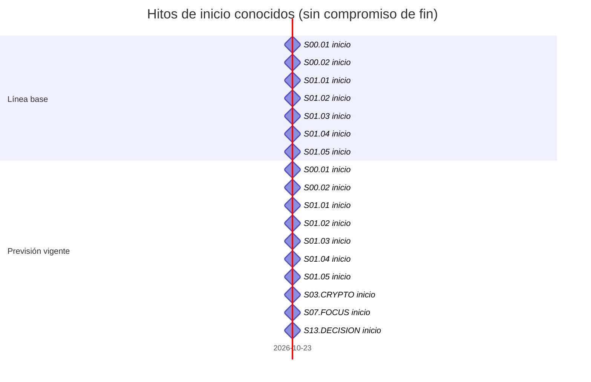
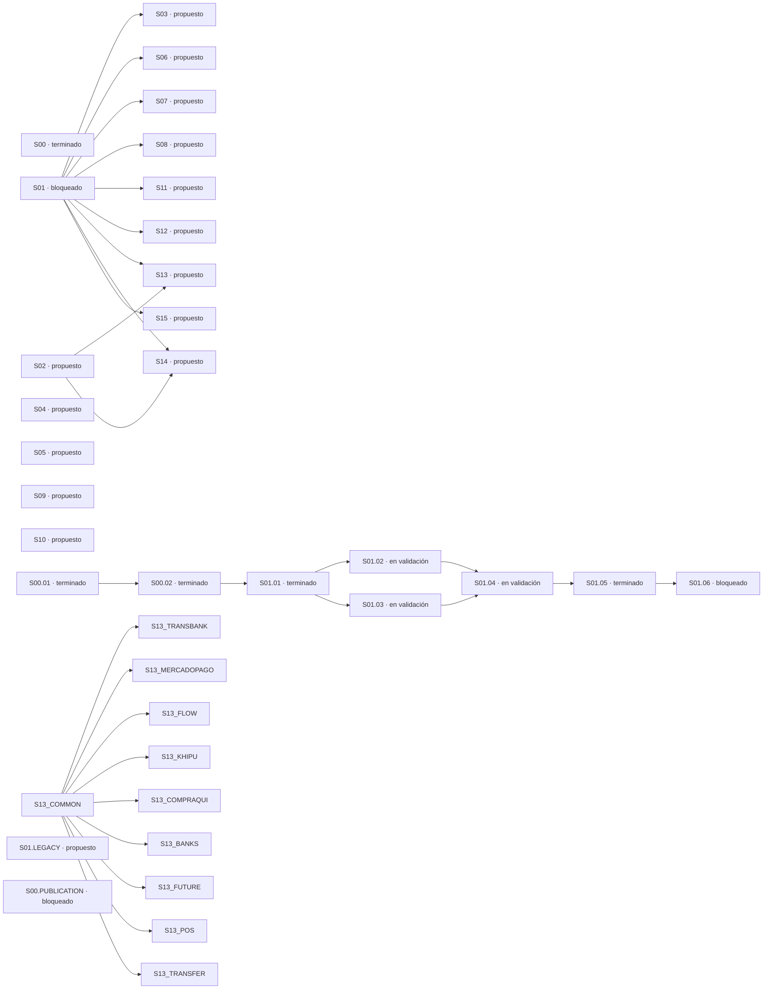

<!-- Generated by python scripts/planning.py; source SHA256 0b200c1106c133ca7276cce30e2188ae05ca2ef394340663dd85e4f82aa083a6 -->

# Gantt y dependencias

Una persona técnica; estimaciones en horas efectivas. Capacidad calendario no confirmada. Ruta crítica provisional.
Línea base inicial inmutable; previsión se modifica con historial. Fin sin fijar hasta confirmar capacidad. Espera externa sin estimar.

Fechas vacías = **sin estimar**. Horas de trabajo no son días de calendario. No hay fecha de go-live. La espera por terceros no tiene duración conocida.

| ID | Estado | Trabajo (horas) | Línea base inicio / fin | Previsión inicio / fin | Dependencias | Bloqueo / siguiente paso |
|---|---|---|---|---|---|---|
| S00 | terminado | sin estimar | sin estimar / sin estimar | 2026-10-23 / 2026-10-23 | — | Conservar evidencia y releer al comenzar la siguiente entrega |
| S01 | bloqueado | sin estimar | sin estimar / sin estimar | sin estimar / sin estimar | — | S01.06: Auth/OTP/MFA, dominio y correo reales sin configuración ni prueba autorizada |
| S01.R01 | en validación | sin estimar | sin estimar / sin estimar | sin estimar / sin estimar | — | Validar cierre técnico e integración externa autorizada |
| S01.R02 | en validación | sin estimar | sin estimar / sin estimar | sin estimar / sin estimar | — | Validar cierre técnico e integración externa autorizada |
| S01.R03 | en validación | sin estimar | sin estimar / sin estimar | sin estimar / sin estimar | — | Validar cierre técnico e integración externa autorizada |
| S01.R04 | en validación | sin estimar | sin estimar / sin estimar | sin estimar / sin estimar | — | Validar cierre técnico e integración externa autorizada |
| S01.R05 | en validación | sin estimar | sin estimar / sin estimar | sin estimar / sin estimar | — | Validar cierre técnico e integración externa autorizada |
| S01.R06 | en validación | sin estimar | sin estimar / sin estimar | sin estimar / sin estimar | — | Validar cierre técnico e integración externa autorizada |
| S01.R07 | en validación | sin estimar | sin estimar / sin estimar | sin estimar / sin estimar | — | Validar cierre técnico e integración externa autorizada |
| S01.R08 | en validación | sin estimar | sin estimar / sin estimar | sin estimar / sin estimar | — | Validar cierre técnico e integración externa autorizada |
| S02 | propuesto | sin estimar | sin estimar / sin estimar | sin estimar / sin estimar | — | Desglosar y estimar al seleccionar la entrega |
| S02.R01 | propuesto | sin estimar | sin estimar / sin estimar | sin estimar / sin estimar | — | Desglosar y estimar al seleccionar la entrega |
| S02.R02 | propuesto | sin estimar | sin estimar / sin estimar | sin estimar / sin estimar | — | Desglosar y estimar al seleccionar la entrega |
| S02.R03 | propuesto | sin estimar | sin estimar / sin estimar | sin estimar / sin estimar | — | Desglosar y estimar al seleccionar la entrega |
| S02.R04 | propuesto | sin estimar | sin estimar / sin estimar | sin estimar / sin estimar | — | Desglosar y estimar al seleccionar la entrega |
| S02.R05 | propuesto | sin estimar | sin estimar / sin estimar | sin estimar / sin estimar | — | Desglosar y estimar al seleccionar la entrega |
| S02.R06 | propuesto | sin estimar | sin estimar / sin estimar | sin estimar / sin estimar | — | Desglosar y estimar al seleccionar la entrega |
| S02.R07 | propuesto | sin estimar | sin estimar / sin estimar | sin estimar / sin estimar | — | Desglosar y estimar al seleccionar la entrega |
| S03 | propuesto | sin estimar | sin estimar / sin estimar | sin estimar / sin estimar | S01 | Desglosar y estimar al seleccionar la entrega |
| S03.R01 | propuesto | sin estimar | sin estimar / sin estimar | sin estimar / sin estimar | — | Desglosar y estimar al seleccionar la entrega |
| S03.R02 | propuesto | sin estimar | sin estimar / sin estimar | sin estimar / sin estimar | — | Desglosar y estimar al seleccionar la entrega |
| S03.R03 | propuesto | sin estimar | sin estimar / sin estimar | sin estimar / sin estimar | — | Desglosar y estimar al seleccionar la entrega |
| S03.R04 | propuesto | sin estimar | sin estimar / sin estimar | sin estimar / sin estimar | — | Desglosar y estimar al seleccionar la entrega |
| S03.R05 | propuesto | sin estimar | sin estimar / sin estimar | sin estimar / sin estimar | — | Desglosar y estimar al seleccionar la entrega |
| S03.R06 | propuesto | sin estimar | sin estimar / sin estimar | sin estimar / sin estimar | — | Desglosar y estimar al seleccionar la entrega |
| S03.R07 | propuesto | sin estimar | sin estimar / sin estimar | sin estimar / sin estimar | — | Desglosar y estimar al seleccionar la entrega |
| S04 | propuesto | sin estimar | sin estimar / sin estimar | sin estimar / sin estimar | — | Desglosar y estimar al seleccionar la entrega |
| S04.R01 | propuesto | sin estimar | sin estimar / sin estimar | sin estimar / sin estimar | — | Desglosar y estimar al seleccionar la entrega |
| S04.R02 | propuesto | sin estimar | sin estimar / sin estimar | sin estimar / sin estimar | — | Desglosar y estimar al seleccionar la entrega |
| S04.R03 | propuesto | sin estimar | sin estimar / sin estimar | sin estimar / sin estimar | — | Desglosar y estimar al seleccionar la entrega |
| S04.R04 | propuesto | sin estimar | sin estimar / sin estimar | sin estimar / sin estimar | — | Desglosar y estimar al seleccionar la entrega |
| S04.R05 | propuesto | sin estimar | sin estimar / sin estimar | sin estimar / sin estimar | — | Desglosar y estimar al seleccionar la entrega |
| S04.R06 | propuesto | sin estimar | sin estimar / sin estimar | sin estimar / sin estimar | — | Desglosar y estimar al seleccionar la entrega |
| S04.R07 | propuesto | sin estimar | sin estimar / sin estimar | sin estimar / sin estimar | — | Desglosar y estimar al seleccionar la entrega |
| S05 | propuesto | sin estimar | sin estimar / sin estimar | sin estimar / sin estimar | — | Desglosar y estimar al seleccionar la entrega |
| S05.R01 | propuesto | sin estimar | sin estimar / sin estimar | sin estimar / sin estimar | — | Desglosar y estimar al seleccionar la entrega |
| S05.R02 | propuesto | sin estimar | sin estimar / sin estimar | sin estimar / sin estimar | — | Desglosar y estimar al seleccionar la entrega |
| S05.R03 | propuesto | sin estimar | sin estimar / sin estimar | sin estimar / sin estimar | — | Desglosar y estimar al seleccionar la entrega |
| S05.R04 | propuesto | sin estimar | sin estimar / sin estimar | sin estimar / sin estimar | — | Desglosar y estimar al seleccionar la entrega |
| S05.R05 | propuesto | sin estimar | sin estimar / sin estimar | sin estimar / sin estimar | — | Desglosar y estimar al seleccionar la entrega |
| S05.R06 | propuesto | sin estimar | sin estimar / sin estimar | sin estimar / sin estimar | — | Desglosar y estimar al seleccionar la entrega |
| S05.R07 | propuesto | sin estimar | sin estimar / sin estimar | sin estimar / sin estimar | — | Desglosar y estimar al seleccionar la entrega |
| S06 | propuesto | sin estimar | sin estimar / sin estimar | sin estimar / sin estimar | S01 | Desglosar y estimar al seleccionar la entrega |
| S06.R01 | propuesto | sin estimar | sin estimar / sin estimar | sin estimar / sin estimar | — | Desglosar y estimar al seleccionar la entrega |
| S06.R02 | propuesto | sin estimar | sin estimar / sin estimar | sin estimar / sin estimar | — | Desglosar y estimar al seleccionar la entrega |
| S06.R03 | propuesto | sin estimar | sin estimar / sin estimar | sin estimar / sin estimar | — | Desglosar y estimar al seleccionar la entrega |
| S06.R04 | propuesto | sin estimar | sin estimar / sin estimar | sin estimar / sin estimar | — | Desglosar y estimar al seleccionar la entrega |
| S06.R05 | propuesto | sin estimar | sin estimar / sin estimar | sin estimar / sin estimar | — | Desglosar y estimar al seleccionar la entrega |
| S06.R06 | propuesto | sin estimar | sin estimar / sin estimar | sin estimar / sin estimar | — | Desglosar y estimar al seleccionar la entrega |
| S06.R07 | propuesto | sin estimar | sin estimar / sin estimar | sin estimar / sin estimar | — | Desglosar y estimar al seleccionar la entrega |
| S07 | propuesto | sin estimar | sin estimar / sin estimar | sin estimar / sin estimar | S01 | Desglosar y estimar al seleccionar la entrega |
| S07.R01 | propuesto | sin estimar | sin estimar / sin estimar | sin estimar / sin estimar | — | Desglosar y estimar al seleccionar la entrega |
| S07.R02 | propuesto | sin estimar | sin estimar / sin estimar | sin estimar / sin estimar | — | Desglosar y estimar al seleccionar la entrega |
| S07.R03 | propuesto | sin estimar | sin estimar / sin estimar | sin estimar / sin estimar | — | Desglosar y estimar al seleccionar la entrega |
| S07.R04 | propuesto | sin estimar | sin estimar / sin estimar | sin estimar / sin estimar | — | Desglosar y estimar al seleccionar la entrega |
| S07.R05 | propuesto | sin estimar | sin estimar / sin estimar | sin estimar / sin estimar | — | Desglosar y estimar al seleccionar la entrega |
| S07.R06 | propuesto | sin estimar | sin estimar / sin estimar | sin estimar / sin estimar | — | Desglosar y estimar al seleccionar la entrega |
| S07.R07 | propuesto | sin estimar | sin estimar / sin estimar | sin estimar / sin estimar | — | Desglosar y estimar al seleccionar la entrega |
| S08 | propuesto | sin estimar | sin estimar / sin estimar | sin estimar / sin estimar | S01 | Desglosar y estimar al seleccionar la entrega |
| S08.R01 | propuesto | sin estimar | sin estimar / sin estimar | sin estimar / sin estimar | — | Desglosar y estimar al seleccionar la entrega |
| S08.R02 | propuesto | sin estimar | sin estimar / sin estimar | sin estimar / sin estimar | — | Desglosar y estimar al seleccionar la entrega |
| S08.R03 | propuesto | sin estimar | sin estimar / sin estimar | sin estimar / sin estimar | — | Desglosar y estimar al seleccionar la entrega |
| S08.R04 | propuesto | sin estimar | sin estimar / sin estimar | sin estimar / sin estimar | — | Desglosar y estimar al seleccionar la entrega |
| S08.R05 | propuesto | sin estimar | sin estimar / sin estimar | sin estimar / sin estimar | — | Desglosar y estimar al seleccionar la entrega |
| S08.R06 | propuesto | sin estimar | sin estimar / sin estimar | sin estimar / sin estimar | — | Desglosar y estimar al seleccionar la entrega |
| S08.R07 | propuesto | sin estimar | sin estimar / sin estimar | sin estimar / sin estimar | — | Desglosar y estimar al seleccionar la entrega |
| S09 | propuesto | sin estimar | sin estimar / sin estimar | sin estimar / sin estimar | — | Desglosar y estimar al seleccionar la entrega |
| S09.R01 | propuesto | sin estimar | sin estimar / sin estimar | sin estimar / sin estimar | — | Desglosar y estimar al seleccionar la entrega |
| S09.R02 | propuesto | sin estimar | sin estimar / sin estimar | sin estimar / sin estimar | — | Desglosar y estimar al seleccionar la entrega |
| S09.R03 | propuesto | sin estimar | sin estimar / sin estimar | sin estimar / sin estimar | — | Desglosar y estimar al seleccionar la entrega |
| S09.R04 | propuesto | sin estimar | sin estimar / sin estimar | sin estimar / sin estimar | — | Desglosar y estimar al seleccionar la entrega |
| S09.R05 | propuesto | sin estimar | sin estimar / sin estimar | sin estimar / sin estimar | — | Desglosar y estimar al seleccionar la entrega |
| S09.R06 | propuesto | sin estimar | sin estimar / sin estimar | sin estimar / sin estimar | — | Desglosar y estimar al seleccionar la entrega |
| S09.R07 | propuesto | sin estimar | sin estimar / sin estimar | sin estimar / sin estimar | — | Desglosar y estimar al seleccionar la entrega |
| S10 | propuesto | sin estimar | sin estimar / sin estimar | sin estimar / sin estimar | — | Desglosar y estimar al seleccionar la entrega |
| S10.R01 | propuesto | sin estimar | sin estimar / sin estimar | sin estimar / sin estimar | — | Desglosar y estimar al seleccionar la entrega |
| S10.R02 | propuesto | sin estimar | sin estimar / sin estimar | sin estimar / sin estimar | — | Desglosar y estimar al seleccionar la entrega |
| S10.R03 | propuesto | sin estimar | sin estimar / sin estimar | sin estimar / sin estimar | — | Desglosar y estimar al seleccionar la entrega |
| S10.R04 | propuesto | sin estimar | sin estimar / sin estimar | sin estimar / sin estimar | — | Desglosar y estimar al seleccionar la entrega |
| S10.R05 | propuesto | sin estimar | sin estimar / sin estimar | sin estimar / sin estimar | — | Desglosar y estimar al seleccionar la entrega |
| S10.R06 | propuesto | sin estimar | sin estimar / sin estimar | sin estimar / sin estimar | — | Desglosar y estimar al seleccionar la entrega |
| S10.R07 | propuesto | sin estimar | sin estimar / sin estimar | sin estimar / sin estimar | — | Desglosar y estimar al seleccionar la entrega |
| S11 | propuesto | sin estimar | sin estimar / sin estimar | sin estimar / sin estimar | S01 | Desglosar y estimar al seleccionar la entrega |
| S11.R01 | propuesto | sin estimar | sin estimar / sin estimar | sin estimar / sin estimar | — | Desglosar y estimar al seleccionar la entrega |
| S11.R02 | propuesto | sin estimar | sin estimar / sin estimar | sin estimar / sin estimar | — | Desglosar y estimar al seleccionar la entrega |
| S11.R03 | propuesto | sin estimar | sin estimar / sin estimar | sin estimar / sin estimar | — | Desglosar y estimar al seleccionar la entrega |
| S11.R04 | propuesto | sin estimar | sin estimar / sin estimar | sin estimar / sin estimar | — | Desglosar y estimar al seleccionar la entrega |
| S11.R05 | propuesto | sin estimar | sin estimar / sin estimar | sin estimar / sin estimar | — | Desglosar y estimar al seleccionar la entrega |
| S11.R06 | propuesto | sin estimar | sin estimar / sin estimar | sin estimar / sin estimar | — | Desglosar y estimar al seleccionar la entrega |
| S11.R07 | propuesto | sin estimar | sin estimar / sin estimar | sin estimar / sin estimar | — | Desglosar y estimar al seleccionar la entrega |
| S12 | propuesto | sin estimar | sin estimar / sin estimar | sin estimar / sin estimar | S01 | Desglosar y estimar al seleccionar la entrega |
| S12.R01 | propuesto | sin estimar | sin estimar / sin estimar | sin estimar / sin estimar | — | Desglosar y estimar al seleccionar la entrega |
| S12.R02 | propuesto | sin estimar | sin estimar / sin estimar | sin estimar / sin estimar | — | Desglosar y estimar al seleccionar la entrega |
| S12.R03 | propuesto | sin estimar | sin estimar / sin estimar | sin estimar / sin estimar | — | Desglosar y estimar al seleccionar la entrega |
| S12.R04 | propuesto | sin estimar | sin estimar / sin estimar | sin estimar / sin estimar | — | Desglosar y estimar al seleccionar la entrega |
| S12.R05 | propuesto | sin estimar | sin estimar / sin estimar | sin estimar / sin estimar | — | Desglosar y estimar al seleccionar la entrega |
| S12.R06 | propuesto | sin estimar | sin estimar / sin estimar | sin estimar / sin estimar | — | Desglosar y estimar al seleccionar la entrega |
| S12.R07 | propuesto | sin estimar | sin estimar / sin estimar | sin estimar / sin estimar | — | Desglosar y estimar al seleccionar la entrega |
| S13 | propuesto | sin estimar | sin estimar / sin estimar | sin estimar / sin estimar | S02, S01 | Desglosar y estimar al seleccionar la entrega |
| S13.R01 | propuesto | sin estimar | sin estimar / sin estimar | sin estimar / sin estimar | — | Desglosar y estimar al seleccionar la entrega |
| S13.R02 | propuesto | sin estimar | sin estimar / sin estimar | sin estimar / sin estimar | — | Desglosar y estimar al seleccionar la entrega |
| S13.R03 | propuesto | sin estimar | sin estimar / sin estimar | sin estimar / sin estimar | — | Desglosar y estimar al seleccionar la entrega |
| S13.R04 | propuesto | sin estimar | sin estimar / sin estimar | sin estimar / sin estimar | — | Desglosar y estimar al seleccionar la entrega |
| S13.R05 | propuesto | sin estimar | sin estimar / sin estimar | sin estimar / sin estimar | — | Desglosar y estimar al seleccionar la entrega |
| S13.R06 | propuesto | sin estimar | sin estimar / sin estimar | sin estimar / sin estimar | — | Desglosar y estimar al seleccionar la entrega |
| S13.R07 | propuesto | sin estimar | sin estimar / sin estimar | sin estimar / sin estimar | — | Desglosar y estimar al seleccionar la entrega |
| S14 | propuesto | sin estimar | sin estimar / sin estimar | sin estimar / sin estimar | S02, S01 | Desglosar y estimar al seleccionar la entrega |
| S14.R01 | propuesto | sin estimar | sin estimar / sin estimar | sin estimar / sin estimar | — | Desglosar y estimar al seleccionar la entrega |
| S14.R02 | propuesto | sin estimar | sin estimar / sin estimar | sin estimar / sin estimar | — | Desglosar y estimar al seleccionar la entrega |
| S14.R03 | propuesto | sin estimar | sin estimar / sin estimar | sin estimar / sin estimar | — | Desglosar y estimar al seleccionar la entrega |
| S14.R04 | propuesto | sin estimar | sin estimar / sin estimar | sin estimar / sin estimar | — | Desglosar y estimar al seleccionar la entrega |
| S14.R05 | propuesto | sin estimar | sin estimar / sin estimar | sin estimar / sin estimar | — | Desglosar y estimar al seleccionar la entrega |
| S14.R06 | propuesto | sin estimar | sin estimar / sin estimar | sin estimar / sin estimar | — | Desglosar y estimar al seleccionar la entrega |
| S14.R07 | propuesto | sin estimar | sin estimar / sin estimar | sin estimar / sin estimar | — | Desglosar y estimar al seleccionar la entrega |
| S15 | propuesto | sin estimar | sin estimar / sin estimar | sin estimar / sin estimar | S01 | Desglosar y estimar al seleccionar la entrega |
| S15.R01 | propuesto | sin estimar | sin estimar / sin estimar | sin estimar / sin estimar | — | Desglosar y estimar al seleccionar la entrega |
| S15.R02 | propuesto | sin estimar | sin estimar / sin estimar | sin estimar / sin estimar | — | Desglosar y estimar al seleccionar la entrega |
| S15.R03 | propuesto | sin estimar | sin estimar / sin estimar | sin estimar / sin estimar | — | Desglosar y estimar al seleccionar la entrega |
| S15.R04 | propuesto | sin estimar | sin estimar / sin estimar | sin estimar / sin estimar | — | Desglosar y estimar al seleccionar la entrega |
| S15.R05 | propuesto | sin estimar | sin estimar / sin estimar | sin estimar / sin estimar | — | Desglosar y estimar al seleccionar la entrega |
| S15.R06 | propuesto | sin estimar | sin estimar / sin estimar | sin estimar / sin estimar | — | Desglosar y estimar al seleccionar la entrega |
| S15.R07 | propuesto | sin estimar | sin estimar / sin estimar | sin estimar / sin estimar | — | Desglosar y estimar al seleccionar la entrega |
| X001 | propuesto | sin estimar | sin estimar / sin estimar | sin estimar / sin estimar | — | Desglosar y estimar al seleccionar la entrega |
| X002 | propuesto | sin estimar | sin estimar / sin estimar | sin estimar / sin estimar | — | Desglosar y estimar al seleccionar la entrega |
| X003 | propuesto | sin estimar | sin estimar / sin estimar | sin estimar / sin estimar | — | Desglosar y estimar al seleccionar la entrega |
| X004 | propuesto | sin estimar | sin estimar / sin estimar | sin estimar / sin estimar | — | Desglosar y estimar al seleccionar la entrega |
| X005 | propuesto | sin estimar | sin estimar / sin estimar | sin estimar / sin estimar | — | Desglosar y estimar al seleccionar la entrega |
| X006 | propuesto | sin estimar | sin estimar / sin estimar | sin estimar / sin estimar | — | Desglosar y estimar al seleccionar la entrega |
| X007 | propuesto | sin estimar | sin estimar / sin estimar | sin estimar / sin estimar | — | Desglosar y estimar al seleccionar la entrega |
| X008 | propuesto | sin estimar | sin estimar / sin estimar | sin estimar / sin estimar | — | Desglosar y estimar al seleccionar la entrega |
| X009 | propuesto | sin estimar | sin estimar / sin estimar | sin estimar / sin estimar | — | Desglosar y estimar al seleccionar la entrega |
| X010 | propuesto | sin estimar | sin estimar / sin estimar | sin estimar / sin estimar | — | Desglosar y estimar al seleccionar la entrega |
| X011 | propuesto | sin estimar | sin estimar / sin estimar | sin estimar / sin estimar | — | Desglosar y estimar al seleccionar la entrega |
| X012 | propuesto | sin estimar | sin estimar / sin estimar | sin estimar / sin estimar | — | Desglosar y estimar al seleccionar la entrega |
| X013 | propuesto | sin estimar | sin estimar / sin estimar | sin estimar / sin estimar | — | Desglosar y estimar al seleccionar la entrega |
| X014 | propuesto | sin estimar | sin estimar / sin estimar | sin estimar / sin estimar | — | Desglosar y estimar al seleccionar la entrega |
| X015 | propuesto | sin estimar | sin estimar / sin estimar | sin estimar / sin estimar | — | Desglosar y estimar al seleccionar la entrega |
| X016 | propuesto | sin estimar | sin estimar / sin estimar | sin estimar / sin estimar | — | Desglosar y estimar al seleccionar la entrega |
| X017 | propuesto | sin estimar | sin estimar / sin estimar | sin estimar / sin estimar | — | Desglosar y estimar al seleccionar la entrega |
| X018 | propuesto | sin estimar | sin estimar / sin estimar | sin estimar / sin estimar | — | Desglosar y estimar al seleccionar la entrega |
| X019 | propuesto | sin estimar | sin estimar / sin estimar | sin estimar / sin estimar | — | Desglosar y estimar al seleccionar la entrega |
| X020 | propuesto | sin estimar | sin estimar / sin estimar | sin estimar / sin estimar | — | Desglosar y estimar al seleccionar la entrega |
| X021 | propuesto | sin estimar | sin estimar / sin estimar | sin estimar / sin estimar | — | Desglosar y estimar al seleccionar la entrega |
| X022 | propuesto | sin estimar | sin estimar / sin estimar | sin estimar / sin estimar | — | Desglosar y estimar al seleccionar la entrega |
| X023 | propuesto | sin estimar | sin estimar / sin estimar | sin estimar / sin estimar | — | Desglosar y estimar al seleccionar la entrega |
| X024 | propuesto | sin estimar | sin estimar / sin estimar | sin estimar / sin estimar | — | Desglosar y estimar al seleccionar la entrega |
| X025 | propuesto | sin estimar | sin estimar / sin estimar | sin estimar / sin estimar | — | Desglosar y estimar al seleccionar la entrega |
| X026 | propuesto | sin estimar | sin estimar / sin estimar | sin estimar / sin estimar | — | Desglosar y estimar al seleccionar la entrega |
| X027 | propuesto | sin estimar | sin estimar / sin estimar | sin estimar / sin estimar | — | Desglosar y estimar al seleccionar la entrega |
| X028 | propuesto | sin estimar | sin estimar / sin estimar | sin estimar / sin estimar | — | Desglosar y estimar al seleccionar la entrega |
| X029 | propuesto | sin estimar | sin estimar / sin estimar | sin estimar / sin estimar | — | Desglosar y estimar al seleccionar la entrega |
| X030 | propuesto | sin estimar | sin estimar / sin estimar | sin estimar / sin estimar | — | Desglosar y estimar al seleccionar la entrega |
| X031 | propuesto | sin estimar | sin estimar / sin estimar | sin estimar / sin estimar | — | Desglosar y estimar al seleccionar la entrega |
| X032 | propuesto | sin estimar | sin estimar / sin estimar | sin estimar / sin estimar | — | Desglosar y estimar al seleccionar la entrega |
| X033 | propuesto | sin estimar | sin estimar / sin estimar | sin estimar / sin estimar | — | Desglosar y estimar al seleccionar la entrega |
| X034 | propuesto | sin estimar | sin estimar / sin estimar | sin estimar / sin estimar | — | Desglosar y estimar al seleccionar la entrega |
| X035 | propuesto | sin estimar | sin estimar / sin estimar | sin estimar / sin estimar | — | Desglosar y estimar al seleccionar la entrega |
| X036 | propuesto | sin estimar | sin estimar / sin estimar | sin estimar / sin estimar | — | Desglosar y estimar al seleccionar la entrega |
| X037 | propuesto | sin estimar | sin estimar / sin estimar | sin estimar / sin estimar | — | Desglosar y estimar al seleccionar la entrega |
| X038 | propuesto | sin estimar | sin estimar / sin estimar | sin estimar / sin estimar | — | Desglosar y estimar al seleccionar la entrega |
| X039 | propuesto | sin estimar | sin estimar / sin estimar | sin estimar / sin estimar | — | Desglosar y estimar al seleccionar la entrega |
| X040 | propuesto | sin estimar | sin estimar / sin estimar | sin estimar / sin estimar | — | Desglosar y estimar al seleccionar la entrega |
| X041 | propuesto | sin estimar | sin estimar / sin estimar | sin estimar / sin estimar | — | Desglosar y estimar al seleccionar la entrega |
| X042 | propuesto | sin estimar | sin estimar / sin estimar | sin estimar / sin estimar | — | Desglosar y estimar al seleccionar la entrega |
| X043 | propuesto | sin estimar | sin estimar / sin estimar | sin estimar / sin estimar | — | Desglosar y estimar al seleccionar la entrega |
| X044 | propuesto | sin estimar | sin estimar / sin estimar | sin estimar / sin estimar | — | Desglosar y estimar al seleccionar la entrega |
| X045 | propuesto | sin estimar | sin estimar / sin estimar | sin estimar / sin estimar | — | Desglosar y estimar al seleccionar la entrega |
| X046 | propuesto | sin estimar | sin estimar / sin estimar | sin estimar / sin estimar | — | Desglosar y estimar al seleccionar la entrega |
| X047 | propuesto | sin estimar | sin estimar / sin estimar | sin estimar / sin estimar | — | Desglosar y estimar al seleccionar la entrega |
| X048 | propuesto | sin estimar | sin estimar / sin estimar | sin estimar / sin estimar | — | Desglosar y estimar al seleccionar la entrega |
| X049 | propuesto | sin estimar | sin estimar / sin estimar | sin estimar / sin estimar | — | Desglosar y estimar al seleccionar la entrega |
| X050 | propuesto | sin estimar | sin estimar / sin estimar | sin estimar / sin estimar | — | Desglosar y estimar al seleccionar la entrega |
| X051 | propuesto | sin estimar | sin estimar / sin estimar | sin estimar / sin estimar | — | Desglosar y estimar al seleccionar la entrega |
| X052 | propuesto | sin estimar | sin estimar / sin estimar | sin estimar / sin estimar | — | Desglosar y estimar al seleccionar la entrega |
| X053 | propuesto | sin estimar | sin estimar / sin estimar | sin estimar / sin estimar | — | Desglosar y estimar al seleccionar la entrega |
| X054 | propuesto | sin estimar | sin estimar / sin estimar | sin estimar / sin estimar | — | Desglosar y estimar al seleccionar la entrega |
| X055 | propuesto | sin estimar | sin estimar / sin estimar | sin estimar / sin estimar | — | Desglosar y estimar al seleccionar la entrega |
| X056 | propuesto | sin estimar | sin estimar / sin estimar | sin estimar / sin estimar | — | Desglosar y estimar al seleccionar la entrega |
| X057 | propuesto | sin estimar | sin estimar / sin estimar | sin estimar / sin estimar | — | Desglosar y estimar al seleccionar la entrega |
| X058 | propuesto | sin estimar | sin estimar / sin estimar | sin estimar / sin estimar | — | Desglosar y estimar al seleccionar la entrega |
| X059 | propuesto | sin estimar | sin estimar / sin estimar | sin estimar / sin estimar | — | Desglosar y estimar al seleccionar la entrega |
| X060 | propuesto | sin estimar | sin estimar / sin estimar | sin estimar / sin estimar | — | Desglosar y estimar al seleccionar la entrega |
| X061 | propuesto | sin estimar | sin estimar / sin estimar | sin estimar / sin estimar | — | Desglosar y estimar al seleccionar la entrega |
| X062 | propuesto | sin estimar | sin estimar / sin estimar | sin estimar / sin estimar | — | Desglosar y estimar al seleccionar la entrega |
| X063 | propuesto | sin estimar | sin estimar / sin estimar | sin estimar / sin estimar | — | Desglosar y estimar al seleccionar la entrega |
| X064 | propuesto | sin estimar | sin estimar / sin estimar | sin estimar / sin estimar | — | Desglosar y estimar al seleccionar la entrega |
| X065 | propuesto | sin estimar | sin estimar / sin estimar | sin estimar / sin estimar | — | Desglosar y estimar al seleccionar la entrega |
| X066 | propuesto | sin estimar | sin estimar / sin estimar | sin estimar / sin estimar | — | Desglosar y estimar al seleccionar la entrega |
| X067 | propuesto | sin estimar | sin estimar / sin estimar | sin estimar / sin estimar | — | Desglosar y estimar al seleccionar la entrega |
| X068 | propuesto | sin estimar | sin estimar / sin estimar | sin estimar / sin estimar | — | Desglosar y estimar al seleccionar la entrega |
| X069 | propuesto | sin estimar | sin estimar / sin estimar | sin estimar / sin estimar | — | Desglosar y estimar al seleccionar la entrega |
| X070 | propuesto | sin estimar | sin estimar / sin estimar | sin estimar / sin estimar | — | Desglosar y estimar al seleccionar la entrega |
| X071 | propuesto | sin estimar | sin estimar / sin estimar | sin estimar / sin estimar | — | Desglosar y estimar al seleccionar la entrega |
| X072 | propuesto | sin estimar | sin estimar / sin estimar | sin estimar / sin estimar | — | Desglosar y estimar al seleccionar la entrega |
| X073 | propuesto | sin estimar | sin estimar / sin estimar | sin estimar / sin estimar | — | Desglosar y estimar al seleccionar la entrega |
| X074 | propuesto | sin estimar | sin estimar / sin estimar | sin estimar / sin estimar | — | Desglosar y estimar al seleccionar la entrega |
| X075 | propuesto | sin estimar | sin estimar / sin estimar | sin estimar / sin estimar | — | Desglosar y estimar al seleccionar la entrega |
| X076 | propuesto | sin estimar | sin estimar / sin estimar | sin estimar / sin estimar | — | Desglosar y estimar al seleccionar la entrega |
| X077 | propuesto | sin estimar | sin estimar / sin estimar | sin estimar / sin estimar | — | Desglosar y estimar al seleccionar la entrega |
| X078 | propuesto | sin estimar | sin estimar / sin estimar | sin estimar / sin estimar | — | Desglosar y estimar al seleccionar la entrega |
| X079 | propuesto | sin estimar | sin estimar / sin estimar | sin estimar / sin estimar | — | Desglosar y estimar al seleccionar la entrega |
| X080 | propuesto | sin estimar | sin estimar / sin estimar | sin estimar / sin estimar | — | Desglosar y estimar al seleccionar la entrega |
| X081 | propuesto | sin estimar | sin estimar / sin estimar | sin estimar / sin estimar | — | Desglosar y estimar al seleccionar la entrega |
| X082 | propuesto | sin estimar | sin estimar / sin estimar | sin estimar / sin estimar | — | Desglosar y estimar al seleccionar la entrega |
| X083 | propuesto | sin estimar | sin estimar / sin estimar | sin estimar / sin estimar | — | Desglosar y estimar al seleccionar la entrega |
| X084 | propuesto | sin estimar | sin estimar / sin estimar | sin estimar / sin estimar | — | Desglosar y estimar al seleccionar la entrega |
| X085 | propuesto | sin estimar | sin estimar / sin estimar | sin estimar / sin estimar | — | Desglosar y estimar al seleccionar la entrega |
| X086 | propuesto | sin estimar | sin estimar / sin estimar | sin estimar / sin estimar | — | Desglosar y estimar al seleccionar la entrega |
| X087 | propuesto | sin estimar | sin estimar / sin estimar | sin estimar / sin estimar | — | Desglosar y estimar al seleccionar la entrega |
| X088 | propuesto | sin estimar | sin estimar / sin estimar | sin estimar / sin estimar | — | Desglosar y estimar al seleccionar la entrega |
| X089 | propuesto | sin estimar | sin estimar / sin estimar | sin estimar / sin estimar | — | Desglosar y estimar al seleccionar la entrega |
| X090 | propuesto | sin estimar | sin estimar / sin estimar | sin estimar / sin estimar | — | Desglosar y estimar al seleccionar la entrega |
| X091 | propuesto | sin estimar | sin estimar / sin estimar | sin estimar / sin estimar | — | Desglosar y estimar al seleccionar la entrega |
| X092 | propuesto | sin estimar | sin estimar / sin estimar | sin estimar / sin estimar | — | Desglosar y estimar al seleccionar la entrega |
| X093 | propuesto | sin estimar | sin estimar / sin estimar | sin estimar / sin estimar | — | Desglosar y estimar al seleccionar la entrega |
| X094 | propuesto | sin estimar | sin estimar / sin estimar | sin estimar / sin estimar | — | Desglosar y estimar al seleccionar la entrega |
| X095 | propuesto | sin estimar | sin estimar / sin estimar | sin estimar / sin estimar | — | Desglosar y estimar al seleccionar la entrega |
| X096 | propuesto | sin estimar | sin estimar / sin estimar | sin estimar / sin estimar | — | Desglosar y estimar al seleccionar la entrega |
| X097 | propuesto | sin estimar | sin estimar / sin estimar | sin estimar / sin estimar | — | Desglosar y estimar al seleccionar la entrega |
| X098 | propuesto | sin estimar | sin estimar / sin estimar | sin estimar / sin estimar | — | Desglosar y estimar al seleccionar la entrega |
| X099 | propuesto | sin estimar | sin estimar / sin estimar | sin estimar / sin estimar | — | Desglosar y estimar al seleccionar la entrega |
| X100 | propuesto | sin estimar | sin estimar / sin estimar | sin estimar / sin estimar | — | Desglosar y estimar al seleccionar la entrega |
| X101 | propuesto | sin estimar | sin estimar / sin estimar | sin estimar / sin estimar | — | Desglosar y estimar al seleccionar la entrega |
| X102 | propuesto | sin estimar | sin estimar / sin estimar | sin estimar / sin estimar | — | Desglosar y estimar al seleccionar la entrega |
| X103 | propuesto | sin estimar | sin estimar / sin estimar | sin estimar / sin estimar | — | Desglosar y estimar al seleccionar la entrega |
| X104 | propuesto | sin estimar | sin estimar / sin estimar | sin estimar / sin estimar | — | Desglosar y estimar al seleccionar la entrega |
| X105 | propuesto | sin estimar | sin estimar / sin estimar | sin estimar / sin estimar | — | Desglosar y estimar al seleccionar la entrega |
| X106 | propuesto | sin estimar | sin estimar / sin estimar | sin estimar / sin estimar | — | Desglosar y estimar al seleccionar la entrega |
| X107 | propuesto | sin estimar | sin estimar / sin estimar | sin estimar / sin estimar | — | Desglosar y estimar al seleccionar la entrega |
| X108 | propuesto | sin estimar | sin estimar / sin estimar | sin estimar / sin estimar | — | Desglosar y estimar al seleccionar la entrega |
| X109 | propuesto | sin estimar | sin estimar / sin estimar | sin estimar / sin estimar | — | Desglosar y estimar al seleccionar la entrega |
| X110 | propuesto | sin estimar | sin estimar / sin estimar | sin estimar / sin estimar | — | Desglosar y estimar al seleccionar la entrega |
| X111 | propuesto | sin estimar | sin estimar / sin estimar | sin estimar / sin estimar | — | Desglosar y estimar al seleccionar la entrega |
| X112 | propuesto | sin estimar | sin estimar / sin estimar | sin estimar / sin estimar | — | Desglosar y estimar al seleccionar la entrega |
| X113 | propuesto | sin estimar | sin estimar / sin estimar | sin estimar / sin estimar | — | Desglosar y estimar al seleccionar la entrega |
| X114 | propuesto | sin estimar | sin estimar / sin estimar | sin estimar / sin estimar | — | Desglosar y estimar al seleccionar la entrega |
| X115 | propuesto | sin estimar | sin estimar / sin estimar | sin estimar / sin estimar | — | Desglosar y estimar al seleccionar la entrega |
| X116 | propuesto | sin estimar | sin estimar / sin estimar | sin estimar / sin estimar | — | Desglosar y estimar al seleccionar la entrega |
| X117 | propuesto | sin estimar | sin estimar / sin estimar | sin estimar / sin estimar | — | Desglosar y estimar al seleccionar la entrega |
| X118 | propuesto | sin estimar | sin estimar / sin estimar | sin estimar / sin estimar | — | Desglosar y estimar al seleccionar la entrega |
| X119 | propuesto | sin estimar | sin estimar / sin estimar | sin estimar / sin estimar | — | Desglosar y estimar al seleccionar la entrega |
| X120 | propuesto | sin estimar | sin estimar / sin estimar | sin estimar / sin estimar | — | Desglosar y estimar al seleccionar la entrega |
| X121 | propuesto | sin estimar | sin estimar / sin estimar | sin estimar / sin estimar | — | Desglosar y estimar al seleccionar la entrega |
| X122 | propuesto | sin estimar | sin estimar / sin estimar | sin estimar / sin estimar | — | Desglosar y estimar al seleccionar la entrega |
| X123 | propuesto | sin estimar | sin estimar / sin estimar | sin estimar / sin estimar | — | Desglosar y estimar al seleccionar la entrega |
| X124 | propuesto | sin estimar | sin estimar / sin estimar | sin estimar / sin estimar | — | Desglosar y estimar al seleccionar la entrega |
| X125 | propuesto | sin estimar | sin estimar / sin estimar | sin estimar / sin estimar | — | Desglosar y estimar al seleccionar la entrega |
| X126 | propuesto | sin estimar | sin estimar / sin estimar | sin estimar / sin estimar | — | Desglosar y estimar al seleccionar la entrega |
| X127 | propuesto | sin estimar | sin estimar / sin estimar | sin estimar / sin estimar | — | Desglosar y estimar al seleccionar la entrega |
| X128 | propuesto | sin estimar | sin estimar / sin estimar | sin estimar / sin estimar | — | Desglosar y estimar al seleccionar la entrega |
| X129 | propuesto | sin estimar | sin estimar / sin estimar | sin estimar / sin estimar | — | Desglosar y estimar al seleccionar la entrega |
| X130 | propuesto | sin estimar | sin estimar / sin estimar | sin estimar / sin estimar | — | Desglosar y estimar al seleccionar la entrega |
| X131 | propuesto | sin estimar | sin estimar / sin estimar | sin estimar / sin estimar | — | Desglosar y estimar al seleccionar la entrega |
| X132 | propuesto | sin estimar | sin estimar / sin estimar | sin estimar / sin estimar | — | Desglosar y estimar al seleccionar la entrega |
| X133 | propuesto | sin estimar | sin estimar / sin estimar | sin estimar / sin estimar | — | Desglosar y estimar al seleccionar la entrega |
| X134 | propuesto | sin estimar | sin estimar / sin estimar | sin estimar / sin estimar | — | Desglosar y estimar al seleccionar la entrega |
| X135 | propuesto | sin estimar | sin estimar / sin estimar | sin estimar / sin estimar | — | Desglosar y estimar al seleccionar la entrega |
| X136 | propuesto | sin estimar | sin estimar / sin estimar | sin estimar / sin estimar | — | Desglosar y estimar al seleccionar la entrega |
| X137 | propuesto | sin estimar | sin estimar / sin estimar | sin estimar / sin estimar | — | Desglosar y estimar al seleccionar la entrega |
| X138 | propuesto | sin estimar | sin estimar / sin estimar | sin estimar / sin estimar | — | Desglosar y estimar al seleccionar la entrega |
| X139 | propuesto | sin estimar | sin estimar / sin estimar | sin estimar / sin estimar | — | Desglosar y estimar al seleccionar la entrega |
| X140 | propuesto | sin estimar | sin estimar / sin estimar | sin estimar / sin estimar | — | Desglosar y estimar al seleccionar la entrega |
| X141 | propuesto | sin estimar | sin estimar / sin estimar | sin estimar / sin estimar | — | Desglosar y estimar al seleccionar la entrega |
| X142 | propuesto | sin estimar | sin estimar / sin estimar | sin estimar / sin estimar | — | Desglosar y estimar al seleccionar la entrega |
| X143 | propuesto | sin estimar | sin estimar / sin estimar | sin estimar / sin estimar | — | Desglosar y estimar al seleccionar la entrega |
| X144 | propuesto | sin estimar | sin estimar / sin estimar | sin estimar / sin estimar | — | Desglosar y estimar al seleccionar la entrega |
| X145 | propuesto | sin estimar | sin estimar / sin estimar | sin estimar / sin estimar | — | Desglosar y estimar al seleccionar la entrega |
| X146 | propuesto | sin estimar | sin estimar / sin estimar | sin estimar / sin estimar | — | Desglosar y estimar al seleccionar la entrega |
| X147 | propuesto | sin estimar | sin estimar / sin estimar | sin estimar / sin estimar | — | Desglosar y estimar al seleccionar la entrega |
| X148 | propuesto | sin estimar | sin estimar / sin estimar | sin estimar / sin estimar | — | Desglosar y estimar al seleccionar la entrega |
| X149 | propuesto | sin estimar | sin estimar / sin estimar | sin estimar / sin estimar | — | Desglosar y estimar al seleccionar la entrega |
| X150 | propuesto | sin estimar | sin estimar / sin estimar | sin estimar / sin estimar | — | Desglosar y estimar al seleccionar la entrega |
| X151 | propuesto | sin estimar | sin estimar / sin estimar | sin estimar / sin estimar | — | Desglosar y estimar al seleccionar la entrega |
| X152 | propuesto | sin estimar | sin estimar / sin estimar | sin estimar / sin estimar | — | Desglosar y estimar al seleccionar la entrega |
| X153 | propuesto | sin estimar | sin estimar / sin estimar | sin estimar / sin estimar | — | Desglosar y estimar al seleccionar la entrega |
| X154 | propuesto | sin estimar | sin estimar / sin estimar | sin estimar / sin estimar | — | Desglosar y estimar al seleccionar la entrega |
| X155 | propuesto | sin estimar | sin estimar / sin estimar | sin estimar / sin estimar | — | Desglosar y estimar al seleccionar la entrega |
| X156 | propuesto | sin estimar | sin estimar / sin estimar | sin estimar / sin estimar | — | Desglosar y estimar al seleccionar la entrega |
| X157 | propuesto | sin estimar | sin estimar / sin estimar | sin estimar / sin estimar | — | Desglosar y estimar al seleccionar la entrega |
| X158 | propuesto | sin estimar | sin estimar / sin estimar | sin estimar / sin estimar | — | Desglosar y estimar al seleccionar la entrega |
| T001 | propuesto | sin estimar | sin estimar / sin estimar | sin estimar / sin estimar | — | Desglosar y estimar al seleccionar la entrega |
| T002 | propuesto | sin estimar | sin estimar / sin estimar | sin estimar / sin estimar | — | Desglosar y estimar al seleccionar la entrega |
| T003 | propuesto | sin estimar | sin estimar / sin estimar | sin estimar / sin estimar | — | Desglosar y estimar al seleccionar la entrega |
| T004 | propuesto | sin estimar | sin estimar / sin estimar | sin estimar / sin estimar | — | Desglosar y estimar al seleccionar la entrega |
| T005 | propuesto | sin estimar | sin estimar / sin estimar | sin estimar / sin estimar | — | Desglosar y estimar al seleccionar la entrega |
| T006 | propuesto | sin estimar | sin estimar / sin estimar | sin estimar / sin estimar | — | Desglosar y estimar al seleccionar la entrega |
| T007 | propuesto | sin estimar | sin estimar / sin estimar | sin estimar / sin estimar | — | Desglosar y estimar al seleccionar la entrega |
| T008 | propuesto | sin estimar | sin estimar / sin estimar | sin estimar / sin estimar | — | Desglosar y estimar al seleccionar la entrega |
| T009 | propuesto | sin estimar | sin estimar / sin estimar | sin estimar / sin estimar | — | Desglosar y estimar al seleccionar la entrega |
| T010 | propuesto | sin estimar | sin estimar / sin estimar | sin estimar / sin estimar | — | Desglosar y estimar al seleccionar la entrega |
| T011 | propuesto | sin estimar | sin estimar / sin estimar | sin estimar / sin estimar | — | Desglosar y estimar al seleccionar la entrega |
| T012 | propuesto | sin estimar | sin estimar / sin estimar | sin estimar / sin estimar | — | Desglosar y estimar al seleccionar la entrega |
| T013 | propuesto | sin estimar | sin estimar / sin estimar | sin estimar / sin estimar | — | Desglosar y estimar al seleccionar la entrega |
| T014 | propuesto | sin estimar | sin estimar / sin estimar | sin estimar / sin estimar | — | Desglosar y estimar al seleccionar la entrega |
| T015 | propuesto | sin estimar | sin estimar / sin estimar | sin estimar / sin estimar | — | Desglosar y estimar al seleccionar la entrega |
| T016 | propuesto | sin estimar | sin estimar / sin estimar | sin estimar / sin estimar | — | Desglosar y estimar al seleccionar la entrega |
| T017 | propuesto | sin estimar | sin estimar / sin estimar | sin estimar / sin estimar | — | Desglosar y estimar al seleccionar la entrega |
| T018 | propuesto | sin estimar | sin estimar / sin estimar | sin estimar / sin estimar | — | Desglosar y estimar al seleccionar la entrega |
| T019 | propuesto | sin estimar | sin estimar / sin estimar | sin estimar / sin estimar | — | Desglosar y estimar al seleccionar la entrega |
| T020 | propuesto | sin estimar | sin estimar / sin estimar | sin estimar / sin estimar | — | Desglosar y estimar al seleccionar la entrega |
| T021 | propuesto | sin estimar | sin estimar / sin estimar | sin estimar / sin estimar | — | Desglosar y estimar al seleccionar la entrega |
| T022 | propuesto | sin estimar | sin estimar / sin estimar | sin estimar / sin estimar | — | Desglosar y estimar al seleccionar la entrega |
| D01.001 | propuesto | sin estimar | sin estimar / sin estimar | sin estimar / sin estimar | — | Consultar texto íntegro al seleccionar tarea; contextualizar implementación con revisión inicial |
| D01.002 | propuesto | sin estimar | sin estimar / sin estimar | sin estimar / sin estimar | — | Consultar texto íntegro al seleccionar tarea; contextualizar implementación con revisión inicial |
| D01.003 | propuesto | sin estimar | sin estimar / sin estimar | sin estimar / sin estimar | — | Consultar texto íntegro al seleccionar tarea; contextualizar implementación con revisión inicial |
| D01.004 | propuesto | sin estimar | sin estimar / sin estimar | sin estimar / sin estimar | — | Consultar texto íntegro al seleccionar tarea; contextualizar implementación con revisión inicial |
| D01.005 | propuesto | sin estimar | sin estimar / sin estimar | sin estimar / sin estimar | — | Consultar texto íntegro al seleccionar tarea; contextualizar implementación con revisión inicial |
| D01.006 | propuesto | sin estimar | sin estimar / sin estimar | sin estimar / sin estimar | — | Consultar texto íntegro al seleccionar tarea; contextualizar implementación con revisión inicial |
| D01.007 | propuesto | sin estimar | sin estimar / sin estimar | sin estimar / sin estimar | — | Consultar texto íntegro al seleccionar tarea; contextualizar implementación con revisión inicial |
| D01.008 | propuesto | sin estimar | sin estimar / sin estimar | sin estimar / sin estimar | — | Consultar texto íntegro al seleccionar tarea; contextualizar implementación con revisión inicial |
| D01.009 | propuesto | sin estimar | sin estimar / sin estimar | sin estimar / sin estimar | — | Consultar texto íntegro al seleccionar tarea; contextualizar implementación con revisión inicial |
| D01.010 | propuesto | sin estimar | sin estimar / sin estimar | sin estimar / sin estimar | — | Consultar texto íntegro al seleccionar tarea; contextualizar implementación con revisión inicial |
| D01.011 | propuesto | sin estimar | sin estimar / sin estimar | sin estimar / sin estimar | — | Consultar texto íntegro al seleccionar tarea; contextualizar implementación con revisión inicial |
| D01.012 | propuesto | sin estimar | sin estimar / sin estimar | sin estimar / sin estimar | — | Consultar texto íntegro al seleccionar tarea; contextualizar implementación con revisión inicial |
| D01.013 | propuesto | sin estimar | sin estimar / sin estimar | sin estimar / sin estimar | — | Consultar texto íntegro al seleccionar tarea; contextualizar implementación con revisión inicial |
| D01.014 | propuesto | sin estimar | sin estimar / sin estimar | sin estimar / sin estimar | — | Consultar texto íntegro al seleccionar tarea; contextualizar implementación con revisión inicial |
| D01.015 | propuesto | sin estimar | sin estimar / sin estimar | sin estimar / sin estimar | — | Consultar texto íntegro al seleccionar tarea; contextualizar implementación con revisión inicial |
| D01.016 | propuesto | sin estimar | sin estimar / sin estimar | sin estimar / sin estimar | — | Consultar texto íntegro al seleccionar tarea; contextualizar implementación con revisión inicial |
| D01.017 | propuesto | sin estimar | sin estimar / sin estimar | sin estimar / sin estimar | — | Consultar texto íntegro al seleccionar tarea; contextualizar implementación con revisión inicial |
| D01.018 | propuesto | sin estimar | sin estimar / sin estimar | sin estimar / sin estimar | — | Consultar texto íntegro al seleccionar tarea; contextualizar implementación con revisión inicial |
| D02.001 | propuesto | sin estimar | sin estimar / sin estimar | sin estimar / sin estimar | — | Consultar texto íntegro al seleccionar tarea; contextualizar implementación con revisión inicial |
| D02.002 | propuesto | sin estimar | sin estimar / sin estimar | sin estimar / sin estimar | — | Consultar texto íntegro al seleccionar tarea; contextualizar implementación con revisión inicial |
| D02.003 | propuesto | sin estimar | sin estimar / sin estimar | sin estimar / sin estimar | — | Consultar texto íntegro al seleccionar tarea; contextualizar implementación con revisión inicial |
| D02.004 | propuesto | sin estimar | sin estimar / sin estimar | sin estimar / sin estimar | — | Consultar texto íntegro al seleccionar tarea; contextualizar implementación con revisión inicial |
| D02.005 | propuesto | sin estimar | sin estimar / sin estimar | sin estimar / sin estimar | — | Consultar texto íntegro al seleccionar tarea; contextualizar implementación con revisión inicial |
| D02.006 | propuesto | sin estimar | sin estimar / sin estimar | sin estimar / sin estimar | — | Consultar texto íntegro al seleccionar tarea; contextualizar implementación con revisión inicial |
| D02.007 | propuesto | sin estimar | sin estimar / sin estimar | sin estimar / sin estimar | — | Consultar texto íntegro al seleccionar tarea; contextualizar implementación con revisión inicial |
| D02.008 | propuesto | sin estimar | sin estimar / sin estimar | sin estimar / sin estimar | — | Consultar texto íntegro al seleccionar tarea; contextualizar implementación con revisión inicial |
| D02.009 | propuesto | sin estimar | sin estimar / sin estimar | sin estimar / sin estimar | — | Consultar texto íntegro al seleccionar tarea; contextualizar implementación con revisión inicial |
| D02.010 | propuesto | sin estimar | sin estimar / sin estimar | sin estimar / sin estimar | — | Consultar texto íntegro al seleccionar tarea; contextualizar implementación con revisión inicial |
| D02.011 | propuesto | sin estimar | sin estimar / sin estimar | sin estimar / sin estimar | — | Consultar texto íntegro al seleccionar tarea; contextualizar implementación con revisión inicial |
| D02.012 | propuesto | sin estimar | sin estimar / sin estimar | sin estimar / sin estimar | — | Consultar texto íntegro al seleccionar tarea; contextualizar implementación con revisión inicial |
| D02.013 | propuesto | sin estimar | sin estimar / sin estimar | sin estimar / sin estimar | — | Consultar texto íntegro al seleccionar tarea; contextualizar implementación con revisión inicial |
| D02.014 | propuesto | sin estimar | sin estimar / sin estimar | sin estimar / sin estimar | — | Consultar texto íntegro al seleccionar tarea; contextualizar implementación con revisión inicial |
| D02.015 | propuesto | sin estimar | sin estimar / sin estimar | sin estimar / sin estimar | — | Consultar texto íntegro al seleccionar tarea; contextualizar implementación con revisión inicial |
| D02.016 | propuesto | sin estimar | sin estimar / sin estimar | sin estimar / sin estimar | — | Consultar texto íntegro al seleccionar tarea; contextualizar implementación con revisión inicial |
| D02.017 | propuesto | sin estimar | sin estimar / sin estimar | sin estimar / sin estimar | — | Consultar texto íntegro al seleccionar tarea; contextualizar implementación con revisión inicial |
| D02.018 | propuesto | sin estimar | sin estimar / sin estimar | sin estimar / sin estimar | — | Consultar texto íntegro al seleccionar tarea; contextualizar implementación con revisión inicial |
| D02.019 | propuesto | sin estimar | sin estimar / sin estimar | sin estimar / sin estimar | — | Consultar texto íntegro al seleccionar tarea; contextualizar implementación con revisión inicial |
| D02.020 | propuesto | sin estimar | sin estimar / sin estimar | sin estimar / sin estimar | — | Consultar texto íntegro al seleccionar tarea; contextualizar implementación con revisión inicial |
| D02.021 | propuesto | sin estimar | sin estimar / sin estimar | sin estimar / sin estimar | — | Consultar texto íntegro al seleccionar tarea; contextualizar implementación con revisión inicial |
| D02.022 | propuesto | sin estimar | sin estimar / sin estimar | sin estimar / sin estimar | — | Consultar texto íntegro al seleccionar tarea; contextualizar implementación con revisión inicial |
| D02.023 | propuesto | sin estimar | sin estimar / sin estimar | sin estimar / sin estimar | — | Consultar texto íntegro al seleccionar tarea; contextualizar implementación con revisión inicial |
| D02.024 | propuesto | sin estimar | sin estimar / sin estimar | sin estimar / sin estimar | — | Consultar texto íntegro al seleccionar tarea; contextualizar implementación con revisión inicial |
| D02.025 | propuesto | sin estimar | sin estimar / sin estimar | sin estimar / sin estimar | — | Consultar texto íntegro al seleccionar tarea; contextualizar implementación con revisión inicial |
| D02.026 | propuesto | sin estimar | sin estimar / sin estimar | sin estimar / sin estimar | — | Consultar texto íntegro al seleccionar tarea; contextualizar implementación con revisión inicial |
| D02.027 | propuesto | sin estimar | sin estimar / sin estimar | sin estimar / sin estimar | — | Consultar texto íntegro al seleccionar tarea; contextualizar implementación con revisión inicial |
| D02.028 | propuesto | sin estimar | sin estimar / sin estimar | sin estimar / sin estimar | — | Consultar texto íntegro al seleccionar tarea; contextualizar implementación con revisión inicial |
| D02.029 | propuesto | sin estimar | sin estimar / sin estimar | sin estimar / sin estimar | — | Consultar texto íntegro al seleccionar tarea; contextualizar implementación con revisión inicial |
| D02.030 | propuesto | sin estimar | sin estimar / sin estimar | sin estimar / sin estimar | — | Consultar texto íntegro al seleccionar tarea; contextualizar implementación con revisión inicial |
| D02.031 | propuesto | sin estimar | sin estimar / sin estimar | sin estimar / sin estimar | — | Consultar texto íntegro al seleccionar tarea; contextualizar implementación con revisión inicial |
| D03.001 | propuesto | sin estimar | sin estimar / sin estimar | sin estimar / sin estimar | — | Consultar texto íntegro al seleccionar tarea; contextualizar implementación con revisión inicial |
| D03.002 | propuesto | sin estimar | sin estimar / sin estimar | sin estimar / sin estimar | — | Consultar texto íntegro al seleccionar tarea; contextualizar implementación con revisión inicial |
| D03.003 | propuesto | sin estimar | sin estimar / sin estimar | sin estimar / sin estimar | — | Consultar texto íntegro al seleccionar tarea; contextualizar implementación con revisión inicial |
| D03.004 | propuesto | sin estimar | sin estimar / sin estimar | sin estimar / sin estimar | — | Consultar texto íntegro al seleccionar tarea; contextualizar implementación con revisión inicial |
| D03.005 | propuesto | sin estimar | sin estimar / sin estimar | sin estimar / sin estimar | — | Consultar texto íntegro al seleccionar tarea; contextualizar implementación con revisión inicial |
| D03.006 | propuesto | sin estimar | sin estimar / sin estimar | sin estimar / sin estimar | — | Consultar texto íntegro al seleccionar tarea; contextualizar implementación con revisión inicial |
| D03.007 | propuesto | sin estimar | sin estimar / sin estimar | sin estimar / sin estimar | — | Consultar texto íntegro al seleccionar tarea; contextualizar implementación con revisión inicial |
| D03.008 | propuesto | sin estimar | sin estimar / sin estimar | sin estimar / sin estimar | — | Consultar texto íntegro al seleccionar tarea; contextualizar implementación con revisión inicial |
| D03.009 | propuesto | sin estimar | sin estimar / sin estimar | sin estimar / sin estimar | — | Consultar texto íntegro al seleccionar tarea; contextualizar implementación con revisión inicial |
| D03.010 | propuesto | sin estimar | sin estimar / sin estimar | sin estimar / sin estimar | — | Consultar texto íntegro al seleccionar tarea; contextualizar implementación con revisión inicial |
| D03.011 | propuesto | sin estimar | sin estimar / sin estimar | sin estimar / sin estimar | — | Consultar texto íntegro al seleccionar tarea; contextualizar implementación con revisión inicial |
| D03.012 | propuesto | sin estimar | sin estimar / sin estimar | sin estimar / sin estimar | — | Consultar texto íntegro al seleccionar tarea; contextualizar implementación con revisión inicial |
| D03.013 | propuesto | sin estimar | sin estimar / sin estimar | sin estimar / sin estimar | — | Consultar texto íntegro al seleccionar tarea; contextualizar implementación con revisión inicial |
| D03.014 | propuesto | sin estimar | sin estimar / sin estimar | sin estimar / sin estimar | — | Consultar texto íntegro al seleccionar tarea; contextualizar implementación con revisión inicial |
| D03.015 | propuesto | sin estimar | sin estimar / sin estimar | sin estimar / sin estimar | — | Consultar texto íntegro al seleccionar tarea; contextualizar implementación con revisión inicial |
| D03.016 | propuesto | sin estimar | sin estimar / sin estimar | sin estimar / sin estimar | — | Consultar texto íntegro al seleccionar tarea; contextualizar implementación con revisión inicial |
| D03.017 | propuesto | sin estimar | sin estimar / sin estimar | sin estimar / sin estimar | — | Consultar texto íntegro al seleccionar tarea; contextualizar implementación con revisión inicial |
| D03.018 | propuesto | sin estimar | sin estimar / sin estimar | sin estimar / sin estimar | — | Consultar texto íntegro al seleccionar tarea; contextualizar implementación con revisión inicial |
| D03.019 | propuesto | sin estimar | sin estimar / sin estimar | sin estimar / sin estimar | — | Consultar texto íntegro al seleccionar tarea; contextualizar implementación con revisión inicial |
| D03.020 | propuesto | sin estimar | sin estimar / sin estimar | sin estimar / sin estimar | — | Consultar texto íntegro al seleccionar tarea; contextualizar implementación con revisión inicial |
| D03.021 | propuesto | sin estimar | sin estimar / sin estimar | sin estimar / sin estimar | — | Consultar texto íntegro al seleccionar tarea; contextualizar implementación con revisión inicial |
| D03.022 | propuesto | sin estimar | sin estimar / sin estimar | sin estimar / sin estimar | — | Consultar texto íntegro al seleccionar tarea; contextualizar implementación con revisión inicial |
| D03.023 | propuesto | sin estimar | sin estimar / sin estimar | sin estimar / sin estimar | — | Consultar texto íntegro al seleccionar tarea; contextualizar implementación con revisión inicial |
| D03.024 | propuesto | sin estimar | sin estimar / sin estimar | sin estimar / sin estimar | — | Consultar texto íntegro al seleccionar tarea; contextualizar implementación con revisión inicial |
| D03.025 | propuesto | sin estimar | sin estimar / sin estimar | sin estimar / sin estimar | — | Consultar texto íntegro al seleccionar tarea; contextualizar implementación con revisión inicial |
| D03.026 | propuesto | sin estimar | sin estimar / sin estimar | sin estimar / sin estimar | — | Consultar texto íntegro al seleccionar tarea; contextualizar implementación con revisión inicial |
| D03.027 | propuesto | sin estimar | sin estimar / sin estimar | sin estimar / sin estimar | — | Consultar texto íntegro al seleccionar tarea; contextualizar implementación con revisión inicial |
| D03.028 | propuesto | sin estimar | sin estimar / sin estimar | sin estimar / sin estimar | — | Consultar texto íntegro al seleccionar tarea; contextualizar implementación con revisión inicial |
| D03.029 | propuesto | sin estimar | sin estimar / sin estimar | sin estimar / sin estimar | — | Consultar texto íntegro al seleccionar tarea; contextualizar implementación con revisión inicial |
| D03.030 | propuesto | sin estimar | sin estimar / sin estimar | sin estimar / sin estimar | — | Consultar texto íntegro al seleccionar tarea; contextualizar implementación con revisión inicial |
| D03.031 | propuesto | sin estimar | sin estimar / sin estimar | sin estimar / sin estimar | — | Consultar texto íntegro al seleccionar tarea; contextualizar implementación con revisión inicial |
| D03.032 | propuesto | sin estimar | sin estimar / sin estimar | sin estimar / sin estimar | — | Consultar texto íntegro al seleccionar tarea; contextualizar implementación con revisión inicial |
| D03.033 | propuesto | sin estimar | sin estimar / sin estimar | sin estimar / sin estimar | — | Consultar texto íntegro al seleccionar tarea; contextualizar implementación con revisión inicial |
| D03.034 | propuesto | sin estimar | sin estimar / sin estimar | sin estimar / sin estimar | — | Consultar texto íntegro al seleccionar tarea; contextualizar implementación con revisión inicial |
| D03.035 | propuesto | sin estimar | sin estimar / sin estimar | sin estimar / sin estimar | — | Consultar texto íntegro al seleccionar tarea; contextualizar implementación con revisión inicial |
| D03.036 | propuesto | sin estimar | sin estimar / sin estimar | sin estimar / sin estimar | — | Consultar texto íntegro al seleccionar tarea; contextualizar implementación con revisión inicial |
| D03.037 | propuesto | sin estimar | sin estimar / sin estimar | sin estimar / sin estimar | — | Consultar texto íntegro al seleccionar tarea; contextualizar implementación con revisión inicial |
| D03.038 | propuesto | sin estimar | sin estimar / sin estimar | sin estimar / sin estimar | — | Consultar texto íntegro al seleccionar tarea; contextualizar implementación con revisión inicial |
| D03.039 | propuesto | sin estimar | sin estimar / sin estimar | sin estimar / sin estimar | — | Consultar texto íntegro al seleccionar tarea; contextualizar implementación con revisión inicial |
| D03.040 | propuesto | sin estimar | sin estimar / sin estimar | sin estimar / sin estimar | — | Consultar texto íntegro al seleccionar tarea; contextualizar implementación con revisión inicial |
| D03.041 | propuesto | sin estimar | sin estimar / sin estimar | sin estimar / sin estimar | — | Consultar texto íntegro al seleccionar tarea; contextualizar implementación con revisión inicial |
| D03.042 | propuesto | sin estimar | sin estimar / sin estimar | sin estimar / sin estimar | — | Consultar texto íntegro al seleccionar tarea; contextualizar implementación con revisión inicial |
| D03.043 | propuesto | sin estimar | sin estimar / sin estimar | sin estimar / sin estimar | — | Consultar texto íntegro al seleccionar tarea; contextualizar implementación con revisión inicial |
| D03.044 | propuesto | sin estimar | sin estimar / sin estimar | sin estimar / sin estimar | — | Consultar texto íntegro al seleccionar tarea; contextualizar implementación con revisión inicial |
| D03.045 | propuesto | sin estimar | sin estimar / sin estimar | sin estimar / sin estimar | — | Consultar texto íntegro al seleccionar tarea; contextualizar implementación con revisión inicial |
| D03.046 | propuesto | sin estimar | sin estimar / sin estimar | sin estimar / sin estimar | — | Consultar texto íntegro al seleccionar tarea; contextualizar implementación con revisión inicial |
| D03.047 | propuesto | sin estimar | sin estimar / sin estimar | sin estimar / sin estimar | — | Consultar texto íntegro al seleccionar tarea; contextualizar implementación con revisión inicial |
| D04.001 | propuesto | sin estimar | sin estimar / sin estimar | sin estimar / sin estimar | — | Consultar texto íntegro al seleccionar tarea; contextualizar implementación con revisión inicial |
| D04.002 | propuesto | sin estimar | sin estimar / sin estimar | sin estimar / sin estimar | — | Consultar texto íntegro al seleccionar tarea; contextualizar implementación con revisión inicial |
| D04.003 | propuesto | sin estimar | sin estimar / sin estimar | sin estimar / sin estimar | — | Consultar texto íntegro al seleccionar tarea; contextualizar implementación con revisión inicial |
| D04.004 | propuesto | sin estimar | sin estimar / sin estimar | sin estimar / sin estimar | — | Consultar texto íntegro al seleccionar tarea; contextualizar implementación con revisión inicial |
| D04.005 | propuesto | sin estimar | sin estimar / sin estimar | sin estimar / sin estimar | — | Consultar texto íntegro al seleccionar tarea; contextualizar implementación con revisión inicial |
| D04.006 | propuesto | sin estimar | sin estimar / sin estimar | sin estimar / sin estimar | — | Consultar texto íntegro al seleccionar tarea; contextualizar implementación con revisión inicial |
| D04.007 | propuesto | sin estimar | sin estimar / sin estimar | sin estimar / sin estimar | — | Consultar texto íntegro al seleccionar tarea; contextualizar implementación con revisión inicial |
| D04.008 | propuesto | sin estimar | sin estimar / sin estimar | sin estimar / sin estimar | — | Consultar texto íntegro al seleccionar tarea; contextualizar implementación con revisión inicial |
| D04.009 | propuesto | sin estimar | sin estimar / sin estimar | sin estimar / sin estimar | — | Consultar texto íntegro al seleccionar tarea; contextualizar implementación con revisión inicial |
| D04.010 | propuesto | sin estimar | sin estimar / sin estimar | sin estimar / sin estimar | — | Consultar texto íntegro al seleccionar tarea; contextualizar implementación con revisión inicial |
| D04.011 | propuesto | sin estimar | sin estimar / sin estimar | sin estimar / sin estimar | — | Consultar texto íntegro al seleccionar tarea; contextualizar implementación con revisión inicial |
| D04.012 | propuesto | sin estimar | sin estimar / sin estimar | sin estimar / sin estimar | — | Consultar texto íntegro al seleccionar tarea; contextualizar implementación con revisión inicial |
| D04.013 | propuesto | sin estimar | sin estimar / sin estimar | sin estimar / sin estimar | — | Consultar texto íntegro al seleccionar tarea; contextualizar implementación con revisión inicial |
| D04.014 | propuesto | sin estimar | sin estimar / sin estimar | sin estimar / sin estimar | — | Consultar texto íntegro al seleccionar tarea; contextualizar implementación con revisión inicial |
| D04.015 | propuesto | sin estimar | sin estimar / sin estimar | sin estimar / sin estimar | — | Consultar texto íntegro al seleccionar tarea; contextualizar implementación con revisión inicial |
| D04.016 | propuesto | sin estimar | sin estimar / sin estimar | sin estimar / sin estimar | — | Consultar texto íntegro al seleccionar tarea; contextualizar implementación con revisión inicial |
| D04.017 | propuesto | sin estimar | sin estimar / sin estimar | sin estimar / sin estimar | — | Consultar texto íntegro al seleccionar tarea; contextualizar implementación con revisión inicial |
| D04.018 | propuesto | sin estimar | sin estimar / sin estimar | sin estimar / sin estimar | — | Consultar texto íntegro al seleccionar tarea; contextualizar implementación con revisión inicial |
| D05.001 | propuesto | sin estimar | sin estimar / sin estimar | sin estimar / sin estimar | — | Consultar texto íntegro al seleccionar tarea; contextualizar implementación con revisión inicial |
| D05.002 | propuesto | sin estimar | sin estimar / sin estimar | sin estimar / sin estimar | — | Consultar texto íntegro al seleccionar tarea; contextualizar implementación con revisión inicial |
| D05.003 | propuesto | sin estimar | sin estimar / sin estimar | sin estimar / sin estimar | — | Consultar texto íntegro al seleccionar tarea; contextualizar implementación con revisión inicial |
| D05.004 | propuesto | sin estimar | sin estimar / sin estimar | sin estimar / sin estimar | — | Consultar texto íntegro al seleccionar tarea; contextualizar implementación con revisión inicial |
| D05.005 | propuesto | sin estimar | sin estimar / sin estimar | sin estimar / sin estimar | — | Consultar texto íntegro al seleccionar tarea; contextualizar implementación con revisión inicial |
| D05.006 | propuesto | sin estimar | sin estimar / sin estimar | sin estimar / sin estimar | — | Consultar texto íntegro al seleccionar tarea; contextualizar implementación con revisión inicial |
| D05.007 | propuesto | sin estimar | sin estimar / sin estimar | sin estimar / sin estimar | — | Consultar texto íntegro al seleccionar tarea; contextualizar implementación con revisión inicial |
| D05.008 | propuesto | sin estimar | sin estimar / sin estimar | sin estimar / sin estimar | — | Consultar texto íntegro al seleccionar tarea; contextualizar implementación con revisión inicial |
| D05.009 | propuesto | sin estimar | sin estimar / sin estimar | sin estimar / sin estimar | — | Consultar texto íntegro al seleccionar tarea; contextualizar implementación con revisión inicial |
| D05.010 | propuesto | sin estimar | sin estimar / sin estimar | sin estimar / sin estimar | — | Consultar texto íntegro al seleccionar tarea; contextualizar implementación con revisión inicial |
| D05.011 | propuesto | sin estimar | sin estimar / sin estimar | sin estimar / sin estimar | — | Consultar texto íntegro al seleccionar tarea; contextualizar implementación con revisión inicial |
| D05.012 | propuesto | sin estimar | sin estimar / sin estimar | sin estimar / sin estimar | — | Consultar texto íntegro al seleccionar tarea; contextualizar implementación con revisión inicial |
| D05.013 | propuesto | sin estimar | sin estimar / sin estimar | sin estimar / sin estimar | — | Consultar texto íntegro al seleccionar tarea; contextualizar implementación con revisión inicial |
| D05.014 | propuesto | sin estimar | sin estimar / sin estimar | sin estimar / sin estimar | — | Consultar texto íntegro al seleccionar tarea; contextualizar implementación con revisión inicial |
| D06.001 | propuesto | sin estimar | sin estimar / sin estimar | sin estimar / sin estimar | — | Consultar texto íntegro al seleccionar tarea; contextualizar implementación con revisión inicial |
| D06.002 | propuesto | sin estimar | sin estimar / sin estimar | sin estimar / sin estimar | — | Consultar texto íntegro al seleccionar tarea; contextualizar implementación con revisión inicial |
| D06.003 | propuesto | sin estimar | sin estimar / sin estimar | sin estimar / sin estimar | — | Consultar texto íntegro al seleccionar tarea; contextualizar implementación con revisión inicial |
| D06.004 | propuesto | sin estimar | sin estimar / sin estimar | sin estimar / sin estimar | — | Consultar texto íntegro al seleccionar tarea; contextualizar implementación con revisión inicial |
| D06.005 | propuesto | sin estimar | sin estimar / sin estimar | sin estimar / sin estimar | — | Consultar texto íntegro al seleccionar tarea; contextualizar implementación con revisión inicial |
| D06.006 | propuesto | sin estimar | sin estimar / sin estimar | sin estimar / sin estimar | — | Consultar texto íntegro al seleccionar tarea; contextualizar implementación con revisión inicial |
| D06.007 | propuesto | sin estimar | sin estimar / sin estimar | sin estimar / sin estimar | — | Consultar texto íntegro al seleccionar tarea; contextualizar implementación con revisión inicial |
| D06.008 | propuesto | sin estimar | sin estimar / sin estimar | sin estimar / sin estimar | — | Consultar texto íntegro al seleccionar tarea; contextualizar implementación con revisión inicial |
| D06.009 | propuesto | sin estimar | sin estimar / sin estimar | sin estimar / sin estimar | — | Consultar texto íntegro al seleccionar tarea; contextualizar implementación con revisión inicial |
| D06.010 | propuesto | sin estimar | sin estimar / sin estimar | sin estimar / sin estimar | — | Consultar texto íntegro al seleccionar tarea; contextualizar implementación con revisión inicial |
| D06.011 | propuesto | sin estimar | sin estimar / sin estimar | sin estimar / sin estimar | — | Consultar texto íntegro al seleccionar tarea; contextualizar implementación con revisión inicial |
| D06.012 | propuesto | sin estimar | sin estimar / sin estimar | sin estimar / sin estimar | — | Consultar texto íntegro al seleccionar tarea; contextualizar implementación con revisión inicial |
| D06.013 | propuesto | sin estimar | sin estimar / sin estimar | sin estimar / sin estimar | — | Consultar texto íntegro al seleccionar tarea; contextualizar implementación con revisión inicial |
| D06.014 | propuesto | sin estimar | sin estimar / sin estimar | sin estimar / sin estimar | — | Consultar texto íntegro al seleccionar tarea; contextualizar implementación con revisión inicial |
| D06.015 | propuesto | sin estimar | sin estimar / sin estimar | sin estimar / sin estimar | — | Consultar texto íntegro al seleccionar tarea; contextualizar implementación con revisión inicial |
| D06.016 | propuesto | sin estimar | sin estimar / sin estimar | sin estimar / sin estimar | — | Consultar texto íntegro al seleccionar tarea; contextualizar implementación con revisión inicial |
| D06.017 | propuesto | sin estimar | sin estimar / sin estimar | sin estimar / sin estimar | — | Consultar texto íntegro al seleccionar tarea; contextualizar implementación con revisión inicial |
| D06.018 | propuesto | sin estimar | sin estimar / sin estimar | sin estimar / sin estimar | — | Consultar texto íntegro al seleccionar tarea; contextualizar implementación con revisión inicial |
| D06.019 | propuesto | sin estimar | sin estimar / sin estimar | sin estimar / sin estimar | — | Consultar texto íntegro al seleccionar tarea; contextualizar implementación con revisión inicial |
| D06.020 | propuesto | sin estimar | sin estimar / sin estimar | sin estimar / sin estimar | — | Consultar texto íntegro al seleccionar tarea; contextualizar implementación con revisión inicial |
| D06.021 | propuesto | sin estimar | sin estimar / sin estimar | sin estimar / sin estimar | — | Consultar texto íntegro al seleccionar tarea; contextualizar implementación con revisión inicial |
| D06.022 | propuesto | sin estimar | sin estimar / sin estimar | sin estimar / sin estimar | — | Consultar texto íntegro al seleccionar tarea; contextualizar implementación con revisión inicial |
| D06.023 | propuesto | sin estimar | sin estimar / sin estimar | sin estimar / sin estimar | — | Consultar texto íntegro al seleccionar tarea; contextualizar implementación con revisión inicial |
| D06.024 | propuesto | sin estimar | sin estimar / sin estimar | sin estimar / sin estimar | — | Consultar texto íntegro al seleccionar tarea; contextualizar implementación con revisión inicial |
| D06.025 | propuesto | sin estimar | sin estimar / sin estimar | sin estimar / sin estimar | — | Consultar texto íntegro al seleccionar tarea; contextualizar implementación con revisión inicial |
| D06.026 | propuesto | sin estimar | sin estimar / sin estimar | sin estimar / sin estimar | — | Consultar texto íntegro al seleccionar tarea; contextualizar implementación con revisión inicial |
| D06.027 | propuesto | sin estimar | sin estimar / sin estimar | sin estimar / sin estimar | — | Consultar texto íntegro al seleccionar tarea; contextualizar implementación con revisión inicial |
| D06.028 | propuesto | sin estimar | sin estimar / sin estimar | sin estimar / sin estimar | — | Consultar texto íntegro al seleccionar tarea; contextualizar implementación con revisión inicial |
| D06.029 | propuesto | sin estimar | sin estimar / sin estimar | sin estimar / sin estimar | — | Consultar texto íntegro al seleccionar tarea; contextualizar implementación con revisión inicial |
| D06.030 | propuesto | sin estimar | sin estimar / sin estimar | sin estimar / sin estimar | — | Consultar texto íntegro al seleccionar tarea; contextualizar implementación con revisión inicial |
| D06.031 | propuesto | sin estimar | sin estimar / sin estimar | sin estimar / sin estimar | — | Consultar texto íntegro al seleccionar tarea; contextualizar implementación con revisión inicial |
| D07.001 | propuesto | sin estimar | sin estimar / sin estimar | sin estimar / sin estimar | — | Consultar texto íntegro al seleccionar tarea; contextualizar implementación con revisión inicial |
| D07.002 | propuesto | sin estimar | sin estimar / sin estimar | sin estimar / sin estimar | — | Consultar texto íntegro al seleccionar tarea; contextualizar implementación con revisión inicial |
| D07.003 | propuesto | sin estimar | sin estimar / sin estimar | sin estimar / sin estimar | — | Consultar texto íntegro al seleccionar tarea; contextualizar implementación con revisión inicial |
| D07.004 | propuesto | sin estimar | sin estimar / sin estimar | sin estimar / sin estimar | — | Consultar texto íntegro al seleccionar tarea; contextualizar implementación con revisión inicial |
| D07.005 | propuesto | sin estimar | sin estimar / sin estimar | sin estimar / sin estimar | — | Consultar texto íntegro al seleccionar tarea; contextualizar implementación con revisión inicial |
| D07.006 | propuesto | sin estimar | sin estimar / sin estimar | sin estimar / sin estimar | — | Consultar texto íntegro al seleccionar tarea; contextualizar implementación con revisión inicial |
| D07.007 | propuesto | sin estimar | sin estimar / sin estimar | sin estimar / sin estimar | — | Consultar texto íntegro al seleccionar tarea; contextualizar implementación con revisión inicial |
| D07.008 | propuesto | sin estimar | sin estimar / sin estimar | sin estimar / sin estimar | — | Consultar texto íntegro al seleccionar tarea; contextualizar implementación con revisión inicial |
| D07.009 | propuesto | sin estimar | sin estimar / sin estimar | sin estimar / sin estimar | — | Consultar texto íntegro al seleccionar tarea; contextualizar implementación con revisión inicial |
| D07.010 | propuesto | sin estimar | sin estimar / sin estimar | sin estimar / sin estimar | — | Consultar texto íntegro al seleccionar tarea; contextualizar implementación con revisión inicial |
| D07.011 | propuesto | sin estimar | sin estimar / sin estimar | sin estimar / sin estimar | — | Consultar texto íntegro al seleccionar tarea; contextualizar implementación con revisión inicial |
| D07.012 | propuesto | sin estimar | sin estimar / sin estimar | sin estimar / sin estimar | — | Consultar texto íntegro al seleccionar tarea; contextualizar implementación con revisión inicial |
| D07.013 | propuesto | sin estimar | sin estimar / sin estimar | sin estimar / sin estimar | — | Consultar texto íntegro al seleccionar tarea; contextualizar implementación con revisión inicial |
| D07.014 | propuesto | sin estimar | sin estimar / sin estimar | sin estimar / sin estimar | — | Consultar texto íntegro al seleccionar tarea; contextualizar implementación con revisión inicial |
| D07.015 | propuesto | sin estimar | sin estimar / sin estimar | sin estimar / sin estimar | — | Consultar texto íntegro al seleccionar tarea; contextualizar implementación con revisión inicial |
| D07.016 | propuesto | sin estimar | sin estimar / sin estimar | sin estimar / sin estimar | — | Consultar texto íntegro al seleccionar tarea; contextualizar implementación con revisión inicial |
| D07.017 | propuesto | sin estimar | sin estimar / sin estimar | sin estimar / sin estimar | — | Consultar texto íntegro al seleccionar tarea; contextualizar implementación con revisión inicial |
| D07.018 | propuesto | sin estimar | sin estimar / sin estimar | sin estimar / sin estimar | — | Consultar texto íntegro al seleccionar tarea; contextualizar implementación con revisión inicial |
| D07.019 | propuesto | sin estimar | sin estimar / sin estimar | sin estimar / sin estimar | — | Consultar texto íntegro al seleccionar tarea; contextualizar implementación con revisión inicial |
| D07.020 | propuesto | sin estimar | sin estimar / sin estimar | sin estimar / sin estimar | — | Consultar texto íntegro al seleccionar tarea; contextualizar implementación con revisión inicial |
| D07.021 | propuesto | sin estimar | sin estimar / sin estimar | sin estimar / sin estimar | — | Consultar texto íntegro al seleccionar tarea; contextualizar implementación con revisión inicial |
| D07.022 | propuesto | sin estimar | sin estimar / sin estimar | sin estimar / sin estimar | — | Consultar texto íntegro al seleccionar tarea; contextualizar implementación con revisión inicial |
| D08.001 | propuesto | sin estimar | sin estimar / sin estimar | sin estimar / sin estimar | — | Consultar texto íntegro al seleccionar tarea; contextualizar implementación con revisión inicial |
| D08.002 | propuesto | sin estimar | sin estimar / sin estimar | sin estimar / sin estimar | — | Consultar texto íntegro al seleccionar tarea; contextualizar implementación con revisión inicial |
| D08.003 | propuesto | sin estimar | sin estimar / sin estimar | sin estimar / sin estimar | — | Consultar texto íntegro al seleccionar tarea; contextualizar implementación con revisión inicial |
| D08.004 | propuesto | sin estimar | sin estimar / sin estimar | sin estimar / sin estimar | — | Consultar texto íntegro al seleccionar tarea; contextualizar implementación con revisión inicial |
| D08.005 | propuesto | sin estimar | sin estimar / sin estimar | sin estimar / sin estimar | — | Consultar texto íntegro al seleccionar tarea; contextualizar implementación con revisión inicial |
| D08.006 | propuesto | sin estimar | sin estimar / sin estimar | sin estimar / sin estimar | — | Consultar texto íntegro al seleccionar tarea; contextualizar implementación con revisión inicial |
| D08.007 | propuesto | sin estimar | sin estimar / sin estimar | sin estimar / sin estimar | — | Consultar texto íntegro al seleccionar tarea; contextualizar implementación con revisión inicial |
| D08.008 | propuesto | sin estimar | sin estimar / sin estimar | sin estimar / sin estimar | — | Consultar texto íntegro al seleccionar tarea; contextualizar implementación con revisión inicial |
| D08.009 | propuesto | sin estimar | sin estimar / sin estimar | sin estimar / sin estimar | — | Consultar texto íntegro al seleccionar tarea; contextualizar implementación con revisión inicial |
| D08.010 | propuesto | sin estimar | sin estimar / sin estimar | sin estimar / sin estimar | — | Consultar texto íntegro al seleccionar tarea; contextualizar implementación con revisión inicial |
| D08.011 | propuesto | sin estimar | sin estimar / sin estimar | sin estimar / sin estimar | — | Consultar texto íntegro al seleccionar tarea; contextualizar implementación con revisión inicial |
| D08.012 | propuesto | sin estimar | sin estimar / sin estimar | sin estimar / sin estimar | — | Consultar texto íntegro al seleccionar tarea; contextualizar implementación con revisión inicial |
| D08.013 | propuesto | sin estimar | sin estimar / sin estimar | sin estimar / sin estimar | — | Consultar texto íntegro al seleccionar tarea; contextualizar implementación con revisión inicial |
| D08.014 | propuesto | sin estimar | sin estimar / sin estimar | sin estimar / sin estimar | — | Consultar texto íntegro al seleccionar tarea; contextualizar implementación con revisión inicial |
| D08.015 | propuesto | sin estimar | sin estimar / sin estimar | sin estimar / sin estimar | — | Consultar texto íntegro al seleccionar tarea; contextualizar implementación con revisión inicial |
| D08.016 | propuesto | sin estimar | sin estimar / sin estimar | sin estimar / sin estimar | — | Consultar texto íntegro al seleccionar tarea; contextualizar implementación con revisión inicial |
| D08.017 | propuesto | sin estimar | sin estimar / sin estimar | sin estimar / sin estimar | — | Consultar texto íntegro al seleccionar tarea; contextualizar implementación con revisión inicial |
| D08.018 | propuesto | sin estimar | sin estimar / sin estimar | sin estimar / sin estimar | — | Consultar texto íntegro al seleccionar tarea; contextualizar implementación con revisión inicial |
| D08.019 | propuesto | sin estimar | sin estimar / sin estimar | sin estimar / sin estimar | — | Consultar texto íntegro al seleccionar tarea; contextualizar implementación con revisión inicial |
| D08.020 | propuesto | sin estimar | sin estimar / sin estimar | sin estimar / sin estimar | — | Consultar texto íntegro al seleccionar tarea; contextualizar implementación con revisión inicial |
| D08.021 | propuesto | sin estimar | sin estimar / sin estimar | sin estimar / sin estimar | — | Consultar texto íntegro al seleccionar tarea; contextualizar implementación con revisión inicial |
| D08.022 | propuesto | sin estimar | sin estimar / sin estimar | sin estimar / sin estimar | — | Consultar texto íntegro al seleccionar tarea; contextualizar implementación con revisión inicial |
| D08.023 | propuesto | sin estimar | sin estimar / sin estimar | sin estimar / sin estimar | — | Consultar texto íntegro al seleccionar tarea; contextualizar implementación con revisión inicial |
| D08.024 | propuesto | sin estimar | sin estimar / sin estimar | sin estimar / sin estimar | — | Consultar texto íntegro al seleccionar tarea; contextualizar implementación con revisión inicial |
| D08.025 | propuesto | sin estimar | sin estimar / sin estimar | sin estimar / sin estimar | — | Consultar texto íntegro al seleccionar tarea; contextualizar implementación con revisión inicial |
| D08.026 | propuesto | sin estimar | sin estimar / sin estimar | sin estimar / sin estimar | — | Consultar texto íntegro al seleccionar tarea; contextualizar implementación con revisión inicial |
| D08.027 | propuesto | sin estimar | sin estimar / sin estimar | sin estimar / sin estimar | — | Consultar texto íntegro al seleccionar tarea; contextualizar implementación con revisión inicial |
| D08.028 | propuesto | sin estimar | sin estimar / sin estimar | sin estimar / sin estimar | — | Consultar texto íntegro al seleccionar tarea; contextualizar implementación con revisión inicial |
| D08.029 | propuesto | sin estimar | sin estimar / sin estimar | sin estimar / sin estimar | — | Consultar texto íntegro al seleccionar tarea; contextualizar implementación con revisión inicial |
| D08.030 | propuesto | sin estimar | sin estimar / sin estimar | sin estimar / sin estimar | — | Consultar texto íntegro al seleccionar tarea; contextualizar implementación con revisión inicial |
| D08.031 | propuesto | sin estimar | sin estimar / sin estimar | sin estimar / sin estimar | — | Consultar texto íntegro al seleccionar tarea; contextualizar implementación con revisión inicial |
| D08.032 | propuesto | sin estimar | sin estimar / sin estimar | sin estimar / sin estimar | — | Consultar texto íntegro al seleccionar tarea; contextualizar implementación con revisión inicial |
| D08.033 | propuesto | sin estimar | sin estimar / sin estimar | sin estimar / sin estimar | — | Consultar texto íntegro al seleccionar tarea; contextualizar implementación con revisión inicial |
| D08.034 | propuesto | sin estimar | sin estimar / sin estimar | sin estimar / sin estimar | — | Consultar texto íntegro al seleccionar tarea; contextualizar implementación con revisión inicial |
| D08.035 | propuesto | sin estimar | sin estimar / sin estimar | sin estimar / sin estimar | — | Consultar texto íntegro al seleccionar tarea; contextualizar implementación con revisión inicial |
| D09.001 | propuesto | sin estimar | sin estimar / sin estimar | sin estimar / sin estimar | — | Consultar texto íntegro al seleccionar tarea; contextualizar implementación con revisión inicial |
| D09.002 | propuesto | sin estimar | sin estimar / sin estimar | sin estimar / sin estimar | — | Consultar texto íntegro al seleccionar tarea; contextualizar implementación con revisión inicial |
| D09.003 | propuesto | sin estimar | sin estimar / sin estimar | sin estimar / sin estimar | — | Consultar texto íntegro al seleccionar tarea; contextualizar implementación con revisión inicial |
| D09.004 | propuesto | sin estimar | sin estimar / sin estimar | sin estimar / sin estimar | — | Consultar texto íntegro al seleccionar tarea; contextualizar implementación con revisión inicial |
| D09.005 | propuesto | sin estimar | sin estimar / sin estimar | sin estimar / sin estimar | — | Consultar texto íntegro al seleccionar tarea; contextualizar implementación con revisión inicial |
| D09.006 | propuesto | sin estimar | sin estimar / sin estimar | sin estimar / sin estimar | — | Consultar texto íntegro al seleccionar tarea; contextualizar implementación con revisión inicial |
| D09.007 | propuesto | sin estimar | sin estimar / sin estimar | sin estimar / sin estimar | — | Consultar texto íntegro al seleccionar tarea; contextualizar implementación con revisión inicial |
| D09.008 | propuesto | sin estimar | sin estimar / sin estimar | sin estimar / sin estimar | — | Consultar texto íntegro al seleccionar tarea; contextualizar implementación con revisión inicial |
| S00.01 | terminado | [2, 4] | 2026-10-23 / sin estimar | 2026-10-23 / 2026-10-23 | — | Conservar evidencia y releer al comenzar la siguiente entrega |
| S00.02 | terminado | [2, 4] | 2026-10-23 / sin estimar | 2026-10-23 / 2026-10-23 | S00.01 | Conservar evidencia y releer al comenzar la siguiente entrega |
| S01.01 | terminado | [4, 8] | 2026-10-23 / sin estimar | 2026-10-23 / 2026-10-23 | S00.02 | Conservar evidencia y releer al comenzar la siguiente entrega |
| S01.02 | en validación | [6, 10] | 2026-10-23 / sin estimar | 2026-10-23 / sin estimar | S01.01 | S01.06: Auth/OTP/MFA, dominio y correo reales sin configuración ni prueba autorizada |
| S01.03 | en validación | [3, 6] | 2026-10-23 / sin estimar | 2026-10-23 / sin estimar | S01.01 | S01.06: Auth/OTP/MFA, dominio y correo reales sin configuración ni prueba autorizada |
| S01.04 | en validación | [4, 8] | 2026-10-23 / sin estimar | 2026-10-23 / sin estimar | S01.02, S01.03 | S01.06: Auth/OTP/MFA, dominio y correo reales sin configuración ni prueba autorizada |
| S01.05 | terminado | [4, 8] | 2026-10-23 / sin estimar | 2026-10-23 / 2026-10-23 | S01.04 | Conservar evidencia y releer al comenzar la siguiente entrega |
| S01.06 | bloqueado | sin estimar | sin estimar / sin estimar | sin estimar / sin estimar | S01.05 | S01.06: Auth/OTP/MFA, dominio y correo reales sin configuración ni prueba autorizada |
| S01.AC-A | terminado | sin estimar | sin estimar / sin estimar | sin estimar / sin estimar | — | Conservar evidencia; validar integración real en S01.06 |
| S01.AC-B | terminado | sin estimar | sin estimar / sin estimar | sin estimar / sin estimar | — | Conservar evidencia; validar integración real en S01.06 |
| S01.AC-C | terminado | sin estimar | sin estimar / sin estimar | sin estimar / sin estimar | — | Conservar evidencia; validar integración real en S01.06 |
| S01.AC-D | terminado | sin estimar | sin estimar / sin estimar | sin estimar / sin estimar | — | Conservar evidencia; validar integración real en S01.06 |
| S01.AC-E | terminado | sin estimar | sin estimar / sin estimar | sin estimar / sin estimar | — | Conservar evidencia; validar integración real en S01.06 |
| S01.AC-F | terminado | sin estimar | sin estimar / sin estimar | sin estimar / sin estimar | — | Conservar evidencia; validar integración real en S01.06 |
| S01.AC-G | terminado | sin estimar | sin estimar / sin estimar | sin estimar / sin estimar | — | Conservar evidencia; validar integración real en S01.06 |
| S01.AC-H | terminado | sin estimar | sin estimar / sin estimar | sin estimar / sin estimar | — | Conservar evidencia; validar integración real en S01.06 |
| S01.AC-I | terminado | sin estimar | sin estimar / sin estimar | sin estimar / sin estimar | — | Conservar evidencia; validar integración real en S01.06 |
| S01.AC-J | terminado | sin estimar | sin estimar / sin estimar | sin estimar / sin estimar | — | Conservar evidencia; validar integración real en S01.06 |
| S01.AC-K | terminado | sin estimar | sin estimar / sin estimar | sin estimar / sin estimar | — | Conservar evidencia; validar integración real en S01.06 |
| S01.AC-L | terminado | sin estimar | sin estimar / sin estimar | sin estimar / sin estimar | — | Conservar evidencia; validar integración real en S01.06 |
| S01.AC-M | terminado | sin estimar | sin estimar / sin estimar | sin estimar / sin estimar | — | Conservar evidencia; validar integración real en S01.06 |
| S01.AC-N | terminado | sin estimar | sin estimar / sin estimar | sin estimar / sin estimar | — | Conservar evidencia; validar integración real en S01.06 |
| S01.AC-O | terminado | sin estimar | sin estimar / sin estimar | sin estimar / sin estimar | — | Conservar evidencia; validar integración real en S01.06 |
| S01.AC-P | terminado | sin estimar | sin estimar / sin estimar | sin estimar / sin estimar | — | Conservar evidencia; validar integración real en S01.06 |
| S13.COMMON | propuesto | sin estimar | sin estimar / sin estimar | sin estimar / sin estimar | — | Desglosar y estimar al seleccionar la entrega |
| S13.TRANSBANK | propuesto | sin estimar | sin estimar / sin estimar | sin estimar / sin estimar | S13.COMMON | Desglosar y estimar al seleccionar la entrega |
| S13.MERCADOPAGO | propuesto | sin estimar | sin estimar / sin estimar | sin estimar / sin estimar | S13.COMMON | Desglosar y estimar al seleccionar la entrega |
| S13.FLOW | propuesto | sin estimar | sin estimar / sin estimar | sin estimar / sin estimar | S13.COMMON | Desglosar y estimar al seleccionar la entrega |
| S13.KHIPU | propuesto | sin estimar | sin estimar / sin estimar | sin estimar / sin estimar | S13.COMMON | Desglosar y estimar al seleccionar la entrega |
| S13.COMPRAQUI | propuesto | sin estimar | sin estimar / sin estimar | sin estimar / sin estimar | S13.COMMON | Desglosar y estimar al seleccionar la entrega |
| S13.BANKS | propuesto | sin estimar | sin estimar / sin estimar | sin estimar / sin estimar | S13.COMMON | Desglosar y estimar al seleccionar la entrega |
| S13.FUTURE | propuesto | sin estimar | sin estimar / sin estimar | sin estimar / sin estimar | S13.COMMON | Desglosar y estimar al seleccionar la entrega |
| S13.POS | propuesto | sin estimar | sin estimar / sin estimar | sin estimar / sin estimar | S13.COMMON | Desglosar y estimar al seleccionar la entrega |
| S13.TRANSFER | propuesto | sin estimar | sin estimar / sin estimar | sin estimar / sin estimar | S13.COMMON | Desglosar y estimar al seleccionar la entrega |
| S13.COVERAGE | propuesto | sin estimar | sin estimar / sin estimar | sin estimar / sin estimar | — | Desglosar y estimar al seleccionar la entrega |
| S13.SAAS | propuesto | sin estimar | sin estimar / sin estimar | sin estimar / sin estimar | — | Desglosar y estimar al seleccionar la entrega |
| TL611 | propuesto | sin estimar | sin estimar / sin estimar | sin estimar / sin estimar | — | Desglosar y estimar al seleccionar la entrega |
| TL612 | propuesto | sin estimar | sin estimar / sin estimar | sin estimar / sin estimar | — | Desglosar y estimar al seleccionar la entrega |
| TL613 | propuesto | sin estimar | sin estimar / sin estimar | sin estimar / sin estimar | — | Desglosar y estimar al seleccionar la entrega |
| TL614 | propuesto | sin estimar | sin estimar / sin estimar | sin estimar / sin estimar | — | Desglosar y estimar al seleccionar la entrega |
| TL615 | propuesto | sin estimar | sin estimar / sin estimar | sin estimar / sin estimar | — | Desglosar y estimar al seleccionar la entrega |
| TL616 | propuesto | sin estimar | sin estimar / sin estimar | sin estimar / sin estimar | — | Desglosar y estimar al seleccionar la entrega |
| TL617 | propuesto | sin estimar | sin estimar / sin estimar | sin estimar / sin estimar | — | Desglosar y estimar al seleccionar la entrega |
| TL618 | propuesto | sin estimar | sin estimar / sin estimar | sin estimar / sin estimar | — | Desglosar y estimar al seleccionar la entrega |
| TL619 | propuesto | sin estimar | sin estimar / sin estimar | sin estimar / sin estimar | — | Desglosar y estimar al seleccionar la entrega |
| TL620 | propuesto | sin estimar | sin estimar / sin estimar | sin estimar / sin estimar | — | Desglosar y estimar al seleccionar la entrega |
| S08.DELIVERY | propuesto | sin estimar | sin estimar / sin estimar | sin estimar / sin estimar | — | Seleccionar y estimar entrega |
| S08.LEASE | propuesto | sin estimar | sin estimar / sin estimar | sin estimar / sin estimar | — | Seleccionar y estimar entrega |
| S01.RETENTION | propuesto | sin estimar | sin estimar / sin estimar | sin estimar / sin estimar | — | Seleccionar y estimar entrega |
| S01.LEGACY | propuesto | sin estimar | sin estimar / sin estimar | sin estimar / sin estimar | — | Seleccionar y estimar entrega |
| S03.CI | propuesto | sin estimar | sin estimar / sin estimar | sin estimar / sin estimar | — | Seleccionar y estimar entrega |
| S00.PUBLICATION | bloqueado | sin estimar | sin estimar / sin estimar | sin estimar / sin estimar | — | gh pr create --draft: API GraphQL de GitHub responde Forbidden; rama subida con Git nativo |
| S03.CRYPTO | terminado | sin estimar | sin estimar / sin estimar | 2026-10-23 / 2026-10-23 | — | Conservar evidencia y releer al comenzar la siguiente entrega |
| S07.FOCUS | terminado | sin estimar | sin estimar / sin estimar | 2026-10-23 / 2026-10-23 | — | Conservar evidencia y releer al comenzar la siguiente entrega |
| S13.DECISION | terminado | sin estimar | sin estimar / sin estimar | 2026-10-23 / 2026-10-23 | — | Conservar evidencia y releer al comenzar la siguiente entrega |

Diagrama de precedencias complementario al calendario tabular; no se dibujan barras con duraciones inventadas.
