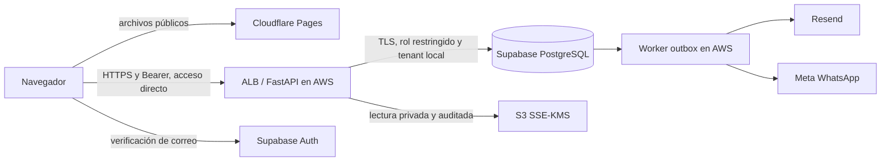

# Plan propuesto de producción y reportería

Estado: propuesta de arquitectura. No representa infraestructura contratada, recursos desplegados ni integraciones externas activas.

**Actualización de dirección:** para el MVP se propone evaluar [Cloudflare Workers + Supabase + Resend](cloudflare-supabase-target.md) y trabajar [localmente con GitHub](local-development.md). La selección AWS de este documento queda como alternativa anterior; los requisitos de reportería y residencia siguen vigentes. El backend actual continúa siendo FastAPI hasta implementar y validar una migración explícita.

## Situación actual

- PostgreSQL 17 corre en Docker dentro del workspace de desarrollo, con base `healthsync` y volumen Docker `reserve_system_healthsync_pg`. No está en Supabase. El puerto está publicado solo en loopback.
- El SQL contiene entidades multitenant, RLS forzada, claves compuestas, consentimientos, auditoría y exclusión GiST. Las credenciales de aplicación no tienen propiedad ni BYPASSRLS.
- React/Vite y FastAPI corren como procesos de desarrollo. Las comprobaciones locales de web y API devuelven HTTP 200. Eso no constituye alojamiento productivo ni diagnostica el error del visor mostrado en la captura.
- Auth está preparado para Supabase, pero no hay un proyecto conectado. El envío de notificaciones requiere integrar proveedores reales. El Vault dispone de esquema y lectura auditada; falta integrar ingestión y almacenamiento reales.
- No existen un dashboard administrativo de analítica, endpoints de reportes ni un flujo del personal para registrar atención realizada/no asistencia. Esos estados sí existen en SQL.

## Servicios elegidos como recomendación inicial

| Componente | Servicio propuesto | Datos tratados |
| --- | --- | --- |
| Frontend React/Vite | Cloudflare Pages | HTML, CSS, JS y configuración pública; no persistir respuestas clínicas en CDN |
| DNS | Cloudflare | Resolución de nombres; API con registro DNS-only en esta propuesta |
| API FastAPI | AWS ECS Fargate + ALB HTTPS y WAF regional | Procesamiento de reservas, identidad, autorizaciones, auditoría y aperturas de PDFs |
| Worker outbox | Otro servicio ECS Fargate, mismo código y región | Eventos, contactos estrictamente necesarios y entrega de notificaciones |
| Base transaccional | Supabase PostgreSQL | Reservas, perfiles con contacto cifrado, consentimientos, configuración y auditoría |
| Autenticación | Supabase Auth | Identidad de acceso y correo verificado; sin diagnósticos o resultados en metadata |
| Resultados PDF | AWS S3 privado + SSE-KMS | Archivos en cuarentena y resultados aprobados, en la región elegida |
| Claves y secretos | AWS KMS / Secrets Manager | Claves de cifrado y credenciales; integrar keyring y rotación en el código |
| Email | Resend | Destinatario y aviso genérico; SMTP para correos Auth y API para notificaciones de la aplicación |
| WhatsApp | Meta WhatsApp Cloud API | Teléfono y plantilla aprobada; sin detalles médicos ni PDFs adjuntos |
| Auditoría independiente | S3 Object Lock con retención definida y cuenta separada | Copia protegida de evidencias, con minimización y retención documentadas |

Vercel es una alternativa válida para el frontend estático. Se recomienda elegir un único proveedor de frontend; React/Vite no necesita un servidor Next.js. El backend y el worker tienen un alojamiento separado porque requieren procesos y operación distintos de la entrega de archivos estáticos.

La elección de S3 sigue el adaptador SSE-KMS que ya existe. Usar Supabase Storage en cambio requiere implementar y validar otro adaptador y su política de cifrado; no se deben mantener dos copias primarias del mismo PDF sin una finalidad explícita. Resend tampoco está conectado al webhook genérico actual: falta el adaptador y comprobar entrega, rebotes y deduplicación.

## Región y recorrido de los datos

Para un lanzamiento regional CL/BR/AR, se propone **São Paulo** como ubicación de la base principal, backend, worker y bucket, sujeta a disponibilidad y condiciones del plan contratado. Debe confirmarse la región del proyecto Supabase y de cada recurso AWS al crearlos. No es una obligación legal universal ni garantiza por sí sola cumplimiento.

Si una clínica exige residencia exclusiva en Chile o Argentina, no debe admitirse en el despliegue brasileño asumiendo que eso cumple su contrato. Se necesita una arquitectura regional compatible y revisión de transferencias antes de alojar datos reales. El cifrado y RLS no eliminan los requisitos de transferencias internacionales.

En esta propuesta la API no pasa por el proxy global de Cloudflare; usa DNS-only, TLS en AWS y WAF regional. Así se evita añadir ese intermediario a los cuerpos de solicitudes médicas. Si se decide usar el proxy de Cloudflare después, debe incluirse en el inventario de tratamiento: termina TLS y procesa las solicitudes; desactivar caché no equivale a impedir ese procesamiento.

La región de la base principal no garantiza que todos los datos de cuenta, logs, soporte, backups o subencargados de todos los proveedores permanezcan allí. Confirmar DPA, retención, ubicaciones, transferencias y servicios de soporte en las condiciones vigentes. Resend recibe correos y Meta teléfonos, que siguen siendo datos personales incluso si el mensaje no contiene detalles de salud. Las copias descargadas por los pacientes salen del almacenamiento administrado por el SaaS.

## Cambios necesarios para pasar a producción

1. Resolver clínica por dominio o ruta pública y validar el ámbito en el backend. El frontend actual compila un `VITE_TENANT_ID`; un SaaS compartido necesita resolución dinámica, sin conceder permisos por el dominio elegido.
2. Configurar origen de API productivo. Las peticiones relativas `/v1` funcionan hoy por el proxy de Vite; en Cloudflare Pages deben dirigirse explícitamente al dominio API permitido. Ajustar CORS y callback Auth para dominios exactos.
3. Incorporar contenedores, infraestructura declarativa, migraciones versionadas y CI/CD con entornos staging/producción separados. El bootstrap Docker local no es un despliegue productivo.
4. Configurar Auth, MFA del personal, correo, WhatsApp, almacenamiento, escaneo PDF y aprovisionamiento de relaciones asistenciales. Confirmar flujos externos de extremo a extremo.
5. Integrar KMS/keyring/rotación, TLS verificado hacia PostgreSQL, límites y rate limiting, redacción de logs, backups/PITR según plan, restauración y observabilidad de colas. El ledger externo y la política de retención también necesitan implementación.
6. Hacer revisión de seguridad y privacidad y un piloto con datos ficticios antes de admitir pacientes reales.

No copiar producción a staging sin un proceso de anonimización válido. Una base compartida con aislamiento por tenant es la opción inicial; un cliente que necesite aislamiento físico requerirá un proyecto/base y almacenamiento dedicados, manteniendo el modelo `tenant_id`.

## Reportería: qué medir y qué falta capturar

La agenda registra una intención de atención. Una reserva confirmada no demuestra que alguien fue atendido.

| Indicador | Definición propuesta | Información adicional necesaria |
| --- | --- | --- |
| Atenciones realizadas | Cantidad de prestaciones cerradas como realizadas en el período de atención | Registro autorizado del personal y hora real de cierre |
| Personas únicas atendidas | Pacientes canónicos distintos con una atención realizada | Identidad clínica por tenant y cobertura de identificación |
| Reservas/anulaciones | Reservas por fecha de atención; distinguir de reservas creadas durante el período | Historial de cambios y timestamp/motivo categórico de anulación |
| No asistencia | `no_show / (completed + no_show)` para la cohorte correspondiente; excluir pendientes y anuladas | Marcación de no asistencia por personal y regla de tolerancia |
| Ocupación de agenda | Minutos ocupados, incluyendo buffers, sobre capacidad habilitada del recurso | Jornadas y bloqueos históricos; unir intervalos para no duplicar capacidad |
| Utilización efectiva | Minutos reales de atención sobre capacidad habilitada | Inicio/fin reales de la atención |
| Anticipación de reserva | Diferencia entre creación y fecha programada, definiendo cómo tratar reprogramaciones | Historial de versiones y reprogramaciones |

Cada indicador se segmenta por clínica, sucursal, especialidad, profesional/recurso, servicio y período. Las fechas se agrupan en el huso de la sucursal. Definir cómo se combinan sucursales con husos diferentes y evitar comparar períodos con denominadores distintos. No recopilar edad, género o identificadores nacionales solo para agregar gráficos.

### Corrección indispensable: identidad de paciente

Actualmente se crea un perfil por reserva y una cuenta puede tener varios perfiles. Por eso `COUNT(DISTINCT patient_id)` **no cuenta necesariamente personas distintas**. Tampoco debe usarse el correo o el usuario Auth como identidad clínica universal: se pueden compartir correos o representar a familiares.

Agregar un identificador de paciente canónico dentro de cada tenant y una relación de los perfiles de reserva con ese paciente, con vinculación verificada y un procedimiento de corrección de duplicados. No fusionar historias automáticamente por un email escrito por un invitado. Mientras no se resuelva esa identidad, mostrar atenciones y perfiles; el reporte de personas únicas debe indicar cuántas atenciones tienen identidad resuelta y cuáles permanecen sin resolver.

### Modelo adicional propuesto

- `encounters`: `tenant_id`, referencia a reserva/paciente canónico, profesional responsable, check-in, inicio/fin reales y resultado. Una atención debe cerrar de forma autorizada, idempotente y auditable. No introducir diagnósticos en la reportería operativa.
- `appointment_events`: historial append-only de confirmaciones, cancelaciones y reprogramaciones, con actor, timestamp y versiones anterior/nueva de horario. No depender del campo `version` para reconstruir toda la historia.
- Historial de disponibilidad/bloqueos con vigencia, para no recalcular la ocupación de meses anteriores usando la jornada actual.
- Permisos específicos de reportes y auditoría de accesos/exportaciones a nivel tenant. La tabla de auditoría actual exige un paciente; no hay que inventar un paciente ficticio para auditar la apertura de un informe agregado.

## Implementación del dashboard

Primera etapa: panel nativo React con filtros, tarjetas KPI, serie temporal, tabla por profesional/sucursal, comparación de períodos y exportación autorizada. FastAPI calcula agregaciones SQL sobre PostgreSQL con el rol restringido, autorización de personal y RLS del tenant. El navegador recibe los agregados necesarios, no un volcado de PII para hacer cálculos.

La reportería debe incluir pruebas de acceso entre tenants, permisos, intervalos y husos, visitas repetidas de una persona, invitados sin identidad resuelta, anulaciones, reprogramaciones y diferencias entre pacientes y prestaciones.

Si se usan vistas PostgreSQL, deben respetar la identidad del invocador (`security_invoker` donde corresponda). Una vista materializada no hereda automáticamente RLS de las tablas fuente: no exponerla asumiendo que sí. Al crecer, preparar tablas resumen por tenant o un almacén analítico con controles propios y frescura explícita. Aplicar retención, control de exportaciones y protección frente a reidentificación en grupos pequeños.

Power BI o Metabase pueden agregarse después para necesidades específicas. Deben recibir acceso curado y aislado por clínica; una credencial global de base embebida en un dashboard rompería ese límite. La analítica comercial del operador SaaS debe tener una finalidad y permisos propios; no implica acceso a historias clínicas de todos los clientes.

## Orden de ejecución recomendado

1. Acordar residencia, proveedores, dominios y alcance del piloto; preparar infraestructura staging.
2. Completar identidad clínica, captura de atención/asistencia y eventos de agenda, antes de construir métricas definitivas.
3. Implementar dashboard por tenant y validar resultados con escenarios conocidos.
4. Activar y validar Auth, Resend, WhatsApp y Vault según los módulos contratados.
5. Probar restauración, aislamiento y controles operativos; revisar condiciones legales; desplegar piloto y luego producción.

Presupuestar por separado base/backup, contenedores y balanceador, almacenamiento/KMS, correo, WhatsApp y observabilidad. No se estiman tarifas o garantías de residencia sin revisar los planes y contratos vigentes.
